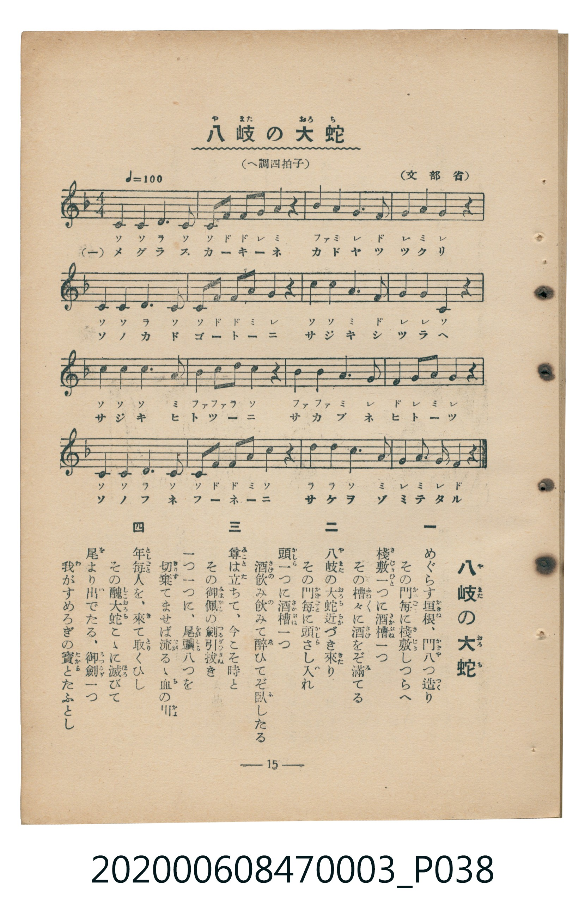

# 八岐の大蛇（八岐大蛇）

> Re:Shōka 使用 AI 協助辨識與重建樂譜，可能會有錯誤。歡迎回報。

- **鋼琴伴奏版**：<br><audio controls src="yamata_no_orochi.mp3"></audio>
- **NEUTRINO 歌聲合成版**：<br><audio controls src="yamata_no_orochi_neutrino.mp3"></audio>

- 臺灣教育會公認『新定兒童唱歌』尋常科第三學年用（第二學期・第2首）
- 國立臺灣歷史博物館典藏（典藏號：2020.006.0847.0003）

## 說明

【曲目說明】
・出處：臺灣教育會公認、臺北新高堂發行《新定兒童唱歌》尋常科第三學年用（昭和6年／1931年），
第二學期第 2 首〈八岐の大蛇〉（八岐大蛇），原書第 15 頁（掃描檔 P038.jpg）。
・出處原曲：文部省唱歌（1910年《尋常小學唱歌》第一學年／此處編入第三學年）。
・調性與拍號：ヘ調（F 大調），4/4 拍，速度 != 100。
・背景與曲風：敘述日本神話中素戔嗚尊（須佐之男命）設下八門八酒槽誘使八岐大蛇飲酒醉臥、
拔十握劍斬蛇並於蛇尾得天叢雲劍（草薙劍）獻予皇室的故事。
・版本說明：本檔案為原書單聲部五線譜（附移動 Do 階名片假名）之忠實數位化版本。

・編曲說明（鋼琴伴奏版）：
1. 前奏 (Intro, 2 小節)：引用第四段莊嚴敘事的結尾樂句作為前導。
2. 主歌伴奏 (YamataNoOrochi, 8 小節 × 4 段)：右手演奏威武古樸的敘事旋律，
左手以穩健的四拍子和弦進行支撐神話史詩氣氛。

## 歌詞

```text
一　めぐらす垣根（かきね）、門（かど）八つ造り
その門毎（かどごと）に棧敷（さじき）しつらへ
棧敷一つに酒槽（さかぶね）一つ
その槽々（ふねぶね）に酒をぞ滿（み）てる

二　八岐（やまた）の大蛇（おろち）近づき來（きた）り
その門毎に頭（かしら）さし入れ
頭一つに酒槽一つ
酒飲み飲みて醉（ゑ）ひてぞ臥（ふ）したる

三　尊（みこと）は立ちて、今こそ時と
その御佩（みはかし）の劍（つるぎ）引拔き
一つ一つに、尾頭（をがしら）八つを
切棄（きりす）てませば流るゝ血の川

四　年毎（としごと）人を、來（き）て取くひし
その醜大蛇（しこおろち）こゝに滅びて
尾（を）より出（い）でたる、御劍（みつるぎ）一つ
我がすめろぎの寶（たから）とたふとし
```

## ABC

```abc
X:1
T:八岐の大蛇（八岐大蛇）
M:4/4
L:1/16
Q:1/4=100
K:F
V:V1 name="Piano" snm="Pia"
[V:V1]
C4 C4 D6 C2 | C2 F2 F2 G2 A4 z4 | B4 A4 G6 F2 | G4 A4 G4 z4 |
w: 1.~め ぐ ら す | か _ き _ ね | か ど や つ | つ く り
w: 2.~や ま た の | お _ ろ _ ち | ち か づ き | き た り
w: 3.~み こ と は | た _ ち _ て | い ま こ そ | と き と
w: 4.~と し ご と | ひ _ と _ を | き て と り | く ひ し
C4 C4 D6 C2 | C2 F2 F2 A2 G4 z4 | c4 c4 A6 F2 | G4 G4 C4 z4 |
w: 1.~そ の か ど | ご _ と _ に | さ じ き し | つ ら へ
w: 2.~そ の か ど | ご _ と _ に | か し ら さ | し い れ
w: 3.~そ の み は | か _ し _ の | つ る ぎ ひ | き ぬ き
w: 4.~そ の し こ | お _ ろ _ ち | こ こ に ほ | ろ び て
c4 c4 c6 A2 | B4 B2 d2 c4 z4 | B4 B4 A6 G2 | F4 G2 A2 G4 z4 |
w: 1.~さ じ き ひ | と つ _ に | さ か ぶ ね | ひ と _ つ
w: 2.~か し ら ひ | と つ _ に | さ か ぶ ね | ひ と _ つ
w: 3.~ひ と つ ひ | と つ _ に | を が し ら | や つ _ を
w: 4.~を よ り い | で た _ る | み つ る ぎ | ひ と _ つ
C4 C4 D6 C2 | C2 F2 F2 A2 c4 z4 | d4 d4 c6 A2 | G4 A3 G F4 z4 |
w: 1.~そ の ふ ね | ふ _ ね _ に | さ け を ぞ | み て た る
w: 2.~さ け の み | の _ み _ て | ゑ ひ て ぞ | ふ し た る
w: 3.~き り す て | ま _ せ _ ば | な が る る | ち の か は
w: 4.~わ が す め | ろ _ ぎ _ の | た か ら と | た ふ と し
```

## TMD 檔案連結

- [主旋律 TMD 檔案](yamata_no_orochi.tmd) [[在 TMD Studio 編輯](https://tmdlang.github.io/Tmd-TS/#tmd=s7IKdvYPcrWy4qpTUCpJTLdSSM7PyUlNLsnMz7MqzsjMK0nNjM_KTMmPL87Iz05Ugisry88pzU21Si9KTEmNN443MjAyiDcwMIs3sDAxBzIMjBFKi_NLi5JTrYqTM_Lzc-JLUitKkvLzsxHyBUX5Zal5iXlANQVFIBtTwIoQClLLMlNSQdKpKZkl-UWZiTlI7kgtKga7FWxJfElRYl5xclFmAcgDCFUlGalAx6bl52Tn5BelKnFpaSk8bV39dNOEx43rni5Z_mJ2-_s9HRARGLdTQUuLS9FWwdDAgMveVsGNy8ZE38QOZOKL9l3PGxc_mzrzRdOmZ3Oan7auebGq93FD37NpG56um_W0ddLz1UufTtn4bG3P44b-pxu6n-7Y8Xz5xOdr1jzZ0fl07Y6nO7c8n7ICaB9IZFcPUOTZnPmPm3cDuUYvl00D2gx299M53c9Xd0PtWrv9af-mp72znneufLlkxdPWHS-m94NdDGK8mDn__Z5ZoBjQA8aAHigGgAwDY7BJXPpaCrbUAlwKCgqPGyY8m73p-ex1L1atejaj73HDRLBo8-6n7btezJwKdAmO8GkEij_tmQ4MpZerZzxd0PR85p4XC4FB1IUt3LrxhNuzGWufTuoxA_Lf7-k3tDQ2BLM63-_pAblEQQE5XIFsBSMFYLA-boDGLzzGHzcAtaBHOtCQp33zn83eAdJoaKrwckEjyMa-5mf9_c9WTVEIMDC20MsqSAcqfdzQhOJzsL5NQP8_m9b-snnF8zmNEM8A9RtaGhoAHQn0K8RbTzf0gzwE8yvYiw0QLwK99GztEqBxz7cD43kpsu9R7Hyxav-zhuUvOtqfdfdCEsDj5hlAQaBtbgog74CYIO8AU60CUA2Q9bJh_tNdyxQgaRrJpOaeZzPXg0yavenlImAAz3o2dcaL_RueTV_6bM6a50vnvVi58cmOtc-3LHjWMeXp9FlPN3QBLXm5oOPJ3glPdnY_n7L96cS9QLterFj7ZEc3MDxfTmsAka2Tni3f-2LVjCd79yMH8svFm4BSL9s6X7QvBSYKSJQ9657ytLfxWf_Cp129z6atASp7smPZs2l7gIynG_Y93Tf96ZKVT_sXvZy9CagAaPuL3s4X02aC2Z3Pe3c_2dXxfFb703VLns9qeTa19cmuboT3nnd2AL0BSawgv81ZA4zHZws7njftgsT002nrXjRuAsbYk11Tnm-f9WLtHJD3ZrY8X777afdUBZd8hZez-p5O6H3e2f60sR3IANoJ9PfT_Querl_2bOqOJ3t7n_ZMg1gDshaaSSCGAyP4xcp5T1tXABMFMIiB4QhirJr3Yu16YM4Bpb8Nvc_aO5HTFdgAYHp43NDwuKnxceOEx02djxtnPp23-NmCnUAdjxu7Hzf2Pm5cC04PjcDQhgmuBIoAg_px45KXDQseN3WBXdI4F5jigYqerQd6H6ruceOUx43AmAaau_rZ4uXPpm4HS0193DgDaDRYfDrQFLDFO0CmQBSBHAUUbYTGLUwP0MRtEOdAFCCsBSp63NAKVrcVqAKuDmLE46ZJjxvnPdsNSrOPG0HJ9XHjssdN3SD9oDgGhxIwyp6v73yxdfvTOb3PNwIDuPHp7l1A74FSWONksOd7nq3vh7BfNu99NmEtUDGwhAGWNhCppw3dEO6THV3PpuwD5TSgCNQHMAWQxLp4IciEafOBbnqyq-35vj6QKxua4JGyC5hbQWkbmJhBbm5qedy473EjMPMBXY6oRx43dj1uAkbQQlCm2D_xceNSYKA-2dcGlgKKg9Vjxg4oUBYAQwcSR9OBgQ82FxjA04EFweMmcOkGVIEWC4gwB2WrxZuAIQkhgYEJzGVgdwITGtAkoOAyYIAD8x0kRmDxPB9LmCPn2Gd7dgDRy7kLgJ552dgH9knPs64ukFuA4g2bgGEIdAUkCoBhCJQFcRe2ARUAk_eLidPRwvzptLlPJzaAyDkbnuzbD3Tl04ZJz-cuBKnc1YYc4DuAKbwBUuCAfTQZlmzXA-tGYAiDfNTQ-GR3F1hq7rOZTUAFiIB9um_hk73AXAHRvB4SsNDYApcj4EQOFARmjc6ne6YCiyFgDMHyX-MSeFCDkt2GfdDoASXbHngMQTIcUBCk7SmwFF3cAo3oJqCrZkJTNSidzH7cuOHZ1kaQhU1zXywEGr3u6fa5GCG_oQtU5m7d_mLXamBYPZ_T_WzXNGCVAPTbs7WLn81Y_6Jz_bOVwDTUAyo0gTVP64aX0ya_bO191rEFWPw9Xb8N7LWepxvaQXkEGgugZA9EwLIVWEaD6oIFk0EGbm181jEBJL4I5KBnmzYjBf7T2bNBgb9zC6zkWAFOLdCS48muXaCAAAY-LGFDfPq0f9rjxn5wYpuOlMLb5iBlD6ApwNhCZBIQtwmobPWz3a2PGzcDTQHbv2EfJLTB2QXI6AL6FqwfGMBAPcshKRcUNftA9QYsmhExisgazzqA2RAYZzNBJSrIWmBuWwcMKrCe-aB0Ac1tQD8CucDCCuRZjKjZuQWEOkGZ-emEeS8XzweGArDyAwV7a_uz5oUQPz7dAKzXlwD98mQXKC883TcPUo0BC39g6AA9AVT_smkxMAcBIxoSWcBYANZHQFcC6zlQTbah68WmLc9bFj5bPwUSp8CGHzRqgG6ivCEHBQpa-lxckYm5iSWJfvn-RfnJGZlWAZmJefkONQY11eCq2cZEyw7MwNaOBDe1gKln3VYFDSNghPU_X9-gA6_LQLIKhgrARp4mFq1Aq6HGAk2wAtbUCxUeN20A0itBqaZpJ5hcDeTvAdJrIXRzL1C0BiwOqts7gXgJELeAeS1A8fVAehW4RQECUCtqFEzjQUjDLF5BFwhN4zVVNXR1NYESGkBhQxBPU0HDUMEIwjJWMABKmQBpoKdAGsAqwOqNgIJGIGmwwT6GILc0AtP4BAUNYAoCKwYmMrDJwESlADIWmDNANLDiU4gHuR0oDKyBQepboOqXgNQDKSDuB5rXBVIHMd8IZD7QX437QObMh6pfBzW_C2J-E9T8hVDzgeEItAMovxSqvhdifi8Qz0c13xgkvh-IJ4PUr4CqXw81H2gf2P0LIeYvg5oPd89kqPq5EPNXQO1YgTDfBCY-HaR-ClT9Cqj5m6DmA-0Fmt80CWo-yIxlSO5p6oKYDwwboBaQWSDz8afJXT340qQRsWmyaS8wPfUhpTdQmtwCTYsdULobmia3AvEOcFoFqdoOS5PA9AxsmZOdJo0hLHCiUzAFQg1jjDRpBDIJJVE2zgWlE2giBAf6SmigAyMBKdAbV0MDfSoQz4AmVrD66fBECUzXwFYgaqIk2XxQogclAngmmQoxfzokQTX1oCVKuPn70RIlLFNNh5i_Dmo-yJ3gRN8HVb8JkejXgGnURAk3H2gOWP1k_JlqMiyTrIaq3w02H6gMWGHBMgeBRLmjE1-iNCY6UaIktOZJYBKUGEGJDZYgYUkSVohOgxaeIPWIpAsqOFETJSiBmYK9CE544ARmoqBhomAGSYem0LIRKAZJh-AyE6zMEOQ15OSKlBwxkhc0elaAxJZgJkVwVG6Dql0LUbsJKVktQUuOGMmLeuaDkyOo3IGZRcB8YDkGbGogJa2mTkhSaUGohZR1iOQI0tPUAXI_MPmBzW-BmL8cXg6DkjfE_aDyeglILSzr9eFyP97kCGze4UuOJqSWkc1TwckLksiAYQytrzHLyI1A_iZwwtwHVgusk5rbgDygv5pB5SwFpSQkdZoBIUYiNkJJsJrA1IqjwNyKnCogfHCBsxYzFU0ExcIkqPp5kFjYD1K7DCo2Hx5vSGkVphNoHUTVfqhNQD7YJmCRh1TfNk2ExS3MVKhNwLhDFF_oNoFTLTD0gQkKqGomVNUyqE37oDbNhti0AeqnVdCUC0tZTd0QmxYiuxYoBiyN0dIvqG4Gp3moTU2NEJsgxSikWEYuroFxDs6D8PwKbhOAxJFiACgGq-1rubh07RRQW6pg64GiylwA)]
- [鋼琴伴奏 TMD 檔案](yamata_no_orochi_piano.tmd) [[在 TMD Studio 編輯](https://tmdlang.github.io/Tmd-TS/#tmd=s7IKdvYPcrWy4tLSUnjauvrppgmPG9c9XbL8xez293s6ICIQ7uPm3S-79zyfsOXJni1Pl_Y_7-x4v6dTQUuLS9FWwdDAgMveVsGNy8ZE38SOq05B6UX7rueNi59NnfmiadOzOc1PW9e8WNX7uKHv2bQNT9fNeto66fnqpU-nbHy2tudxQ__TDd1Pd-x4vnzi8zVrnuzofLp2x9OdW55PWQF0AUhkVw9Q5Nmc-UAXALlGL5dNA9qsBLLl6Zzu56u7oXat3f60f9PT3lnPO1e-XLLiaeuOF9P7wX4AMV7MnP9-zywjAyMDPQMDMz0DCxNzIMPAGGwSl76Wgi21AJeCgsLjhgnPZm96Pnvdi1Wrns3oe9wwESzavPtp-64XM6cCXYIjfBqB4k97pgND6eXqGU8XND2fuefFQmAQdWELt2484fZsxtqnk3rMgPz3e_oNLY0NwazO93t6QC5RUEAOVyBbwUgBGKyPG6AxDk8DjxuAWlCSAcSQp33zn83eAdJoaKrwckEjyMa-5mf9_c9WTVEIMDC20MsqSAcqfdzQhOJzsL5NQP8_m9b-snnF8zmNMM_A1L1Ytf9Zw_IXHe3Punshkfa4eQZQEGiDmwLICSAmyAnAlKYAVANkvWyY_3TXMgVIOkSY9Hz7CqBdkBgA6sZMvECzIYFhqKfwtLMXKK6g4ZlXUpSvAwyOpxv6n69v0ASqebpnKjBMgX59Onv2s3VbX_R1PZ215dnUGU92dT-f1fJ864SnG_Y9W9H0tH_pk71znjftAhm1ARjnYHcoKBjpKTzZsRvoR4jVChqRibmJJYl--f5F-ckZmToKFlC7FA5PVwB6ad1WsKX9m591dj_bMwWo5emKxmdrlz3tX_JsxQ6gjRCrn03vfrqvGx6fQPB0-zKglie7lz5fufJp41KgSpCDu3ufrp0ATApP9yx72bAJmJieTVn_bNKE50vnvVi5EZhhXqxc-WzD4mcbZkMdTHkGgAIFLX0uLnBwWgVkJublB3k41BjUVIOda2OiZQdm1CiYxoOQhlm8gi4QmsZrqmro6moCJTSAwoYgnqaChqGCMYRlqmAAlDIDQg1TsAawOFi9kYKGsYIRRJkhSBlXLYr9PtjtNwRZHG0YCySROCBbTEAcsAjYlWA21FjUKMTjP2wFCzjv7WgARrSCBiyd6cAzDUgW6H5gRGli0QoMU6ixQBOsgKl8ocLjpg1AeiUozTftBJOrgfw9QHothG7uBXsUJA7KF51AvASIW8C8FqD4eiC9CpaKYFYQHTPQIDeGhBmQBnoKpAGsAhozwIgBBx3IYB9DkFsaFR43TlDQeNzUCVb8uHEm2OTHjd0KIGMfN_aC6MeNaxXiQW4HCj9uXAlS3wJVvwSkHkgBcT_QvC6QOoj5RiDzgf5q3AcyZz5U_Tqo-V0Q85ug5i-Emg8MR6AdQPmlUPW9EPN7gXg-qvnGIPH9QDwZpH4FVP16qPlA-8DuXwgxfxnUfLh7JkPVz4WYvwJqxwqE-SYw8ekg9VOg6ldAzd8ENR9oL9D8pklQ80FmLENyT1MXxHxg2AC1gMwCmY8_Te7qwZcmjYhNk017gempDym9gdLkFmha7IDS3dA0uRWId4DTKkjVdliaBKZnYLFPdpqElhbgRAcsM0xBRQN6mjQCmYSSKBvngtIJNBGCA30lNNCBkYAU6I2roYE-FYhnQBMrWP10eKIEpuvHjTtQEyXJ5oMSPSgRwDPJVIj50yEJqqkHLVHCzd-PlihhmWo6xPx1UPNB7gQn-j6o-k2IRL8GTKMmSrj5QHPA6ifjz1STYZlkNVT9brD5QGWPGzfDMgeBRLmjE1-iNCY6UaIktOZJYBKUGEGJDZYgYUkSVohOgxaeIPWIpAsqOFETJSiBoVdHJgoaJgpmyLWWCUgMkg7BZSZYmSHIa8jJFSk5YiQvaPSsAIktwUyK4KjcBlW7FqJ2E1KyWoKWHDGSF_XMBydHULkDM4uA-cBy7HFjD1LSauqEJJUWhFpIWYdIjiA9TR0g9wOTH9j8Foj5y-HlMCh5Q9wPKq-XgNTCsl4fLvfjTY6QJiDO5GhCahnZPBWcvCCJDBjG0Poas4zcCORvAifMfWC1wDqpuQ3IA_qrGVTOUlBKEmpTwRMsrF2FpcDcipwqIHxwgbMWMxVNBMXCJKj6eZBY2A9SuwwqNh8eb0hpFaYTaB1E1X6oTUA-2CZgkYdU3zZNhMUtzFSoTcC4QxRf6DaBUy0w9IEJCqhqJlTVMqhN-6A2zYbYtAHqp1XQlAtLWU3dEJsWIrsWKAYsjdHSL6huBqd5qE1NjRCbIMUopFhGLq6BcQ7Og_D8Cm4TgMSRYgAoBqvtcTRUsTaEiW2o4kncJLWlo03BEqS1SEi0HFK_Q9jgvABM0Ahx0uod4q2GeZV8b6MXMtQKc0T_RddOAdwzUgAyUJNItA_IKExRI6yixlhFTcCiylwA)]

## 分析

```text
================================================================================
📊 TMD Song Profile: [ 八岐の大蛇（八岐大蛇） ]
================================================================================
⏱  Duration:       0:38 (38.4s), 16 measures total
🎼 Key & Tempo:    首調基準 F, != 100.0 BPM, <4/4>
   - 分析範圍：      由實際發聲的音符與和弦推測調性；播放脈絡另行呈現
🎤 人聲音域:    C4 (MIDI 60) – D5 (MIDI 74) [跨度: 14 個半音 / 1.2 個八度, 難度: moderate]
   - 最低音:  C4 in [YamataNoOrochi #1 @ m.1, 0:00]
   - 最高音: D5 in [YamataNoOrochi #1 @ m.10, 0:22]
   - 適合: soprano, mezzo-soprano, contralto, tenor, baritone, bass
🏛  結構:      YamataNoOrochi (38.4s)
⚡ 編曲密度:        Peak 1 軌道同時演奏
🗝  調性診斷：       C 大調（流行色彩大調，未偵測到可信轉調）
   - 風格氣質:    流行大調（略帶和弦色彩音與裝飾副屬和弦）
   - 轉調歷程:    全曲維持單一推測調性（未偵測到可信轉調）
   - 核心骨幹音:  C, G, A, D, F
   - 調性數值:    C 大調 [相關度: 0.83, 穩定度: Moderate, 自然音純度: 92.0%]
   - 候選調性 (K-S): C 大調 (0.83), F 大調 (0.71), A 小調 (0.60)
   - 五度圈歷程:   +0
   - 各段落調性細節:
     • [YamataNoOrochi #1]: C 大調 (r: 0.83, 自然音純度: 92.0%, 調外音: A#)

  [ 五度圈游移軌跡 ]
              [C ]*
         F            G  
      Bb               D  
      Eb               A  
         Ab           E  
            Db       B  
               F# 
     (* = active key center)

  [ 十二半音累積音高分佈 ]
     C  : ████████████████████████  33.9%
     C# :                            0.0%
     D  : █████████                 12.5%
     D# :                            0.0%
     E  :                            0.0%
     F  : ████████                  10.7%
     F# :                            0.0%
     G  : █████████████             18.3%
     G# :                            0.0%
     A  : ████████████              16.5%
     A# : ██████                     8.0%
     B  :                            0.0%
--------------------------------------------------------------------------------
Assignment 軌道音域：
  - Piano         : C4 – D5 (14 個半音 / 1.2 個八度, 65 個音符)
================================================================================
```


## 原書掃描頁




