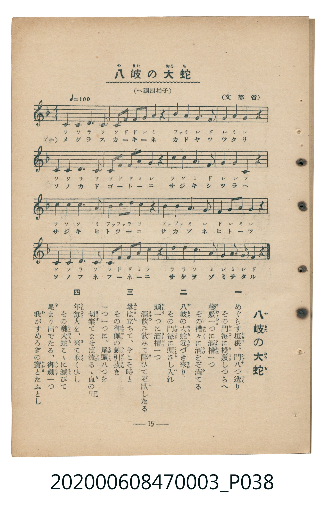

# 八岐の大蛇（八岐大蛇）

<audio controls src="yamata_no_orochi.mp3"></audio>

- 臺灣教育會公認『新定兒童唱歌』尋常科第三學年用（第二學期・第2首）
- 國立臺灣歷史博物館典藏（典藏號：2020.006.0847.0003）

## 說明

【曲目說明】
・出處：臺灣教育會公認、臺北新高堂發行《新定兒童唱歌》尋常科第三學年用（昭和6年／1931年），
第二學期第 2 首〈八岐の大蛇〉（八岐大蛇），原書第 15 頁（掃描檔 P038.jpg）。
・出處原曲：文部省唱歌（1910年《尋常小學唱歌》第一學年／此處編入第三學年）。
・調性與拍號：ヘ調（F 大調），4/4 拍，速度 != 100。
・背景與曲風：敘述日本神話中素戔嗚尊（須佐之男命）設下八門八酒槽誘使八岐大蛇飲酒醉臥、
拔十握劍斬蛇並於蛇尾得天叢雲劍（草薙劍）獻予皇室的故事。
・版本說明：本檔案為原書單聲部五線譜（附移動 Do 階名片假名）之忠實數位化版本。

・編曲說明（鋼琴伴奏版）：
1. 前奏 (Intro, 2 小節)：引用第四段莊嚴敘事的結尾樂句作為前導。
2. 主歌伴奏 (YamataNoOrochi, 8 小節 × 4 段)：右手演奏威武古樸的敘事旋律，
左手以穩健的四拍子和弦進行支撐神話史詩氣氛。

## 歌詞

```text
一　めぐらす垣根（かきね）、門（かど）八つ造り
その門毎（かどごと）に棧敷（さじき）しつらへ
棧敷一つに酒槽（さかぶね）一つ
その槽々（ふねぶね）に酒をぞ滿（み）てる

二　八岐（やまた）の大蛇（おろち）近づき來（きた）り
その門毎に頭（かしら）さし入れ
頭一つに酒槽一つ
酒飲み飲みて醉（ゑ）ひてぞ臥（ふ）したる

三　尊（みこと）は立ちて、今こそ時と
その御佩（みはかし）の劍（つるぎ）引拔き
一つ一つに、尾頭（をがしら）八つを
切棄（きりす）てませば流るゝ血の川

四　年毎（としごと）人を、來（き）て取くひし
その醜大蛇（しこおろち）こゝに滅びて
尾（を）より出（い）でたる、御劍（みつるぎ）一つ
我がすめろぎの寶（たから）とたふとし
```

## ABC

```abc
X:1
T:八岐の大蛇（八岐大蛇）
M:4/4
L:1/16
Q:1/4=100
K:F
V:V1 name="Piano" snm="Pia"
[V:V1]
C2 C2 D3 C C F F G A2 z2 | B3 A G2 F2 G2 A2 G2 z2 | C2 C2 D3 C C F F A G2 z2 | c2 c2 A3 F G2 G2 C2 z2 |
C2 C2 C3 A B2 B d c2 z2 | B3 B A2 G2 F2 G A G2 z2 | C2 C2 D3 C C F F A c2 z2 | d2 d2 c3 A G2 A G F2 z2 |
```

## TMD 檔案連結

- [主旋律 TMD 檔案](yamata_no_orochi.tmd) [[在 TMD Studio 編輯](https://tmdlang.github.io/Tmd-TS/#tmd=s7IKdvYPcrWy4tLSUnjauvrppgmPG9c9XbL8xez293s6ICIwbqeClhaXoq2CoYEBl72tghuXjYm-iR1XnYLSi_ZdzxsXP5s680XTpmdzmp-2rnmxqvdxQ9-zaRuerpv1tHXS89VLn07Z-Gxtz-OG_qcbup_u2PF8-cTna9Y82dH5dO2Opzu3PJ-yAmgfSGRXD1Dk2Zz5j5t3A7lGL5dNA9qsBLLl6Zzu56u7oXat3f60f9PT3lnPO1e-XLLiaeuOF9P7wS4GMV7MnP9-zywjAyMDPQMDMz0DCxNzIMPAGGwSl76Wgi21AJeCgsLjhgnPZm96Pnvdi1Wrns3oe9wwESzavPtp-64XM6cCXYIjfBqB4k97pgND6eXqGU8XND2fuefFQmAQdWELt2484fZsxtqnk3rMgPz3e_oNLY0NwazO93t6QC5RUEAOVyBbwUgBGKyPG6DxC4_xxw1ALeiRDjTkad_8Z7N3gDQamiq8XNAIsrGv-Vl__7NVUxQCDIwt9LIK0oFKHzc0ofgcrG8T0P_PprW_bF7xfE4jxDNA_YaWhgZARwL9CvHW0w39IA_B_Ar2YgPEi0AvPVu7BGjc8-3AeF6K7HsUO1-s2v-sYfmLjvZn3b2QBPC4eQZQEGibmwLIOyAmyDvAVKsAVANkvWyY_3TXMgVImkYyqbnn2cz1IJNmb3q5CBjAs55NnfFi_4Zn05c-m7Pm-dJ5L1ZufLJj7fMtC551THk6fdbTDV1AS14u6Hiyd8KTnd3Pp2x_OnEv0K4XK9Y-2dENDM-X0xpAZOukZ8v3vlg148ne_ciB_HLxJqDUy7bOF-1LgYkCEmXPuqc87W181r_waVfvs2lrgMqe7Fj2bNoeIOPphn1P901_umTl0_5FL2dvAioA2v6it_PFtJlgdufz3t1PdnU8n9X-dN2S57Nank1tfbKrG-G9550dQG9AEivIb3PWAOPx2cKO5027IDH9dNq6F42bgDH2ZNeU59tnvVg7B-S9mS3Pl-9-2j1VwSVf4eWsvqcTep93tj9tbAcygHYC_f10_4Kn65c9m7rjyd7epz3TINaArIVmEojhwAh-sXLe09YVwEQBDGJgOIIYq-a9WLsemHNA6W9D77P2TuR0BTYAmB4eNzQ8bmp83DjhcVPn48aZT-ctfrZgJ1DH48bux429jxvXgtNDIzC0YYIrgSLAoH7cuORlw4LHTV1glzTOBaZ4oKJn64Heh6p73DjlcSMwpoHmrn62ePmzqdvBUlMfN84AGg0Wnw40BWzxDpApEEUgRwFFG6FxC9MDNHEbxDkQBQhrgYoeN7SC1W0FqoCrgxjxuGnS48Z5z3aD0uzjRlByfdy47HFTN0g_KI7BoQSMsufrO19s3f50Tu_zjcAAbny6exfQe6AU1jgZ7PmeZ-v7IeyXzXufTVgLVAwsYYClDUTqaUM3hPtkR9ezKftAOQ0oAvUBTAEksS5eCDJh2nygm57sanu-rw_kyoYmeKTsAuZWUNoGJmaQm5taHjfue9wIzHxAlyPqkceNXY-bgBG0EJQp9k983LgUGKhP9rWBpYDiYPWYsQMKlAXA0IHE0XRg4IPNBQbwdGBB8LgJXLoBVaDFAiLMQdlq8SZgSEJIYGACcxnYncCEBjQJKLgMGODAfAeJEVg8z8cS5sg59tmeHUD0cu4CoGdeNvaBfdLzrKsL5BageMMmYBgCXQGJAmAYAmVB3IVtQAXA5P1i4nS0MH86be7TiQ0gcs6GJ_v2A135tGHS87kLQSp3tSEH-A5gCm-AFDhgH02GJdv1wLoRGMIgHzU0PtndBZaa-2xmE1ABImCf7lv4ZC8wV0A0r4cELDS2wOUIOJEDBYFZo_PpnqnAYggYQ7D817gEHtSgZLdhHzR6QMm2Bx5DkAwHFARpewosRRe3QCO6CeiqmdBUDUonsx83bni2tRFkYdPcFwuBRq97un0uRshv6AKVuVu3v9i1GhhWz-d0P9s1DVglAP32bO3iZzPWv-hc_2wlMA31gApNYM3TuuHltMkvW3ufdWwBFn9P128De63n6YZ2UB6BxgIo2QMRsGwFltGgumDBZJCBWxufdUwAiS8COejZps1Igf909mxQ4O_cAis5VoBTC7TkeLJrFygggIEPS9gQnz7tn_a4sR-c2KYjpfC2OUjZA2gKMLYQmQTEbQIqW_1sd-vjxs1AU8D2b9gHCW1wdgEyuoC-BesHBjBQz3JIygVFzT5QvQGLZkSMIrLGsw5gNgTG2UxQiQqyFpjb1gGDCqxnPihdQHMb0I9ALrCwAnkWI2p2bgGhTlBmfjph3svF84GhAKz8QMHe2v6seSHEj083AOv1JUC_PNkFygtP982DVGPAwh8YOkBPANW_bFoMzEHAiIZEFjAWgPUR0JXAeg5Uk23oerFpy_OWhc_WT4HEKbDhB40aoJsob8hBgYKWPhdXZGJuYkmiX75_UX5yRqZVQGZiXr5DjUGNQjW4brax0LIDM7A1JMFtLWDyWbdVQcMIGGP9z9c36MArM5CsgqECsJWniUUr0G6osUATrIBV9UKFx00bgPRKULJp2gkmVwP5e4D0Wgjd3AsUrQGLgyr3TiBeAsQtYF4LUHw9kF4FblKAANSKGgXTeBDSMItX0NUFsjRVNXR1NRU0gGKGIDaQaahgBGEZKxgANWiYgFQaQxUaAX1hBJQxAsmBMwfu0NjVgy80jIgNjaa9QJ_0IfkUFBpboKHQAaW7oaGxFYh3gEMJpGo7LDSAIQlsFJIXGmCvg3wOCg1TINQwBqkGKwCLG4HMIBwcOzrxBYcx0cGB4sXmSWASFAwgb8KCAhYYsIQzDZpgQOoRgQZKLNiCA4iRotwElATMIIFgipQkTKDyoMRgCPIXckDhDwtggYovLExITRrNU8F-g_hwKjyDYCaNjUD-JnCo7AOrnQ_EbUDefiANSl7kJg5IuJgBoYYpanYBJhZodjIEh0stF5eunQJqSQMSUebiAgA)]
- [鋼琴伴奏 TMD 檔案](yamata_no_orochi_piano.tmd) [[在 TMD Studio 編輯](https://tmdlang.github.io/Tmd-TS/#tmd=s7IKdvYPcrWy4tLSUnjauvrppgmPG9c9XbL8xez293s6ICIQ7uPm3S-79zyfsOXJni1Pl_Y_7-x4v6dTQUuLS9FWwdDAgMveVsGNy8ZE38SOq05B6UX7rueNi59NnfmiadOzOc1PW9e8WNX7uKHv2bQNT9fNeto66fnqpU-nbHy2tudxQ__TDd1Pd-x4vnzi8zVrnuzofLp2x9OdW55PWQF0AUhkVw9Q5Nmc-UAXALlGL5dNA9qsBLLl6Zzu56u7oXat3f60f9PT3lnPO1e-XLLiaeuOF9P7wX4AMV7MnP9-zywjAyMDPQMDMz0DCxNzIMPAGGwSl76Wgi21AJeCgsLjhgnPZm96Pnvdi1Wrns3oe9wwESzavPtp-64XM6cCXYIjfBqB4k97pgND6eXqGU8XND2fuefFQmAQdWELt2484fZsxtqnk3rMgPz3e_oNLY0NwazO93t6QC5RUEAOVyBbwUgBGKyPG6AxDk8DjxuAWlCSAcSQp33zn83eAdJoaKrwckEjyMa-5mf9_c9WTVEIMDC20MsqSAcqfdzQhOJzsL5NQP8_m9b-snnF8zmNMM_A1L1Ytf9Zw_IXHe3Punshkfa4eQZQEGiDmwLICSAmyAnAlKYAVANkvWyY_3TXMgVIOkSY9Hz7CqBdkBgA6sZMvECzIYFhqKfwtLMXKK6g4ZlXUpSvAwyOpxv6n69v0ASqebpnKjBMgX59Onv2s3VbX_R1PZ215dnUGU92dT-f1fJ864SnG_Y9W9H0tH_pk71znjftAhm1ARjnYHcoKBjpKTzZsRvoR4jVChqRibmJJYl--f5F-ckZmToKFlC7FA5PVwB6ad1WsKX9m591dj_bMwWo5emKxmdrlz3tX_JsxQ6gjRCrn03vfrqvGx6fQPB0-zKglie7lz5fufJp41KgSpCDu3ufrp0ATApP9yx72bAJmJieTVn_bNKE50vnvVi5EZhhXqxc-WzD4mcbZkMdTHkGgAIFLX0uLnBwWgVkJublB3k41BjUKFSD3WtjoWUHZtQomMaDkIZZvIKuLpClqaqhq6upoAEUMwSxgUxDBWMIy1TBAKjBDAg1TEGqwcJAcSMFDWMFI4gaQ5AarloUq31wWG0ItFMh2jAWSMKZIBtMQBywCNAVYBbUTNSow-cvbCUKONPtaADGsIIGPIFhUQYMOOKDBuptY7DDNUxQgwUoDZQxAjsfv7N29VDXWdAYA1sNjDdTUAwBVYMVgMWNQGYQdteOTpLdBYozRCCYgALFDDn9QALJBCoPCh5DkAXILsbvKEg5QP3AIil5Y0uK2NM5VZIikVkl2hQsTMXEhm4xJNVA2KBAVTBCiFIxLSFZC_Miud4lKbmQXCTp2imASzoFIAM1TZAvoszFBQA)]

## 分析

```text
================================================================================
📊 TMD Song Profile: [ 八岐の大蛇（八岐大蛇） ]
================================================================================
⏱  Duration:       0:19 (19.2s), 8 measures total
🎼 Key & Tempo:    首調基準 F, != 100.0 BPM, <4/4>
   - 分析範圍：      由實際發聲的音符與和弦推測調性；播放脈絡另行呈現
🎤 人聲音域:    C4 (MIDI 60) – D5 (MIDI 74) [跨度: 14 個半音 / 1.2 個八度, 難度: moderate]
   - 最低音:  C4 in [YamataNoOrochi #1 @ m.1, 0:00]
   - 最高音: D5 in [YamataNoOrochi #1 @ m.5, 0:11]
   - 適合: soprano, mezzo-soprano, contralto, tenor, baritone, bass
🏛  結構:      YamataNoOrochi (19.2s)
⚡ 編曲密度:        Peak 1 軌道同時演奏
🗝  調性診斷：       C 大調（流行色彩大調，未偵測到可信轉調）
   - 風格氣質:    流行大調（略帶和弦色彩音與裝飾副屬和弦）
   - 轉調歷程:    全曲維持單一推測調性（未偵測到可信轉調）
   - 核心骨幹音:  C, G, A, D, F
   - 調性數值:    C 大調 [相關度: 0.83, 穩定度: Moderate, 自然音純度: 91.1%]
   - 候選調性 (K-S): C 大調 (0.83), F 大調 (0.72), C 小調 (0.61)
   - 五度圈歷程:   +0
   - 各段落調性細節:
     • [YamataNoOrochi #1]: C 大調 (r: 0.83, 自然音純度: 91.1%, 調外音: A#)

  [ 五度圈游移軌跡 ]
              [C ]*
         F            G  
      Bb               D  
      Eb               A  
         Ab           E  
            Db       B  
               F# 
     (* = active key center)

  [ 十二半音累積音高分佈 ]
     C  : ████████████████████████  33.9%
     C# :                            0.0%
     D  : █████████                 12.5%
     D# :                            0.0%
     E  :                            0.0%
     F  : ████████                  11.6%
     F# :                            0.0%
     G  : █████████████             18.7%
     G# :                            0.0%
     A  : ██████████                14.3%
     A# : ██████                     8.9%
     B  :                            0.0%
--------------------------------------------------------------------------------
Assignment 軌道音域：
  - Piano         : C4 – D5 (14 個半音 / 1.2 個八度, 65 個音符)
================================================================================
```


## 原書掃描頁




