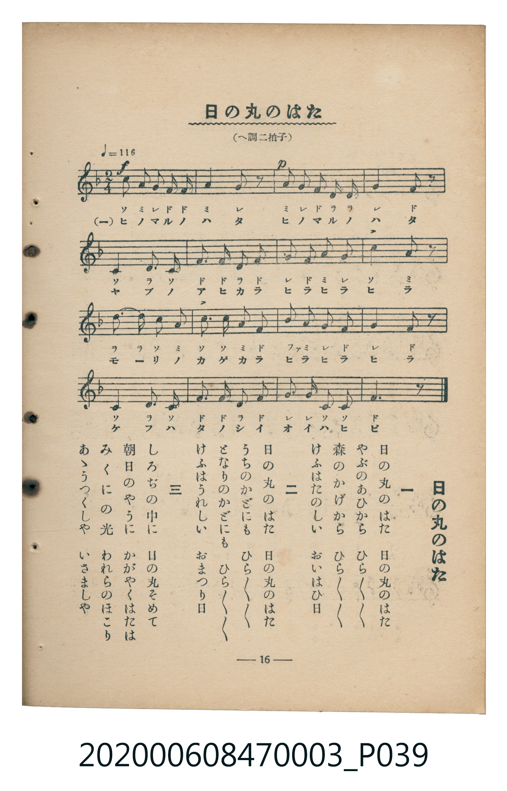

# 日の丸のはた（日之丸國旗）

> Re:Shōka 使用 AI 協助辨識與重建樂譜，可能會有錯誤。歡迎回報。

- **鋼琴伴奏版**：<br><audio controls src="hinomaru_no_hata.mp3"></audio>
- **NEUTRINO 歌聲合成版**：<br><audio controls src="hinomaru_no_hata_neutrino.mp3"></audio>

- 臺灣教育會公認『新定兒童唱歌』尋常科第三學年用（第二學期・第3首）
- 國立臺灣歷史博物館典藏（典藏號：2020.006.0847.0003）

## 說明


- 出處：臺灣教育會公認、臺北新高堂發行《新定兒童唱歌》尋常科第三學年用（昭和6年／1931年），
第二學期第 3 首〈日の丸のはた〉（日之丸國旗），原書第 16 頁（掃描檔 P039.jpg）。
- 調性與拍號：ヘ調（F 大調），2/4 拍，速度 != 116。
- 背景與曲風：描寫祝祭日竹林與森林樹影間、家家戶戶門前飄揚著紅日白底旗幟的歡欣景象。
- 版本說明：本檔案為原書單聲部五線譜（附移動 Do 階名片假名）之忠實數位化版本。

### 編曲說明（鋼琴伴奏版）：

1. 前奏 (Intro, 4 小節)：引用第一段明亮活潑的主題動機開場。
2. 主歌伴奏 (HinomaruNoHata, 16 小節 × 3 段)：右手演奏主旋律，左手以輕快的 2/4 拍進行曲伴奏支撐。


## 歌詞

```text
一　日の丸のはた　日の丸のはた
やぶのあひから　ひらひらひらひら
森のかげから　ひらひらひらひら
けふはたのしい　おいはひ日

二　日の丸のはた　日の丸のはた
うちのかどにも　ひらひらひらひら
となりのかどにも　ひらひらひらひら
けふはうれしい　おまつり日

三　しろぢの中に　日の丸そめて
朝日のやうに　かがやくはたは
みくにの光　われらのほこり
あゝうつくしや　いさましや
```

## ABC

<div class="abc-score" data-abc-src="hinomaru_no_hata.abc" aria-label="五線譜載入中"></div>

[下載 ABC 原始檔](hinomaru_no_hata.abc)

## TMD 檔案連結

- [主旋律 TMD 檔案](hinomaru_no_hata.tmd) [[在 TMD Studio 編輯](https://tmdlang.github.io/Tmd-TS/#tmd=s7IKdvYPcrWy4qpTUCpJTLdSSM7PyUlNLsnMz7MqzsjMK0nNjM_KTMmPL87Iz05Ugisry88pzU21Si9KTEmNN443MjAyiDcwMIs3sDAxBzIMjBFKi_NLi5JTrYqTM_Lzc-JLUitKkvLzsxHyBUX5Zal5iXlANQVFIBtTwIoQClLLMlNSQdKpKZkl-UWZiTlI7kgtKga7FWxJfElRYl5xclFmAcgDCFUlGalAx2bmFqSi6gYalp6ZZ5Wbn5dUCvQgskRJRj7QcwUZlVYZmcUgW5MTc-KzE_OQwgBqZ0FieqpVgIGxpRKXlpbCs-lLHzeue7JjB5B83Lj-ceP893s6gIJPdnYDBZ_O6X42ffr7PZ0KWlpcirYKhoZmXPa2Cm5cNkb6JnYgk1-073reuPjZ1JkvmjY9m9P8tHXNi1W9jxv6nk3b8HTdrKetk56vXvp0ysZna3seN_Q_3dD9dMeO58snPl-z5smOzqdrdzzdueX5lBVAK0Eiu3qAIs_mzH_cvBvINX65bBrQZrD7ge54vrobatfa7U_7Nz3tnfW8c-XLJSuetu54Mb0faAKE8WIm0AOzQPGrB4xfPVD8AhkGxmCTuPS1FGypBbgUFBQeN0x4NnvT89nrXqxa9WxG3-OGiWDR5t1P23e9mDkV6BIc4dMIFH_aMx0YSi9Xz3i6oOn5zD0vFgKDqAtbuHXjCbdnM9Y-ndRjBuS_39NvaGlsCGZ1vt_TA3KJggJyuALZCsYKwGB93ACKYrR4f9wA1IUl6oFGPe2b_2z2DpB2QzOFlwsaQer6mp_19z9bNUUBlJT0sgrSgUofNzRB_f9i1f5nDctfdLQ_6-6FRMnj5hlAQaBON4WnS5aDmSCjgelIAagGyHrZMP_prmUKkFSGZFJzz7OZ60Emzd70chHQy7OA9j5dv_r50rnPl64FOvf56p3P5k0HKVi8Dsh4tmLn070bX06bDAzkp-u2AdGzDhB6Oa3haWfvy8Utz_pnvZg4_fmWVpDemXuf7poK9OfTnfOfz2p5tnbhszWLQdZtXIhwwfPOjmdzgNEGimGQ9XPWAL39bGHH86ZdkIB5Om3di8ZNL5tXPNk15fn2WS_WzgF68-XMlufLdz_tnqrgkq_wclbf0wm9zzvbnza2AxlArwMD-en-BU_XL3s2dceTvb1Pe6ZBrAFZC01ZEMOBKeDFynlPW1c8m9YO9OSTHWtBjFXzXqxdD0xuoHS_ofdZeydyNIANeLKj4XFDA7ZoxiIItrGp5XHjNrBQ0-PGTY8bux83AWO0AcQGMjBIkB5gkIM1dD9unESUhseNEx83boW6BKRz-uPGFrCeLhADJL4J6DyQUqDXIN4EhTksVQKjChivyFxQ8tw3D5IIgLEOjOCnExuAJEQcmBqA4sAE8WLxQmSpJ7u7ni5Z-WzG-qf7Vz9b0QSK-9ZtwCQFCpqGJngY7gLmPpLCsLHtceNCWJCsfNy4-nFTE8EgWfG4cdXjJmAAkKYNHpJtj5t6UENy3-PGJUATSQ_JOSuedUx82jARmG1AGaZ_MUp4zlnxsmXD042tcNknO-djDVVgRno6bQ4wVIFZFFguo4XqDkgqmf64qfdx4yJwMK4F-RklVOc-bmp83LgMnMrmgOMFGDygJAoMYZBScFD1gEX6YelpPSRg9oOFVgM1PG0FW9XUDwohUOgBQ3j348bJwLCBKG163DQXbOQSsB6gkyBhCDR1KjgYQSLoYQgMB0jBAQ66tc_mT36yowtSoIBCqbkf6OCXM_cCc-CzFYtfTmt-0dAASmDgUgaoAJTq5nQDwxAoCHTgiz1zQREBDnagyMuVU582bQKZMxUYmLNe7trzfF_fy12gyIJwn65ofLZ2GTQ8gS6jvCaDAgUtfS4uj8y8_NzEolK_fI_EkkSrgMzEvHyHGoOaanB1YmOhZQdmYKtIwXUN0M_rtipomCg83dD_fH2DDrxcAskqGCoAazlNLFqBVkONBZpgBSx1JwFxHxDPA-LVYHYNkOwHl1P7wTUbiE9YFdTgGoXqtFoFU2D1Z6SgYahgqKmqoasJFDVW0AWKGIDkC2rBsoYKGmbxCmbxMBVGQBWGIBVgc3wMgRY0bgLidUC8T0HjcVM3iANSCUx_QLXAhKgQD-YRoQpiphENzDQGiU4HBkMvkF4EVA3WtgqiuhusejUuM-eCVTU1glUtA5uJP9J39eCLdCOiI30JuMKdBo5IcAQ3LYJEchMoclfCo3wlnIYlA5A-EA8pwk3jge4HxaUuEJqC4xMcocDoB4mAkwBQAKjAEBzNhuDoB-oDShqjRnhTC8goYO0I1gkNdCC_CcrfpAkOVGAJAwtQIAtGQ0SAyoBs1Chvg5i6EM1UUOyA-CtBpgI93tRErKngSG8C4qkgc0DSSOaCPQHit0HM1YUmBWApCvYhsACEJiVQQgLRhCN-Rye-iDcmOuJB0bwHiFchRT3I5yC_khH1GmZgr5pBoxiU7YGCoIgFpgSooDE42k2geR5bPgcGGSSCgaqBFQY4l6BE0CRyoh2ofwVUPzA3YjWXrIgH6t8P1d8P1Q8zF5IQQL4Au7YLHLz9QAyKeJDJIHXAihGIJ4PlCUb809mz8UW8CbER37QRHH1ToYU2yF37IUV603YgXgIWASYKIAukAhLdoGifDI5wCvK7Bii-gWU_LInEg1ANUAokilraT4Rk063Q0F0PzabzEdkLXNI2tkDEu6DiLSBxUGbaBA7dzWBh1AIAh8mgcgEUwcAgxGryPpA4MEQgMYluMrQQAJsMK6CAWR5swhLkFAKqHaAmw4qGqSDxfWA5WLEHMbmWi0vXTgG1cQC2DiiqzAUA)]
- [鋼琴伴奏 TMD 檔案](hinomaru_no_hata_piano.tmd) [[在 TMD Studio 編輯](https://tmdlang.github.io/Tmd-TS/#tmd=s7IKdvYPcrWy4qpTUCpJTLdSyC8qychPL0osyKi0ysgsLskvykxOzInPTsxLVIIrKs4vLUpOjS9ITE-1CjAwtlTi0tJSeDZ96ePGdU927ACSjxvXP26c_35PB1Dwyc5uoODTOd3Ppk9_3Lz7Zfee5xO2PNmz5enS_uedHe_3dCpoaXEp2ioYGppx2dsquHHZGOmb2IHsetG-63nj4mdTZ75o2vRsTvPT1jUvVvU-buh7Nm3D03WznrZOer566dMpG5-t7Xnc0P90Q_fTHTueL5_4fM2aJzs6n67d8XTnludTVgAdARLZ1QMUeTZnPtAFQK7xy2XTgDaDfQR02fPV3VC71m5_2r_pae-s550rXy5Z8bR1x4vp_UATIIwXM4FemmVkYGSgZ2BgpmdgYWIOZBgYg03i0tdSsKUW4FJQUHjcMOHZ7E3PZ697sWrVsxl9jxsmgkWbdz9t3_Vi5lSgS3CETyNQ_GnPdGAovVw94-mCpucz97xYCAyiLmzh1o0n3J7NWPt0Uo8ZkP9-T7-hpbEhmNX5fk8PyCUKCsjhCmQrGCsAg_VxAyjS0VLC4wagLvTEADHqad_8Z7N3gLQbmim8XNAIUtfX_Ky__9mqKQqgxKWXVZAOVPq4oQnq_xer9j9rWP6io_1Zdy8kSh43zwAKAnW6KTxdshzMBBkNTEcKQDVA1suG-U93LVOApDKESc-3rwAGMSR8gboxkybQbIhXDfUUnnb2AsUVNDzzSorydRRMFJ5u6H--vkETqObpnqnAEAMHYMOzdVuBpj3Zte7Zlt3P9k58PqvlyY7dLxf2PO2e-mzl_JfTup8u2AJ1gYKCkZ4CUBYYERBLFTQ8MvPycxOLSv3yPRJLEnVAYQKxRuHwdGD4Ag0H29e_-Vln97M9U4B6QPqndz_d1w0Ky-3LgOJPdi99sWfq0_2rgXYrQMPgZcMmYBoAehZi0bMp659NmgB1BuXJFQoUtPS5uMDBYxWQmZiXH-ThUGNQUw32qo2Flh2YUaNgCvSIhpGCoaaqhq6mgiFQxFhBV8FIwQDMMlLQMFQwi4dImsUDxYyAsoYgWa5aFON9sBtvGK8QbRirYAKkTGIRfNN4sAXoskDhaNNYkDDUAtQYwOMRbPkdnCXAaUBBA5ZAdOCpGCQL9AkwIjSxaAUGHtRYoAlWwOQ5CYj7gHgeEK8Gs2uAZD8o6TbtBycfEJ-wKqjBNQrVabXgwAcHMTT4kQO_uqAWLGuooAEMeFgcIEcAyBwfQ6AFjZuAeB0Q71PQeNzUDeKAVAJzO1AtMMMrgCKOKFUQM41oYKYxSHQ6MBh6gfQioGqwtlUQ1d1g1atxmTkXrKqpEaxqGdhM_JG-qwdfpBsRHelLwCXTNHBEgiO4aREkkptAkbsSHuUr4TQsGYD0gXhIEQ5M3LrguNQFQlNwfIIjFBj9IBFwEoDkMlAuBEU8KPpBOVQXyEKJ8KYWkFGPG7eBdUIDHchvgvI3aYID9XFTJyxAgSwYDREBKgOyUaO8DWLqQjRTQbED4q8EmQr0eFMTsaaCI70JiKeCzAFJI5kL9gSI3wYxVxeaFB439oB9-LixH5qUQAkJRBOO-B2d-CLemOiIB0XzHiBehRT1IJ-D_EpG1GuYgb1qBo1iULYHCoIiFpgSoILG4Gg3geZ5bPkcGGSQCAaqftzUBc4lKBE0iZxoB-pfAdUPzI1YzSUr4oH690P190P1w8yFJASQL8Cu7QIHbz8QgyIeZDJI3ePG3UA8GSxPMOKfzp6NL-JNiI34po3g6JsKLbRB7toPKdKbtgPxErAIMFEAWSAVkOgGRftkcIRTkN-BdTBI1AiWROJBCFhDgkVRS_uJkGy6FRq666HZdD4ie4FL2sYWiHgXVLwFJA7KTJvAobsZLIxaAOAwGVQugCIYGIRYTd4HEgeGCCQm0U2GFgJgk2EFFDDLg01YgpxCQLUD1GRY0TAVJL4PLAcr9iAm42gbYG2FENs2wJNAKGvIkFRZEeMKkPFAClhcQCxEtxdKwdUT5Q60shOvO6AWQo2H2wNMy9FmuSABIyDLCMgiJ0TQMzMtQgSEoW1MXTsFcDtWAchATVPRPkBVWESNsIoag0WVuQA)]

## 分析

```text
================================================================================
📊 TMD Song Profile: [ 日の丸のはた（日之丸國旗） ]
================================================================================
⏱  Duration:       0:16 (16.6s), 16 measures total
🎼 Key & Tempo:    首調基準 F, != 116.0 BPM, <2/4>
   - 分析範圍：      由實際發聲的音符與和弦推測調性；播放脈絡另行呈現
🎤 人聲音域:    C4 (MIDI 60) – D5 (MIDI 74) [跨度: 14 個半音 / 1.2 個八度, 難度: moderate]
   - 最低音:  C4 in [HinomaruNoHata #1 @ m.5, 0:04]
   - 最高音: D5 in [HinomaruNoHata #1 @ m.9, 0:08]
   - 適合: soprano, mezzo-soprano, contralto, tenor, baritone, bass
🏛  結構:      HinomaruNoHata (16.6s)
⚡ 編曲密度:        Peak 1 軌道同時演奏
🗝  調性診斷：       F 大調（純淨自然大調，未偵測到可信轉調）
   - 風格氣質:    純淨自然大調（陽光明朗、易唱易記，無明顯調外色彩）
   - 轉調歷程:    全曲維持單一推測調性（未偵測到可信轉調）
   - 核心骨幹音:  F, C, G, A, D
   - 調性數值:    F 大調 [相關度: 0.87, 穩定度: Moderate, 自然音純度: 100.0%]
   - 候選調性 (K-S): F 大調 (0.87), C 大調 (0.75), D 小調 (0.61)
   - 五度圈歷程:   -1
   - 各段落調性細節:
     • [HinomaruNoHata #1]: F 大調 (r: 0.87, 自然音純度: 100.0%)

  [ 五度圈游移軌跡 ]
               C  
        [F ]*          G  
      Bb               D  
      Eb               A  
         Ab           E  
            Db       B  
               F# 
     (* = active key center)

  [ 十二半音累積音高分佈 ]
     C  : ████████████████████      22.0%
     C# :                            0.0%
     D  : ████████████              13.6%
     D# :                            0.0%
     E  :                            0.0%
     F  : ████████████████████████  27.1%
     F# :                            0.0%
     G  : ██████████████████        20.3%
     G# :                            0.0%
     A  : ██████████████            15.3%
     A# : ██                         1.7%
     B  :                            0.0%
--------------------------------------------------------------------------------
Assignment 軌道音域：
  - Piano         : C4 – D5 (14 個半音 / 1.2 個八度, 53 個音符)
================================================================================
```


## 原書掃描頁




