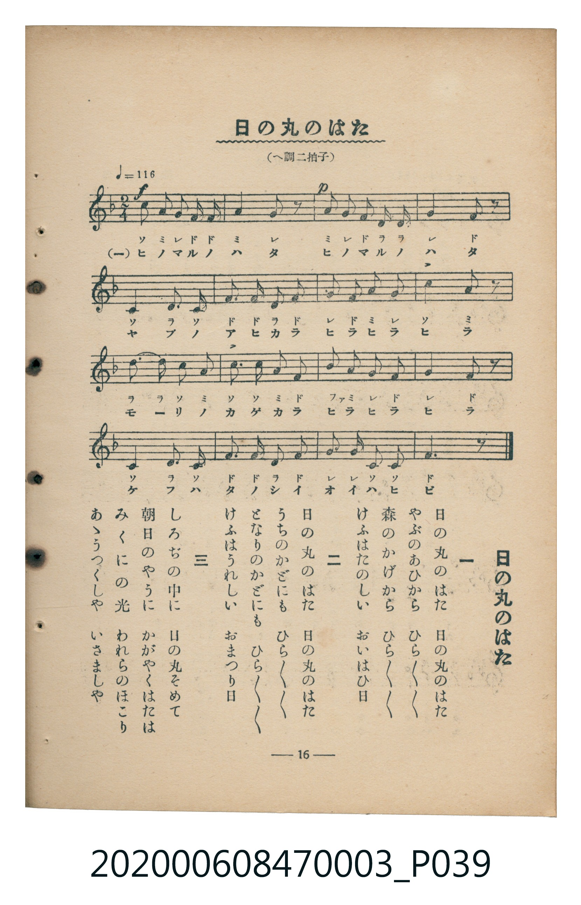

# 日の丸のはた（日之丸國旗）

<audio controls src="hinomaru_no_hata.mp3"></audio>

- 臺灣教育會公認『新定兒童唱歌』尋常科第三學年用（第二學期・第3首）
- 國立臺灣歷史博物館典藏（典藏號：2020.006.0847.0003）

## 說明

【曲目說明】
・出處：臺灣教育會公認、臺北新高堂發行《新定兒童唱歌》尋常科第三學年用（昭和6年／1931年），
第二學期第 3 首〈日の丸のはた〉（日之丸國旗），原書第 16 頁（掃描檔 P039.jpg）。
・調性與拍號：ヘ調（F 大調），2/4 拍，速度 != 116。
・背景與曲風：描寫祝祭日竹林與森林樹影間、家家戶戶門前飄揚著紅日白底旗幟的歡欣景象。
・版本說明：本檔案為原書單聲部五線譜（附移動 Do 階名片假名）之忠實數位化版本。

・編曲說明（鋼琴伴奏版）：
1. 前奏 (Intro, 4 小節)：引用第一段明亮活潑的主題動機開場。
2. 主歌伴奏 (HinomaruNoHata, 16 小節 × 3 段)：右手演奏主旋律，左手以輕快的 2/4 拍進行曲伴奏支撐。

## 歌詞

```text
一　日の丸のはた　日の丸のはた
やぶのあひから　ひらひらひらひら
森のかげから　ひらひらひらひら
けふはたのしい　おいはひ日

二　日の丸のはた　日の丸のはた
うちのかどにも　ひらひらひらひら
となりのかどにも　ひらひらひらひら
けふはうれしい　おまつり日

三　しろぢの中に　日の丸そめて
朝日のやうに　かがやくはたは
みくにの光　われらのほこり
あゝうつくしや　いさましや
```

## ABC

```abc
X:1
T:日の丸のはた（日之丸國旗）
M:2/4
L:1/16
Q:1/4=116
K:F
V:V1 name="Piano" snm="Pia"
[V:V1]
c2 A2 G F F2 | A4 G2 z2 | A2 G2 F D D2 | G4 F2 z2 |
C4 D2 C2 | F2 F2 D2 F2 | G2 F2 A2 G2 | c4 A2 z2 |
d2 d2 c2 A2 | c2 c2 A2 F2 | B2 A2 G2 F2 | G4 F2 z2 |
C4 D2 C2 | F2 F2 D2 F2 | G2 G2 C2 C2 | F6 z2 |
```

## TMD 檔案連結

- [主旋律 TMD 檔案](hinomaru_no_hata.tmd) [[在 TMD Studio 編輯](https://tmdlang.github.io/Tmd-TS/#tmd=s7IKdvYPcrWy4tLSUng2fenjxnVPduwAko8b1z9unP9-TwdQ8MnObqDg0zndz6ZPf7-nU0FLi0vRVsHQ0IzL3lbBjcvGSN_EjqtOQelF-67njYufTZ35omnTsznNT1vXvFjV-7ih79m0DU_XzXraOun56qVPp2x8trbncUP_0w3dT3fseL584vM1a57s6Hy6dsfTnVueT1kBtBIksqsHKPJszvzHzbuBXOOXy6YBbVYC2QJ0x_PV3VC71m5_2r_pae-s550rXy5Z8bR1x4vp_UATIIwXM4EemGVkYGSgZ2BgpmdgYWIOZBgYg03i0tdSsKUW4FJQUHjcMOHZ7E3PZ697sWrVsxl9jxsmgkWbdz9t3_Vi5lSgS3CETyNQ_GnPdGAovVw94-mCpucz97xYCAyiLmzh1o0n3J7NWPt0Uo8ZkP9-T7-hpbEhmNX5fk8PyCUKCsjhCmQrGCsAg_VxAyiK0eL9cQNQF5aoBxr1tG_-s9k7QNoNzRReLmgEqetrftbf_2zVFIUAA2NLvayCdKDSxw1NUP-_WLX_WcPyFx3tz7p7IVHyuHkGUBCo003h6ZLlYCbIaGA6UgCqAbJeNsx_umuZAiSVIZnU3PNs5nqQSbM3vVwE9PIsoL1P169-vnTu86Vrgc59vnrns3nTQQoWrwMynq3Y-XTvxpfTJgMD-em6bUD0rAOEXk5reNrZ-3Jxy7P-WS8mTn--pRWkd-bep7umAv35dOf857Nanq1d-GzNYpB1GxciXPC8s-PZHGC0gWIYZP2cNUBvP1vY8bxpFyRgnk5b96Jx08vmFU92TXm-fdaLtXOA3nw5s-X58t1Pu6cquOQrvJzV93RC7_PO9qeN7UAG0OvAQH66f8HT9cueTd3xZG_v055pEGtA1kJTFsRwYAp4sXLe09YVz6a1Az35ZMdaEGPVvBdr1wOTGyjdb-h91t6JHA1gA57saHjc0IAtmrEIgm1sanncuA0s1PS4cdPjxu7HTcAYbQCxgQwMEqQHGORgDd2PGycRpeFx48THjVuhLgHpnP64sQWspwvEAIlvAjoPpBToNYg3QWEOS5XAqALGKzIXlDz3zYMkAmCsAyP46cQGIAkRB6YGoDgwQbxYvBBZ6snurqdLVj6bsf7p_tXPVjSB4r51GzBJgYKmoQkehruAuY-kMGxse9y4EBYkKx83rn7c1EQwSFY8blz1uAkYAKRpg4dk2-OmHtSQ3Pe4cQnQRNJDcs6KZx0TnzZMBGYbUIbpX4wSnnNWvGzZ8HRjK1z2yc75WEMVmJGeTpsDDFVgFgWWy2ihugOSSqY_bup93LgIHIxrQX5GCdW5j5saHzcuA6eyOeB4AQYPKIkCQxikFBxUPWCRflh6Wg8JmP1godVADU9bwVY19YNCCBR6wBDe_bhxMjBsIEqbHjfNBRu5BKwH6CRIGAJNnQoORpAIehgCwwFScICDbu2z-ZOf7OiCFCigUGruBzr45cy9wBz4bMXil9OaXzQ0gBIYuJQBKgClujndwDAECgId-GLPXFBEgIMdKPJy5dSnTZtA5kwFBuasl7v2PN_X93IXKLIg3KcrGp-tXQYNT6DLKK_JoEBBS5-LyyMzLz83sajUL98jsSTRKiAzMS_focagRqEaXJ_YWGjZgRnYalJwZQP09LqtChomCk839D9f36ADL5hAsgqGCsBqThOLVqDdUGOBJlgBi91JQNwHxPOAeDWYXQMk-8EF1X5w1QbiE1YFNbhGwRRY92kYKRhqqmroagIdUgPk6yoYKRiAWUYKGoYKZvEQSbN4oJgRUNYQJAtOtLg9vKsHn4eNiPbwEnBtMw3sCbDnmhZBPNgE8thKuHdXwmlYEID0gXjIno0Huh7oDSBdA_QFyGtgLwP9D_YsKDh0gSzC3tvRic97xkR7D-SZPUC8CsmDQI81bSLPg2ZACIpRkEdANMhzJmCvQbxJVNw9nT0bn-dMiPVc00awE6dCkx7Ia_shCbNpOxAvAYsAPQ5kgVRAvATy2mSwp4iMOSOQGFRYFwhB3qvl4tK1U0DNtCARZS4uAA)]
- [鋼琴伴奏 TMD 檔案](hinomaru_no_hata_piano.tmd) [[在 TMD Studio 編輯](https://tmdlang.github.io/Tmd-TS/#tmd=s7IKdvYPcrWy4tLSUng2fenjxnVPduwAko8b1z9unP9-TwdQ8MnObqDg0zndz6ZPf9y8-2X3nucTtjzZs-Xp0v7nnR3v93QqaGlxKdoqGBqacdnbKrhx2Rjpm9hx1SkovWjf9bxx8bOpM180bXo2p_lp65oXq3ofN_Q9m7bh6bpZT1snPV-99OmUjc_W9jxu6H-6ofvpjh3Pl098vmbNkx2dT9fueLpzy_MpK4COAIns6gGKPJszH-gCINf45bJpQJuVQLYAXfZ8dTfUrrXbn_Zveto763nnypdLVjxt3fFiej_QBAjjxUygl2YZGRgZ6BkYmOkZWJiYAxkGxmCTuPS1FGypBbgUFBQeN0x4NnvT89nrXqxa9WxG3-OGiWDR5t1P23e9mDkV6BIc4dMIFH_aMx0YSi9Xz3i6oOn5zD0vFgKDqAtbuHXjCbdnM9Y-ndRjBuS_39NvaGlsCGZ1vt_TA3KJggJyuALZCsYKwGB93ACKdLSU8LgBqAs9MUCMeto3_9nsHSDthmYKLxc0gtT1NT_r73-2aopCgIGxpV5WQTpQ6eOGJqj_X6za_6xh-YuO9mfdvZAoedw8AygI1Omm8HTJcjATZDQwHSkA1QBZLxvmP921TAGSyhAmPd--AhjEkPAF6sZMmkCzIV411FN42tkLFFfQ8MwrKcrXUTBReLqh__n6Bk2gmqd7pgJDDByADc_WbQWa9mTXumdbdj_bO_H5rJYnO3a_XNjztHvqs5XzX07rfrpgC9QFCgpGegpAWWBEQCxV0PDIzMvPTSwq9cv3SCxJ1AGFCcQahcPTgeELNBxsX__mZ53dz_ZMAeoB6Z_e_XRfNygsty8Dij_ZvfTFnqlP968G2q0ADYOXDZuAaQDoWYhFz6asfzZpAtQZlCdXKFDQ0ufiAgePVUBmYl5-kIdDjUGNQjXYrzYWWnZgRo2CKdAnGkYKhpqqGrqaCoZAEWMFXQUjBQMwy0hBw1DBLB4iaRYPFDMCyhqCZLlqUcz3wWG-YbxCtGGsggmQMolF8E3jwTagywKFo01jQcJQG1DjAJ9XsGV5cK4AJwMFDXgawaIMGFaUhgZ-N-zqIcEN8UBDgaYDaWAAASGQDXIJ0FlgN4BcqQtkEbZ1RyfxtpoBIcj3INNBNMhGE7B9ELuJ8ufT2bOp4U8jkBhUWBcI8aQF7MmOKmmBkpRLvdSAsBVEAeMEYiG6vVAKrp4od5CSPqAWQo2H2wOMs2izXJCAEZBlBGSREyIkpRsyQwSEoQlJ104BXHIpABmoiYpYEWUuLgA)]

## 分析

```text
================================================================================
📊 TMD Song Profile: [ 日の丸のはた（日之丸國旗） ]
================================================================================
⏱  Duration:       0:16 (16.6s), 16 measures total
🎼 Key & Tempo:    首調基準 F, != 116.0 BPM, <2/4>
   - 分析範圍：      由實際發聲的音符與和弦推測調性；播放脈絡另行呈現
🎤 人聲音域:    C4 (MIDI 60) – D5 (MIDI 74) [跨度: 14 個半音 / 1.2 個八度, 難度: moderate]
   - 最低音:  C4 in [HinomaruNoHata #1 @ m.5, 0:04]
   - 最高音: D5 in [HinomaruNoHata #1 @ m.9, 0:08]
   - 適合: soprano, mezzo-soprano, contralto, tenor, baritone, bass
🏛  結構:      HinomaruNoHata (16.6s)
⚡ 編曲密度:        Peak 1 軌道同時演奏
🗝  調性診斷：       F 大調（純淨自然大調，未偵測到可信轉調）
   - 風格氣質:    純淨自然大調（陽光明朗、易唱易記，無明顯調外色彩）
   - 轉調歷程:    全曲維持單一推測調性（未偵測到可信轉調）
   - 核心骨幹音:  F, C, G, A, D
   - 調性數值:    F 大調 [相關度: 0.88, 穩定度: Moderate, 自然音純度: 100.0%]
   - 候選調性 (K-S): F 大調 (0.88), C 大調 (0.77), D 小調 (0.59)
   - 五度圈歷程:   -1
   - 各段落調性細節:
     • [HinomaruNoHata #1]: F 大調 (r: 0.88, 自然音純度: 100.0%)

  [ 五度圈游移軌跡 ]
               C  
        [F ]*          G  
      Bb               D  
      Eb               A  
         Ab           E  
            Db       B  
               F# 
     (* = active key center)

  [ 十二半音累積音高分佈 ]
     C  : █████████████████████     23.7%
     C# :                            0.0%
     D  : ███████████               12.7%
     D# :                            0.0%
     E  :                            0.0%
     F  : ████████████████████████  27.1%
     F# :                            0.0%
     G  : █████████████████         19.5%
     G# :                            0.0%
     A  : ██████████████            15.3%
     A# : ██                         1.7%
     B  :                            0.0%
--------------------------------------------------------------------------------
Assignment 軌道音域：
  - Piano         : C4 – D5 (14 個半音 / 1.2 個八度, 53 個音符)
================================================================================
```


## 原書掃描頁




