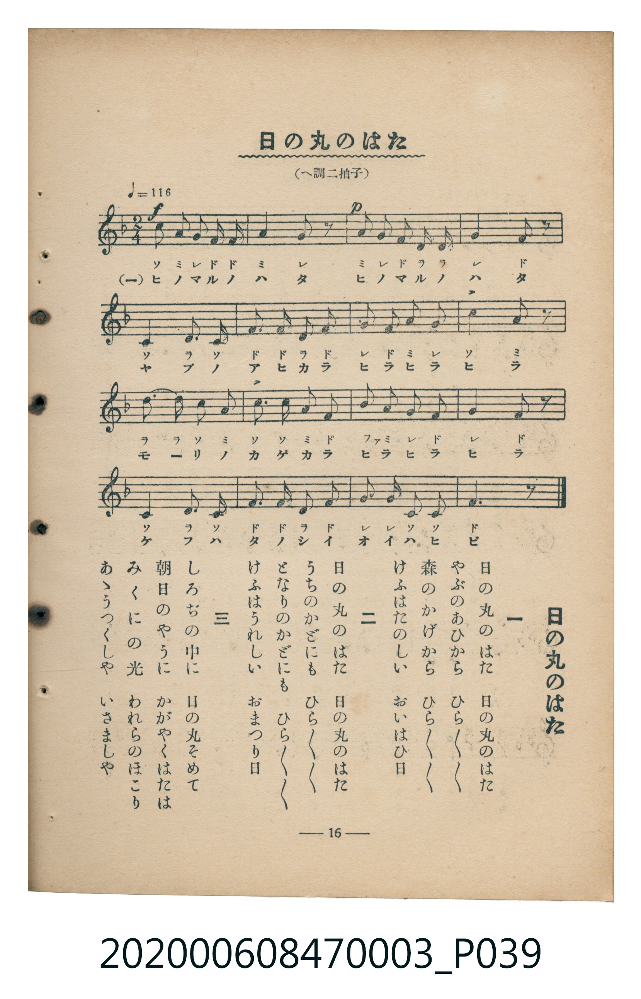

# 日の丸のはた（日之丸國旗）

> Re:Shōka 使用 AI 協助辨識與重建樂譜，可能會有錯誤。歡迎回報。

- **NEUTRINO 歌聲合成版**：<br><audio controls src="hinomaru_no_hata_neutrino.mp3"></audio>
- **鋼琴伴奏版**：<br><audio controls src="hinomaru_no_hata.mp3"></audio>


- 臺灣教育會公認『新定兒童唱歌』尋常科第三學年用（第二學期・第3首）
- 國立臺灣歷史博物館典藏（典藏號：2020.006.0847.0003）

## 說明


- 出處：臺灣教育會公認、臺北新高堂發行《新定兒童唱歌》尋常科第三學年用（昭和6年／1931年），

第二學期第 3 首〈日の丸のはた〉（日之丸國旗），原書第 16 頁（掃描檔 P039.jpg）。
- 調性與拍號：ヘ調（F 大調），2/4 拍，速度 != 116。

- 背景與曲風：描寫祝祭日竹林與森林樹影間、家家戶戶門前飄揚著紅日白底旗幟的歡欣景象。

- 版本說明：本檔案為原書單聲部五線譜（附移動 Do 階名片假名）之忠實數位化版本。


### 編曲說明（鋼琴伴奏版）：

1. 前奏 (Intro, 4 小節)：引用第一段明亮活潑的主題動機開場。
2. 主歌伴奏 (HinomaruNoHata, 16 小節 × 3 段)：右手演奏主旋律，左手以輕快的 2/4 拍進行曲伴奏支撐。


## 跨冊／重複收錄參照

> 同曲＋同名異曲（《公學校唱歌》第一學年、《公學校唱歌集》與《新定兒童唱歌》第一學年為文部省『尋常小學唱歌』〈日の丸の旗〉同曲；《新定兒童唱歌》第三學年為同名異曲）

- **[同名異曲]** 《公學校唱歌》第一學年用（昭和10年／1935）：[**〈ヒノマル ノ ハタ（日之丸旗）〉**](../../../kogakko_shoka/grade_1/1_hinomaru_no_hata/index.md)（`F` / `2/4` — [原始 TMD](../../../kogakko_shoka/grade_1/1_hinomaru_no_hata/hinomaru_no_hata.tmd)）
- **[同名異曲]** 《公學校唱歌集》（大正4年／1915，國臺圖 0725 26）：[**〈日の丸の旗〉**](../../../kogakko_shokashu_1915/3_02_hinomaru_no_hata/index.md)（`F` / `2/4` — [原始 TMD](../../../kogakko_shokashu_1915/3_02_hinomaru_no_hata/hinomaru_no_hata.tmd)）
- **[同名異曲]** 《新定兒童唱歌》尋常科第一學年用（2020.006.0847.0001）：[**〈ヒノマルノハタ（日之丸旗）〉**](../../grade_1_2020.006.0847.0001/1_01_hinomaru_no_hata/index.md)（`F` / `2/4` — [原始 TMD](../../grade_1_2020.006.0847.0001/1_01_hinomaru_no_hata/hinomaru_no_hata.tmd)）
- 總表：[跨冊重複與同名歌曲總索引](../../../duplicate_songs.md)

## 歌詞

```text
一　日の丸のはた　日の丸のはた
やぶのあひから　ひらひらひらひら
森のかげから　ひらひらひらひら
けふはたのしい　おいはひ日

二　日の丸のはた　日の丸のはた
うちのかどにも　ひらひらひらひら
となりのかどにも　ひらひらひらひら
けふはうれしい　おまつり日

三　しろぢの中に　日の丸そめて
朝日のやうに　かがやくはたは
みくにの光　われらのほこり
あゝうつくしや　いさましや
```

## ABC

```abc
X:1
T:日の丸のはた（日之丸國旗）
M:2/4
L:1/16
Q:1/4=116
K:F
V:V1 name="Piano" snm="Pia"
[V:V1]
!f! c2 A2 G2 F F | A4 G2 z2 | !p! A2 G2 F2 D D | G4 F2 z2 |
w: 1.~ひ の ま る の | は た | ひ の ま る の | は た
w: 2.~ひ の ま る の | は た | ひ の ま る の | は た
w: 3.~し ろ ぢ の な | か に | ひ の ま る そ | め て
C4 D3 C | F3 F D2 F2 | G2 F2 A2 G2 | c4 A2 z2 |
w: 1.~や ぶ の | あ ひ か ら | ひ ら ひ ら | ひ ら
w: 2.~う ち の | か ど に も | ひ ら ひ ら | ひ ら
w: 3.~あ ひ の | や う に _ | か が や く | は は
d3 d c2 A2 | c3 c A2 F2 | B2 A2 G2 F2 | G4 F2 z2 |
w: 1.~も _ り の | か げ か ら | ひ ら ひ ら | ひ ら
w: 2.~と な り の | か ど に も | ひ ら ひ ら | ひ ら
w: 3.~み く に の | ひ _ か り | わ れ ら の | ほ り
C4 D3 C | F3 F D2 F2 | G3 G C2 C2 | F6 z2 |
w: 1.~け ふ は | た の し い | お い は ひ | び
w: 2.~け ふ は | う れ し い | お ま つ り | び
w: 3.~あ あ う | つ く し や | い さ ま し | や
```

## TMD 檔案連結

- [主旋律 TMD 檔案](hinomaru_no_hata.tmd) [[在 TMD Studio 編輯](https://tmdlang.github.io/Tmd-TS/#tmd=s7IKdvYPcrWy4qpTUCpJTLdSSM7PyUlNLsnMz7MqzsjMK0nNjM_KTMmPL87Iz05Ugisry88pzU21Si9KTEmNN443MjAyiDcwMIs3sDAxBzIMjBFKi_NLi5JTrYqTM_Lzc-JLUitKkvLzsxHyBUX5Zal5iXlANQVFIBtTwIoQClLLMlNSQdKpKZkl-UWZiTlI7kgtKga7FWxJfElRYl5xclFmAcgDCFUlGalAx2bmFqRCdGtpKTybvvRx47onO3YAyceN6x83zn-_pwMo-GRnN1Dw6ZzuZ9Onv9_TqaClxaVoq2BoaMZlb6vgxmVjpG9iBzL3Rfuu542Ln02d-aJp07M5zU9b17xY1fu4oe_ZtA1P18162jrp-eqlT6dsfLa253FD_9MN3U937Hi-fOLzNWue7Oh8unbH051bnk9ZAbQSJLKrByjybM78x827gVzjl8umAW0Gux7ojueru6F2rd3-tH_T095ZzztXvlyy4mnrjhfT-4EmQBgvZgI9MAsUD3rAeNADxQOQYWAMNolLX0vBllqAS0FB4XHDhGezNz2fve7FqlXPZvQ9bpgIFm3e_bR914uZU4EuwRE-jUDxpz3TgaH0cvWMpwuans_c82IhMIi6sIVbN55wezZj7dNJPWZA_vs9_YaWxoZgVuf7PT0glygoIIcrkK1grAAM1scNoChGi_fHDUBdWKIeaNTTvvnPZu8AaTc0U3i5oBGkrq_5WX__s1VTFAIMjC31sgrSgUofNzRB_f9i1f5nDctfdLQ_6-6FRMnj5hlAQaBON4WnS5aDmSCjgelIAagGyHrZMP_prmUKkFSGZFJzz7OZ60Emzd70chHQy7OA9j5dv_r50rnPl64FOvf56p3P5k0HKVi8Dsh4tmLn070bX06bDAzkp-u2AdGzDhB6Oa3haWfvy8Utz_pnvZg4_fmWVpDemXuf7poK9OfTnfOfz2p5tnbhszWLQdZtXIhwwfPOjmdzgNEGimGQ9XPWAL39bGHH86ZdkIB5Om3di8ZNL5tXPNk15fn2WS_WzgF68-XMlufLdz_tnqrgkq_wclbf0wm9zzvbnza2AxlArwMD-en-BU_XL3s2dceTvb1Pe6ZBrAFZC01ZEMOBKeDFynlPW1c8m9YO9OSTHWtBjFXzXqxdD0xuoHS_ofdZeydyNIANeLKj4XFDA7ZoxiIItrGp5XHjNrBQ0-PGTY8bux83AWO0AcQGMjBIkB5gkIM1dD9unESUhseNEx83boW6BKRz-uPGFrCeLhADJL4J6DyQUqDXIN4EhTksVQKjChivyFxQ8tw3D5IIgLEOjOCnExuAJEQcmBqA4sAE8WLxQmSpJ7u7ni5Z-WzG-qf7Vz9b0QSK-9ZtwCQFCpqGJngY7gLmPpLCsLHtceNCWJCsfNy4-nFTE8EgWfG4cdXjJmAAkKYNHpJtj5t6UENy3-PGJUATSQ_JOSuedUx82jARmG1AGaZ_MUp4zlnxsmXD042tcNknO-djDVVgRno6bQ4wVIFZFFguo4XqDkgqmf64qfdx4yJwMK4F-RklVOc-bmp83LgMnMrmgOMFGDygJAoMYZBScFD1gEX6YelpPSRg9oOFVgM1PG0FW9XUDwohUOgBQ3j348bJwLCBKG163DQXbOQSsB6gkyBhCDR1KjgYQSLoYQgMB0jBAQ66tc_mT36yowtSoIBCqbkf6OCXM_cCc-CzFYtfTmt-0dAASmDgUgaoAJTq5nQDwxAoCHTgiz1zQREBDnagyMuVU582bQKZMxUYmLNe7trzfF_fy12gyIJwn65ofLZ2GTQ8gS6jvCaDAgUtfS4uj8y8_NzEolK_fI_EkkSrgMzEvHyHGoOaanB1YmOhZQdmYKtIwXUN0M_rtipomCg83dD_fH2DDrxcAskqGCoAazlNLFqBVkONBZpgBSx1JwFxHxDPA-LVYHYNkOwHl1P7wTUbiE9YFdTgGoXqtFoFU2D1Z6SgYahgqKmqoasJFDVW0AWKGIDkC2rBsoYKGmbxCmbxMBVGQBWGIBVgc3wMgRY0bgLidUC8T0HjcVM3iANSCUx_QLXAhKgQD-YRoQpiphENzDQGiU4HBkMvkF4EVA3WtgqiuhusejUuM-eCVTU1glUtA5uJP9J39eCLdCOiI30JuMKdBo5IcAQ3LYJEchMoclfCo3wlnIYlA5A-EA8pwk3jge4HxaUuEJqC4xMcocDoB4mAkwBQAKjAEBzNhuDoB-oDShqjRnhTC8goYO0I1gkNdCC_CcrfpAkOVGAJAwtQIAtGQ0SAyoBs1Chvg5i6EM1UUOyA-CtBpgI93tRErKngSG8C4qkgc0DSSOaCPQHit0HM1YUmBWApCvYhsACEJiVQQgLRhCN-Rye-iDcmOuJB0bwHiFchRT3I5yC_khH1GmZgr5pBoxiU7YGCoIgFpgSooDE42k2geR5bPgcGGSSCgaqBFQY4l6BE0CRyoh2ofwVUPzA3YjWXrIgH6t8P1d8P1Q8zF5IQQL4Au7YLHLz9QAyKeJDJIHXAihGIJ4PlCUb809mz8UW8CbER37QRHH1ToYU2yF37IUV603YgXgIWASYKIAukAhLdoGifDI5wCvK7Bii-gWU_LInEg1ANUAokilraT4Rk063Q0F0PzabzEdkLXNI2tkDEu6DiLSBxUGbaBA7dzWBh1AIAh8mgcgEUwcAgxGryPpA4MEQgMYluMrQQAJsMK6CAWR5swhLkFAKqHaAmw4qGqSDxfWA5WLEHMbmWi0vXTgG1cQC2DiiqzAUA)]
- [鋼琴伴奏 TMD 檔案](hinomaru_no_hata_piano.tmd) [[在 TMD Studio 編輯](https://tmdlang.github.io/Tmd-TS/#tmd=s7IKdvYPcrWy4tLSUng2fenjxnVPduwAko8b1z9unP9-TwdQ8MnObqDg0zndz6ZPf9y8-2X3nucTtjzZs-Xp0v7nnR3v93QqaGlxKdoqGBqacdnbKrhx2Rjpm9hx1SkovWjf9bxx8bOpM180bXo2p_lp65oXq3ofN_Q9m7bh6bpZT1snPV-99OmUjc_W9jxu6H-6ofvpjh3Pl098vmbNkx2dT9fueLpzy_MpK4COAIns6gGKPJszH-gCINf45bJpQJuVQLYAXfZ8dTfUrrXbn_Zveto763nnypdLVjxt3fFiej_QBAjjxUygl2YZGRgZ6BkYmOkZWJiYAxkGxmCTuPS1FGypBbgUFBQeN0x4NnvT89nrXqxa9WxG3-OGiWDR5t1P23e9mDkV6BIc4dMIFH_aMx0YSi9Xz3i6oOn5zD0vFgKDqAtbuHXjCbdnM9Y-ndRjBuS_39NvaGlsCGZ1vt_TA3KJggJyuALZCsYKwGB93ACKdLSU8LgBqAs9MUCMeto3_9nsHSDthmYKLxc0gtT1NT_r73-2aopCgIGxpV5WQTpQ6eOGJqj_X6za_6xh-YuO9mfdvZAoedw8AygI1Omm8HTJcjATZDQwHSkA1QBZLxvmP921TAGSyhAmPd--AhjEkPAF6sZMmkCzIV411FN42tkLFFfQ8MwrKcrXUTBReLqh__n6Bk2gmqd7pgJDDByADc_WbQWa9mTXumdbdj_bO_H5rJYnO3a_XNjztHvqs5XzX07rfrpgC9QFCgpGegpAWWBEQCxV0PDIzMvPTSwq9cv3SCxJ1AGFCcQahcPTgeELNBxsX__mZ53dz_ZMAeoB6Z_e_XRfNygsty8Dij_ZvfTFnqlP968G2q0ADYOXDZuAaQDoWYhFz6asfzZpAtQZlCdXKFDQ0ufiAgePVUBmYl5-kIdDjUFNNdirNhZadmBGjYIp0CMaRgqGmqoaupoKhkARYwVdBSMFAzDLSEHDUMEsHiJpFg8UMwLKGoJkuWpRjPfBbrxhvEK0YayCCZAyiUXwTePBFqDLAoWjTWNBwlALUGMAj0ew5XdwlgCnAQUNWALRgadikCzQJ8CI0MSiFRh4UGOBJlgBk-ckIO4D4nlAvBrMrgGS_aCk27QfnHxAfMKqoAbXKFSn1YIDHxzE0OBHDvzqglqwrKGCBjDgYXGAHAEgc3wMgRY0bgLidUC8T0HjcVM3iANSCcztQLXADK8AijiiVEHMNKKBmcYg0enAYOgF0ouAqsHaVkFUd4NVr8Zl5lywqqZGsKplYDPxR_quHnyRbkR0pC8Bl0zTwBEJjuCmRZBIbgJF7kp4lK-E07BkANIH4iFFODBx64LjUhcITcHxCY5QYPSDRMBJAJLLQLkQFPGg6AflUF0gCyXCm1pARj1u3AbWCQ10IL8Jyt-kCQ7Ux02dsAAFsmA0RASoDMhGjfI2iKkL0UwFxQ6IvxJkKtDjTU3EmgqO9CYgngoyBySNZC7YEyB-G8RcXWhSeNzYA_bh48Z-aFICJSQQTTjid3Tii3hjoiMeFM17gHgVUtSDfA7yKxlRr2EG9qoZNIpB2R4oCIpYYEqAChqDo90Emuex5XNgkEEiGKj6cVMXOJegRNAkcqIdqH8FVD8wN2I1l6yIB-rfD9XfD9UPMxeSEEC-ALu2Cxy8_UAMiniQySB1jxt3A_FksDzBiH86eza-iDchNuKbNoKjbyq00Aa5az-kSG_aDsRLwCLARAFkgVRAohsU7ZPBEU5BfgfWwSBRI1gSiQchYA0JFkUt7SdCsulWaOiuh2bT-YjsBS5pG1sg4l1Q8RaQOCgzbQKH7mawMGoBgMNkULkAimBgEGI1eR9IHBgikJhENxlaCIBNhhVQwCwPNmEJcgoB1Q5Qk2FFw1SQ-D6wHKzYg5iMo22AtRVCbNsATwKhrCFDUmVFjCtAxgMpYHEBsRDdXigFV0-UO9DKTrzugFoINR5uDzAtR5vlggSMgCwjIIucEEHPzLQIERCGtjF17RTA7VgFIAM1TUX7AFVhETXCKmoMFlXmAgA)]

## 分析

```text
================================================================================
📊 TMD Song Profile: [ 日の丸のはた（日之丸國旗） ]
================================================================================
⏱  Duration:       0:16 (16.6s), 16 measures total
🎼 Key & Tempo:    首調基準 F, != 116.0 BPM, <2/4>
   - 分析範圍：      由實際發聲的音符與和弦推測調性；播放脈絡另行呈現
🎤 人聲音域:    C4 (MIDI 60) – D5 (MIDI 74) [跨度: 14 個半音 / 1.2 個八度, 難度: moderate]
   - 最低音:  C4 in [HinomaruNoHata #1 @ m.5, 0:04]
   - 最高音: D5 in [HinomaruNoHata #1 @ m.9, 0:08]
   - 適合: soprano, mezzo-soprano, contralto, tenor, baritone, bass
🏛  結構:      HinomaruNoHata (16.6s)
⚡ 編曲密度:        Peak 1 軌道同時演奏
🗝  調性診斷：       F 大調（純淨自然大調，未偵測到可信轉調）
   - 風格氣質:    純淨自然大調（陽光明朗、易唱易記，無明顯調外色彩）
   - 轉調歷程:    全曲維持單一推測調性（未偵測到可信轉調）
   - 核心骨幹音:  F, C, G, A, D
   - 調性數值:    F 大調 [相關度: 0.87, 穩定度: Moderate, 自然音純度: 100.0%]
   - 候選調性 (K-S): F 大調 (0.87), C 大調 (0.75), D 小調 (0.61)
   - 五度圈歷程:   -1
   - 各段落調性細節:
     • [HinomaruNoHata #1]: F 大調 (r: 0.87, 自然音純度: 100.0%)

  [ 五度圈游移軌跡 ]
               C  
        [F ]*          G  
      Bb               D  
      Eb               A  
         Ab           E  
            Db       B  
               F# 
     (* = active key center)

  [ 十二半音累積音高分佈 ]
     C  : ████████████████████      22.0%
     C# :                            0.0%
     D  : ████████████              13.6%
     D# :                            0.0%
     E  :                            0.0%
     F  : ████████████████████████  27.1%
     F# :                            0.0%
     G  : ██████████████████        20.3%
     G# :                            0.0%
     A  : ██████████████            15.3%
     A# : ██                         1.7%
     B  :                            0.0%
--------------------------------------------------------------------------------
Assignment 軌道音域：
  - Piano         : C4 – D5 (14 個半音 / 1.2 個八度, 53 個音符)
================================================================================
```


## 原書掃描頁




