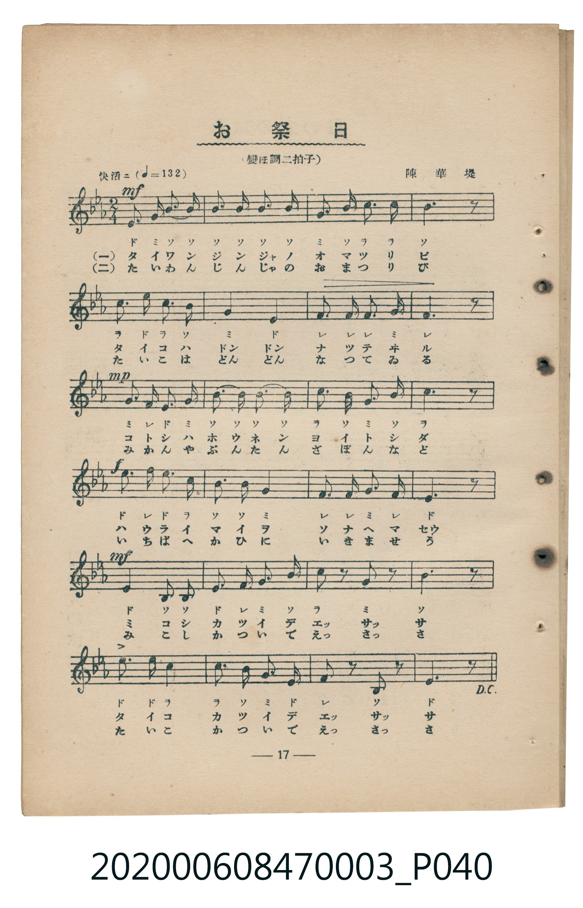
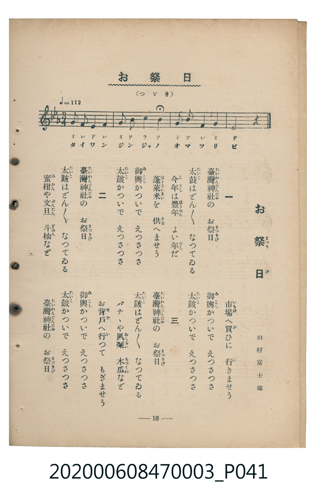

# お祭日（祭典之日）

> Re:Shōka 使用 AI 協助辨識與重建樂譜，可能會有錯誤。歡迎[回報](https://github.com/TMDLang/reshoka/issues)。

- **鋼琴伴奏版**：<br><audio controls src="omatsuribi.mp3"></audio>
- **NEUTRINO 歌聲合成版**：<br><audio controls src="omatsuribi_neutrino.mp3"></audio>

- 作詞：田村富士雄
- 作曲：陳華堤
- 臺灣教育會公認『新定兒童唱歌』尋常科第三學年用（第二學期・第4首）
- 國立臺灣歷史博物館典藏（典藏號：2020.006.0847.0003）

## 說明


- 出處：臺灣教育會公認、臺北新高堂發行《新定兒童唱歌》尋常科第三學年用（昭和6年／1931年），
第二學期第 4 首〈お祭日〉（祭典之日），原書第 17–18 頁（掃描檔 P040.jpg–P041.jpg）。
原發表於昭和 4 年（1929年）臺灣教育會《臺灣の歌》，後亦收錄於臺灣總督府編《公學校唱歌》第三學年用第八課。
- 詞曲：田村富士雄 作詞／陳華堤 作曲（日治時期臺灣本土音樂家陳華堤代表作之一）。
- 調性與拍號：變ホ調（Eb 大調），主歌 2/4 拍（速度標示「快活ニ != 132」），尾奏轉 3/4 拍（速度 != 112）。
- 背景與曲風：專為臺灣學童創作之臺灣在地題材唱歌，描寫秋季「臺灣神社」（たいわんじんじや，原址位於今臺北圓山）
大祭之熱鬧景象。歌詞融入濃厚的臺灣物產與臺語語彙：第一段獻上豐收的「蓬萊米（はうらいまい）」；
第二段到市場購買「蜜柑（みかん）、文旦（ぶんたん）、斗柚（ざぼん）」；第三段到屋後果園採摘
「香蕉（バナナ）、鳳梨（おんらい，臺語『旺來』音譯）、木瓜（もつくわ，臺語『木瓜』音譯）」，
並穿插抬神轎與抬太鼓「えつさつさ」的吆喝聲。全曲三段唱畢（原譜 P040 末尾標示 D.C.）後，接 P041 轉為
3/4 拍（!= 112）的 4 小節莊重尾奏「たいわんじんじやのおまつりび」。
- 版本說明：本檔案為原書單聲部五線譜（附移動 Do 階名片假名）之忠實數位化版本。

### 編曲說明（鋼琴伴奏版）：

1. 前奏 (Intro, 4 小節)：引用第六段「太鼓かついで、えつさつさ」的頓音與節奏動機熱鬧開場。
2. 主歌伴奏 (Omatsuribi, 24 小節 × 3 段)：右手演奏充滿附點彈性的祭典旋律，
左手以太鼓般的低音與和弦節奏支撐，並在「えつさつさ」處與右手齊奏斷音呼應。
3. 尾奏 (Coda, 4 小節)：三段歌詞唱畢後，依原譜轉為 3/4 拍（!= 112），以寬廣莊重的三拍子和聲收束全曲。


## 歌詞

```text
一　臺灣神社（たいわんじんじや）の　お祭日（まつりび）
太鼓（たいこ）はどん／＼　なつてゐる
今年（ことし）は豐年（ほうねん）　よい年（とし）だ
蓬萊米（はうらいまい）を　供（そな）へませう
御輿（みこし）かついで　えつさつさ
太鼓（たいこ）かついで　えつさつさ

二　臺灣神社（たいわんじんじや）の　お祭日（まつりび）
太鼓（たいこ）はどん／＼　なつてゐる
蜜柑（みかん）や文旦（ぶんたん）　斗柚（ざぼん）など
市場（いちば）へ買（か）ひに　行（い）きませう
御輿（みこし）かついで　えつさつさ
太鼓（たいこ）かついで　えつさつさ

三　臺灣神社（たいわんじんじや）の　お祭日（まつりび）
太鼓（たいこ）はどん／＼　なつてゐる
バナナや鳳梨（おんらい）　木瓜（もつくわ）など
お背戶（せど）へ行（い）つて　もぎませう
御輿（みこし）かついで　えつさつさ
太鼓（たいこ）かついで　えつさつさ
臺灣神社（たいわんじんじや）の　お祭日（まつりび）
```

## ABC

<div class="abc-score" data-abc-src="omatsuribi.abc" aria-label="五線譜載入中"></div>

[下載 ABC 原始檔](omatsuribi.abc)

## TMD 檔案連結

- [主旋律 TMD 檔案](omatsuribi.tmd) [[在 TMD Studio 編輯](https://tmdlang.github.io/Tmd-TS/#tmd=s7IKdvYPcrWy4qpTUCpJTLdSSM7PyUlNLsnMz7MqzsjMK0nNjM_KTMmPL87Iz05Ugisry88pzU21Si9KTEmNN443MjAyiDcwMIs3sDAxBzIMjBFKi_NLi5JTrYqTM_Lzc-JLUitKkvLzs9Hl4wsS01OtAgxMDBAyBUX5Zal5iXlA3QVFILekgLUjFKSWZaakgqSLkxPz4stSizLTMlNTkFyZWlQM9gnEipKixLzi5KLMApD3EKryi0oy8oE-KciotMrILC7JL8pMTsyJz07MQ_JwSUYq0L9pqcUlmWWJOciaM9Mz86xKEjPLgU7IT0vLTM4EyWtpKTxu7Hq-dO2z6Uvf7-kAMp627niysxvM7VTQ0uJStFUwNDbisrdVcNXhsjHSN7EDGfpk75wXK-e93zPr-ZQNz-ZOfLq-5-ni1S9nt4BtBEo-m70JKPly5uYX_eufLlgCFn7Rvut54-JnU2e-aNr0bE7z09Y1L1b1Pm7oezZtw9N1s562Tnq-eunTKRufre153ND_dEP30x07ni-f-HzNmic7Op-u3fF055bnU1aAHAkU2dUDFHk2Z_7j5t1ArsnLZdOAzgXb8nRO9_PV3VC71m5_2r_pae-s550rXy5ZAfTai-n9QBMgjBcz5wPdCEoTesA0oQdKE0CGgTHYJC59LQVbagEuBQWFxw0TgIHyfPa6F6tWPZvR97hhIli0effT9l0vZk4FugRH-DQCxZ_2TAeG0svVM54uaHo-c8-LhcAg6sIWbt14wu3ZjLVPJ_WYAfnv9_QbWhobglmd7_f0gFyioIAcrkC2gokCMFgfN3TAE8jjBqBi9DQC1P60b_6z2TtAWgzNHzVMNrRQeLmgEWRhX_Oz_v5nq6YogDKMXlZBOlAWyDQEMYFaHzc0QWwGGgD21Ypn0_ZAXAm0HOy6DkNLI0uIO9GCBxgAEJHHjesgXge5ZF_Pk13Lnk3Z9rKnBWgWRMHzHXufz138dNec59tXAHUBwxXkxwUL4WGGFlRA7tPW1S9WbYK6DxhHwLQOSdFoyV0Blg_64UkdJARW2wEMn2ebdj-b2QQMT6jj56x5Omf-y_mbn61oerpuG1zPk92LgZ4HagSG6pMdDYigAVm9av-zhuUvOtqfdfdCUuyLdV2Pm2cDxYF2uCYpPF2yHMwGxcSTHbuBXlIA5lIFoHKg_MuG-U-BAbJi5vMlux439Dzdv_rZlt2Pm7sVINn6cQNQETgKN-x7urT_xd5OBWM0vWCVhkaobmrueTZzPchNsze9XARMW7Oebuh43rQL4ktgQIJSZOdWiIeggnNWPJ2z4eXCnmdzJ0ACHmgrMHU8Xb_6-fLup2sXA10Hja6l854v2Qd2GTDpzX_c2PK4qf9x0-THjTNgZAsk0T2d2_Bkby8wnp_sBqUFYCZ5Omfy040bgW6Fpqsly4GpFeiG520bX65ZDnLzxoVAbwBtB8bai3m9T1uXPtvf_LRv1vNZLVDbO1c-n7II6DUg98WqeUD0dO9MUMSD0kjDs3Vbn_fufrKj68XGCcBUBtQFcvbkNS8mdD3fuBns4PWPG9seN3WCnN24D0iCAw7ol9nImQxoztOODU93ND1dsOXF5j0vNm0HmTNnzrP5E8GG7H_c2A30LFhv47Np7c-mLwOLbwOHwHwkqenP5s8CS0173LgHJg6yDpKooRZt7AbmjGfz5jydM-lZ38JnE2dAHAO09OWymS-mgrL14-YJj5uBCasLYvLLzZufgWIWlPtBloJ9BAx2SLCASu3pu57sawOW1MDk_GLteqh75qx4PnkOSFdT0-PGJY8bgREHLHCRdIEVoOoCuhZaAj3Zsez5yv3P-ic961oDTAYv9vaB0ljXmqdLVr3cMxno2seNQPcAjZ0KJRt6gVHwdELb02lzXzSC8uvT1hXANAn1-JSNz6cuAhX3ffNfrJ0DLoQUns1ZDUzrkAyh4KLnrAd0AjBsQImxbylIiaECMBcA0zLERYjcAM8GQBtBpdOG_ufrG170db1s74VkHrDzsCdXYBEFCkZQeljyuAnI2Ax0OSI7Pe_sAJYMkHoBmNSAbGCZ-WwhKEdBitan09YBvfeyecWTXVOeb58F9Awoe85seb5899PuqQou-QovZ_U9ndD7vLP9aWM7kAF0JjDVP92_4On6Zc-m7gDmkqc90yDWgKyF1kcQwyGZARRw09qBwf1kx1oQA5j0164HVlKg4NvQ-6y9E0cZDjYLmDMeNzQgZ1-8eReYlNYB1SM3PJDDBpp9IZGOMKgRnLZB-WslOJ0D09UesCmrwIlh2eOmCY-busHO2d0FqTyAeh43rnjcOB2iE5hpYeK7Qbm0cS0swzQ8bgIKtsBk4VoWgIwjnL-bJgGNeLJvNljBXKCLwJp3gBXMBqoHe2ffwhd7QEU2OHcD3QWxoRvseKBZy8F-QUneeEKBkDagBkgUwtsVkHgBJl7U-rsHYsHTSbNACFhCz9__tAFYCfU-bQRm0yZIUD6bAQ07YBZ_unQvkPG0bQ2outnXBi0OYUH0dALQQU3ALPti63ZIDgZZMWP_04nLICSwZILIwjyGIgvUC09Tu4BV8-BJU9gL5yZgKwNX4dyAvXAGGb0S7BZw6Q-WBjpk4ePGDZBUA6wMwILA9gyQu-lx42pQOCwEFlEglWDB3mGQsiABCq_eQAU9NLyArZgGUALp2w2tIDdtfzp7HjCtUTFx7QBF0KBJXPC6F2gbjooXnKCw165IaQqoB9Q269gG1g9MICuhaQol-YAtB5V5QFP6BjApUTn8qZUyIU0ieBsIlDKhAd-D1pYCJlFgW-rJjm6qJE48boYmXaAnKe-MQoGClj4Xl39uYklxaVFmUqZVQGZiXr5DjUFNNbjlY2NopmUHZmHrCIObseDmsIIGrC2kA28hgGQVgO2ohT2aWLQC7QUZW6NQnZtWC1SmC4TGCqZg2hQoDGMhRIyhLDMwbQZXA4EGQFwDNtLHsAaYA-aDRYEpSQGYlCDspslAPcDEBOeBE1YzVOE6sGQXlLcPiJdAFXaBZTYjWRaPsMyInpYZ08ky_DEO7rjgjHEjgjEOiUDDOCgDEbdAQShdAzQGRBtBaWO4CMHYbpwMZa8Hew5U6EI1oXBAcqugwkuAeBk0SCaAZJq6sYc_emTT0i70uKaRXQQyN6gHhTOqjYnI3AW10Mg1gmdybJkblhRgmRwmgj26YUGxAoinowTLbiivDYjXQr0OzhxNHUhBuQLKng7WswB7BIAjez9UZTfYHIh5LWBd2-Cmw6MJmg2nQfXsQegBRgk40rDbBIrq5gkQlc1dYIxsE4wHtKmpE-4LkJ-aoDxQRINaAQQswxvXT2fPxhfXJoTjGlSOx4GtM4qDsRDFNCxukTM3LGXUwDM-ttheD_UWME5R_Q8sy-Bx2jQJbjqw8wUPCGCrB8reB5YBNXGwRwI4ulugihcC8QYoewdYIyTnAFviQLwaySqYjl4k58wGy-CwB5yvYYXxbHg8weyBmYfIu2B74FHdR4Q9BIrvKfji2ZSUChsYqyAbwQQsDmGxCsvDoNgEiYBjFW-VDclrII-Bcg0kZyMHPShIYMGzHCwDbP8thvoa3KSEcUByU7EHP1KuprFN4IimtU34s3TrWnxRbQaKah3w8BdKhCOiGpqJ4VU1yBWoJbUhNDeD4hKcDCDRjC87Y9ZptIpmutiEo56mrk21XFzO-SmJGM1zC4Kt82ZwCoCMTcIHLMEJATx2hyWnI6WAakVb4GhnrUK1DXAE1K4WmiqMoXU5KN5BPEiTHJSzITyQOCh1IJIBUhKAhBai9QqpIkGiM1BbrqB2K0QCWCPCW62gNitEFNZqhQeQrp0CoiOjAOSBQgxEK3MBAA)]
- [鋼琴伴奏 TMD 檔案](omatsuribi_piano.tmd) [[在 TMD Studio 編輯](https://tmdlang.github.io/Tmd-TS/#tmd=s7IKdvYPcrWy4qpTUCpJTLdSyC8qychPL0osyKi0ysgsLskvykxOzInPTsxLVIIrKs4vLUpOjS9ITE-1CjAwMdAFEoZKXFpaCo8bu54vXfts-tL3ezqAjKetO57s7AZyHzfvftm95_mELU_2bHm6tP95Z8f7PZ0KWlpcirYKhsZGXPa2Cq46XDZG-iZ2IFue7J3zYuW893tmPZ-y4dnciU_X9zxdvPrl7BawE4CSz2ZvAkq-nLn5Rf_6pwuWgIVftO963rj42dSZL5o2PZvT_LR1zYtVvY8b-p5N2_B03aynrZOer176dMrGZ2t7Hjf0P93Q_XTHjufLJz5fs-bJjs6na3c83bnl-ZQVIGcDRXb1AEWezZkPdDaQa_Jy2TSgc8G2PJ3T_Xx1N9Sutduf9m962jvreefKl0tWAD37Yno_0AQI48XM-UA3GhkYGegZGJjpGViYmAMZBsZgk7j0tRRsqQW4FBQUHjdMAAbK89nrXqxa9WxG3-OGiWDR5t1P23e9mDkV6BIc4dMIFH_aMx0YSi9Xz3i6oOn5zD0vFgKDqAtbuHXjCbdnM9Y-ndRjBuS_39NvaGlsCGZ1vt_TA3KJggJyuALZCiYKwGB93NABTzKPG4CKUVINRPvTvvnPZu8AaTE0f9Qw2dBC4eWCRpCFfc3P-vufrZqiAEqDelkF6UBZUEoEMYFaHzc0QcMAmJYgKQYtOSnA0lk_PCmBhIBqkfSu2v-sYfmLjvZn3b2QKH2xrutx82ygONANrkkKT5csB7NBTn2yYzcwnBSAyVgBqBwoD0neUH9s2AdM-i_2dioYo8gbguQRFj7fvgLoAEg0AlVgZhugEyAhaqin8LSzFyiuoOGZV1KUrwMM06cb-p-vb9AEqnm6ZyowYoDB9rR17bN1Wx839DxdsurlnsmPG7sfNy553NjyuHE5MPofNwJjAMidCiUbep_Panm5YPLL-ZuBngaaBTT_affUZyvnP2_b-HLN8pfTup8u2AJ1roKCkZ4CxNMQFypo-OcmlhSXFmUmZeooGMHco3B4uoKxAtAVYIf1b37W2f1szxSQya2tz3bvfzmz5eXueU_3dgBDGmg7JAk8m979dF83PPkAwdPty4Aan-xeCvHIi441QMVP9vZBnApMfE_3LIM4-NmU9c8mTQBHyLKnc1YA_Y7pTWCuAOkCO-bl3i6QrmnbgUY9nbjnWTssPhQUjIGBDI44BQ3n_JRE1DAGZgGgp4C-B6YiYB55PnXR0309IGv3zQWm2hdr5wBj-3nTLmwRDlIF9Mn6NU93L37R1_WyHRTuIPO6e5-unQD0zIvGTc-mbHs2d_7TVlCCgDqI8tICChS09Lm4wMnGKiAzMS8_yMOhxqCmGuxpG0MzLTswq0bBME5BFwiBlBmYoQsUg7BMgVEKlgKKGAFpA5BYPJQB1AhVDoJgEa5aFAt9kC20gNtnEq8QbRILo-B8QyBlCOIbxQNNA1pjALICIgjCQC7IfETqw-crbIUvuHza0QCMTgUNWBTrwEsWkCzQR8CSUROLVmBQQhxfnZtWC_W4MTB8IKFUA2chRCAhZwoNSTO4GuTgAhnpY1gDrFPng0WBWVbhcVM_hN00GajnceMMOA_IftzUDFW4DizZBeXtA-IlUIVdYJnNSJaBYgxqmRE9LTOmk2X4Y3xXD74YNyIY45AIhOcORNyC8gUsv4Byhy6QhNDGcBGCsd04GcpeD_bcSlBwQDShcEByq6DCS4B4GdwEoExTN_bwR49sWtqFHtc0sotA5gaV1Tij2piIzF1QC41cI3gmx5a5UYtHhAj26IYFxQogno4SLLuhvDYgXgthQzJHUwdSUK6AsqeD9SzAHgHgyN4PVdkNNgdiHjgoG7fBTYdHEzQbToPq2YPQA4wScKRhtwkU1c0TICqbu8AY2SYYD2hTUyfcFyA_NUF5i8EuxG8T3oh-Ons2vog2IRzRoEIcUu0ZxcFYiDIaFrHIORuWLLBVe4ioXg_1FjBCUT0PLMjgEdo0CW7648a58IB43LgDyt4Hlpn-uKkdZBLu6G6Bql8IxBug7B1gvbDg3QTEq5Fsg-noRXIRyB6wJA6rwFkbVh7PhscWzCqYkYjsC7YKHtt9xFlFoBCfgi_CTUmptqFNGDABi0xY9MJyMihaQSKQdg6-ihuS40B-A-UdSP5GjgBQqMBCaDlYBthKXQz1NbixCuOA5KZijwGkvE1jm8BxTWub8OdtcF8GZ1SbgaJaR8FFz1kPJcIRUU3F5iy-GptW0UwXm3DU1tS1CUtjHWuPgNi2Ot4MDu0oAKMT0onAwYd3OhDyoH4FSS1IvO5A79xA7YF3bkzjgSxTkMUQGiQCFSDCJWgNHIpCBL3bZQZkmOXGgmiCDkGvgCkMElgAQAIEIU9E1KDWC8QGCLI9yAFiALWVlEhBL7BICgsi-r7QcADmJtDoBJZOLywfVSvaAgceahWqbYCDEXa1UBuNoU1ZUIEH4kF6pKAqDcIDiYOKRUT5h1T2QYoJROcN0kIEic5A7biBum0QCWCDEN5pA3XZIKKwThu8ZED4BaVMMMHrF0SMQdjAkEOkbWB0oSR0aKDp2imAhyQUgAxEcRTtA1SBJmKEIWIMFgE5FUQrcwEA)]

## 分析

```text
================================================================================
📊 TMD Song Profile: [ お祭日（祭典之日） ]
================================================================================
⏱  Duration:       0:28 (28.2s), 28 measures total
🎼 Key & Tempo:    首調基準 E,, != 132.0 BPM, <2/4>
   - 分析範圍：      由實際發聲的音符與和弦推測調性；播放脈絡另行呈現
🎤 人聲音域:    A#3 (MIDI 58) – F5 (MIDI 77) [跨度: 19 個半音 / 1.6 個八度, 難度: challenging]
   - 最低音:  A#3 in [Omatsuribi #1 @ m.17, 0:15]
   - 最高音: F5 in [Omatsuribi #1 @ m.13, 0:11]
   - 適合: soprano, mezzo-soprano, contralto, tenor, baritone, bass
🏛  結構:      Omatsuribi (21.8s) -> Coda (6.4s)
⚡ 編曲密度:        Peak 1 軌道同時演奏
🗝  調性診斷：       D# 大調（純淨自然大調，未偵測到可信轉調）
   - 風格氣質:    純淨自然大調（陽光明朗、易唱易記，無明顯調外色彩）
   - 轉調歷程:    全曲維持單一推測調性（未偵測到可信轉調）
   - 核心骨幹音:  A#, D#, G, C, F
   - 調性數值:    D# 大調 [相關度: 0.86, 穩定度: Moderate, 自然音純度: 100.0%]
   - 候選調性 (K-S): D# 大調 (0.86), A# 大調 (0.76), G 小調 (0.64)
   - 五度圈歷程:   -3 -> -3
   - 各段落調性細節:
     • [Omatsuribi #1]: D# 大調 (r: 0.86, 自然音純度: 100.0%)
     • [Coda #1]: D# 大調 (r: 0.81, 自然音純度: 100.0%)

  [ 五度圈游移軌跡 ]
               C  
         F            G  
      Bb               D  
     [Eb]*              A  
         Ab           E  
            Db       B  
               F# 
     (* = active key center)

  [ 十二半音累積音高分佈 ]
     C  : ██████████████            15.3%
     C# :                            0.0%
     D  :                            0.0%
     D# : ███████████████████████   24.5%
     E  :                            0.0%
     F  : ██████████████            15.3%
     F# :                            0.0%
     G  : ██████████████████        19.0%
     G# :                            0.0%
     A  :                            0.0%
     A# : ████████████████████████  25.9%
     B  :                            0.0%
--------------------------------------------------------------------------------
Assignment 軌道音域：
  - Piano         : A#3 – F5 (19 個半音 / 1.6 個八度, 82 個音符)
================================================================================
```


## 原書掃描頁






