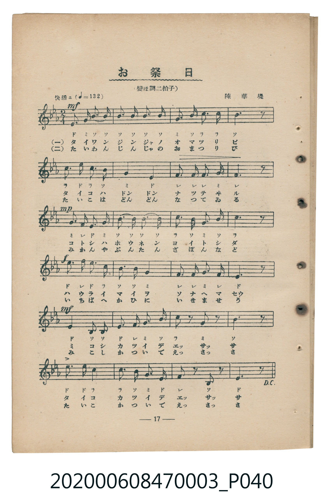
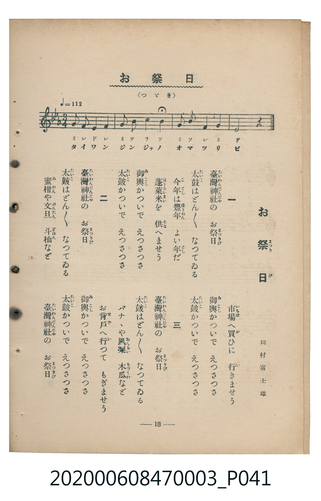

# お祭日（祭典之日）

> Re:Shōka 使用 AI 協助辨識與重建樂譜，可能會有錯誤。歡迎回報。

- **NEUTRINO 歌聲合成版**：<br><audio controls src="omatsuribi_neutrino.mp3"></audio>
- **鋼琴伴奏版**：<br><audio controls src="omatsuribi.mp3"></audio>


- 臺灣教育會公認『新定兒童唱歌』尋常科第三學年用（第二學期・第4首）
- 國立臺灣歷史博物館典藏（典藏號：2020.006.0847.0003）

## 說明


- 出處：臺灣教育會公認、臺北新高堂發行《新定兒童唱歌》尋常科第三學年用（昭和6年／1931年），
第二學期第 4 首〈お祭日〉（祭典之日），原書第 17–18 頁（掃描檔 P040.jpg–P041.jpg）。
亦收錄於臺灣總督府編《公學校唱歌》第三學年用第八課。
- 詞曲：田村富士雄 作詞／陳華堤 作曲（日治時期臺灣本土音樂家陳華堤代表作之一）。
- 調性與拍號：變ホ調（Eb 大調），主歌 2/4 拍（速度標示「快活ニ != 132」），尾奏轉 3/4 拍（速度 != 112）。
- 背景與曲風：專為臺灣學童創作之臺灣在地題材唱歌，描寫秋季「臺灣神社」（たいわんじんじや，原址位於今臺北圓山）
大祭之熱鬧景象。歌詞融入濃厚的臺灣物產與臺語語彙：第一段獻上豐收的「蓬萊米（ほうらいまい）」；
第二段到市場購買「蜜柑（みかん）、文旦（ぶんたん）、斗柚（ざぼん）」；第三段到屋後果園採摘
「香蕉（バナナ）、鳳梨（おんらい，臺語『旺來』音譯）、木瓜（もつくわ，臺語『木瓜』音譯）」，
並穿插抬神轎與抬太鼓「えつさつさ」的吆喝聲。全曲三段唱畢（原譜標示 D.C.）後，設有一段 4 小節轉為
3/4 拍（!= 112）的莊重尾奏「たいわんじんじやのおまつりび」。
- 版本說明：本檔案為原書單聲部五線譜（附移動 Do 階名片假名）之忠實數位化版本。

### 編曲說明（鋼琴伴奏版）：

1. 前奏 (Intro, 4 小節)：引用第六段「太鼓かついで、えつさつさ」的頓音與節奏動機熱鬧開場。
2. 主歌伴奏 (Omatsuribi, 24 小節 × 3 段)：右手演奏充滿附點彈性的祭典旋律，
左手以太鼓般的低音與和弦節奏支撐，並在「えつさつさ」處與右手齊奏斷音呼應。
3. 尾奏 (Coda, 4 小節)：三段歌詞唱畢後，依原譜轉為 3/4 拍（!= 112），以寬廣莊重的三拍子和聲收束全曲。


## 跨冊／重複收錄參照

> 同曲＋同詞異曲（田村富士雄作詞；《公學校唱歌》與《新定兒童唱歌》第三學年為同曲，《臺灣の歌》為昭和4年御大典記念陳華提原創譜曲版）

- **[同曲]** 《公學校唱歌》第三學年（昭和10年／1935）：[**〈おまつり日（祭典之日）〉**](../../../kogakko_shoka/grade_3/8_omatsuribi/index.md)（`Eb` / `2/4` — [原始 TMD](../../../kogakko_shoka/grade_3/8_omatsuribi/omatsuribi.tmd)）
- **[同詞異曲]** 《臺灣の歌》（昭和4年／1929，國臺圖 0786 8）：[**〈お祭日〉**](../../../taiwan_no_uta/2_omatsuribi/index.md)（`E,` / `2/4` — [原始 TMD](../../../taiwan_no_uta/2_omatsuribi/omatsuribi.tmd)）
- 總表：[跨冊重複與同名歌曲總索引](../../../duplicate_songs.md)

## 歌詞

```text
一　臺灣神社（たいわんじんじや）の　お祭日（まつりび）
太鼓（たいこ）はどんどん　なつてゐる
今年（ことし）は豐年（ほうねん）　よい年（とし）だ
蓬萊米（ほうらいまい）を　供（そな）へませう
御輿（みこし）かついで　えつさつさ
太鼓（たいこ）かついで　えつさつさ

二　臺灣神社（たいわんじんじや）の　お祭日（まつりび）
太鼓（たいこ）はどんどん　なつてゐる
蜜柑（みかん）や文旦（ぶんたん）　斗柚（ざぼん）など
市場（いちば）へ買（か）ひに　行（い）きませう
御輿（みこし）かついで　えつさつさ
太鼓（たいこ）かついで　えつさつさ

三　臺灣神社（たいわんじんじや）の　お祭日（まつりび）
太鼓（たいこ）はどんどん　なつてゐる
バナナや鳳梨（おんらい）　木瓜（もつくわ）など
お背戶（せど）へ行（い）つて　もぎませう
御輿（みこし）かついで　えつさつさ
太鼓（たいこ）かついで　えつさつさ
臺灣神社（たいわんじんじや）の　お祭日（まつりび）
```

## ABC

```abc
X:1
T:お祭日（祭典之日）
M:2/4
L:1/16
Q:1/4=132
K:Eb
V:V1 name="Piano" snm="Pia"
[V:V1]
!mf! E3 G B3 B | B3 B B3 B | G3 B c3 c | B6 z2 |
w: 1.~た い わ ん | じ ん じゃ の | お ま つ り | び
w: 2.~た い わ ん | じ ん じゃ の | お ま つ り | び
w: 3.~た い わ ん | じ ん じゃ の | お ま つ り | び
c3 e c3 B | G4 E4 | F3 F F3 G | F6 z2 |
w: 1.~た い こ は | どん どん | な つ て ゐ | る
w: 2.~た い こ は | どん どん | な つ て ゐ | る
w: 3.~た い こ は | どん どん | な つ て ゐ | る
!mp! G3 F E3 G | B3 B B3 B | c3 B G3 B | c6 z2 |
w: 1.~こ と し は | ほ う ね ん | よ い と し | だ
w: 2.~み か ん や | ぶ ん た ん | ざ ぼ ん な | ど
w: 3.~バ ナ ナ や | お ん ら い | も つ くわ な | ど
!f! e3 f e3 c | B3 B G4 | F3 F G3 F | E6 z2 |
w: 1.~ほ う ら い | ま い を | そ な へ ま | せう
w: 2.~い ち ば へ | か ひ に | い き ま せ | う
w: 3.~お せ ど へ | い つ て | も ぎ ま せ | う
!mf! G4 E2 E2 | G3 A B3 e | c2 z2 B2 z2 | B6 z2 |
w: 1.~み こ し | か つ い で | えっ さっ | さ
w: 2.~み こ し | か つ い で | えっ さっ | さ
w: 3.~み こ し | か つ い で | えっ さっ | さ
e3 e c4 | c3 B G3 F | F2 z2 B,2 z2 | E6 z2 |
w: 1.~た い こ | か つ い で | えっ さっ | さ
w: 2.~た い こ | か つ い で | えっ さっ | さ
w: 3.~た い こ | か つ い で | えっ さっ | さ
[M:3/4] [Q:1/4=112] G2 F2 E4 F4 | G2 B2 c4 B4 | G2 B2 F4 G4 | E8 z4 |
w: 1.~_ _ _ _ | _ _ _ _ | _ _ _ _ | _
w: 2.~_ _ _ _ | _ _ _ _ | _ _ _ _ | _
w: 3.~た い わ ん | じ ん じゃ の | お ま つ り | び
```

## TMD 檔案連結

- [主旋律 TMD 檔案](omatsuribi.tmd) [[在 TMD Studio 編輯](https://tmdlang.github.io/Tmd-TS/#tmd=s7IKdvYPcrWy4qpTUCpJTLdSSM7PyUlNLsnMz7MqzsjMK0nNjM_KTMmPL87Iz05Ugisry88pzU21Si9KTEmNN443MjAyiDcwMIs3sDAxBzIMjBFKi_NLi5JTrYqTM_Lzc-JLUitKkvLzsxHyBUX5Zal5iXlANQVFIBtTwIoQClLLMlNSQdKpKZkl-UWZiTlI7kgtKga7FWxJfElRYl5xclFmAcgDCFUlGalAx6alFpdkloF0a2kpPG7ser507bPpS9_v6QAynrbueLKzG8ztVNDS4lK0VTA0NuKyt1VwTeKyMdI3sQMZ9qJ91_PGxc-mznzRtOnZnOanrWterOp93ND3bNqGp-tmPW2d9Hz10qdTNj5b2_O4of_phu6nO3Y8Xz7x-Zo1T3Z0Pl274-nOLc-nrABZCBTZ1QMUeTZn_uPm3UCuyctl04BWg538dE7389XdULvWbn_av-lp76znnStfLlkBdOaL6f1AEyCMFzPnv98zCxT4esDA1wMFPpBhYAw2iUtfS8GWWoBLQUHhccOEZ7M3PZ-97sWqVc9m9D1umAgWbd79tH3Xi5lTgS7BET6NQPGnPdOBofRy9YynC5qez9zzYiEwiLqwhVs3nnB7NmPt00k9ZkD--z39hpbGhmBW5_s9PSCXKCgghyuQrWCiAAzWxw0d8Mh-3ABUjB7fQO1P--Y_m70DpMXQ_FHDZEMLhZcLGkEW9jU_6-9_tmqKQoCBiYFeVkE6UBbINAQxgVofNzRBbH6ya9mzKdte9rQ8m7YHEgrPd-x9Pnfx011znm9fAfQqMCxA7lqwEO5PNO8BuU9bV79YtQlqJjBcX6ycBwxwYLg-n7Lh2dyJT9f3PF28-uXsFoUne-cA5YBh8HLm5hf9658uWAISAqvtAPrp2abdz2Y2AcMAGh9z1jydM__l_M3PVjQ9XbcNrufJ7sUvFq4AagSGxJMdDQjvgKxetf9Zw_IXHe3PunshqezFuq7HzbOB4kA7XJMUni5ZDmaDQu_Jjt1ALykAc4kCUDlQ_mXD_KfAAFkx8_mSXY8bep7uX_1sy-7Hzd0KkGz1uAGoCBzsG_Y9Xdr_Ym-ngjGaXrBKQyNUNzX3PJu5HuSm2ZteLgKmh1lPN3Q8b9oF8SUwIEGpqHMrxENQwTkrns7Z8HJhz7O5EyABD7QVGKNP169-vrz76drFQNdBo2vpvOdL9oFdBkwu8x83tjxu6n_cNPlx4wwY2QJJKE_nNjzZ2wuM5ye7uyAJ--mcyU83bgS6FZIWgEEDTGFANzxv2_hyzXKQmzcuBHoDaDsw1l7M633auvTZ_uanfbOez2qB2t658vmURUCvAbkvVs0Doqd7Z4IiHpRGGp6t2_q8d_eTHV0vNk4ApjKgLpCzJ695MaHr-cbNYAfvftzY9ripE-Tsxn1AEhxwQL_MRs4YQHOedmx4uqPp6YItLzbvebFpO8icOXOezZ8INmT_48ZuoGfBehufTWt_Nn0ZWHwbOATmI0lNfzZ_Flhq2uPGPTBxkHWQRA21aGP30309z-bNeTpn0rO-hc8mzoA4Bmjpy2UzX0wFZcXHzRMeNwMTVhfE5JebNz8DxSwox4IsBfsIGOyQYAGVtNN3PdnXBixdgcn5xdr1UPfMWfF88hyQrqamx41LHjcCIw5YSCLpAitA1QV0LbTUeLJj2fOV-5_1T3rWtQaYDF7s7QOlsa41T5eserlnMtC1jxuB7gEaOxVKNvQCo-DphLan0-a-aATl16etK4BpEurxKRufT10EKqL75r9YOweSCRRc9Jz1gNYCwwPkrhVrn83phEQssIx6uqH_-foGYC4ApmWIixC5AZ4NQEmlr-tley8kz4BdhT2VPm5cBwo9UDJY8rgJyNgMdDAiFz3v7AAWCJAiHJjCgGxg8fZsISgjQUrBp9PWAX31snnFk11Tnm-fBfQDKFfObHm-fPfT7qkKLvkKL2f1PZ3Q-7yz_WljO5ABdB0wsT_dv-Dp-mXPpu4AZo6nPdMg1oCshVYdEMMheQAUXtPagaH8ZMdaEAOY4teuB9YnoFDb0PusvRNHcQs2CxhujxsakHMt3iwLTEHrgOqR63vksIHmWkhcIwxqBCfpxvWPG1eCzQKTIFNWgdPAssdNEx43dYOds7sLXAsBdQLVrXjcOB2iE5hXYeLgzNm4FpZPGh43AQVbYLJwLQtAxhHO1k2TgEY82TcbrGAu0EVgzTvACmYD1YO9s2_hiz2gkhqcqYHugtjQDXY80KzlYL-gpGo8oUBIG1ADJArhTQBIvADTLGpV2wOx4OmkWSAELJjn73_aAKx7ep82AnNnEyQon82Ahh0wZz9duhfIeNq2BlTL7GuDloKwIHo6AeigJmBOfbF1OyTjgqyYsf_pxGUQElggQWRhHkORBeqFp6ldwBp58KQp7GVyE7BxgatMbsBeJoOMXgl2C7jQB0sDHbLwceMGSKoB1gFgwW4wd9PjxtWgcFgILKVAKsGCvcMgZUECFF6rgcp3aHgBGy8NoATStxtaL27a_nT2PGBao2Li2gGKoEGTuOBVLtA2HPUtOEFhr1SR0hRQD6hJ1rENrB-YQFZC0xRK8gFbDirzgKb0DWBSonL4UytlQlpC8KYPKGVCA74HrQkFTKLAJtSTHd1USZx43AxNukBPUt5vhAIFLX0uLv_cxJLi0qLMpEyrgMzEvHyHGoOaanCDx8ZCyw7MwNZlBTdeIW0lDVhjSQfeQADJKhgqANOcJhatQGuhxgJNsFJ43LQflG6blgAzwXpwVtisUAPk74CygazHzYuBzD6w8Cqw8DwgbgGzVoFEmyeDm2gggGT6rh6g6Y3zwbmiBai1H2zPZJCGxhlQNjiBNQOpdWDhLrDifUC8BKygCyy6Gd30GoXq3LRaBQ1DBV0gNNZU1dDV1VTQMAVzTaHcGnQBTHljVHkzMNcMLg9Rb6BQA7bUxxCoA-QfkCDQR0ANID-BeU2TweaB_AXng3ggv0GUr4Mq6ILy94EVLIEq7wLJgjwK4sbDLDSit4XGdLQQf9oGd8xwpm0j0tN2EygRPW7uByfXTlDCBnGhDJAYOOkBE_Xj5jYwawNYdDURCbsRlPqB1QzYg6A6BsyFMkBi4DwDDAlgqQ92zgRwTurGTNXQFGgYh5oiESkWlGBBiR6o1AgsZQRTCeHCskINMIgIpV2gsyG89ZCoATsYxIcywDpWQdUsAetYBo3MCWAdQB8QSq5UtwNLCqWmHQQKXFBfFmeiNCY6UULSXgeQtR0pUc4Gp41lQFYvWBRcDDevgCVgoHoQaztYtAF3sgSn-MZucOkK0tACDpRtYDaovAUnW2gpPA2sdg9MLTCUwAGImTCrcwuAxS2kuIQnOdTSl4jiFjU1o5W-NQoQabQkC4vcFeCIm44c1UD-bii_DSy7Fhqt0KKqqQMlmayA8qZDkskCbIl3P1RNN7jog9rdBNQPlt2GMB-RCOEF4zSo3j3IehtXQRMllmTcPAGiphlYNgJ50HITbhuMD7atqRPhF7DfmlASNKgdistCvGn66ezZ-NK0CbFpGin1gpIPKMWC0uk8eOrdBE5QoNy2F5y6u4AY3AgAqgGJ7gZpxpGkwS2NxoVAvAHM2gH2Iaj8BHbPgBhSSIPEICp7QbUPmDUbLAoq0NETNLj5EAdJ0PDiFiqAaAGgpWFQisUselGzRQ24gMZIxygpFT02ga6F84FjGRBbgAMZiCgF8nZAecB6FeQpUI8BWxJugSpbCNa0AcrbAbUIUtQBgw1oETDcoBbB9PSC9cAcMxtiEZotkBIYVskD1QB5kMSGsAVmHjBxQgpblCTbh98WAg2DKfjSqynR6RVUDILSJqiBCyqFQWkQlI7ATQBgigWx2sGiKx43N4OVboUwQGJb0VMUavkLSnqgsnY6NFlCkiqoAQBJoMvBosAu1GIwF9gjAzFAYlOxJFVQUxdS8RuCAhKS3ExQS1l4kwFUjBoAwwGY_LC0XyElHMxxKCkCUpDAYm45JFbAToyHOREYO2Anoqc6GpgKTGXUNRV_Kdi6Fl-qMiOzuUnFVIXa2KRCqoKVdfCEA6p9cdXRiLLNCJS44sGpC2sxh9Qyg9Td1EpjNDMbo0VJHbMJtCSbwekNMm8Bn-4AJzvwuD6WxIaa3oA6IekNteMOSUc70DvuEOFVaB13SL8Ho-terWgLnF6pVai2AU652NVC04sxMOpBMQ6q-0A8U3CCAZUwEB5IHFI9QtIFKGUAefC0EQ-GoLABqcHPg-gH8-DxT5F-cGkyH5KBwA0lWM8A1J1FGoYAxe46qASwgQIdiAApB9V3IFFI_xVmeC0Xl66dAmIMB2wbUESZCwA)]
- [鋼琴伴奏 TMD 檔案](omatsuribi_piano.tmd) [[在 TMD Studio 編輯](https://tmdlang.github.io/Tmd-TS/#tmd=s7IKdvYPcrWy4tLSUnjc2PV86dpn05e-39MBZDxt3fFkZzeQ-7h598vuPc8nbHmyZ8vTpf3POzve7-lU0NLiUrRVMDQ24rK3VXBN4rIx0jex46pTUHrRvut54-JnU2e-aNr0bE7z09Y1L1b1Pm7oezZtw9N1s562Tnq-eunTKRufre153ND_dEP30x07ni-f-HzNmic7Op-u3fF055bnU1aAnAAU2dUDFHk2Zz7QCUCuyctl04BWK4FseTqn-_nqbqhda7c_7d_0tHfW886VL5esADr8xfR-oAkQxouZ89_vmWVkYGSgZ2BgpmdgYWIOZBgYg03i0tdSsKUW4FJQUHjcMOHZ7E3PZ697sWrVsxl9jxsmgkWbdz9t3_Vi5lSgS3CETyNQ_GnPdGAovVw94-mCpucz97xYCAyiLmzh1o0n3J7NWPt0Uo8ZkP9-T7-hpbEhmNX5fk8PyCUKCsjhCmQrmCgAg_VxQwc8-h83ABWjpACI9qd985_N3gHSYmj-qGGyoYXCywWNIAv7mp_19z9bNUUhwMDEQC-rIB0oC2QagphArY8bmqBh8GLlPGDgAMPg-ZQNz-ZOfLq-5-ni1S9ntyg82TsHKAd078uZm1_0r3-6YAlICKgWSe-q_c8alr_oaH_W3QuJ0hfruh43zwaKA93gmqTwdMlyMBvk1Cc7dgPDSQGYJBWAyoHykKQK9ceGfcBk_GJvp4IxirwhSB5h4fPtK4AOgEQjUAVmFgA6ARKihnoKTzt7geIKGp55JUX5OsAwfbqh__n6Bk2gmqd7pgIjBhhsT1vXPlu39XFDz9Mlq17umfy4sftx45LHjS2PG5cDo_9xIzAGgNypULKh9_mslpcLJr-cvxnoaaBZQPOfdk99tnL-87aNL9csfzmt--mCLVDnKigY6SlAPA1xoYKGf25iSXFpUWZSpo6CEcw9CoenKxgrAF0Bdlj_5med3c_2TAGZ3Nr6bPf-lzNbXu6e93RvBzCkgbZDksCz6d1P93XDkw8QPN2-DKjxye6lEI-86FgDVPxkbx_EqcDE93TPMoiDn01Z_2zSBHCELHs6ZwXQ75jeBOYKkC6wY17u7QLpmrYdaNTTiXuetcPiQ0HBGBjI4IhT0HDOT0lEDWNgFgB6Cuh7YCoC5pHnUxc93dcDsnbfXGCqfbF2DjC2nzftwhbhIFVAn6xf83T34hd9XS_bQeEOMq-79-naCUDPvGjc9GzKtmdz5z9tBSUIqIMoLy2gQEFLn4sLnGysAjIT8_KDPBxqDGqqwZ62sdCyAzNqFDQM4xR0gdAwTlNVQ1dXU8EMyAEKgyhdBVOooIYxmGsE5dYoGCkYKJjGA4kaBUOwFJDFVYtioQ92C03iFaJNYmEUUDuQYRirYAakzHJBAkYgY2FmQyRBGGoBIvnh9VZ1blot0G9gpxnDPGGK4iegJ1EFMOUhvobLQ8LEDC4PUQ9yGMhSH0OgjseN88GCwOwH1PC4qR_Ca5oMNu9x4wwEH8R73NQMVb4OqqALyt8HVrAEqrwLJPu4cTOYGw-z0IjeFhrT0UKwjdhqUWhFA8yXChqwvKoDryJAssDUCaziNLFoBeYJqLFPdjRYAa3dDyqTm5YA8WZw6dwPckVz5-NmCBfKAIl1gQVagLgNzNoAFl0NK7uQjd7VAzQaGExAZY1ADY2Twaz1YA-uBIYMmAtlgMRWgQWAjmhcBnbOBJBoUze60fBcCc-raLm0BlgGA2WBGKjUCCwFy7FQLiwrgDIwobQLdDaEtx4SNWAHg_hQBljHKqiaJWAdy6CROQGsA-gDQsmV6nZgSaHUtAN_ogRXFjgTpTHRiRKS9jqArO1IiXI2OG0sA7J6waKbwaIrYAkYqB7E2g4WbcCdLMEpvrEblEPBGlrAgbINzJ4MS7ZAFkh0GljtHphaYCiBAxAzYVbnFgCLW9RKAq30JaK4xVrnIOQh0mhJFha5K8ARNx05qoH83VB-G1h2LTRaoUVVUwdKMlkB5U2HJJMF2BLvfqiabnDRB7W7CagfLLsNYT4iEcILxmlQvXuQ9TaugiZKLMm4eQJETTOwbATyoOUm3DYYH2xbUyfCL2C_NaEk6H54OY1pId40_XT2bHxp2oTYNI2UekHJB5RiQel0Hjz1bgInKFBu2wtO3V1APAPMmgcW3Q3SjCNJt4AT50Ig3gBm7QD7EFR-Pm7cBMSQQhokBlHZC6p9wKzZYFFQgY6eoMHNB0jTyAhe3EIFEC0AtDQMSrGYRS962wnRYEJKxygpFT02ga6F8x83TYLY8rhxLiJKgbwdUB6wXgV5ajbIX1iScAtU2UKwpg1Q3g6oRZCiDhhsQIuA4Qa1CKanF6wH5pjZEIvQbIGUwLBKHqgGyIMkNoQtMPOAiRNS2KIk2T78thBoGEzBl15NiU6voGIQlDY3Q0thUBoEpSNwEwCYYkGsdrDoisfNzWClWyEMkNhW9BSFWv6Ckh6orJ0OTZaQpApqAEAS6HKwKLBDsxjMBfZpQAyQ2FQsSRXU1IVU_IaggIQkNxPUUhbeZAAVo8DmNbh1jdl-hZRwMMehpAhIQQKLueWQWAE7MR7mRGDsgJ2InupoYCowlVHXVPylILiHjTNVmZHZ3KRiqkJtbFIhVVGzXwhLXagtM0jdTa00RjOzMVqU1DEbS1cWa4cZd2OzASVJ4kl-8G40MGJAFE4-ep8cEpGk9cTwuoOYvn-0EZAFo4FlFJBlSqRT0NrfFAUJ1I1QYWCpCXUjkCboEPRGE2VhgggBEAVXAKSIiBzU2pDSEDGA2kpKrKCXnRQnEPTBIWhAADMUaPwOz6hQtaItcGiuVqHaBjhcZ1cLtdIYWGaBiipQow3EMwWXdKCqEcIDiUPadZACDVSkAXmQwgGUp-dDCl5wAxvWowQNg0C6U9ABEODwB1QC2LAFtm0gAx_AYQ-oKGTcA1Q0gMxG8QvWYgG7X4BBoQsOE6AHwCZBRYBhCROHCoGlQVGIUASWhvgNaL-unQJ4LE8ByEAUVNE-IFWoIkYYIsZgEZAPQLQyFwA)]

## 分析

```text
================================================================================
📊 TMD Song Profile: [ お祭日（祭典之日） ]
================================================================================
⏱  Duration:       0:28 (28.2s), 28 measures total
🎼 Key & Tempo:    首調基準 E,, != 132.0 BPM, <2/4>
   - 分析範圍：      由實際發聲的音符與和弦推測調性；播放脈絡另行呈現
🎤 人聲音域:    A#3 (MIDI 58) – F5 (MIDI 77) [跨度: 19 個半音 / 1.6 個八度, 難度: challenging]
   - 最低音:  A#3 in [Omatsuribi #1 @ m.23, 0:20]
   - 最高音: F5 in [Omatsuribi #1 @ m.13, 0:11]
   - 適合: soprano, mezzo-soprano, contralto, tenor, baritone, bass
🏛  結構:      Omatsuribi (28.2s)
⚡ 編曲密度:        Peak 1 軌道同時演奏
🗝  調性診斷：       D# 大調（純淨自然大調，未偵測到可信轉調）
   - 風格氣質:    純淨自然大調（陽光明朗、易唱易記，無明顯調外色彩）
   - 轉調歷程:    全曲維持單一推測調性（未偵測到可信轉調）
   - 核心骨幹音:  A#, D#, G, C, F
   - 調性數值:    D# 大調 [相關度: 0.85, 穩定度: Moderate, 自然音純度: 100.0%]
   - 候選調性 (K-S): D# 大調 (0.85), A# 大調 (0.76), G 小調 (0.66)
   - 五度圈歷程:   -3
   - 各段落調性細節:
     • [Omatsuribi #1]: D# 大調 (r: 0.85, 自然音純度: 100.0%)

  [ 五度圈游移軌跡 ]
               C  
         F            G  
      Bb               D  
     [Eb]*              A  
         Ab           E  
            Db       B  
               F# 
     (* = active key center)

  [ 十二半音累積音高分佈 ]
     C  : ██████████████            15.3%
     C# :                            0.0%
     D  :                            0.0%
     D# : █████████████████████     23.1%
     E  :                            0.0%
     F  : ██████████████            15.3%
     F# :                            0.0%
     G  : ██████████████████        19.9%
     G# :                            0.5%
     A  :                            0.0%
     A# : ████████████████████████  25.9%
     B  :                            0.0%
--------------------------------------------------------------------------------
Assignment 軌道音域：
  - Piano         : A#3 – F5 (19 個半音 / 1.6 個八度, 82 個音符)
================================================================================
```


## 原書掃描頁






