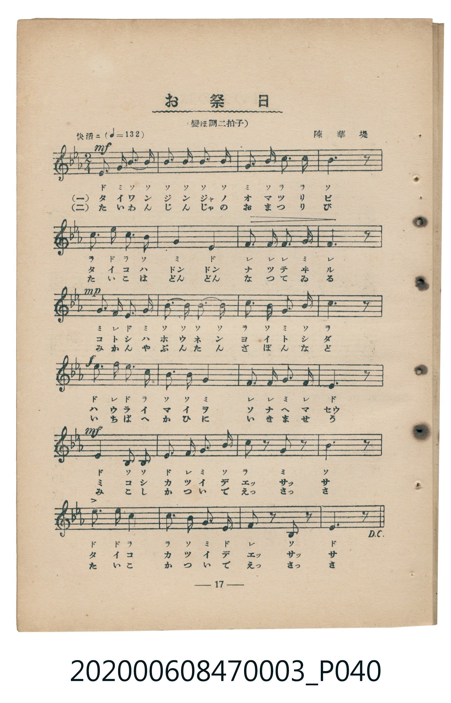
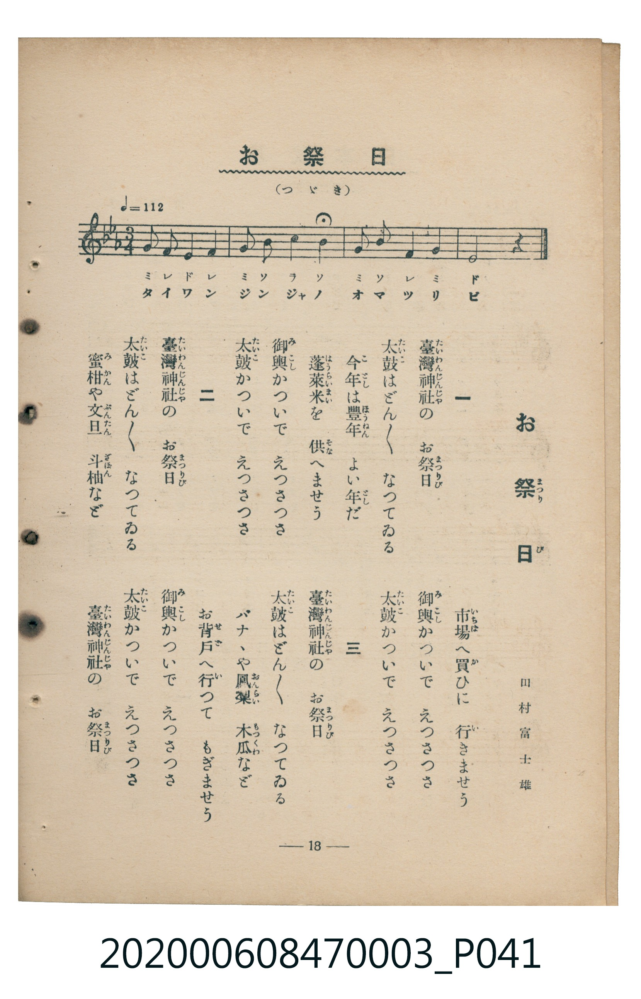

# お祭日（祭典之日）

<audio controls src="omatsuribi.mp3"></audio>

- 臺灣教育會公認『新定兒童唱歌』尋常科第三學年用（第二學期・第4首）
- 國立臺灣歷史博物館典藏（典藏號：2020.006.0847.0003）

## 說明

【曲目說明】
・出處：臺灣教育會公認、臺北新高堂發行《新定兒童唱歌》尋常科第三學年用（昭和6年／1931年），
第二學期第 4 首〈お祭日〉（祭典之日），原書第 17–18 頁（掃描檔 P040.jpg–P041.jpg）。
亦收錄於臺灣總督府編《公學校唱歌》第三學年用第八課。
・詞曲：田村富士雄 作詞／陳華堤 作曲（日治時期臺灣本土音樂家陳華堤代表作之一）。
・調性與拍號：變ホ調（Eb 大調），主歌 2/4 拍（速度標示「快活ニ != 132」），尾奏轉 3/4 拍（速度 != 112）。
・背景與曲風：專為臺灣學童創作之臺灣在地題材唱歌，描寫秋季「臺灣神社」（たいわんじんじや，原址位於今臺北圓山）
大祭之熱鬧景象。歌詞融入濃厚的臺灣物產與臺語語彙：第一段獻上豐收的「蓬萊米（ほうらいまい）」；
第二段到市場購買「蜜柑（みかん）、文旦（ぶんたん）、斗柚（ざぼん）」；第三段到屋後果園採摘
「香蕉（バナナ）、鳳梨（おんらい，臺語『旺來』音譯）、木瓜（もつくわ，臺語『木瓜』音譯）」，
並穿插抬神轎與抬太鼓「えつさつさ」的吆喝聲。全曲三段唱畢（原譜標示 D.C.）後，設有一段 4 小節轉為
3/4 拍（!= 112）的莊重尾奏「たいわんじんじやのおまつりび」。
・版本說明：本檔案為原書單聲部五線譜（附移動 Do 階名片假名）之忠實數位化版本。

・編曲說明（鋼琴伴奏版）：
1. 前奏 (Intro, 4 小節)：引用第六段「太鼓かついで、えつさつさ」的頓音與節奏動機熱鬧開場。
2. 主歌伴奏 (Omatsuribi, 24 小節 × 3 段)：右手演奏充滿附點彈性的祭典旋律，
左手以太鼓般的低音與和弦節奏支撐，並在「えつさつさ」處與右手齊奏斷音呼應。
3. 尾奏 (Coda, 4 小節)：三段歌詞唱畢後，依原譜轉為 3/4 拍（!= 112），以寬廣莊重的三拍子和聲收束全曲。

## 歌詞

```text
一　臺灣神社（たいわんじんじや）の　お祭日（まつりび）
太鼓（たいこ）はどんどん　なつてゐる
今年（ことし）は豐年（ほうねん）　よい年（とし）だ
蓬萊米（ほうらいまい）を　供（そな）へませう
御輿（みこし）かついで　えつさつさ
太鼓（たいこ）かついで　えつさつさ

二　臺灣神社（たいわんじんじや）の　お祭日（まつりび）
太鼓（たいこ）はどんどん　なつてゐる
蜜柑（みかん）や文旦（ぶんたん）　斗柚（ざぼん）など
市場（いちば）へ買（か）ひに　行（い）きませう
御輿（みこし）かついで　えつさつさ
太鼓（たいこ）かついで　えつさつさ

三　臺灣神社（たいわんじんじや）の　お祭日（まつりび）
太鼓（たいこ）はどんどん　なつてゐる
バナナや鳳梨（おんらい）　木瓜（もつくわ）など
お背戶（せど）へ行（い）つて　もぎませう
御輿（みこし）かついで　えつさつさ
太鼓（たいこ）かついで　えつさつさ
臺灣神社（たいわんじんじや）の　お祭日（まつりび）
```

## 原書掃描頁





## 分析

```text
================================================================================
📊 TMD Song Profile: [ お祭日（祭典之日） ]
================================================================================
⏱  Duration:       0:28 (28.2s), 28 measures total
🎼 Key & Tempo:    首調基準 E,, != 132.0 BPM, <2/4>
   - 分析範圍：      由實際發聲的音符與和弦推測調性；播放脈絡另行呈現
🎤 人聲音域:    A#3 (MIDI 58) – F5 (MIDI 77) [跨度: 19 個半音 / 1.6 個八度, 難度: challenging]
   - 最低音:  A#3 in [Omatsuribi #1 @ m.23, 0:20]
   - 最高音: F5 in [Omatsuribi #1 @ m.13, 0:11]
   - 適合: soprano, mezzo-soprano, contralto, tenor, baritone, bass
🏛  結構:      Omatsuribi (28.2s)
⚡ 編曲密度:        Peak 1 軌道同時演奏
🗝  調性診斷：       D# 大調（純淨自然大調，未偵測到可信轉調）
   - 風格氣質:    純淨自然大調（陽光明朗、易唱易記，無明顯調外色彩）
   - 轉調歷程:    全曲維持單一推測調性（未偵測到可信轉調）
   - 核心骨幹音:  A#, D#, G, C, F
   - 調性數值:    D# 大調 [相關度: 0.85, 穩定度: Moderate, 自然音純度: 100.0%]
   - 候選調性 (K-S): D# 大調 (0.85), A# 大調 (0.76), G 小調 (0.66)
   - 五度圈歷程:   -3
   - 各段落調性細節:
     • [Omatsuribi #1]: D# 大調 (r: 0.85, 自然音純度: 100.0%)

  [ 五度圈游移軌跡 ]
               C  
         F            G  
      Bb               D  
     [Eb]*              A  
         Ab           E  
            Db       B  
               F# 
     (* = active key center)

  [ 十二半音累積音高分佈 ]
     C  : ██████████████            15.3%
     C# :                            0.0%
     D  :                            0.0%
     D# : █████████████████████     23.1%
     E  :                            0.0%
     F  : ██████████████            15.3%
     F# :                            0.0%
     G  : ██████████████████        19.9%
     G# :                            0.5%
     A  :                            0.0%
     A# : ████████████████████████  25.9%
     B  :                            0.0%
--------------------------------------------------------------------------------
Assignment 軌道音域：
  - Piano         : A#3 – F5 (19 個半音 / 1.6 個八度, 82 個音符)
================================================================================
```

## ABC

```abc
X:1
T:お祭日（祭典之日）
C:TMD (Chen, Chih-Han / aguai)
M:2/4
L:1/16
Q:1/4=132
K:Eb

V:V1 name="Piano" snm="Pia"

[V:V1]
e3 g b3 b | b3 b b3 b | g3 b c3 c | b6 z2 |
c3 e c3 b | g4 e4 | f3 f f3 g | f6 z2 |
g3 f e3 g | b3 b b3 b | c3 b g3 b | c6 z2 |
e3 f e3 c | b3 b g4 | f3 f g3 f | e6 z2 |
g4 e2 e2 | g3 a b3 e | c2 z2 b2 z2 | b6 z2 |
e3 e c4 | c3 b g3 f | f2 z2 B2 z2 | e6 z2 |
M:3/4 Q:1/4=112 g2 f2 e4 f4 | g2 b2 c4 b4 | g2 b2 f4 g4 | e8 z4 |
```

- [主旋律 TMD 檔案](omatsuribi.tmd)
- [鋼琴伴奏 TMD 檔案](omatsuribi_piano.tmd)
