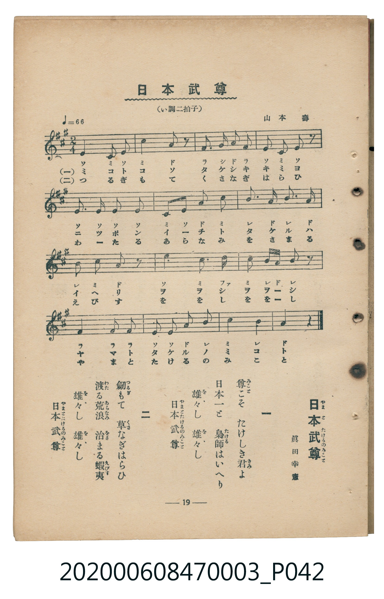

# 日本武尊

<audio controls src="yamato_takeru_no_mikoto.mp3"></audio>

- 臺灣教育會公認『新定兒童唱歌』尋常科第三學年用（第二學期・第5首）
- 國立臺灣歷史博物館典藏（典藏號：2020.006.0847.0003）

## 說明

【曲目說明】
・出處：臺灣教育會公認、臺北新高堂發行《新定兒童唱歌》尋常科第三學年用（昭和6年／1931年），
第二學期第 5 首〈日本武尊〉（やまとたけるのみこと），原書第 19 頁（掃描檔 P042.jpg）。
・詞曲：眞田幸憲 作詞／山本壽 作曲。
・調性與拍號：イ調（A 大調），2/4 拍，速度 != 66。
・背景與曲風：歌頌日本古代傳說英雄日本武尊（倭建命）平定熊襲（梟帥）與東征蝦夷、草薙劍除難的事蹟。
・版本說明：本檔案為原書單聲部五線譜（附移動 Do 階名片假名）之忠實數位化版本。

・編曲說明（鋼琴伴奏版）：
1. 前奏 (Intro, 4 小節)：引用第四段「日本武尊」莊重宏偉的終止樂句開場。
2. 主歌伴奏 (YamatoTakeruNoMikoto, 16 小節 × 2 段)：右手演奏莊嚴旋律，左手以厚實的八分音符和聲支撐。

## 歌詞

```text
一　尊（みこと）こそ　たけしき君（きみ）よ
日本一と　梟帥（たける）はいへり
雄々（をゝ）し　雄々（をゝ）し
日本武尊（やまとたけるのみこと）

二　劍（つるぎ）もて　草（くさ）なぎはらひ
渡（わた）る荒浪（あらなみ）　治（をさ）まる蝦夷（えびす）
雄々（をゝ）し　雄々（をゝ）し
日本武尊（やまとたけるのみこと）
```

## ABC

```abc
X:1
T:日本武尊
C:TMD (Chen, Chih-Han / aguai)
M:2/4
L:1/16
Q:1/4=66
K:A
V:V1 name="Piano" snm="Pia"
[V:V1]
e4 c2 e2 | c4 a2 z2 | f2 g2 a2 f2 | e2 c2 e2 z2 |
e4 e2 e2 | e4 c2 e2 | a2 c2 b3 a | b2 a2 b2 a2 |
b2 c2 a2 z2 | e4 c2 z2 | d2 c2 b2 a2 | b4 g2 z2 |
f4 f2 f2 | e2 e2 a2 b2 | c4 b4 | a6 z2 |
```

## TMD 檔案連結

- [主旋律 TMD 檔案](yamato_takeru_no_mikoto.tmd)
- [鋼琴伴奏 TMD 檔案](yamato_takeru_no_mikoto_piano.tmd)

## 分析

```text
================================================================================
📊 TMD Song Profile: [ 日本武尊 ]
================================================================================
⏱  Duration:       0:29 (29.1s), 16 measures total
🎼 Key & Tempo:    首調基準 A, != 66.0 BPM, <2/4>
   - 分析範圍：      由實際發聲的音符與和弦推測調性；播放脈絡另行呈現
🎤 人聲音域:    C#4 (MIDI 61) – D5 (MIDI 74) [跨度: 13 個半音 / 1.1 個八度, 難度: moderate]
   - 最低音:  C#4 in [YamatoTakeruNoMikoto #1 @ m.1, 0:00]
   - 最高音: D5 in [YamatoTakeruNoMikoto #1 @ m.11, 0:18]
   - 適合: soprano, mezzo-soprano, contralto, tenor, baritone, bass
🏛  結構:      YamatoTakeruNoMikoto (29.1s)
⚡ 編曲密度:        Peak 1 軌道同時演奏
🗝  調性診斷：       E 大調（純淨自然大調，未偵測到可信轉調）
   - 風格氣質:    純淨自然大調（陽光明朗、易唱易記，無明顯調外色彩）
   - 轉調歷程:    全曲維持單一推測調性（未偵測到可信轉調）
   - 核心骨幹音:  E, A, C#, B, F#
   - 調性數值:    E 大調 [相關度: 0.86, 穩定度: Moderate, 自然音純度: 98.3%]
   - 候選調性 (K-S): E 大調 (0.86), A 大調 (0.83), C# 小調 (0.70)
   - 五度圈歷程:   +4
   - 各段落調性細節:
     • [YamatoTakeruNoMikoto #1]: E 大調 (r: 0.86, 自然音純度: 98.3%, 調外音: D)

  [ 五度圈游移軌跡 ]
               C  
         F            G  
      Bb               D  
      Eb               A  
         Ab          [E ]*
            Db       B  
               F# 
     (* = active key center)

  [ 十二半音累積音高分佈 ]
     C  :                            0.0%
     C# : █████████████████         19.0%
     D  : ██                         1.7%
     D# :                            0.0%
     E  : ████████████████████████  27.6%
     F  :                            0.0%
     F# : █████████                 10.3%
     G  :                            0.0%
     G# : ███                        3.4%
     A  : █████████████████         19.8%
     A# :                            0.0%
     B  : ████████████████          18.1%
--------------------------------------------------------------------------------
Assignment 軌道音域：
  - Piano         : C#4 – D5 (13 個半音 / 1.1 個八度, 47 個音符)
================================================================================
```


## 原書掃描頁




