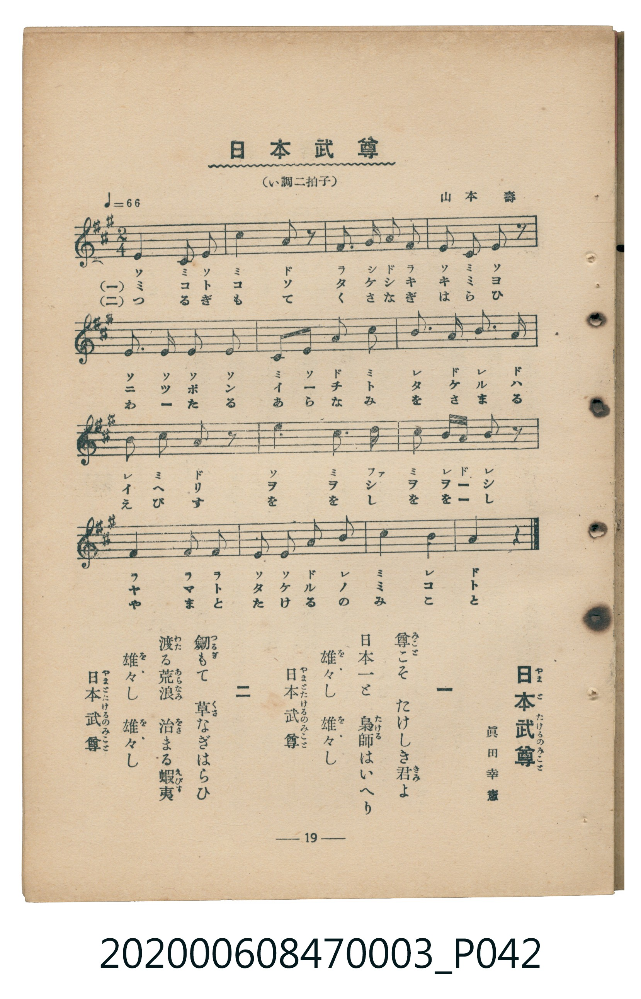

# 日本武尊

> Re:Shōka 使用 AI 協助辨識與重建樂譜，可能會有錯誤。歡迎回報。

- **NEUTRINO 歌聲合成版**：<br><audio controls src="yamato_takeru_no_mikoto_neutrino.mp3"></audio>
- **鋼琴伴奏版**：<br><audio controls src="yamato_takeru_no_mikoto.mp3"></audio>


- 臺灣教育會公認『新定兒童唱歌』尋常科第三學年用（第二學期・第5首）
- 國立臺灣歷史博物館典藏（典藏號：2020.006.0847.0003）

## 說明


- 出處：臺灣教育會公認、臺北新高堂發行《新定兒童唱歌》尋常科第三學年用（昭和6年／1931年），
第二學期第 5 首〈日本武尊〉（やまとたけるのみこと），原書第 19 頁（掃描檔 P042.jpg）。
- 詞曲：眞田幸憲 作詞／山本壽 作曲。
- 調性與拍號：イ調（A 大調），2/4 拍，速度 != 66。
- 背景與曲風：歌頌日本古代傳說英雄日本武尊（倭建命）平定熊襲（梟帥）與東征蝦夷、草薙劍除難的事蹟。
- 版本說明：本檔案為原書單聲部五線譜（附移動 Do 階名片假名）之忠實數位化版本。

### 編曲說明（鋼琴伴奏版）：

1. 前奏 (Intro, 4 小節)：引用第四段「日本武尊」莊重宏偉的終止樂句開場。
2. 主歌伴奏 (YamatoTakeruNoMikoto, 14 小節 × 2 段)：右手演奏莊嚴旋律，左手以低音區沉穩的八分音符和聲支撐。


## 跨冊／重複收錄參照

> 同名異曲（各冊收錄之不同詞曲版本）

- **[同名異曲]** 《共益商社唱歌教科書》卷四・教師用（明治33年／1900）：[**〈日本武尊〉**](../../../kyoeki_shoka/kan_4_854865/10_yamato_takeru_no_mikoto/index.md)（`C` / `6/8` — [原始 TMD](../../../kyoeki_shoka/kan_4_854865/10_yamato_takeru_no_mikoto/yamato_takeru_no_mikoto.tmd)）
- 總表：[跨冊重複與同名歌曲總索引](../../../duplicate_songs.md)

## 歌詞

```text
一　尊（みこと）こそ　たけしき君（きみ）よ
日本一と　梟帥（たける）はいへり
雄々（をゝ）し　雄々（をゝ）し
日本武尊（やまとたけるのみこと）

二　劍（つるぎ）もて　草（くさ）なぎはらひ
渡（わた）る荒浪（あらなみ）　治（をさ）まる蝦夷（えびす）
雄々（をゝ）し　雄々（をゝ）し
日本武尊（やまとたけるのみこと）
```

## ABC

```abc
X:1
T:日本武尊
M:2/4
L:1/16
Q:1/4=66
K:A
V:V1 name="Piano" snm="Pia"
[V:V1]
E4 C2 E2 | c4 A2 z2 | F3 G A2 F2 | E2 C2 E2 z2 |
w: 1.~み こ と | こ そ | た け し き | き み よ
w: 2.~つ る ぎ | も て | く さ な ぎ | は ら ひ
E3 E E2 E2 | C2 E2 A2 c2 | B3 A B3 A | B2 c2 A2 z2 |
w: 1.~に つ ぽ ん | い _ ち と | た け る は | い へ り
w: 2.~わ _ た る | あ ら な み | を さ ま る | え び す
e4 c3 d | c2 B A B2 z2 | F4 F2 F2 | E2 E2 A2 B2 |
w: 1.~を を し | を _ _ し | や ま と | た け る の
w: 2.~を を し | を _ _ し | や ま と | た け る の
c4 B4 | A4 z4 |
w: 1.~み こ | と
w: 2.~み こ | と
```

## TMD 檔案連結

- [主旋律 TMD 檔案](yamato_takeru_no_mikoto.tmd) [[在 TMD Studio 編輯](https://tmdlang.github.io/Tmd-TS/#tmd=s7IKdvYPcrWy4qpTUCpJTLdSSM7PyUlNLsnMz7MqzsjMK0nNjM_KTMmPL87Iz05Ugisry88pzU21Si9KTEmNN443MjAyiDcwMIs3sDAxBzIMjBFKi_NLi5JTrYqTM_Lzc-JLUitKkvLzsxHyBUX5Zal5iXlANQVFIBtTwIoQClLLMlNSQdKpKZkl-UWZiTlI7kgtKga7FWxJfElRYl5xclFmAcgDCFUlGalAx2ZkFgO1V6ILZ-YWpEIM1dJSeDZ96bM5a56tXfZ0Q5eClhaXoq2CmRmXva2CI5eNkb6JHUjvi_ZdzxsXP5s680XTpmdzmp-2rnmxqvdxQ9-zaRuerpv1tHXS89VLn07Z-Gxtz-OG_qcbup_u2PF8-cTna9Y82dH5dO2Opzu3PJ-y4v2eDpDIrh6gyLM58x837wZyTV8um_Z-TyfYhU_ndD9f3Q21a-32p_2bnvbOet658uWSFU9bd7yY3g80AcJ4MXP--z2zQFGgB4wCPVAUABkGxmCTuPS1FGypBbgUFBQeN0x4NnvT89nrXqxa9WxG3-OGiWDR5t1P23e9mDkV6BIc4dMIFH_aMx0YSi9Xz3i6oOn5zD0vFgKDqAtbuHXjCbdnM9Y-ndRjBuS_39NvaGlsCGZ1vt_TA3KJggJyuALZCqYKwGB93NCBHLePG4DqOx43tTxu3Pe4ccXjxvmPGyc-bup-3LjuceP-x42TgYIQM5_2zX82ewfIHENLhZcLGkEO6Gt-1t__bNUUhQADEyO9rIJ0oNLHDU3QgHixch4whIAB8XzOvOdTNjzdueNZ2yaFJ3vnACWALn66cSPQGU8X7wUJARUiaVy1_1nD8hcd7c-6eyGR-rhpCVAQaKWjwtMly8FMkJuAKVEBqAbIetkw_-muZQrgZIpkUHPPs5nrQQbN3vRyEdAjs4CB-nJBDyQEnvYvebJ78dOmzcAYfNG98eXsFuSQASWrhrVPd-96OnEv0LanOzcDI-d5W9eLpUAvdTxbNP_pjqVAcZDhczc-3df4Yu6yp0u2g6K3t_PFtJlPu3pfzlzycvbi57NanuzqfrFzPsJZzzs7gNZA0g3ITUArV015trDjedMuSCg_nbbuReOml80rnuya8nz7rBdr5wCtfDmz5fny3U-7pyq45Cu8nNX3dELv8872p43tQAbQIU92dj_dv-Dp-mXPpu54srf3ac80iDUga6HpFWI4MAiAEfC0dcWzae1A1z_ZsRbEWDXvxdr1wEQM8vaG3mftnchxCjbgyY6Gxw0NkJBBThtgxlygFDTxNE5_3Nj7dMJssLJeoEqQmqYOkBGQ8AUZBExqDQ2wQASqgyY7sHHrHzcCk-OOx01dID3AaHnc0ApOpJMeN80Fq5gO1IxVHGEJPBIJpm2QHqA6SAgAowOo7fnSec_nzH82Yz0wWTztbn_esvDZ-inAiAT66unaCU-nAs0FprjFEPc_2Tn_BTDbzmh71rQCqAViPTi3NrzfM_vpklkvd-0BOvbpYmDwNkK4QGOB7gMagpoVm-BBvQuY9RuASQgcNkvAbgamFGAwNj1uXAaUAqYxsFT_40ZgSQP0-SqgAlDINQHZm8ChsGMh2PNAFcAMBNTZ_aJ30rOtq8DamsDqgHrAcQOMiE27oQEJNW4fSD04QYPVA9Hmx40zoYFF9xh51tn9rKfx6fptwBB5Nm0NMF89b-543rj6ZXsfOCB6gJ592dj3bMu2ZzuXP9u86Nn-JaCgBudYiC9AmWPOBnKiA-gUyusLKFDQ0ufiikzMTSzJD0nMTi0q9cv3zczOL8m3CshMzMt3qDGoqQYX3TYWWnZgBrZKC1yu72h4tm6rgoaJwtMN_c_XN-jAcytIVsFQAVijaGLRCnQA1FigCVbAsmg-qGRo2gxkdSjUgFkg_l5w_QHi7wfijUC8HYjXgkXWgnU9bl4BVoNk4K4eoIGNS8AGdANZfWDlTSB-4zKYgY39QDwViFfBVDSuB6rqBNKbkA2sUTCNV9BVMI4H0TUKxkC2oYIBkKVhBhLXVTCP11TV0NXVBAoDRcDKIYqBisAm-BiCDN8PVApMV0C8AmzZZDB_rgJIiwYw_YHNAiZCTSAxHYh7wap6wTqBhRZIHcQ0I5D4EpBiFM-BNC-DmdYPNW0qyDRsHgSZhj9ed_Xgi1cjouO1G1zTtADxXEjAN0NidgmQ1QgV6QCL7AeTG8Eiq4EYGEFgVTOAeBVG_Db1g-MTmACAwQCJUXAMgz24CioCMXISWOVUsMg-aLB1ADEwsTXORMSzBjiidYFRB41QIB8S52DaEBj3QEVGYDWGUCVoXESEAyNhNTQSloAiYS_Q3slgF7SABRdCEwJq1GuAHAfhrYebBoxwoDgkSoF2wPwM8THMvyC_gtVNQkQ90Ox9EF5TN8g0Ahm5E1-EGxMd4aDc87h5D5QFSpzbwfkJmu-AojBZCL0HTQ1GRIOjD6QUzAJ5ezqygUBRmCySgUhq4BFsBPQFJO-aAgNFA5SVdRVMYFEHlATGJjgmNYFKUXMvMP027gDa0QXOYZBQRgrs6SD9IK4GNIqmo-VXRHIjRT_eCHs6eza-CDMhOsLABWXzPGg-RCprwbkQXHKAyllIiQxWgxFFLeAcBsxbwDQNiSKghsaJ0Ly2DpoXQYUeSB1IDTxSwKUokICVneCcZgQtaUG5qwbI1wVGB5CFiBCgjaBwg9iIyz5IgQsyAaRKFxikcDNAkUKBGbVcXLp2CtgqULDxQDllLgA)]
- [鋼琴伴奏 TMD 檔案](yamato_takeru_no_mikoto_piano.tmd) [[在 TMD Studio 編輯](https://tmdlang.github.io/Tmd-TS/#tmd=s7IKdvYPcrWy4tLSUng2femzOWuerV32dEPX-z0dL7v3PJ-w5cmeLU-X9j_v7Hi_p1NBS4tL0VbBzIzL3lbBkcvGSN_EjqtOQelF-67njYufTZ35omnTsznNT1vXvFjV-7ih79m0DU_XzXraOun56qVPp2x8trbncUP_0w3dT3fseL584vM1a57s6Hy6dsfTnVueT1kBtBEksqsHKPJszvzHzbuBXNOXy6YBLVYC2fJ0Tvfz1d1Qu9Zuf9q_6WnvrOedK18uWfG0dceL6f1AEyCMFzPnv98zy8jAyEDPwMBMz8DCxBzIMDAGm8Slr6VgSy3ApaCg8LhhwrPZm57PXvdi1apnM_oeN0wEizbvftq-68XMqUCX4AifRqD4057pwFB6uXrG0wVNz2fuebEQGERd2MKtG0-4PZux9umkHjMg__2efkNLY0Mwq_P9nh6QSxQUkMMVyFYwVQAG6-OGDuQIf9wAUv-0b_6z2TtAagwtFV4uaAQZ3tf8rL__2aopCgEGJkZ6WQXpQKMfNzRBPfli5Tyg74GefD5n3vMpG57u3PGsbZPCk71zgBJA1zzduBFoxdPFe0FCQIVIGlftf9aw_EVH-7PuXkiEPW5aAhQEWumo8HTJcjAT5CZgKlMAqgGyXjbMf7prmQI4CSIMer59BdBgSOBjTbZAoyHhYKin8LSzFyiuoOGZV1KUr6NgovB0Q__z9Q2aQDVP90wFBifQ709nz362buvjhh7U8Ol90df1sr336br-p42dz2e1PN_a9Gztomcrmp72L305rfvpgi1QNykoGOkpPNmxGxhvEGcoaEQm5iaW5IckZqcWlfrl-2Zm55cAbTeEWa9weLqCkQLQUrA7-jc_6-x-tmcKUCfQyqeztjyb3v10XzcoerYvA0o92b30yd6-l_M3P-1teLap8_nKlUDXPG1d_bSjDSj4fM0yYGJ40bjp2ZT1zyZNgLqJ8qQOBQpa-lxc4NCzCshMzMsP8nCoMaipBvvbxkLLDsyoUajOTatVMItX0AURQFSjYBoPQoZAf9YoGAPFjYC4BsjXVTAAsbhqUYz1wWVsQa2CSXy8QjSQiEViAU0CsQ2BTDMQA0jkQkQhgqYgQSCBohJuMbboweM9bCUIOJPtaADGoYIGLFp14FkGJAv0KzB7a2LRCgxSqLFAE6yAaXo-KGU3bQayOoDuBbFA_L3gtAXi7wfijUC8HYjXgkXWgnU9bl4BVoNk4K4eoIGNS8AGdANZfWDlTSB-4zKYgY39QDwViFfBVDSuB6rqBNKbkA2ExiswHnUVjMHxCYlLQ2BQ1ihogONbV8E8XlNVQ1dXEygMi3mIYqAisDE-hiAb9gOVPm6cDMQrwDZOBvPnKoC0aDxunA8263HjRE0gMR2Ie8GqesE6Hzd1gNRBTDMCiS8BKUbxIUjzMphp_VDTpoJMw-ZLkGn4I3dXDzhyjbFHrhHRkdsNLrZagHguJPSbIdG7BMhqhIp0gEX2g8mNYJHVQAyMJbCqGUC8CiOSm_rBkQpMBcBggEQrOJrBHlwFFYEYOQmscipYZB802DqAGJjiGmciIlsDHNG6wKiDRigkDwPjHJqXjUGKQBkZmASgStC4iAgHRsJqaCQsAUXCXqC9k8EuaAELLoQmBNSo1wA5DsJbDzcNGOFAcUiUAu2A-RniY5h_QX4Fq5uEiHqg2fsgvKZukGkEcnMnvgg3JjrCQVnocfMeKAuUOLeDMxU08wFFYbIQeg-aGoyIBkcfSCmYBfL2dGQDgaIwWSQDkdTAI9gI6AtI3jUFBgrQp6CwMYFFHVASGJvgmNQEKkXNvcD027gDaEcXOIdBQhkpsKeD9IO4GtAomo6WXxHJjRT9eCMMUm_jLH5NiI4wcGnZPA-aD5EKXHAuBJccoMIWUiyD1WBEUQs4hwHzFjBNQ6IIqKFxIjSvrYPmRVChB1IHUgOPFJJqTXiEAG0EhRvERlz2QQpckAkgVbrAIIWbAYoUCszAW4lircyJrUTxxBi0PQCvz8GVPIiBVMdDK_oaQq0GmDrSKgG8jkO0ObC2PmBNExwKSSuciHQIyHJQYGBxBHJLiWA4oGc1vNZTv72ma6cAbisqABnYkl20j2EsbjkjsJwyFwA)]

## 分析

```text
================================================================================
📊 TMD Song Profile: [ 日本武尊 ]
================================================================================
⏱  Duration:       0:25 (25.5s), 14 measures total
🎼 Key & Tempo:    首調基準 A, != 66.0 BPM, <2/4>
   - 分析範圍：      由實際發聲的音符與和弦推測調性；播放脈絡另行呈現
🎤 人聲音域:    C#4 (MIDI 61) – E5 (MIDI 76) [跨度: 15 個半音 / 1.2 個八度, 難度: moderate]
   - 最低音:  C#4 in [YamatoTakeruNoMikoto #1 @ m.1, 0:00]
   - 最高音: E5 in [YamatoTakeruNoMikoto #1 @ m.9, 0:14]
   - 適合: soprano, mezzo-soprano, contralto, tenor, baritone, bass
🏛  結構:      YamatoTakeruNoMikoto (25.5s)
⚡ 編曲密度:        Peak 1 軌道同時演奏
🗝  調性診斷：       E 調性不明確（純淨自然大調，未偵測到可信轉調）
   - 風格氣質:    純淨自然大調（陽光明朗、易唱易記，無明顯調外色彩）
   - 轉調歷程:    全曲維持單一推測調性（未偵測到可信轉調）
   - 核心骨幹音:  E, C#, A, B, F#
   - 調性數值:    E 調性不明確 [相關度: 0.80, 穩定度: Ambiguous, 自然音純度: 99.0%]
   - 候選調性 (K-S): E 大調 (0.80), A 大調 (0.78), C# 小調 (0.73)
   - 五度圈歷程:   +4
   - 各段落調性細節:
     • [YamatoTakeruNoMikoto #1]: E 調性不明確 (r: 0.80, 自然音純度: 99.0%, 調外音: D)

  [ 五度圈游移軌跡 ]
               C  
         F            G  
      Bb               D  
      Eb               A  
         Ab          [E ]*
            Db       B  
               F# 
     (* = active key center)

  [ 十二半音累積音高分佈 ]
     C  :                            0.0%
     C# : ████████████████████      23.0%
     D  : █                          1.0%
     D# :                            0.0%
     E  : ████████████████████████  28.0%
     F  :                            0.0%
     F# : ███████████               13.0%
     G  :                            0.0%
     G# : █                          1.0%
     A  : ███████████████           17.0%
     A# :                            0.0%
     B  : ███████████████           17.0%
--------------------------------------------------------------------------------
Assignment 軌道音域：
  - Piano         : C#4 – E5 (15 個半音 / 1.2 個八度, 44 個音符)
================================================================================
```


## 原書掃描頁




