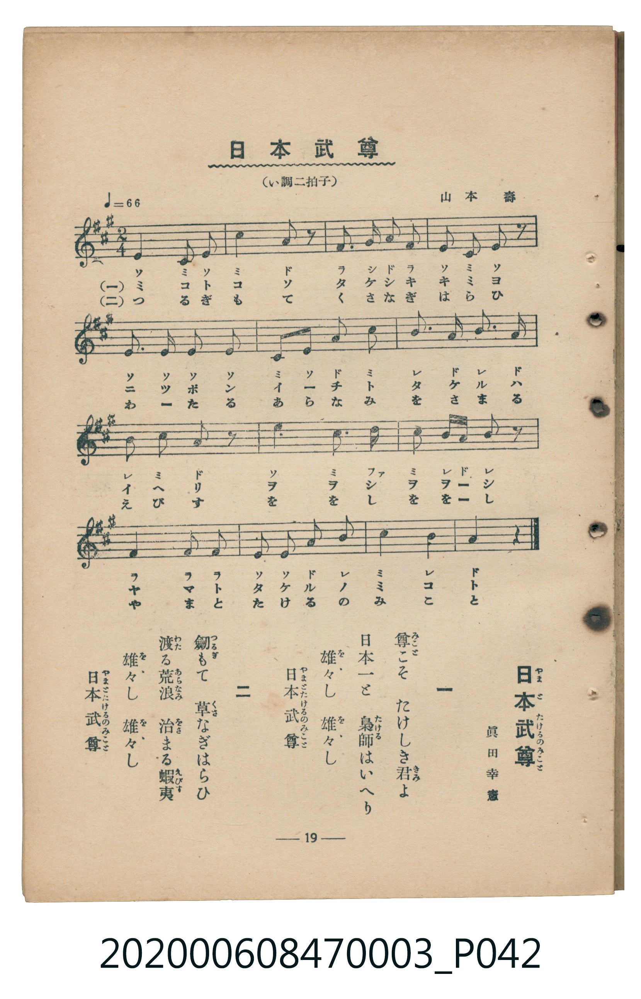

# 日本武尊

> Re:Shōka 使用 AI 協助辨識與重建樂譜，可能會有錯誤。歡迎回報。

- **鋼琴伴奏版**：<br><audio controls src="yamato_takeru_no_mikoto.mp3"></audio>
- **NEUTRINO 歌聲合成版**：<br><audio controls src="yamato_takeru_no_mikoto_neutrino.mp3"></audio>

- 臺灣教育會公認『新定兒童唱歌』尋常科第三學年用（第二學期・第5首）
- 國立臺灣歷史博物館典藏（典藏號：2020.006.0847.0003）

## 說明


- 出處：臺灣教育會公認、臺北新高堂發行《新定兒童唱歌》尋常科第三學年用（昭和6年／1931年），
第二學期第 5 首〈日本武尊〉（やまとたけるのみこと），原書第 19 頁（掃描檔 P042.jpg）。
- 詞曲：眞田幸憲 作詞／山本壽 作曲。
- 調性與拍號：イ調（A 大調），2/4 拍，速度 != 66。
- 背景與曲風：歌頌日本古代傳說英雄日本武尊（倭建命）平定熊襲（梟帥）與東征蝦夷、草薙劍除難的事蹟。
- 版本說明：本檔案為原書單聲部五線譜（附移動 Do 階名片假名）之忠實數位化版本。

### 編曲說明（鋼琴伴奏版）：

1. 前奏 (Intro, 4 小節)：引用第四段「日本武尊」莊重宏偉的終止樂句開場。
2. 主歌伴奏 (YamatoTakeruNoMikoto, 14 小節 × 2 段)：右手演奏莊嚴旋律，左手以低音區沉穩的八分音符和聲支撐。


## 歌詞

```text
一　尊（みこと）こそ　たけしき君（きみ）よ
日本一と　梟帥（たける）はいへり
雄々（をゝ）し　雄々（をゝ）し
日本武尊（やまとたけるのみこと）

二　劍（つるぎ）もて　草（くさ）なぎはらひ
渡（わた）る荒浪（あらなみ）　治（をさ）まる蝦夷（えびす）
雄々（をゝ）し　雄々（をゝ）し
日本武尊（やまとたけるのみこと）
```

## ABC

<div class="abc-score" data-abc-src="yamato_takeru_no_mikoto.abc" aria-label="五線譜載入中"></div>

[下載 ABC 原始檔](yamato_takeru_no_mikoto.abc)

## TMD 檔案連結

- [主旋律 TMD 檔案](yamato_takeru_no_mikoto.tmd) [[在 TMD Studio 編輯](https://tmdlang.github.io/Tmd-TS/#tmd=s7IKdvYPcrWy4qpTUCpJTLdSSM7PyUlNLsnMz7MqzsjMK0nNjM_KTMmPL87Iz05Ugisry88pzU21Si9KTEmNN443MjAyiDcwMIs3sDAxBzIMjBFKi_NLi5JTrYqTM_Lzc-JLUitKkvLzsxHyBUX5Zal5iXlANQVFIBtTwIoQClLLMlNSQdKpKZkl-UWZiTlI7kgtKga7FWxJfElRYl5xclFmAcgDCFUlGalAx2ZkFgO1V6ILZ-YWpKIaCrQjPTPPqiQxE-hrkM_LE-NzEzPzchLzUpBVlWTkAwOgIKMSanRmcmJOfHZiHlI4Qd1VkJieahVgYGKkxKWlpfBs-tJnc9Y8W7vs6YYuBS0tLkVbBTMzLntbBUcuGyN9EzuQ7hftu543Ln42deaLpk3P5jQ_bV3zYlXv44a-Z9M2PF0362nrpOerlz6dsvHZ2p7HDf1PN3Q_3bHj-fKJz9esebKj8-naHU93bnk-ZcX7PR0gkV09QJFnc-Y_bt4N5Jq-XDbt_Z5OsBufzul-vrobatfa7U_7Nz3tnfW8c-XLJSuetu54Mb0faAKE8WLm_Pd7ZoHiWQ8Yz3qgeAYyDIzBJnHpaynYUgtwKSgoPG6Y8Gz2puez171YterZjL7HDRPBos27n7bvejFzKtAlOMKnESj-tGc6MJRerp7xdEHT85l7XiwEBlEXtnDrxhNuz2asfTqpxwzIf7-n39DS2BDM6ny_pwfkEgUF5HAFshVMFYDB-rihAzluHzcA1Xc8bmp53LjvceOKx43zHzdOfNzU_bhx3ePG_Y8bJwMFIWY-7Zv_bPYOkDmGlgovFzSCHNDX_Ky__9mqKQqgdKOXVZAOVPq4oQkaEC9WzgOGEDAgns-Z93zKhqc7dzxr26TwZO8coATQxU83bgQ64-nivSAhoEIkjav2P2tY_qKj_Vl3LyRSHzctAQoCrXRUeLpkOZgJchMwJSoA1QBZLxvmP921TAGcTJEMau55NnM9yKDZm14uAnpkFjBQXy7ogYTA0_4lT3Yvftq0GRiDL7o3vpzdghwyoGTVsPbp7l1PJ-4F2vZ052Zg5Dxv63qxFOiljmeL5j_dsRQoDjJ87san-xpfzF32dMl2UPT2dr6YNvNpV-_LmUtezl78fFbLk13dL3bORzjreWcH0BpIugG5CWjlqinPFnY8b9oFCeWn09a9aNz0snnFk11Tnm-f9WLtHKCVL2e2PF---2n3VAWXfIWXs_qeTuh93tn-tLEdyAA65MnO7qf7Fzxdv-zZ1B1P9vY-7ZkGsQZkLTS9QgwHBgEwAp62rng2rR3o-ic71oIYq-a9WLsemIhB3t7Q-6y9EzlOwQY82dHwuKEBEjLIaQPMmAuUgiaexumPG3ufTpgNVtYLVAlS09QBMgISviCDgEmtoQEWiEB10GQHNm7940ZgctzxuKkLpAcYLY8bWsGJdNLjprlgFdOBmrGKIyyBRyLBtA3SA1QHCQFgdAC1PV867_mc-c9mrAcmi6fd7c9bFj5bPwUYkUBfPV074elUoLnAFLcY4v4nO-e_AGbbGW3PmlYAtUCsB-fWhvd7Zj9dMuvlrj1Axz5dDAzeRggXaCzQfUBDULNiEzyodwGzfgMwCYHDZgnYzcCUAgzGpseNy4BSwDQGlup_3AgsaYA-XwVUAAq5JiB7EzgUdiwEex6oApiBgDq7X_ROerZ1FVhbE1gdUA84boARsWk3NCChxu0DqQcnaLB6INr8uHEmNLDoHiPPOruf9TQ-Xb8NGCLPpq0B5qvnzR3PG1e_bO8DB0QP0LMvG_uebdn2bOfyZ5sXPdu_BBTU4BwL8QUoc8zZQE50AJ1CeX0BBQpa-lxckYm5iSX5IYnZqUWlfvm-mdn5JflWAZmJefkONQY11eCi28ZCyw7MwFZpgcv1HQ3P1m1V0DBReLqh__n6Bh14bgXJKhgqAGsUTSxagQ6AGgs0wQpYFs0HlQxNm4GsDoUaMAvE3wuuP0D8_UC8EYi3A_FasMhasK7HzSvAapAM3NUDNLBxCdiAbiCrD6y8CcRvXAYzsLEfiKcC8SqYisb1QFWdQHoTsoE1CqbxCroKxvEgukbBGMg2VDAAsjTMQOK6CubxmqoaurqaQGGgCFg5RDFQEdgEH0OQ4fuBSoHpCohXgC2bDObPVQBp0QCmP7BZwESoCSSmA3EvWFUvWCew0AKpg5hmBBJfAlKM4jmQ5mUw0_qhpk0FmYbNgyDT8Mfrrh588WpEdLx2g2uaFiCeCwn4ZkjMLgGyGqEiHWCR_WByI1hkNRADIwisagYQr8KI36Z-cHwCEwAwGCAxCo5hsAdXQUUgRk4Cq5wKFtkHDbYOIAYmtsaZiHjWAEe0LjDqoBEK5EPiHEwbAuMeqMgIrMYQqgSNi4hwYCSshkbCElAk7AXaOxnsghaw4EJoQkCNeg2Q4yC89XDTgBEOFIdEKdAOmJ8hPob5F-RXsLpJiKgHmr0PwmvqBplGICN34otwY6IjHJR7HjfvgbJAiXM7OD9B8x1QFCYLofegqcGIaHD0gZSCWSBvT0c2ECgKk0UyEEkNPIKNgL6A5F1TYKBogLKyroIJLOqAksDYBMekJlApau4Fpt_GHUA7usA5DBLKSIE9HaQfxNWARtF0tPyKSG6k6McbYU9nz8YXYSZERxi4oGyeB82HSGUtOBeCSw5QOQspkcFqMKKoBZzDgHkLmKYhUQTU0DgRmtfWQfMiqNADqQOpgUcKuBQFErCyE5zTjKAlLSh31QD5usDoALIQEQK0ERRuEBtx2QcpcEEmgFTpAoMUbgYoUigwo5aLS9dOAVsFCjYeKKfMBQA)]
- [鋼琴伴奏 TMD 檔案](yamato_takeru_no_mikoto_piano.tmd) [[在 TMD Studio 編輯](https://tmdlang.github.io/Tmd-TS/#tmd=s7IKdvYPcrWy4qpTUCpJTLdSyC8qychPL0osyKi0ysgsLskvykxOzInPTsxLVIIrKs4vLUpOjS9ITE-1CjAwMVLi0tJSeDZ96bM5a56tXfZ0Q9f7PR0vu_c8n7DlyZ4tT5f2P-_seL-nU0FLi0vRVsHMjMveVsGRy8ZI38QOZOSL9l3PGxc_mzrzRdOmZ3Oan7auebGq93FD37NpG56um_W0ddLz1UufTtn4bG3P44b-pxu6n-7Y8Xz5xOdr1jzZ0fl07Y6nO7c8n7ICaCNIZFcPUOTZnPmPm3cDuaYvl00DWgx2-NM53c9Xd0PtWrv9af-mp72znneufLlkxdPWHS-m9wNNgDBezJz_fs8sIwMjAz0DAzM9AwsTcyDDwBhsEpe-loIttQCXgoLC44YJz2Zvej573YtVq57N6HvcMBEs2rz7afuuFzOnAl2CI3wageJPe6YDQ-nl6hlPFzQ9n7nnxUJgEHVhC7duPOH2bMbap5N6zID893v6DS2NDcGszvd7ekAuUVBADlcgW8FUARisjxs6kCP8cQNI_dO--c9m7wCpMbRUeLmgEWR4X_Oz_v5nq6YogBKKXlZBOtDoxw1NUE--WDkP6HugJ5_Pmfd8yoanO3c8a9uk8GTvHKAE0DVPN24EWvF08V6QEFAhksZV-581LH_R0f6suxcSYY-blgAFgVY6KjxdshzMBLkJmMoUgGqArJcN85_uWqYAToIIg55vXwE0GBL4WJMt0GhIOBjqKTzt7AWKK2h45pUU5esomCg83dD_fH2DJlDN0z1TgcEJ9PvT2bOfrdv6uKEHNXx6X_R1vWzvfbqu_2lj5_NZLc-3Nj1bu-jZiqan_UtfTut-umAL1E0KCkZ6Ck927AbGG8QZChqRibmJJfkhidmpRaV--b6Z2fklQNsNYdYrHJ6uYKQAtBTsjv7Nzzq7n-2ZAtQJtPLprC3Ppnc_3dcNip7ty4BST3YvfbK37-X8zU97G55t6ny-ciXQNU9bVz_taAMKPl-zDJgYXjRuejZl_bNJE6BuojypQ4GClj4XFzj0rAIyE_PygzwcagxqqsH-trHQsgMzahSqc9NqFcziFXRBBBDVKJjGg5Ah0J81CsZAcSMgrgHydRUMQCyuWhRjfXAZW1CrYBIfrxANJGKRWECTQGxDINMMxAASuRBRiKApSBBIoKiEW4wtevB4D1sJAs5kOxqAcaigAYtWHXiWAckC_QrM3ppYtAKDFGos0AQrYJqeD0rZTZuBrA6ge0EsEH8vOG2B-PuBeCMQbwfitWCRtWBdj5tXgNUgGbirB2hg4xKwAd1AVh9YeROI37gMZmBjPxBPBeJVMBWN64GqOoH0JmQDofEKjEddBWNwfELi0hAYlDUKGuD41lUwj9dU1dDV1QQKw2IeohioCGyMjyHIhv1ApY8bJwPxCrCNk8H8uQogLRqPG-eDzXrcOFETSEwH4l6wql6wzsdNHSB1ENOMQOJLQIpRfAjSvAxmWj_UtKkg07D5EmQa_sjd1QOOXGPskWtEdOR2g4utFiCeCwn9Zkj0LgGyGqEiHWCR_WByI1hkNRADYwmsagYQr8KI5KZ-cKQCUwEwGCDRCo5msAdXQUUgRk4Cq5wKFtkHDbYOIAamuMaZiMjWAEe0LjDqoBEKycPAOIfmZWOQIlBGBiYBqBI0LiLCgZGwGhoJS0CRsBdo72SwC1rAgguhCQE16jVAjoPw1sNNA0Y4UBwSpUA7YH6G-BjmX5BfweomIaIeaPY-CK-pG2QagdzciS_CjYmOcFAWety8B8oCJc7t4EwFzXxAUZgshN6DpgYjosHRB1IKZoG8PR3ZQKAoTBbJQCQ18Ag2AvoCkndNgYEC9CkobExgUQeUBMYmOCY1gUpRcy8w_TbuANrRBc5hkFBGCuzpIP0grgY0iqaj5VdEciNFP94Ig9TbOItfE6IjDFxaNs-D5kOkAhecC8ElB6iwhRTLYDUYUdQCzmHAvAVM05AoAmponAjNa-ugeRFU6IHUgdTAI4WkWhMeIUAbQeEGsRGXfZACF2QCSJUuMEjhZoAihQIz8FaiWCtzYitRPDEGbQ_A63NwJQ9iINXx0Iq-hlCrAaaOtEoAr-MQbQ6srQ9Y0wSHQtIKJyIdArIcFBhYHIHcUiIYDuhZDa_11G-v6dopgNuKCkAGtmQX7WMYi1vOCCynzAUA)]

## 分析

```text
================================================================================
📊 TMD Song Profile: [ 日本武尊 ]
================================================================================
⏱  Duration:       0:25 (25.5s), 14 measures total
🎼 Key & Tempo:    首調基準 A, != 66.0 BPM, <2/4>
   - 分析範圍：      由實際發聲的音符與和弦推測調性；播放脈絡另行呈現
🎤 人聲音域:    C#4 (MIDI 61) – E5 (MIDI 76) [跨度: 15 個半音 / 1.2 個八度, 難度: moderate]
   - 最低音:  C#4 in [YamatoTakeruNoMikoto #1 @ m.1, 0:00]
   - 最高音: E5 in [YamatoTakeruNoMikoto #1 @ m.9, 0:14]
   - 適合: soprano, mezzo-soprano, contralto, tenor, baritone, bass
🏛  結構:      YamatoTakeruNoMikoto (25.5s)
⚡ 編曲密度:        Peak 1 軌道同時演奏
🗝  調性診斷：       E 調性不明確（純淨自然大調，未偵測到可信轉調）
   - 風格氣質:    純淨自然大調（陽光明朗、易唱易記，無明顯調外色彩）
   - 轉調歷程:    全曲維持單一推測調性（未偵測到可信轉調）
   - 核心骨幹音:  E, C#, A, B, F#
   - 調性數值:    E 調性不明確 [相關度: 0.80, 穩定度: Ambiguous, 自然音純度: 99.0%]
   - 候選調性 (K-S): E 大調 (0.80), A 大調 (0.78), C# 小調 (0.73)
   - 五度圈歷程:   +4
   - 各段落調性細節:
     • [YamatoTakeruNoMikoto #1]: E 調性不明確 (r: 0.80, 自然音純度: 99.0%, 調外音: D)

  [ 五度圈游移軌跡 ]
               C  
         F            G  
      Bb               D  
      Eb               A  
         Ab          [E ]*
            Db       B  
               F# 
     (* = active key center)

  [ 十二半音累積音高分佈 ]
     C  :                            0.0%
     C# : ████████████████████      23.0%
     D  : █                          1.0%
     D# :                            0.0%
     E  : ████████████████████████  28.0%
     F  :                            0.0%
     F# : ███████████               13.0%
     G  :                            0.0%
     G# : █                          1.0%
     A  : ███████████████           17.0%
     A# :                            0.0%
     B  : ███████████████           17.0%
--------------------------------------------------------------------------------
Assignment 軌道音域：
  - Piano         : C#4 – E5 (15 個半音 / 1.2 個八度, 44 個音符)
================================================================================
```


## 原書掃描頁




