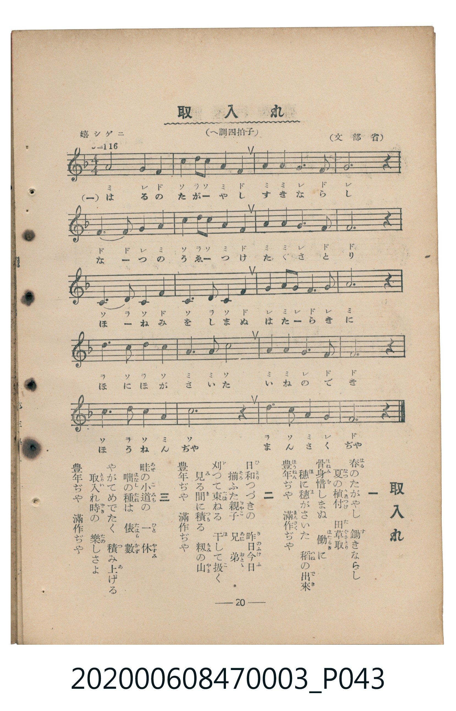

# 取入れ（秋收）

> Re:Shōka 使用 AI 協助辨識與重建樂譜，可能會有錯誤。歡迎回報。

- **鋼琴伴奏版**：<br><audio controls src="toriire.mp3"></audio>
- **NEUTRINO 歌聲合成版**：<br><audio controls src="toriire_neutrino.mp3"></audio>

- 臺灣教育會公認『新定兒童唱歌』尋常科第三學年用（第二學期・第6首）
- 國立臺灣歷史博物館典藏（典藏號：2020.006.0847.0003）

## 說明


- 出處：臺灣教育會公認、臺北新高堂發行《新定兒童唱歌》尋常科第三學年用（昭和6年／1931年），
第二學期第 6 首〈取入れ〉（秋收），原書第 20 頁（掃描檔 P043.jpg）。
- 出處原曲：文部省唱歌（1911年《尋常小學唱歌》第二學年）。
- 調性與拍號：ヘ調（F 大調），2/4 拍（原書副標題誤植為「へ調四拍子」，五線譜拍號與小節線實為 2/4 拍），
速度標示「嬉シゲニ != 116」。
- 背景與曲風：歌詠春耕、夏耘（插秧與除草）不辭辛勞，到了秋天稻穗結實纍纍、全家歡喜收割堆起穀山，
齊聲歡呼「豐年ぢや　滿作ぢや」的農家豐收之樂。
- 版本說明：本檔案為原書單聲部五線譜（附移動 Do 階名片假名）之忠實數位化版本。

### 編曲說明（鋼琴伴奏版）：

1. 前奏 (Intro, 4 小節)：引用第五段「豐年ぢや　滿作ぢや」歡慶豐收的明亮樂句開場。
2. 主歌伴奏 (Toriire, 20 小節 × 3 段)：右手演奏充滿農家喜悅的輕快旋律，左手以活潑的八分音符和弦伴奏。


## 歌詞

```text
一　春（はる）のたがやし　鋤（す）きならし
夏（なつ）の植付（うゑつけ）　田草取（たぐさとり）
骨身惜（ほねみを）しまぬ　働（はたらき）に
穗（ほ）に穗（ほ）がさいた　稻（いね）の出來（でき）
豐年（ほうねん）ぢや　滿作（まんさく）ぢや

二　日和（ひより）つづきの　昨日今日（きのふけふ）
揃（そろ）ふた親子（おやこ）　兄弟（あにおとゝ）
刈（か）つて束（たば）ねる　干（ほ）して扱（こ）く
見（み）る間（ま）に積（つ）もる　籾（もみ）の山（やま）
豐年ぢや　滿作ぢや

三　畦（あぜ）の小道（こみち）の　一休（ひとやすみ）
咄（はなし）の種（たね）は　俵數（たはらかず）
やがてめでたく　積（つ）み上（あ）げる
取入（とりい）れ時（どき）の　樂（たの）しさよ
豐年ぢや　滿作ぢや
```

## ABC

```abc
X:1
T:取入れ（秋收）
M:4/4
L:1/16
Q:1/4=116
K:F
V:V1 name="Piano" snm="Pia"
[V:V1]
A8 G4 F4 | c4 d2 c2 A4 F4 | A4 A4 G6 F2 | G12 z4 |
w: 1.~は る の | た が _ や し | す き な ら | し
w: 2.~ひ よ り | つ づ _ き の | き の ふ け | ふ
w: 3.~あ ぜ の | こ み _ ち の | ひ と や す | み
F6 F2 G4 A4 | c4 d2 c2 A4 F4 | A4 A4 G6 F2 | F12 z4 |
w: 1.~な _ つ の | う ゑ _ つ け | た ぐ さ と | り
w: 2.~そ ろ ふ た | お や _ こ _ | あ に お と | と
w: 3.~は な し の | た ね _ は _ | た は ら か | ず
C6 D2 C4 F4 | C6 D2 C4 F4 | G4 A2 G2 F6 G2 | A12 z4 |
w: 1.~ほ _ ね み | を し ま ぬ | は た _ ら き | に
w: 2.~か _ つ て | た ば ね る | ほ し _ て こ | く
w: 3.~や _ が て | め で た く | つ み _ あ げ | る
d6 c2 d4 c4 | A6 A2 c8 | A4 A4 G6 F2 | F12 z4 |
w: 1.~ほ に ほ が | さ い た | い ね の で | き
w: 2.~み る ま に | つ も る | も み の や | ま
w: 3.~と り い れ | ど き の | た の し さ | よ
C6 D2 C4 A4 | c12 z4 | d6 c2 c4 A4 | F12 z4 |
w: 1.~ほ う ね ん | ぢや | ま ん さ く | ぢや
w: 2.~ほ う ね ん | ぢや | ま ん さ く | ぢや
w: 3.~ほ う ね ん | ぢや | ま ん さ く | ぢや
```

## TMD 檔案連結

- [主旋律 TMD 檔案](toriire.tmd) [[在 TMD Studio 編輯](https://tmdlang.github.io/Tmd-TS/#tmd=s7IKdvYPcrWy4qpTUCpJTLdSSM7PyUlNLsnMz7MqzsjMK0nNjM_KTMmPL87Iz05Ugisry88pzU21Si9KTEmNN443MjAyiDcwMIs3sDAxBzIMjBFKi_NLi5JTrYqTM_Lzc-JLUitKkvLzsxHyBUX5Zal5iXlANQVFIBtTwIoQClLLMlNSQdKpKZkl-UWZiTlI7kgtKga7FWxJfElRYl5xclFmAcgDCFUlGalAx5bnFyFZCzQoPTPPKjc_L6kU6DklLi0thaf90562Ln3c1PN-T8fz5d3Ppmx7v6dTQUuLS9FWwdDQjMveVsGNy8ZE38QOZMyL9l3PGxc_mzrzRdOmZ3Oan7auebGq93FD37NpG56um_W0ddLz1UufTtn4bG3P44b-pxu6n-7Y8Xz5xOdr1jzZ0fl07Y6nO7c8n7ICZBNQZFcPUOTZnPmPm3cDuWYvl00D2gx27NM53c9Xd0PtWrv9af-mp72znneufLlkxdPWHS-m9wNNgDBezJz_fs8sUFToAaNCDxQVQIaBMdgkLn0tBVtqAS4FBYXHDROezd70fPa6F6tWPZvR97hhIli0effT9l0vZk4FugRH-DQCxZ_2TAeG0svVM54uaHo-c8-LhcAg6sIWbt14wu3ZjLVPJ_WYAfnv9_QbWhobglmd7_f0gFyioIAcrkC2gpkCMFgfN3TAY_lxA1AxIqKBGp_2zX82ewdIsZGBwssFjSBb-pqf9fc_WzVFIcDAxFgvqyAdqPRxQxOKb8H6NgH9_Gxa-8vmFc_nNEI8ANRvaGkIchjQfxCvPN3QD_IEzH9wR0IcjzD4xar9zxqWv-hof9bdC4nZx80zgIJAI90Uni5ZDmaC3Gykb6IAVANKBmDXP-1c_2zFzJcLe16sWvJsSe_zpl2PG3oeN-4Aang6ezZQ5dO1Ex43ANX3PNk15fn2WS_WzoFYAbQL6Ljn6xuAgk_XLwNqVICbjQjVlw3zn-5aBrTh-RKQwU_XdD5u2v64adPj5m4FSDYBGo7kjeaeZzPXg7wxe9PLRcBomwX094uVC57NWPqiYSowNTxd0v-iYQYooPsnPV8O8vDLmUte9AIt7Hyyo_fFvrUv9s1-2j0PFDkdG57sagNG19MlK5-v2P185fTnWyeAHLqrF4hARrWueLpu27O1C59OmwOM0qedm54uaHuxdfvzlQ1PN25E-GBv14vGTSBlE_cAffBi4wRQ_DQuetzU8rih4dnu_U_2zoFxe5_PanmxbxPQWKAyoJlPdnY_W9GE8N7zzo5nc4DpGpQFQH6bswaYUp4t7AAGHjQ2pq0DWgZME_DABnr15cyW58t3P-2equCSr_ByVt_TCb3PO9ufNrYDGSB_7-x-un8B0GfPpu54srf3ac80iDUga6FZD2I4OCjnAb0NTHbAgHuyYy2IsWrei7XrgfkRlCI29D5r70ROuWADnuxoAPl0xlKgkseN6x83dYOSXuO6x43zHzf2gDzeOB2o4GX3ErCCmWDZ3seNqx43ARnTQUYAow0st-pxI1ARSDMwrT3ZDYrIx41tj5smAsUfNwLdAEzSDc-nbADGKDDfgWWBdkx43Dj1ceOKx01dICeB4mTVihe7Vj9rBoXO48bdjxvXPm7c_7hpEtjo6Y8b9z1uBHq_4WkzKJ2DnAw0BeQWUHA9blwNMgKYHiCaIUKoXGAGAFoI9Nd8kHNWAAWBUkDuWojbgbn4yb42sOByiKEgEyEpA-aiNpCjmiaDNaCkFbCCfUApsB3AYIEqABkBlIPEByhxzFgKSrnABNUwFajtWVfX0znzn87Z8Lyr8enOzaAEvqQfogCeFYAB93LaZFiGmP1s7eKnsxcA0xYwZwDDCpIzgCY87V7yrL396falYNf0QDLHkx1dT_s7Xk7rBnoO6FAggoiDMv7uLlApumI3sCh4OXX7033TnwNdsnTv-z2Nz2ash3j76VRg3PQAuaCyBpz2wSLAIhGahnYBi6-GZ9OXAstgcAhsetzUAYlQcNQvBaeYdeB0tgKoDGgnkASrBIs3bgUmDyAJDetn_c1gubmPmyBxCpSe_2LZKqALweJd4FQJDn1gMmhteboHWCQCxZuAUQ2SBSWmuVCznnZ0gOUgqRrolmXP5kJUA5PeBrAgMCa7QQbtBBba8EQCTGfLnnUCCwqgCCSe-8HJYBnQIKAQqLwFagNGCCTGYekMkiTBuaCpCWLu841AWWBoAF0H1gVMYaACCCgC9ARIIyJ5YS14MJPOCmDKAEXbkpUvGxa_mDgdGFtA9rMNi0Hx3bHt2XpQsf506WZQIQ4OHVBhOHkhsMwEFnfApAMsDJ_s6IZE-bPetmcdE4BhAiwzn81e82TnvqdtvS9aVj_fBMxvPS_2dj6fswfoyyf79kPKT2Bx8XTXcnDqARWkwGKI-FSyA5z_py6DRRYwfYKDY0P_S1AYg0IalNMbF0JLoIYGoG1P9oAKL1CSAkUrMMhmQsIRHLmTWmBFALDsAaZmkLbnK9bB4heSo4HlX8OT_VuBBShMHFjKAcW7HzfOghoENhhYLix73NQIzvZARf0gxyJHaON-YDaCuB3MnQSMX7ArwG0IsASoFAOWJeDoB9Z1QHVAwZWwogmcAVZABIEWAJ0JSWhTgbmFxETwdM4KYHnwdH4TMPBebF8PdNizte1P-xdDEsGLRlDiAJUuKzcCK39QpQCMpOa9LxbPfbpk1tMNE4FFyItF3UAFzzcCC5vZ8GgGVYRLVgKrTGBBAmyRgRtloFgHJSxw0wjoJ1CjYM58UDTvXw30DSSOiUoEQD9Q3t6EAgUtfS6uEGDDPbMo1SogMzEv36HGoKYaXKvbmGjZgRnY2rngpuCOhmfrtipomChAGjk68FoRJKtgqABshGpi0Qq0E2os0AQrBWBCAqedbiBrnUINkJwP4jf2AFsDe0BpCiw2HYhnAnEvEK8CinZCRWEAamiNgrGCroIR0PIaBVMFDTMFU01VDV1NoChIxBgINYyACnQVDEHiQIkaoGIQ30ChBmyAjyHI3PVAEVQXaYAcBFQPcg_IXpAoxD1AmVVgI4COApkHkgVx42EmGoHENoEVdABxF1jNEpC-pWATwX6C2ANhAWW2QkxsnAgxEcKFm2gMEmsCK5gD1zsZpG8_xMSFcNFNQLwCKAN0NsTEmRATgQqhJuKP4109-OLYiOg4BsYZKDaB_oa5rA0c6xPh4iAxIA8Y1sDWDBBPBbscKAoMMYxY1jBEiUUjYMQSHeEQrcgRDo9CcOAhOxEYcBMRohOhiQHkQKCeqdAgXQEOUqAz0aMdqGYuNGn0gszYCtYNMqMLGiUg0clABZAIBVZ-ID0Qg2DmAgMBPfKBakApFKRmFcgEUOZASqhrIeaClMDcux5kXydUTzfE3FlEJoEdnfiSgDHRSWA3NKrXgpMfKMQmQbMwsAYH4jVgV62HuBic9TvBWQIkuhpLEjCNB3vALB4as0A-KM5xiRspaBgrGEFSBzT5gHngNAEqNTDSxG5EmoC5GRiKk6ChOB0kjuxuoI75INVIIQ2MdYjrsaSMbtQUtwxsOsgEsM4NUFuBhRDIhN0gOWC5AjIdqBSiZjLE9H4s6QOa3cGmAwtSqOlNjVCdy0HioHTRjyiMwEUHkAaVKyA1kyCpGuJMgqkE1BHGk0pMSEklwPCC0D1g14EKAlChC6oWQBEP4YFiZB3IK1CxXiwpxAzsdnCJAPQbsGwACUKi2hiWOMCZhPhyApImgE4EhSDMjUhlQQskZCE5D-JOoOw6RLhD3IolPUBKZGCAw9LVaojJS6DiTaDKBxQboFgBlRX7kUxuAtoLMnkflrQALUCABRTIZKCbmqBuXolIpRCDYKUFuAqC1GJAn0HSQQdx6QDYKceXDkxJSgdt0DwwGewyUAsOEsMgf4LcNBmaOvrhKQOhhkBJAakvoBGMnlJMwdJ4478Nlj-R3AYNIJAySDwAZUHKIE5EV4Yc99Q2FRLvVDS1lotL104B2lIE2wHkKnMBAA)]
- [鋼琴伴奏 TMD 檔案](toriire_piano.tmd) [[在 TMD Studio 編輯](https://tmdlang.github.io/Tmd-TS/#tmd=s7IKdvYPcrWy4tLSUnjaP-1p69LHTT3v93Q8X979bMq2x827X3bveT5hy5M9W54u7X_e2fF-T6eClhaXoq2CoaEZl72tghuXjYm-iR1XnYLSi_ZdzxsXP5s680XTpmdzmp-2rnmxqvdxQ9-zaRuerpv1tHXS89VLn07Z-Gxtz-OG_qcbup_u2PF8-cTna9Y82dH5dO2Opzu3PJ-yAmQ3UGRXD1Dk2Zz5QBcAuWYvl00D2qwEsuXpnO7nq7uhdq3d_rR_09PeWc87V75csuJp644X0_uBJkAYL2bOf79nlpGBkYGegYGZnoGFiTmQYWAMNolLX0vBllqAS0FB4XHDhGezNz2fve7FqlXPZvQ9bpgIFm3e_bR914uZU4EuwRE-jUDxpz3TgaH0cvWMpwuans_c82IhMIi6sIVbN55wezZj7dNJPWZA_vs9_YaWxoZgVuf7PT0glygoIIcrkK1gpgAM1scNHfB4f9wAVAyNeojGp33zn83eAVJsZKDwckEjyJa-5mf9_c9WTVEIMDAx1ssqSAcqfdzQhOJbsL5NQD8_m9b-snnF8zmNMA_A1L1Ytf9Zw_IXHe3PunshEfW4eQZQEGiDm8LTJcvBTJATjPRNFIBqgKyXDfOf7lqmAEl7CJOeb18BtAsS6kDdmAkWaDYkAAz1FJ529gLFFTQ880qK8nUUTBSebuh_vr5BE6jm6Z6pwHAEB9KUZ-u2Pm7oebFxAjAIHzcuetzU8rih4dnu_U_2zoFxe5-tXfisdRtQDTC0ns9qAdr-ZNe6ZyuanvYvfTmt--mCLVAnKigY6Sk82bEb6H2IqxQ0QvKLMjOLUnVAoQpxgMLh6QrGCkBrwS7p3_yss_vZnilAxU9bW4H2vti36em6bU-nzXnW1Aq068WeqU_3r342vfvpvm5QLG1fBlT_ZPfSZ1t2P9s7Eajgaevqpx1tL-dvfr5mGTBNPN2zDGI11EmUp3goUNDS5-ICh6VVQGZiXn6Qh0ONQU012Ns2Jlp2YEaNgmm8glk8iDQGcRR0gdAMzDJWMAKyaxQMgaQBiMVVi2KeD3bzDOMVog1jQQaCKDjfBEiZIPFB8qZIfLgN0PDH42ZspQM4A-1oAEaSggYs4ejAcwFIFugPYNbVxKIVGE5QY4EmWCk8blwPSrxN3UDWOqADHzfOB_Ebe4AJeg9QvAUsNh2IZwJxLxCvAop2QkVhAGpoDTAYdYEBaQgOUg0zBVNNVQ1dTaAoSMQYCDVAoayrYAgSB0rUgEMdFOI1YAN8DEHmrgeKoLpIA-QgoHqQe0D2gkQh7gHKrAIbAXQUyDyQLIgbDzPRCCS2CaygA4i7wGqWgPQtBZsI9hPEHggLKLMVYmLjRIiJEC7cRGOQWBNYwRy43skgffshJi6Ei24C4hVAGaCzISbOhJgIVAg1EX8c7-rBF8dGRMcxMM5AsQn0N8xlbeBYnwgXB4kBecCwftw4AYingl0OFAWGGEYsa4ByCSIWjaC5iagIh2hFjnB4FIIDD9mJwICbiBCdCE0MIAcC9UyFBukKcJACnYke7UA1c6FJoxdkxlawbpAZXdAoAYlOBmd7UIQ-blwN0gMxCGYuMBDQIx-oBpRCQWpWgUwAZQ6khLoWYi5ICcy960H2dUL1dEPMnUVkEtjRiS8JGBOdBHZDo3otOPmBQmwSNAs_btwHxGvArloPcTE463eCswRIdDWWJAAs0sClZzw0ZoF8UJzjEjdS0AAWsZDUAU0-YB44TYBKDYw0sRuRJmBuBobiJGgoTgeJI7sbqGM-SDVSSANjHeJ6LCmjGzXFLQObDjIBrHMD1FZgIQQyYTdIDliugEwHKoWomQwxvR9L-oBmd7DpwIIUanpTI1TncpA4KF30IwojcNEBpEHlCkjNJEiqhjiTYCp5Ons2vlRiQkoqAYYXhO4Buw5UEIAKXVC1AIp4CA8UI-tAXoGK9WJJIWZgt4NLBKDfgGUDSBAS1cawxAHOJMSXE5A0AXQiKARhbkQqC1ogIQvJeRB3AmXXIcId4lYs6QFSIgMDHJauVkNMXgIVbwJVPqDYAMUKqKzYj2RyE9BekMn7sKQFaAECLKBAJgPd1AR180pEKoUYBCstwFUQpBYD-gySDjqISweQBiPOdGBKUjpog-aByWCXgdqakBgG-RPkpsnQ1NEPTxkINQRKCkTrCxjB6CkF1BgjEP9tsPyJ5DZoAIGUQeIBKAtSBnEiujLkuKe2qZB4p6Kp6A1FrI1RYhuKeOIfZ3sWzoc2bKHC4PY0qGELac-S1JahhjOwN6tJqk_JcQawBxFtlovkfTLcgV5i43UH1LvYehWUBgdagUFOcBDd2dG1UwD3qBSADGh6jvYBKkDmGqFyjcFcZS4A)]

## 分析

```text
================================================================================
📊 TMD Song Profile: [ 取入れ（秋收） ]
================================================================================
⏱  Duration:       0:41 (41.4s), 20 measures total
🎼 Key & Tempo:    首調基準 F, != 116.0 BPM, <4/4>
   - 分析範圍：      由實際發聲的音符與和弦推測調性；播放脈絡另行呈現
🎤 人聲音域:    C4 (MIDI 60) – D5 (MIDI 74) [跨度: 14 個半音 / 1.2 個八度, 難度: moderate]
   - 最低音:  C4 in [Toriire #1 @ m.9, 0:16]
   - 最高音: D5 in [Toriire #1 @ m.2, 0:02]
   - 適合: soprano, mezzo-soprano, contralto, tenor, baritone, bass
🏛  結構:      Toriire (41.4s)
⚡ 編曲密度:        Peak 1 軌道同時演奏
🗝  調性診斷：       F 大調（純淨自然大調，未偵測到可信轉調）
   - 風格氣質:    純淨自然大調（陽光明朗、易唱易記，無明顯調外色彩）
   - 轉調歷程:    全曲維持單一推測調性（未偵測到可信轉調）
   - 核心骨幹音:  F, C, A, G, D
   - 調性數值:    F 大調 [相關度: 0.86, 穩定度: High, 自然音純度: 100.0%]
   - 候選調性 (K-S): F 大調 (0.86), C 大調 (0.72), A 小調 (0.72)
   - 五度圈歷程:   -1
   - 各段落調性細節:
     • [Toriire #1]: F 大調 (r: 0.86, 自然音純度: 100.0%)

  [ 五度圈游移軌跡 ]
               C  
        [F ]*          G  
      Bb               D  
      Eb               A  
         Ab           E  
            Db       B  
               F# 
     (* = active key center)

  [ 十二半音累積音高分佈 ]
     C  : ███████████████████████   25.0%
     C# :                            0.0%
     D  : ████████                   8.8%
     D# :                            0.0%
     E  :                            0.0%
     F  : ████████████████████████  25.7%
     F# :                            0.0%
     G  : ███████████████           15.5%
     G# :                            0.0%
     A  : ███████████████████████   25.0%
     A# :                            0.0%
     B  :                            0.0%
--------------------------------------------------------------------------------
Assignment 軌道音域：
  - Piano         : C4 – D5 (14 個半音 / 1.2 個八度, 63 個音符)
================================================================================
```


## 原書掃描頁




