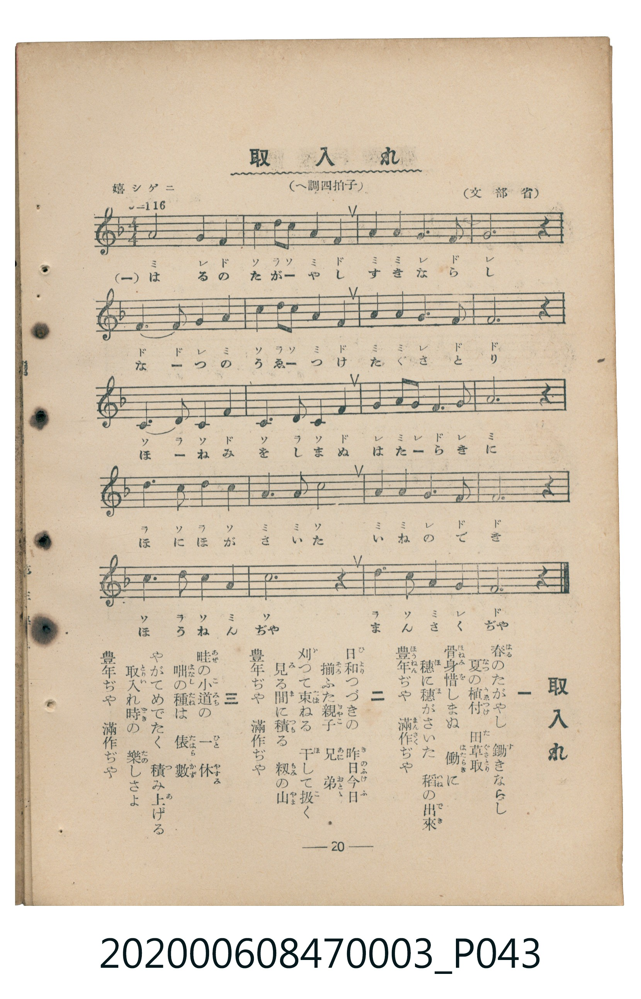

# 取入れ（秋收）

> Re:Shoka 使用 AI 辨識樂譜，可能會有錯誤。歡迎回報。

<audio controls src="toriire.mp3"></audio>

- 臺灣教育會公認『新定兒童唱歌』尋常科第三學年用（第二學期・第6首）
- 國立臺灣歷史博物館典藏（典藏號：2020.006.0847.0003）

## 說明

【曲目說明】
・出處：臺灣教育會公認、臺北新高堂發行《新定兒童唱歌》尋常科第三學年用（昭和6年／1931年），
第二學期第 6 首〈取入れ〉（秋收），原書第 20 頁（掃描檔 P043.jpg）。
・出處原曲：文部省唱歌（1911年《尋常小學唱歌》第二學年）。
・調性與拍號：ヘ調（F 大調），2/4 拍（原書副標題誤植為「へ調四拍子」，五線譜拍號與小節線實為 2/4 拍），
速度標示「嬉シゲニ != 116」。
・背景與曲風：歌詠春耕、夏耘（插秧與除草）不辭辛勞，到了秋天稻穗結實纍纍、全家歡喜收割堆起穀山，
齊聲歡呼「豐年ぢや　滿作ぢや」的農家豐收之樂。
・版本說明：本檔案為原書單聲部五線譜（附移動 Do 階名片假名）之忠實數位化版本。

・編曲說明（鋼琴伴奏版）：
1. 前奏 (Intro, 4 小節)：引用第五段「豐年ぢや　滿作ぢや」歡慶豐收的明亮樂句開場。
2. 主歌伴奏 (Toriire, 20 小節 × 3 段)：右手演奏充滿農家喜悅的輕快旋律，左手以活潑的八分音符和弦伴奏。

## 歌詞

```text
一　春（はる）のたがやし　鋤（す）きならし
夏（なつ）の植付（うゑつけ）　田草取（たぐさとり）
骨身惜（ほねみを）しまぬ　働（はたらき）に
穗（ほ）に穗（ほ）がさいた　稻（いね）の出來（でき）
豐年（ほうねん）ぢや　滿作（まんさく）ぢや

二　日和（ひより）つづきの　昨日今日（きのふけふ）
揃（そろ）ふた親子（おやこ）　兄弟（あにおとゝ）
刈（か）つて束（たば）ねる　干（ほ）して扱（こ）く
見（み）る間（ま）に積（つ）もる　籾（もみ）の山（やま）
豐年ぢや　滿作ぢや

三　畦（あぜ）の小道（こみち）の　一休（ひとやすみ）
咄（はなし）の種（たね）は　俵數（たはらかず）
やがてめでたく　積（つ）み上（あ）げる
取入（とりい）れ時（どき）の　樂（たの）しさよ
豐年ぢや　滿作ぢや
```

## ABC

```abc
X:1
T:取入れ（秋收）
M:2/4
L:1/16
Q:1/4=116
K:F
V:V1 name="Piano" snm="Pia"
[V:V1]
A4 G2 F2 | c3 d c2 A2 | F2 A A G2 F2 | G4 z4 |
F2 F2 G2 A2 | c3 d c2 A2 | F2 A A G2 F2 | F4 z4 |
C2 D2 C2 F2 | c2 d3 c F2 | G2 A G F2 G2 | A4 z4 |
d2 c2 d2 c2 | A2 A2 c4 | A2 A2 G2 F2 | F4 z4 |
C2 D2 C2 A2 | c6 d2 | c2 A2 G4 | F4 z4 |
```

## TMD 檔案連結

- [主旋律 TMD 檔案](toriire.tmd) [[在 TMD Studio 編輯](https://tmdlang.github.io/Tmd-TS/#tmd=s7IKdvYPcrWy4qpTUCpJTLdSSM7PyUlNLsnMz7MqzsjMK0nNjM_KTMmPL87Iz05Ugisry88pzU21Si9KTEmNN443MjAyiDcwMIs3sDAxBzIMjBFKi_NLi5JTrYqTM_Lzc-JLUitKkvLzsxHyBUX5Zal5iXlANQVFIBtTwIoQClLLMlNSQdKpKZkl-UWZiTlI7kgtKga7FWxJfElRYl5xclFmAcgDCFUlGalAx5bnFwGt1dJSeNo_7Wnr0sdNPe_3dDxf3v1syrb3ezoVtLS4FG0VDA3NuOxtFdy4bIz0TexAJrxo3_W8cfGzqTNfNG16Nqf5aeuaF6t6Hzf0PZu24em6WU9bJz1fvfTplI3P1vY8buh_uqH76Y4dz5dPfL5mzZMdnU_X7ni6c8vzKStANgFFdvUARZ7Nmf-4eTeQa_Zy2TSgzWB3Pp3T_Xx1N9Sutduf9m962jvreefKl0tWPG3d8WJ6P9AECOPFzPnv98wChbgeMMT1QCEOZBgYg03i0tdSsKUW4FJQUHjcMOHZ7E3PZ697sWrVsxl9jxsmgkWbdz9t3_Vi5lSgS3CETyNQ_GnPdGAovVw94-mCpucz97xYCAyiLmzh1o0n3J7NWPt0Uo8ZkP9-T7-hpbEhmNX5fk8PyCUKCsjhCmQrmCkAg_VxQwc8lh83ABUjIhqo8Wnf_Gezd4AUGxkovFzQCLKlr_lZf_-zVVMUAgxMjPWyCtKBSh83NKH4FqxvE9DPz6a1v2xe8XxOI8QDQP2GloYghwH9B_HK0w39IE_A_Ad3JMTxCINfrNr_rGH5i472Z929kJh93DwDKAg00k3h6ZLlYCbIzcDkqABUA0oGYNc_7Vz_bMXMlwt7Xqxa8mxJ7_OmXY8beh437gBqeDp7NlDl07UTHjcA1fc82TXl-fZZL9bOgVgBtAvouOfrG4CCT9cvA2pUgJuNCNWXDfOf7loGtOH5EpDBT9d0Pm7a_rhp0-PmbgVINgEajuSN5p5nM9eDvDF708tFwGibBfT3i5ULns1Y-qJhKjA1PF3S_6JhBiig-yc9Xw7y8MuZS170Ai3sfLKj98W-tS_2zX7aPQ8UOR0bnuxqA0bX0yUrn6_Y_Xzl9OdbJ4AcuqsXiEBGta54um7bs7ULn06bA4zSp52bni5oe7F1-_OVDU83bkT4YG_Xi8ZNIGUT9wB98GLjBFD8NC563NTyuKHh2e79T_bOgXF7n89qebFvE9BYoDKgmU92dj9b0YTw3vPOjmdzgOkalAVAfpuzBphSni3sAAYeNDamrQNaBkwT8MAGevXlzJbny3c_7Z6q4JKv8HJW39MJvc872582tgMZIH_v7H66fwHQZ8-m7niyt_dpzzSINSBroVkPYjg4KOcBvQ1MdsCAe7JjLYixat6LteuB-RGUIjb0PmvvRE65YAOe7GgA-XTGUqCSx43rHzd1g5Je47rHjfMfN_aAPN44HajgZfcSsIKZYNnex42rHjcBGdNBRgCjDSy36nEjUBFIMzCtPdkNisjHjW2PmyYCxR83At0ATNINz6dsAMYoMN-BZYF2THjcOPVx44rHTV0gJ4HiZNWKF7tWP2sGhc7jxt2PG9c-btz_uGkS2Ojpjxv3PW4Eer_haTMonYOcDDQF5BZQcD1uXA0yApgeIJohQqhcYAYAWgj013yQc1YABYFSQO5aiNuBufjJvjaw4HKIoSATISkD5qI2kKOaJoM1oKQVsIJ9QCmwHcBggSoAGQGUg8QHKHHMWApKucAE1TAVqO1ZV9fTOfOfztnwvKvx6c7NoAS-pB-iAJ4VgAH3ctpkWIaY_Wzt4qezFwDTFjBnAMMKkjOAJjztXvKsvf3p9qVg1_RAMseTHV1P-zteTusGeg7oUCCCiIMy_u4uUCm6YjewKHg5dfvTfdOfA12ydO_7PY3PZqyHePvpVGDc9AC5oLIGnPbBIsAiEZqGdgGLr4Zn05cCy2BwCGx63NQBiVBw1C8Fp5h14HS2AqgMaCeQBKsEizduBSYPIAkN62f9zWC5uY-bIHEKlJ7_YtkqoAvB4l3gVAkOfWAyaG15ugdYJALFm4BRDZIFJaa5ULOednSA5SCpGuiWZc_mQlQDk94GsCAwJrtBBu0EFtrwRAJMZ8uedQILCqAIJJ77wclgGdAgoBCovAVqA0YIJMZh6QySJMG5oKkJYu7zjUBZYGgAXQfWBUxhoAIIKAL0BEgjInlhLXgwk84KYMoARduSlS8bFr-YOB0YW0D2sw2LQfHdse3ZelCx_nTpZlAhDg4dUGE4eSGwzAQWd8CkAywMn-zohkT5s962Zx0TgGECLDOfzV7zZOe-p229L1pWP98EzG89L_Z2Pp-zB-jLJ_v2Q8pPYHHxdNdycOoBFaTAYoj4VLIDnP-nLoNFFjB9goNjQ_9LUBiDQhqU0xsXQkughgagbU_2gAovUJICRSswyGZCwhEcuZNaYEUAsOwBpmaQtucr1sHiF5KjgeVfw5P9W4EFKEwcWMoBxbsfN86CGgQ2GFguLHvc1AjO9kBF_SDHIkdo435gNoK4HcydBIxfsCvAbQiwBKgUA5Yl4OgH1nVAdUDBlbCiCZwBVkAEgRYAnQlJaFOBuYXERPB0zgpgefB0fhMw8F5sXw902LO17U_7F0MSwYtGUOIAlS4rNwIrf1ClAIyk5r0vFs99umTW0w0TgUXIi0XdQAXPNwILm9nwaAZVhEtWAqtMYEECbJGBG2WgWAclLHDTCOgnUKNgznxQNO9fDfQNJI6JSgRAP1De3oQCBS19Lq4QYEM_syjVKiAzMS_focagRqEaXK3bWGjZgRnYGrrgtuCOhmfrtipomChAWjk68GoRJKtgqABshWpi0Qq0FGos0AQrBWBKAieebiBrnUINkJwP4jf2AJsDe0CJCiw2HYhnAnEvEK8CinZCRWEAamiNgrGCroIR0PIaBQ1TBV1dBTNNVQ1dXU0FU6BMDVBcw1jBGCSkCVVlBFRvAMQ14OyF27O7evB51ohozwIdD_JW4xK4d9vA3p8IFweJAXnAYADW60A8FYhXgESbujC9awiERmCvEeddQyK9u6MTn3eNifbubqi31gLxfrAnJkHjDVhuA_EasHfXQ7wLju9OcCyDRFdjetc0XsEsHkSC_GKqoGEG8rMp1M-Q6AT62AjiY1DIQBIEET4GNeXx-NiEFB8DXQ6he8D-AEVgCzRdgzwB4YFCZB0QL4eK9WL61gzoRRAGecIYSAM9AWaRFpW7puDzmClJHmuDOLxpMtjJoEIV4mRQZIIidzLUu_1wryLUYItGUCIF-QuYcMEskN9AvkT4rZaLS9dOAVpIgZjKXFwA)]
- [鋼琴伴奏 TMD 檔案](toriire_piano.tmd) [[在 TMD Studio 編輯](https://tmdlang.github.io/Tmd-TS/#tmd=s7IKdvYPcrWy4tLSUnjaP-1p69LHTT3v93Q8X979bMq2x827X3bveT5hy5M9W54u7X_e2fF-T6eClhaXoq2CoaEZl72tghuXjZG-iR1XnYLSi_ZdzxsXP5s680XTpmdzmp-2rnmxqvdxQ9-zaRuerpv1tHXS89VLn07Z-Gxtz-OG_qcbup_u2PF8-cTna9Y82dH5dO2Opzu3PJ-yAmQ3UGRXD1Dk2Zz5QBcAuWYvl00D2qwEsuXpnO7nq7uhdq3d_rR_09PeWc87V75csuJp644X0_uBJkAYL2bOf79nlpGBkYGegYGZnoGFiTmQYWAMNolLX0vBllqAS0FB4XHDhGezNz2fve7FqlXPZvQ9bpgIFm3e_bR914uZU4EuwRE-jUDxpz3TgaH0cvWMpwuans_c82IhMIi6sIVbN55wezZj7dNJPWZA_vs9_YaWxoZgVuf7PT0glygoIIcrkK1gpgAM1scNHfB4f9wAVAyNeojGp33zn83eAVJsZKDwckEjyJa-5mf9_c9WTVEIMDAx1ssqSAcqfdzQhOJbsL5NQD8_m9b-snnF8zmNMA_A1L1Ytf9Zw_IXHe3PunshEfW4eQZQEGiDm8LTJcvBTJATgKlLAagGyHrZMP_prmUKkLSHMOn59hVAuyChDtSNmWCBZkMCwFBP4WlnL1BcQcMzr6QoX0fBROHphv7n6xs0gWqe7pkKDEdwIE15tm7r44aeFxsnAIPwceOix00tjxsanu3e_2TvHBi399nahc9atwHVAEPr-awWoO1Pdq17tqLpaf_Sl9O6ny7YAnWigoKRnsKTHbuB3oe4SkEjJL8oM7MoVQcUqhAHKByermCsALQW7JL-zc86u5_tmQJU_LS1FWjvi32bnq7b9nTanGdNrUC7XuyZ-nT_6mfTu5_u6wbF0vZlQPVPdi99tmX3s70TgQqetq5-2tH2cv7m52uWAdPE0z3LIFZDnUR5iocCBS19Li5wWFoFZCbm5Qd5ONQY1ChUg_1tY6FlB2bUKJjGK5jFg0hjEEdBFwjNwCxjBSMgu0bBEEgagFhctSgG-uAw0DBeIdowFmQiiILzTYCUCRIfJG-KxIdbAY0BfK7GVkCA89COBmA8KWjA0w4WZcBggbjTGGihEdB3NQoaQG8Dfa2pqqGrqwn2OcjXGsYKxiAhTagqUGhAHInfDbt6iHeDIRAage0jzg2IuCAQDp3EuwGeAEAWmCpomIEcYgp1CMTjQGcYQZwBci4k6IhwxtPZs4l3hhnQbhAGmW4MTogQFmkeB5cPpHqcqJSPkiyxp32qJEsc2QfOh-YjqDDYF6B8RPWUSZwzsOdi6iVOHM4Axlu0WS6S98lwB0mpE-pdbIUYpcFBSpKltGzVtVMAl-AKQAY0QeNmKnNxAQA)]

## 分析

```text
================================================================================
📊 TMD Song Profile: [ 取入れ（秋收） ]
================================================================================
⏱  Duration:       0:20 (20.7s), 20 measures total
🎼 Key & Tempo:    首調基準 F, != 116.0 BPM, <2/4>
   - 分析範圍：      由實際發聲的音符與和弦推測調性；播放脈絡另行呈現
🎤 人聲音域:    C4 (MIDI 60) – D5 (MIDI 74) [跨度: 14 個半音 / 1.2 個八度, 難度: moderate]
   - 最低音:  C4 in [Toriire #1 @ m.9, 0:08]
   - 最高音: D5 in [Toriire #1 @ m.2, 0:01]
   - 適合: soprano, mezzo-soprano, contralto, tenor, baritone, bass
🏛  結構:      Toriire (20.7s)
⚡ 編曲密度:        Peak 1 軌道同時演奏
🗝  調性診斷：       F 大調（純淨自然大調，未偵測到可信轉調）
   - 風格氣質:    純淨自然大調（陽光明朗、易唱易記，無明顯調外色彩）
   - 轉調歷程:    全曲維持單一推測調性（未偵測到可信轉調）
   - 核心骨幹音:  C, F, A, G, D
   - 調性數值:    F 大調 [相關度: 0.86, 穩定度: Moderate, 自然音純度: 100.0%]
   - 候選調性 (K-S): F 大調 (0.86), C 大調 (0.77), A 小調 (0.69)
   - 五度圈歷程:   -1
   - 各段落調性細節:
     • [Toriire #1]: F 大調 (r: 0.86, 自然音純度: 100.0%)

  [ 五度圈游移軌跡 ]
               C  
        [F ]*          G  
      Bb               D  
      Eb               A  
         Ab           E  
            Db       B  
               F# 
     (* = active key center)

  [ 十二半音累積音高分佈 ]
     C  : ████████████████████████  26.4%
     C# :                            0.0%
     D  : ██████████                10.7%
     D# :                            0.0%
     E  :                            0.0%
     F  : ██████████████████████    24.3%
     F# :                            0.0%
     G  : ███████████████           16.4%
     G# :                            0.0%
     A  : ████████████████████      22.1%
     A# :                            0.0%
     B  :                            0.0%
--------------------------------------------------------------------------------
Assignment 軌道音域：
  - Piano         : C4 – D5 (14 個半音 / 1.2 個八度, 63 個音符)
================================================================================
```


## 原書掃描頁




