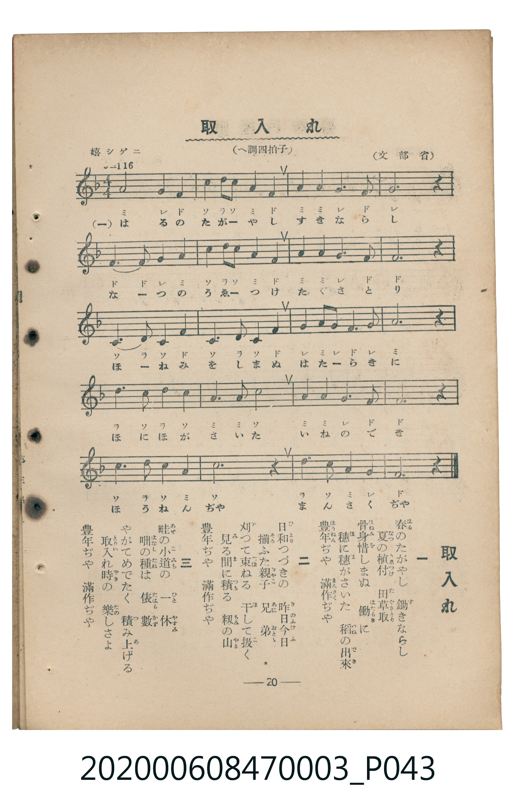

# 取入れ（秋收）

> Re:Shōka 使用 AI 協助辨識與重建樂譜，可能會有錯誤。歡迎[回報](https://github.com/TMDLang/reshoka/issues)。

- **鋼琴伴奏版**：<br><audio controls src="toriire.mp3"></audio>
- **NEUTRINO 歌聲合成版**：<br><audio controls src="toriire_neutrino.mp3"></audio>

- 臺灣教育會公認『新定兒童唱歌』尋常科第三學年用（第二學期・第6首）
- 國立臺灣歷史博物館典藏（典藏號：2020.006.0847.0003）

## 說明


- 出處：臺灣教育會公認、臺北新高堂發行《新定兒童唱歌》尋常科第三學年用（昭和6年／1931年），
第二學期第 6 首〈取入れ〉（秋收），原書第 20 頁（掃描檔 P043.jpg）。
- 出處原曲：文部省唱歌（1911年《尋常小學唱歌》第二學年）。
- 調性與拍號：ヘ調（F 大調），2/4 拍（原書副標題誤植為「へ調四拍子」，五線譜拍號與小節線實為 2/4 拍），
速度標示「嬉シゲニ != 116」。
- 背景與曲風：歌詠春耕、夏耘（插秧與除草）不辭辛勞，到了秋天稻穗結實纍纍、全家歡喜收割堆起穀山，
齊聲歡呼「豐年ぢや　滿作ぢや」的農家豐收之樂。
- 版本說明：本檔案為原書單聲部五線譜（附移動 Do 階名片假名）之忠實數位化版本。

### 編曲說明（鋼琴伴奏版）：

1. 前奏 (Intro, 4 小節)：引用第五段「豐年ぢや　滿作ぢや」歡慶豐收的明亮樂句開場。
2. 主歌伴奏 (Toriire, 20 小節 × 3 段)：右手演奏充滿農家喜悅的輕快旋律，左手以活潑的八分音符和弦伴奏。


## 歌詞

```text
一　春（はる）のたがやし　鋤（す）きならし
夏（なつ）の植付（うゑつけ）　田草取（たぐさとり）
骨身惜（ほねみを）しまぬ　働（はたらき）に
穗（ほ）に穗（ほ）がさいた　稻（いね）の出來（でき）
豐年（ほうねん）ぢや　滿作（まんさく）ぢや

二　日和（ひより）つづきの　昨日今日（きのふけふ）
揃（そろ）ふた親子（おやこ）　兄弟（あにおとゝ）
刈（か）つて束（たば）ねる　干（ほ）して扱（こ）く
見（み）る間（ま）に積（つ）もる　籾（もみ）の山（やま）
豐年ぢや　滿作ぢや

三　畦（あぜ）の小道（こみち）の　一休（ひとやすみ）
咄（はなし）の種（たね）は　俵數（たはらかず）
やがてめでたく　積（つ）み上（あ）げる
取入（とりい）れ時（どき）の　樂（たの）しさよ
豐年ぢや　滿作ぢや
```

## ABC

<div class="abc-score" data-abc-src="toriire.abc" aria-label="五線譜載入中"></div>

[下載 ABC 原始檔](toriire.abc)

## TMD 檔案連結

- [主旋律 TMD 檔案](toriire.tmd) [[在 TMD Studio 編輯](https://tmdlang.github.io/Tmd-TS/#tmd=s7IKdvYPcrWy4qpTUCpJTLdSSM7PyUlNLsnMz7MqzsjMK0nNjM_KTMmPL87Iz05Ugisry88pzU21Si9KTEmNN443MjAyiDcwMIs3sDAxBzIMjBFKi_NLi5JTrYqTM_Lzc-JLUitKkvLzsxHyBUX5Zal5iXlANQVFIBtTwIoQClLLMlNSQdKpKZkl-UWZiTlI7kgtKga7FWxJfElRYl5xclFmAcgDCFUlGalAx5bnFyFZCzQoPTPPKjc_L6kU6DlkiZKMfKDHCjIqrTIyi0E2JifmxGcn5iH5H2pfQWJ6qlWAgQnQu1paCk_7pz1tXfq4qef9no7ny7ufTdn2fk-ngpYWl6KtgqGhGZe9rYIbl42JvokdyJwX7bueNy5-NnXmi6ZNz-Y0P21d82JV7-OGvmfTNjxdN-tp66Tnq5c-nbLx2dqexw39Tzd0P92x4_nyic_XrHmyo_Pp2h1Pd255PmUFyCagyK4eoMizOfMfN-8Gcs1eLpsGtBns2qdzup-v7obatXb70_5NT3tnPe9c-XLJiqetO15M7weaAGG8mDn__Z5ZoJjUA8akHigmgQwDY7BJXPpaCrbUAlwKCgqPGyY8m73p-ex1L1atejaj73HDRLBo8-6n7btezJwKdAmO8GkEij_tmQ4MpZerZzxd0PR85p4XC4FB1IUt3LrxhNuzGWufTuoxA_Lf7-k3tDQ2BLM63-_pAblEQQE5XIFsBTMFYLA-buiAx_LjBqBiREQDNT7tm_9s9g6QYiMDhZcLGkG29DU_6-9_tmqKAiiZ6GUVpAOVPm5oQvEtWN8moJ-fTWt_2bzi-ZxGiAeA-g0tDUEOA_oP4pWnG_pBnoD5D-5IiOMRBr9Ytf9Zw_IXHe3PunshMfu4eQZQEGikm8LTJcvBTJCbjfRNFIBqQMkA7PqnneufrZj5cmHPi1VLni3pfd6063FDz-PGHUANT2fPBqp8unbC4wag-p4nu6Y83z7rxdo5ECuAdgEd93x9A1Dw6fplQI0KcLMRofqyYf7TXcuANjxfAjL46ZrOx03bHzdtetzcrQDJJkDDkbzR3PNs5nqQN2ZverkIGG2zgP5-sXLBsxlLXzRMBaaGp0v6XzTMAAV0_6Tny0EefjlzyYteoIWdT3b0vti39sW-2U-754Eip2PDk11twOh6umTl8xW7n6-c_nzrBJBDd_UCEcio1hVP1217tnbh02lzgFH6tHPT0wVtL7Zuf76y4enGjQgf7O160bgJpGziHqAPXmycAIqfxkWPm1oeNzQ8273_yd45MG7v81ktL_ZtAhoLVAY088nO7mcrmhDee97Z8WwOMF2DsgDIb3PWAFPKs4UdwMCDxsa0dUDLgGkCHthAr76c2fJ8-e6n3VMVXPIVXs7qezqh93ln-9PGdiAD5O-d3U_3LwD67NnUHU_29j7tmQaxBmQtNOtBDAcH5Tygt4HJDhhwT3asBTFWzXuxdj0wP4JSxIbeZ-2dyCkXbMCTHQ0gn85YClTyuHH946ZuUNJrXPe4cf7jxh6QxxunAxW87F4CVjATLNv7uHHV4yYgYzrICGC0geVWPW4EKgJpBqa1J7tBEfm4se1x00Sg-ONGoBuASbrh-ZQNwBgF5juwLNCOCY8bpz5uXPG4qQvkJFCcrFrxYtfqZ82g0HncuPtx49rHjfsfN00CGz39ceO-x41A7zc8bQalc5CTgaaA3AIKrseNq0FGANMDRDNECJULzABAC4H-mg9yzgqgIFAKyF0LcTswFz_Z1wYWXA4xFGQiJGXAXNQGclTTZLAGlLQCVrAPKAW2AxgsUAUgI4BykPgAJY4ZS0EpF5igGqYCtT3r6no6Z_7TORuedzU-3bkZlMCX9EMUwLMCMOBeTpsMyxCzn61d_HT2AmDaAuYMYFhBcgbQhKfdS561tz_dvhTsmh5I5niyo-tpf8fLad1AzwEdCkQQcVDG390FKkVX7AYWBS-nbn-6b_pzoEuW7n2_p_HZjPUQbz-dCoybHiAXVNaA0z5YBFgkQtPQLmDx1fBs-lJgGQwOgU2PmzogEQqO-qXgFLMOnM5WAJUB7QSSYJVg8catwOQBJKFh_ay_GSw393ETJE6B0vNfLFsFdCFYvAucKsGhD0wGrS1P9wCLRKB4EzCqQbKgxDQXatbTjg6wHCRVA92y7NlciGpg0tsAFgTGZDfIoJ3AQhueSIDpbNmzTmBBARSBxHM_OBksAxoEFAKVt0BtwAiBxDgsnUGSJDgXNDVBzH2-ESgLDA2g68C6gCkMVAABRYCeAGlEJC-sBQ9m0lkBTBmgaFuy8mXD4hcTpwNjC8h-tmExKL47tj1bDyrWny7dDCrEwaEDKgwnLwSWmcDiDph0gIXhkx3dkCh_1tv2rGMCMEyAZeaz2Wue7Nz3tK33Rcvq55uA-a3nxd7O53P2AH35ZN9-SPkJLC6e7loOTj2gghRYDBGfSnaA8__UZbDIAqZPcHBs6H8JCmNQSINyeuNCaAnU0AC07ckeUOEFSlKgaAUG2UxIOIIjd1ILrAgAlj3A1AzS9nzFOlj8QnI0sPxreLJ_K7AAhYkDSzmgePfjxllQg8AGA8uFZY-bGsHZHqioH-RY5Aht3A_MRhC3g7mTgPELdgW4DQGWAJViwLIEHP3Aug6oDii4ElY0gTPACogg0AKgMyEJbSowt5CYCJ7OWQEsD57ObwIG3ovt64EOe7a2_Wn_YkgieNEIShyg0mXlRmDlD6oUgJHUvPfF4rlPl8x6umEisAh5sagbqOD5RmBhMxsezaCKcMlKYJUJLEiALTJwowwU66CEBW4aAf0EahTMmQ-K5v2rgb6BxDFRiQDoB8rbm1CgoKXPxRUCbM5nFgEb7ZmJefkONQY11eBa3cZEyw7MwNbOBTcFdzQ8W7dVQcNEAdLI0YHXiiBZBUMFYCNUE4tWoJ1QY4EmWCkAExI47XQDWesUaoDkfBC_sQfYGtgDSlNgselAPBOIe4F4FVC0EyoKA1BDaxSMFXQVjICW1yiYKmiYKZhqqmroagJFQSLGQKhhBFSgq2AIEgdK1AAVg_gGCjVgA3wMQeauB4qgukgD5CCgepB7QPaCRCHuAcqsAhsBdBTIPJAsiBsPM9EIJLYJrKADiLvAapaA9C0Fmwj2E8QeCAsosxViYuNEiIkQLtxEY5BYE1jBHLjeySB9-yEmLoSLbgLiFUAZoLMhJs6EmAhUCDURfxzv6sEXx0ZExzEwzkCxCfQ3zGVt4FifCBcHiQF5wLAGtmaAeCrY5UBRYIhhxLKGIUosGgEjlugIh2hFjnB4FIIDD9mJwICbiBCdCE0MIAcC9UyFBukKcJACnYke7UA1c6FJoxdkxlawbpAZXdAoAYlOBiqARCiw8gPpgRgEMxcYCOiRD1QDSqEgNatAJoAyB1JCXQsxF6QE5t71IPs6oXq6IebOIjIJ7OjElwSMiU4Cu6FRvRac_EAhNgmahYE1OBCvAbtqPcTF4KzfCc4SINHVWJKAaTzYA2bx0JgF8kFxjkvcSEHDWMEIkjqgyQfMA6cJUKmBkSZ2I9IEzM3AUJwEDcXpIHFkdwN1zAepRgppYKxDXI8lZXSjprhlYNNBJoB1boDaCiyEQCbsBskByxWQ6UClEDWTIab3Y0kf0OwONh1YkEJNb2qE6lwOEgeli35EYQQuOoA0qFwBqZkESdUQZxJMJaCOMJ5UYkJKKgGGF4TuAbsOVBCACl1QtQCKeAgPFCPrQF6BivViSSFmYLeDSwSg34BlA0gQEtXGsMQBziTElxOQNAF0IigEYW5EKgtaICELyXkQdwJl1yHCHeJWLOkBUiIDAxyWrlZDTF4CFW8CVT6g2ADFCqis2I9kchPQXpDJ-7CkBWgBAiygQCYD3dQEdfNKRCqFGAQrLcBVEKQWA_oMkg46iEsHwE45vnRgSlI6aIPmgclgl4FacJAYBvkT5KbJ0NTRD08ZCDUESgpIfQGNYPSUYgqWxhv_bbD8ieQ2aACBlEHiASgLUgZxIroy5LintqmQeKeiqbVcXLp2CtCWItgOIFeZCwA)]
- [鋼琴伴奏 TMD 檔案](toriire_piano.tmd) [[在 TMD Studio 編輯](https://tmdlang.github.io/Tmd-TS/#tmd=s7IKdvYPcrWy4qpTUCpJTLdSyC8qychPL0osyKi0ysgsLskvykxOzInPTsxLVIIrKs4vLUpOjS9ITE-1CjAwMVbi0tJSeNo_7Wnr0sdNPe_3dDxf3v1syrbHzbtfdu95PmHLkz1bni7tf97Z8X5Pp4KWFpeirYKhoRmXva2CG5eNib6JHcjkF-27njcufjZ15oumTc_mND9tXfNiVe_jhr5n0zY8XTfraeuk56uXPp2y8dnanscN_U83dD_dseP58onP16x5sqPz6dodT3dueT5lBchuoMiuHqDIsznzgS4Acs1eLpsGtBns_qdzup-v7obatXb70_5NT3tnPe9c-XLJiqetO15M7weaAGG8mDn__Z5ZRgZGBnoGBmZ6BhYm5kCGgTHYJC59LQVbagEuBQWFxw0Tns3e9Hz2uherVj2b0fe4YSJYtHn30_ZdL2ZOBboER_g0AsWf9kwHhtLL1TOeLmh6PnPPi4XAIOrCFm7deMLt2Yy1Tyf1mAH57_f0G1oaG4JZne_39IBcoqCAHK5AtoKZAjBYHzd0wOP9cQNQMTTqIRqf9s1_NnsHSLGRgcLLBY0gW_qan_X3P1s1RQGUcPSyCtKBSh83NKH4FqxvE9DPz6a1v2xe8XxOI8wDMHUvVu1_1rD8RUf7s-5eSEQ9bp4BFATa4KbwdMlyMBPkBCN9EwWgGiDrZcP8p7uWKUDSHsKk59tXAO2ChDpQN2aCBZoNCQBDPYWnnb1AcQUNz7ySonwdBROFpxv6n69v0ASqebpnKjAcwYE05dm6rY8bel5snAAMwseNix43tTxuaHi2e_-TvXNg3N5naxc-a90GVAMMreezWoC2P9m17tmKpqf9S19O6366YAvUiQoKRnoKT3bsBnof4ioFjRBgpswsStUBhSrEAQqHpysYKwCtBbukf_Ozzu5ne6YAFT9tbQXa-2Lfpqfrtj2dNudZUyvQrhd7pj7dv_rZ9O6n-7pBsbR9GVD9k91Ln23Z_WzvRKCCp62rn3a0vZy_-fmaZcA08XTPMojVUCdRnuKhQEFLn4sLHJZWAZmJeflBHg41BjXVYG_bmGjZgRk1CqbxCmbxINIYxFHQBUIzMMtYwQjIrlEwBJIGIBZXLYp5PtjNM4xXiDaMBRkIouB8EyBlgsQHyZsi8eE2QMMfj5uxlQ7gDLSjARhJChqwhKMDzwUgWaA_gFlXE4tWYDhBjQWaYKXwuHE9KPE2dQNZ64AOfNw4H8Rv7AEm6D1A8Raw2HQgngnEvUC8CijaCRWFAaihNcBg1AUGpCE4SDXMFEw1VTV0NYGiIBFjINQAhbKugiFIHChRAw51UIjXgA3wMQSZux4oguoiDZCDgOpB7gHZCxKFuAcoswpsBNBRIPNAsiBuPMxEI5DYJrCCDiDuAqtZAtI3C2wi2E8QeyAsoMxWiImNvY-b2iGGtqEaagwSawKrmQPXPhmkdT_E0IVw0U1AvAIoA3Q5xNCZEBOBCqEm4o_mXT34otmI6GgGRhsoQoFeh7msDRzxE-HiIDEgDxjcjxsnAPFUsMuBosBAw4hoDVBGQUSkETRDERXnEK3IcQ6PRXDgITsRKNOBEJ0ITQ8gBwJlpkKDdAU4SIHORI95oJq50NTRCzJjK1g3yIwuaJSARCeDcz4oQh83rgbpgRgEMxcYCOiRD1QDSqQgNatAJoDyB1JaXQsxF6QE5t71IPs6oXq6IeYCEyBRSWBHJ74kYEx0EtgNjeq14OQHCrFJ0Fz8uHEfEK8Bu2o9xMXg3N8JzhUg0dVYkgCwVAMXoPHQmAXyQXGOS9xIQQNYykJSBzT5gHngNAEqODDSxG5EmoC5GRiKk6ChOB0kjuxuoI75INVIIQ2MdYjrsaSMbtQUtwxsOsgEsM4NUFuB5RDIhN0gOWDRAjIdqBSiZjLE9H4s6QOa3cGmA8tSqOlNjVCdy0HioHTRjyiPwEUHkAaVKyA1kyCpGuJMgqnk6ezZ-FKJCSmpBBheELoH7DpQQQAqd0E1AyjiITxQjKwDeQUq1oslhZiB3Q4uEYB-A5YNIEFIVBvDEgc4kxBfTkDSBNCJoBCEuRGpLGiBhCwk50HcCZRdhwh3iFuxpAdIiQwMcFi6Wg0xeQlUvAlU_4BiAxQroLJiP5LJTUB7QSbvw5IWoAUIsIACmQx0UxPUzSsRqRRiEKy0ANdCkIoM6DNIOgAWg8SkA0ibEWc6MCUpHbRB88BksMtAzU1IDIP8CXLTZGjq6IenDIQaAiUFogEGjGD0lAJqjxGI_zZY_oS4bcbjpmZYAIGUQeIBKAtSBnEiujLkuKe2qZB4p6Kp6G1FrO1RYtuKeOIfZ5MWzoe2baHC4CY1qG0LadKS1JahhjOwt6xJqk_JcQawExFtlovkfTLcgV5i43UH1LvYOhaUBgdagUFOcBDd39G1UwB3qhSADGh6jvYBKkDmGqFyjcFcZS4A)]

## 分析

```text
================================================================================
📊 TMD Song Profile: [ 取入れ（秋收） ]
================================================================================
⏱  Duration:       0:41 (41.4s), 20 measures total
🎼 Key & Tempo:    首調基準 F, != 116.0 BPM, <4/4>
   - 分析範圍：      由實際發聲的音符與和弦推測調性；播放脈絡另行呈現
🎤 人聲音域:    C4 (MIDI 60) – D5 (MIDI 74) [跨度: 14 個半音 / 1.2 個八度, 難度: moderate]
   - 最低音:  C4 in [Toriire #1 @ m.9, 0:16]
   - 最高音: D5 in [Toriire #1 @ m.2, 0:02]
   - 適合: soprano, mezzo-soprano, contralto, tenor, baritone, bass
🏛  結構:      Toriire (41.4s)
⚡ 編曲密度:        Peak 1 軌道同時演奏
🗝  調性診斷：       F 大調（純淨自然大調，未偵測到可信轉調）
   - 風格氣質:    純淨自然大調（陽光明朗、易唱易記，無明顯調外色彩）
   - 轉調歷程:    全曲維持單一推測調性（未偵測到可信轉調）
   - 核心骨幹音:  F, C, A, G, D
   - 調性數值:    F 大調 [相關度: 0.86, 穩定度: High, 自然音純度: 100.0%]
   - 候選調性 (K-S): F 大調 (0.86), C 大調 (0.72), A 小調 (0.72)
   - 五度圈歷程:   -1
   - 各段落調性細節:
     • [Toriire #1]: F 大調 (r: 0.86, 自然音純度: 100.0%)

  [ 五度圈游移軌跡 ]
               C  
        [F ]*          G  
      Bb               D  
      Eb               A  
         Ab           E  
            Db       B  
               F# 
     (* = active key center)

  [ 十二半音累積音高分佈 ]
     C  : ███████████████████████   25.0%
     C# :                            0.0%
     D  : ████████                   8.8%
     D# :                            0.0%
     E  :                            0.0%
     F  : ████████████████████████  25.7%
     F# :                            0.0%
     G  : ███████████████           15.5%
     G# :                            0.0%
     A  : ███████████████████████   25.0%
     A# :                            0.0%
     B  :                            0.0%
--------------------------------------------------------------------------------
Assignment 軌道音域：
  - Piano         : C4 – D5 (14 個半音 / 1.2 個八度, 63 個音符)
================================================================================
```


## 原書掃描頁




