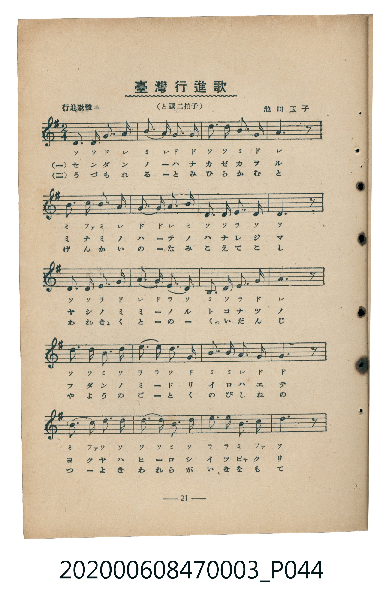
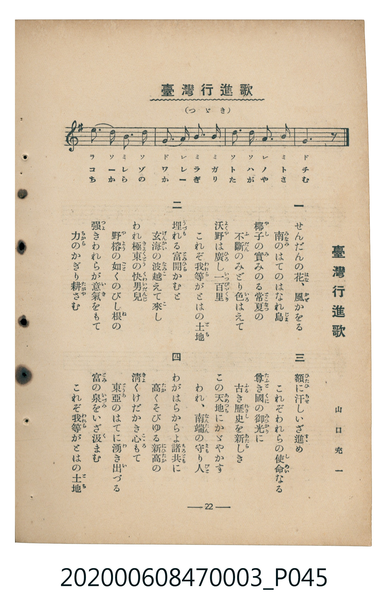

# 臺灣行進歌

> Re:Shōka 使用 AI 協助辨識與重建樂譜，可能會有錯誤。歡迎回報。

- **鋼琴伴奏版**：<br><audio controls src="taiwan_koshinka.mp3"></audio>
- **NEUTRINO 歌聲合成版**：<br><audio controls src="taiwan_koshinka_neutrino.mp3"></audio>

- 詞：山口充一
- 曲：池田玉子
- 臺灣教育會公認《新定兒童唱歌》尋常科第三學年用（2020.006.0847.0003）

## 說明

原書資訊與歌詞全文（對應 P044.jpg – P045.jpg，書頁 pp. 21–22，第二學期第 7 首）：
調性與拍號：と調二拍子（G 大調 2/4 拍），「行進歌體ニ」


## 歌詞

```text
一　せんだんの花、風かをる
南のはてのはなれ島
椰子の實みのる常夏の
不斷のみどり色はえて
沃野は廣し一百里
これぞ我等がととはの土地

二　埋（うづも）れる富開かむと
玄海の波越えて來し
われ極東の快男兒
野榕（やよう）の如くのびし根の
強きわれらが意氣をもて
力のかぎり耕さむ

三　額（ひたひ）に汗しいざ進め
これぞわれらの使命なる
尊き國の御光（みひかり）に
古き歷史を新しき
この天地（あめつち）にかゞやかす
われ、南端の守り人

四　わがはらからよ諸共（もろとも）に
高くそびゆる新高（にひたか）の
清くけだかき心もて
東亞のはてに湧き出づる
富の泉をいざ汲まむ
これぞ我等がととはの土地
```

## ABC

<div class="abc-score" data-abc-src="taiwan_koshinka.abc" aria-label="五線譜載入中"></div>

[下載 ABC 原始檔](taiwan_koshinka.abc)

## TMD 檔案連結

- [主旋律 TMD 檔案](taiwan_koshinka.tmd) [[在 TMD Studio 編輯](https://tmdlang.github.io/Tmd-TS/#tmd=s7IKdvYPcrWy4qpTUCpJTLdSSM7PyUlNLsnMz7MqzsjMK0nNjM_KTMmPL87Iz05Ugisry88pzU21Si9KTEmNN443MjAyiDcwMIs3sDAxBzIMjBFKi_NLi5JTrYqTM_Lzc-JLUitKkvLzsxHyBUX5Zal5iXlANQVFIBtTwIoQClLLMlNSQdKpKZkl-UWZiTlI7kgtKga7FWxJfElRYl5xclFmAcgDCFUlGalAx-Zm5mSWJBZVoosnpxal5ubnoZgLtCY9M8-qJDGzPDEvPj8tLTMZTb4kIx_o-4KMSquMzGKQs5ITc-KzE_OQAgnqqILE9FSrAAMTE10gYarEpaWl8KJ91_PGxS8W9rxs2PRsbY-ClhaXoq2CoaERl72tgjuXjZG-iR3ImBcr573fM-vpxo1P-xc_bW19sqMBbPqz2ZuAws82Lng-ZcPzvs6nayeAhSGmPps680XTpmdzmp-2rnmxqvdxQ9ezaRuerpv1tHXS89VLn07ZCLTwcUP30w3dT3fseL584vM1a57sAJqx4-nOLc-nrHi_pwMUm3rA2NQDxSaQYWD8fk-nEheXvpaCLbUAl4KCwtO--c9m73ixuf3Fiq4XHe1AdwH9-7R1xbNp7UBXPN3Q-6y9UwEUcHpZBekKjxomgzimIM77PT1AnS8XNCoUFOgpGBkC5YyMgIIgv-zqAfrl2Zz5QLaCucLLZdOAjgeGFsjCF6v2P2tYDrKqu_fFzPlA0ceNK4CCQD1AEWAwAq11V3i6ZDlQTAEYBwpAUbBuYID1wGPr5eopj5u7Hzf0coHMBMbJ44aGx42zHzdNfty4AEyue9G18XFD48tFKx43dj9umvS4qRvs397pQLnHjesfNy6DMVY9bup5unkbSPrZkg1AJwAlnq4HSu8HqWgCxdHTJf1ANsSu3mfTtoO1AqVXPm7qetG5CWxMB9BIsBmbml-29wGFnu5e_LhxOtBxz2fue9neA5J73DgZaNnjxnnPOiY-X9v5uBHIBjoQiIAGrHs6Z_7TORsgXtoF9G_D0_ndwOB43Nj2uHHp46YmYDiAdANdtL7n5bRusMeA3l4B0vC8r-XZVpC7nm1e9GJbF8Q5T_YBdU4HW9zUD9T6bOnWZ3M3gmzav_r5lO3A5AiSA7r22bKpIIuaWh43gawDWQRUtKzpcSPI348bNwONebZgJzQMnu4BWtQLMfJxE8gXz1r6n21YDA5moB5wMDztmg3WCnRmHyiUGqY-bpwKdC80xjqB3nu5EBi1QPuA4TcfSIJtXf1sIzCGgKjlceM0YGQ_bmpECTgkW9c92bv_6cS94AiERO4GoL97n84BWrnu6b6FT1uByQZoPDCegDYAw6oLYgNYaf8SoNJna7c_7QdaMQmYPcGW9sLsAhqwZCUwMsAGNAEd8bgRqGEhxACwYUCXAJ0ItGomInyBCQ6YwJ6vBkfmOmB4dj3ZtQvs4aezZ4OSKFAVKMrXg90PNAQYnx0vVu942roRHPxAi3pBqQES1RCXvlw9AxwLc0Gx0NQG9CrQsUBBsMuAToEEHjCdgEIEnP52tII1TARlBZADe5_ub0bECzABPNk1DykTrH62czlIUfsucCqDhOR6oCuBSQnovkmQqHi2EWjRPlD8EZuMgeooL6OgQEFLn4srBFwTeOeDKsXsRKuAzMS8fIcag5pqkFUKNoZmWnZgFrYyUgFcxDYACxAFDRNgQul_vr5BB16waWLRALQRatjLWX1PJ_RaAeN4LzimwWRzJ5hcAyRrgPR8OA8mAyKBMih6IKqgMmDVyABhowbQqZogC3eDNWwGkw1wNkhzH5i3B0z2g8kuqIWrwRaCZSDs5k1QPSAeLgt39YAsbGwDx-5SsOYmMNkDNbYbYWHjCjC5HyLTCDIemJTBYmBVTSCngmRA6rBYWKNgGq-gC4RAyhDMMAKKGUNZEBFDkCqIIqgMSMQIzIJAAyCuAZvnYwiybDZYFFj4A9kL4GyQzDqoDmDyhNKrwOLdUN4cBLtpEtSzCHtAToXaYwTS1QbVtRQcRBBdPSi6QB6H0PuhAQRR1YlkTwM0gLDaY4ykq3E-Ens1WBfEVhAf6ufG6WDxFihvGhDPhLJngl3WiN0eE5BcP1RlDyJ8gC5FhA-ED6E7wKbBfN2L8ClQDKRjNYY9-HPkLlCVTkGOhOYoYL2yECUTglI7IhvCMiZIHj1LroSzYTJYEixSloRaAspsMDYoK4IshGRDSJYE5yM0GYgesFOadkBl5uGxEJolJ4E1TAaRkOwFjGdI9lqHsBCYopGzJER1B5hcBiZBIiCZ6dgthGU_E3g2rIFnREimM0bJtmZwFlwUe67cD01dq5DY68AugaQ1EH8ZFnGwDmC-grBngGX2YU_F4Fw5CZoOQbkflq9b0HL_KigNyZWTobwOJBdAyovp2O0B50qoLqDLgNUflN0PTjsQtyLlFqh_IKaB8iAih4LLH1ylDChXAnM9RGU3EMNy6FyweZvh9kBLIqA5iLwHKiuQdSOHALG5ckcnFetJcAZDqfNgmRIl60HyEk49WJIscqZcAta8HawNUjNC8zo0i0IyJUQGVAuCZMC5owlSt0KyJjRfgdXhshCSKYFRDqsbwS3hdnAsISo9WK5E5FCQDLCJ2AfNvqAqCpatQVIzsFuJJcshqkFDlFxojFsh1pzZBEuL0-EpBJYzIPkUkoKRUxisVgPlMVheWoIjhYHtAeVMWP0CzjHgoIJoBGcaeAWIMAIaULA03wIOKljehgQV7twJS_dbkVzbCzESbhEsn0ByJ6xMAuUaWN3chaMuA9sDzp29UJWgsgPm0olgXRC3QvIesv2w0gYYdsB6E6IbUmdCyh6icyewJ0HF3InIdaCED8l3iHyJyIOQbITeyoVVs1hSLnLunArW0AAmIfkNVjEi505IoQCqx0CpBpyjm9eCSUhmA-UrkB5Q1YrLQmjuBOcwcE8WmgdBABTWUxD2QRuxsFwLzqnAshVEgurIx40gu2EyWOxDb56aAkXMwCwzqAwoA0LkjOE5FlarYs2SwGQLSSQLwIkdM5mC-CtREik0E4ObYrCKE9xIw5KswPaAsyRMFyj5wpqzEHumwO2BZR9IPoUVEJvBwQNhr8WX9cHZEeofYPGByDLgpjKUByl-IOLghje0aQtu9MKrUUjjFqYDW3aEuRUU3TATcDUywE1oePECCjdYQbgUR6VMoAk7hYpNWKS8CXILUTkV2QCYJizpFTlDgpN-03qwPkhGg2aDZnBjE5ohwZkPXKkiMmQzmAQOvi2GGgDSBMqzuGyENmIhuiGdUkiztBdqLlJNCu1DQnuc0HoSpA6UOkAkqEcKSdtYLYRXgibxSPUmvowKa_TC1GDNlkAHw7ICotZcD3YIpF8GyYDIiRWmagkQb3nc1Aw3AGRcF_aUDG7GLoEbCLMUXH0gV6LwfAHJSTCrgCkZGEoQVbgqFrA9yM1YYC6B5xhgAxXFBY0LoTSk0wmrzkAugNkJaRZAupr4c-Z-pDIE0ixfCrcHWgVDSwDkTiwsl-4Dh0EDhj34K8rWtZg5Ezx0TWzORK4IUbMfeq8Se98SpddJREUJbYxCch-kn7gPqhmSVyEGQpwF6-aCcxO0hwlp4IJEQDKNeCyEZsuFIA3QQRtI5gPVdpDoBvGQRpmAyRYiA_YvOJNCK9pGUP0OiSCsFsKyG3IGhA37wOpHRCZF9Dbx1ZSQ9AvJEZA0Mo9APoGlxPVIKXEFWAaSzrHnR1geANZgaN06WH7og7sEUiPDmqDI-WQqjvQLtgeUH6HuRvYPpIsIy6eg-hC1RQDpDIPyOqxEAdXOCJ9iz4-0DbdaLi5dOwXUcVoFoIgyFwA)]
- [鋼琴伴奏 TMD 檔案](taiwan_koshinka_piano.tmd) [[在 TMD Studio 編輯](https://tmdlang.github.io/Tmd-TS/#tmd=s7IKdvYPcrWy4qpTUCpJTLdSyC8qychPL0osyKi0ysgsLskvykxOzInPTsxLVIIrKs4vLUpOjS9ITE-1CjAwMdEFEqZKXFpaCi_adz1vXPxiYc_Lhk3P1va839PxsnvP8wlbnuzZ8nRp__POjvd7OhW0tLgUbRUMDY247G0V3LlsjPRN7EBmv1g57_2eWU83bnzav_hpa-uTHQ1gK5_N3gQUfrZxwfMpG573dT5dOwEsDLHq2dSZL5o2PZvT_LR1zYtVvY8bup5N2_B03aynrZOer176dMpGoCseN3Q_3dD9dMeO58snPl-z5skOoBk7nu7c8nzKCqADjQyMDPQMDMz0DCxMzIEMA2OgG5W4uEISM8sT87zzizMy87ITrQIyE_PygzwcagxqqrkUgMDG0EzLDszS11KwRQcKYIsagCGhoGGi8HRD__P1DToKoMDSyypI18SiQUsfbFiNgmm8gi4QAilDMMMIKGYMZUFEDEGqIIqgMiARIzALAg2AuAZsno9hjcLjxtlg0cdNk4HsBXA2SGYdVMfjxvVQehVYvBvKm4NgN00CyTRBeBAIcirUHiOQrjaorqVAdU1QXT0ouh43roDS-8H2bIKq6kSypwEsA1GHYY8xkq7G-Ujs1WBdEFtBfKifG6eDxVugvGlAPBPKngl2WSN2e0xAcv1QlT2I8AG6FBE-ED6E7gCbBvN1L8KnQDGQjtUY9uBPPbt6yEk9kPRgAk8xNfA0A0kfxigpzAzOgotiT0D7oQGxCom9DuwtSLCA-MuwiIN1AJMAhD0DLLMPe4CDE9AkaJCBEiosCbagJdRVUBqSgCZDeR1ILoAk7enY7QEnIKguoMseN86DsvvBEQhxK1LEQv0DMQ2UXBCJCZxVcGUIUAICJlCIym4ghiWmuWDzNsPtgWYaoDmIZAJK1si6kUOA2AS0o5Oy4geaOBBliyFKejHGrRBrGmqChdp0uF9gcQhJUZCwRg4LWFEBSg2wWF-CIyzgaQiWacFx2_u4qR2qERy98FIFYQRItB-R1VuAGLWInIHdLnA6gsXQViTX9kKMhFsEi1FIOoLlHlD8wgq8LhwFBCId9UJVglI5zKUTwbogboWkEmT7YfkCGHbAwgiiG1IQQXIJ0eno6ezZZKUjsPmwCsoUKGIGZplBZUCpBSJnDE9esMIKa_oBhjHERwvAMYMZpiD-SpQQhaY4cGEMK4_AxTSWMECkH5guUFjDKjSIPVPg9sDiGpKoYKl5Mzh1Q9hr8aVTcNqB-geY1hHxC64soTxIXoGIg6teaOUGrvbgpROkeoPpwJZ2YG5tQzIBV9kNrkTheQEUbrBcuxRHWUegEptCViUGKVBM4pFKI3wpClbpwdRgTT_A-ITFGaIsWo_UCIGkFORQhalaAsRbHjc1ww0AGdeFPcjB1dgSuIEwS8GZErlogkcgJMphVgGDHBjZEFW4sitGNQaMTnjUAisoFBc0LoTSkPYRrJAAuQBmJ6SwhbSK8Ceh_UiJHVItL4XbAy3YoEkVub0FS077wGHQgGEP_uKndS1mEjIlmIQgSQM5scBa07BCB5GgEC0jfMUPJKwhsQfxzzwCcQoLtfVIobYCLAOJE-xpBxZfwGIBrQkCi7s-uEsgxRysEkKO06k4whqedqDuRvYPpDkDS1OgQga1mIU03EDpEpb6QUUecq2KLe3QNtxqsffUfJB7aiaIjhqwXwpMTcAu5dM9_U-3L3vW2Q3pmiISjmG8QrRhLFaGaTyQZRoPZOJUawRkGIFUgBUbYKoElmnRJkSaCleLUAKSxGIqdi0IhfhshYuBwlLXTgE1OKN9gFJYRI2wihpjFQXaDBRV5gIA)]

## 分析

```text
================================================================================
📊 TMD Song Profile: [ 臺灣行進歌 ]
================================================================================
⏱  Duration:       0:25 (25.7s), 24 measures total
🎼 Key & Tempo:    首調基準 G, != 112.0 BPM, <2/4>
   - 分析範圍：      由實際發聲的音符與和弦推測調性；播放脈絡另行呈現
🎤 人聲音域:    B3 (MIDI 59) – E5 (MIDI 76) [跨度: 17 個半音 / 1.4 個八度, 難度: challenging]
   - 最低音:  B3 in [TaiwanKoshinka #1 @ m.11, 0:10]
   - 最高音: E5 in [TaiwanKoshinka #1 @ m.14, 0:13]
   - 適合: soprano, mezzo-soprano, contralto, tenor, baritone, bass
🏛  結構:      TaiwanKoshinka (25.7s)
⚡ 編曲密度:        Peak 1 軌道同時演奏
🗝  調性診斷：       G 調性不明確（純淨自然大調，未偵測到可信轉調）
   - 風格氣質:    純淨自然大調（陽光明朗、易唱易記，無明顯調外色彩）
   - 轉調歷程:    全曲維持單一推測調性（未偵測到可信轉調）
   - 核心骨幹音:  D, B, G, A, E
   - 調性數值:    G 調性不明確 [相關度: 0.80, 穩定度: Ambiguous, 自然音純度: 100.0%]
   - 候選調性 (K-S): G 大調 (0.80), D 大調 (0.80), B 小調 (0.72)
   - 五度圈歷程:   +1
   - 各段落調性細節:
     • [TaiwanKoshinka #1]: G 調性不明確 (r: 0.80, 自然音純度: 100.0%)

  [ 五度圈游移軌跡 ]
               C  
         F           [G ]*
      Bb               D  
      Eb               A  
         Ab           E  
            Db       B  
               F# 
     (* = active key center)

  [ 十二半音累積音高分佈 ]
     C  : █                          1.7%
     C# :                            0.0%
     D  : ████████████████████████  30.0%
     D# :                            0.0%
     E  : ██████████                12.8%
     F  :                            0.0%
     F# :                            0.0%
     G  : ██████████████            17.8%
     G# :                            0.0%
     A  : ████████████              15.6%
     A# :                            0.0%
     B  : ██████████████████        22.2%
--------------------------------------------------------------------------------
Assignment 軌道音域：
  - Piano         : B3 – E5 (17 個半音 / 1.4 個八度, 78 個音符)
================================================================================
```


## 原書掃描頁






