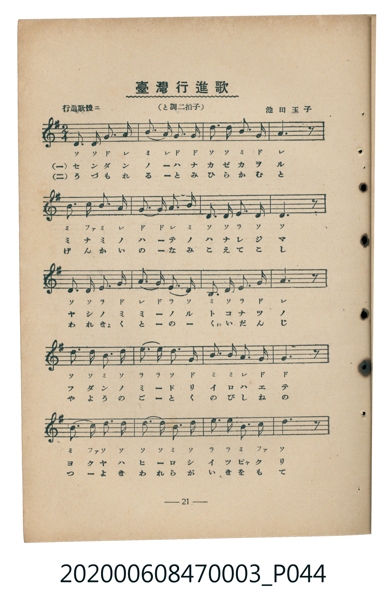
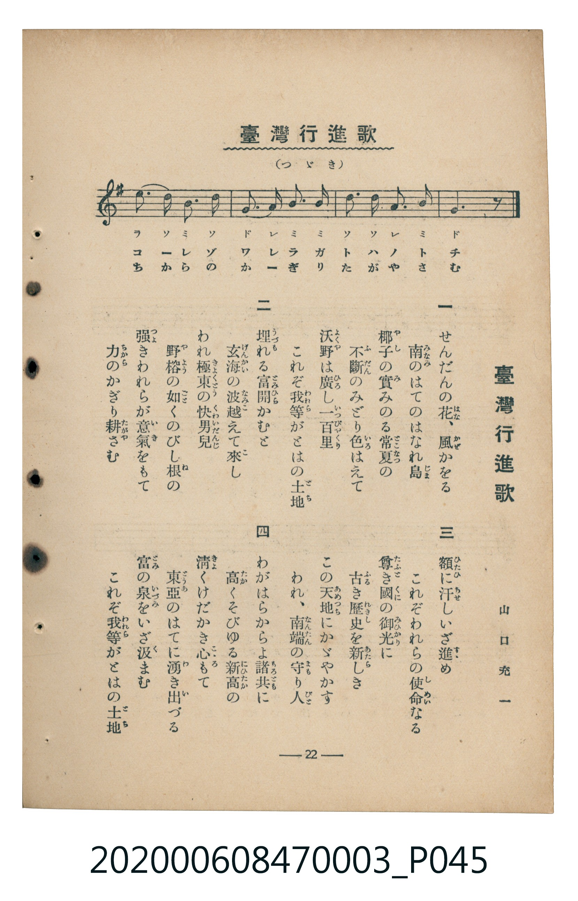

# 臺灣行進歌

<audio controls src="taiwan_koshinka.mp3"></audio>

- 詞：山口充一
- 曲：池田玉子
- 臺灣教育會公認《新定兒童唱歌》尋常科第三學年用（2020.006.0847.0003）

## 說明

原書資訊與歌詞全文（對應 P044.jpg – P045.jpg，書頁 pp. 21–22，第二學期第 7 首）：
調性與拍號：と調二拍子（G 大調 2/4 拍），「行進歌體ニ」

## 歌詞

```text
一　せんだんの花、風かをる
南のはてのはなれ島
椰子の實みのる常夏の
不斷のみどり色はえて
沃野は廣し一百里
これぞ我等がととはの土地

二　埋（うづも）れる富開かむと
玄海の波越えて來し
われ極東の快男兒
野榕（やよう）の如くのびし根の
強きわれらが意氣をもて
力のかぎり耕さむ

三　額（ひたひ）に汗しいざ進め
これぞわれらの使命なる
尊き國の御光（みひかり）に
古き歷史を新しき
この天地（あめつち）にかゞやかす
われ、南端の守り人

四　わがはらからよ諸共（もろとも）に
高くそびゆる新高（にひたか）の
清くけだかき心もて
東亞のはてに湧き出づる
富の泉をいざ汲まむ
これぞ我等がととはの土地
```

## 原書掃描頁





## 分析

```text
================================================================================
📊 TMD Song Profile: [ 臺灣行進歌 ]
================================================================================
⏱  Duration:       0:25 (25.7s), 24 measures total
🎼 Key & Tempo:    首調基準 G, != 112.0 BPM, <2/4>
   - 分析範圍：      由實際發聲的音符與和弦推測調性；播放脈絡另行呈現
🎤 人聲音域:    B3 (MIDI 59) – E5 (MIDI 76) [跨度: 17 個半音 / 1.4 個八度, 難度: challenging]
   - 最低音:  B3 in [TaiwanKoshinka #1 @ m.11, 0:10]
   - 最高音: E5 in [TaiwanKoshinka #1 @ m.14, 0:13]
   - 適合: soprano, mezzo-soprano, contralto, tenor, baritone, bass
🏛  結構:      TaiwanKoshinka (25.7s)
⚡ 編曲密度:        Peak 1 軌道同時演奏
🗝  調性診斷：       G 調性不明確（純淨自然大調，未偵測到可信轉調）
   - 風格氣質:    純淨自然大調（陽光明朗、易唱易記，無明顯調外色彩）
   - 轉調歷程:    全曲維持單一推測調性（未偵測到可信轉調）
   - 核心骨幹音:  D, B, G, A, E
   - 調性數值:    G 調性不明確 [相關度: 0.80, 穩定度: Ambiguous, 自然音純度: 100.0%]
   - 候選調性 (K-S): G 大調 (0.80), D 大調 (0.80), B 小調 (0.72)
   - 五度圈歷程:   +1
   - 各段落調性細節:
     • [TaiwanKoshinka #1]: G 調性不明確 (r: 0.80, 自然音純度: 100.0%)

  [ 五度圈游移軌跡 ]
               C  
         F           [G ]*
      Bb               D  
      Eb               A  
         Ab           E  
            Db       B  
               F# 
     (* = active key center)

  [ 十二半音累積音高分佈 ]
     C  : █                          1.7%
     C# :                            0.0%
     D  : ████████████████████████  30.0%
     D# :                            0.0%
     E  : ██████████                12.8%
     F  :                            0.0%
     F# :                            0.0%
     G  : ██████████████            17.8%
     G# :                            0.0%
     A  : ████████████              15.6%
     A# :                            0.0%
     B  : ██████████████████        22.2%
--------------------------------------------------------------------------------
Assignment 軌道音域：
  - Piano         : B3 – E5 (17 個半音 / 1.4 個八度, 78 個音符)
================================================================================
```

## ABC

```abc
X:1
T:臺灣行進歌
C:曲：池田玉子
M:2/4
L:1/16
Q:1/4=112
K:G
V:V1 name="Piano" snm="Pia"
[V:V1]
d3 d g3 a | b3 a g3 g | d3 d b3 g | a6 z2 |
b3 c b3 a | g3 g a3 b | d3 d e3 d | d6 z2 |
d3 d e3 g | a3 g e3 d | B3 d e3 g | a6 z2 |
d3 d b3 d | e3 e d3 g | b3 b a3 g | g6 z2 |
B3 c d3 d | d3 d b3 d | e3 e b3 c | d6 z2 |
e3 d b3 d | g3 a b3 b | d3 d a3 b | g6 z2 |
```

- [主旋律 TMD 檔案](taiwan_koshinka.tmd)
- [鋼琴伴奏 TMD 檔案](taiwan_koshinka_piano.tmd)
