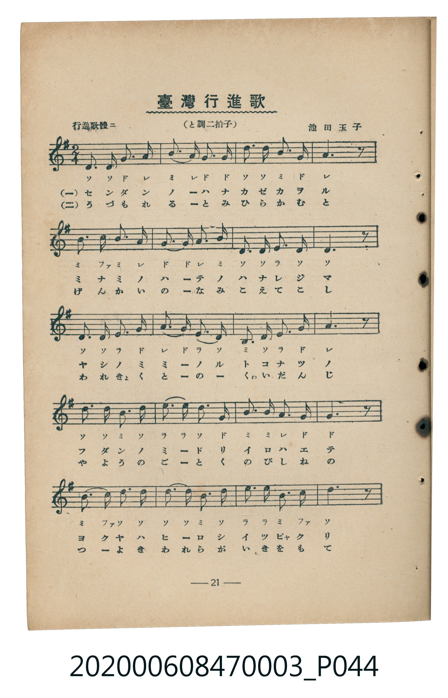
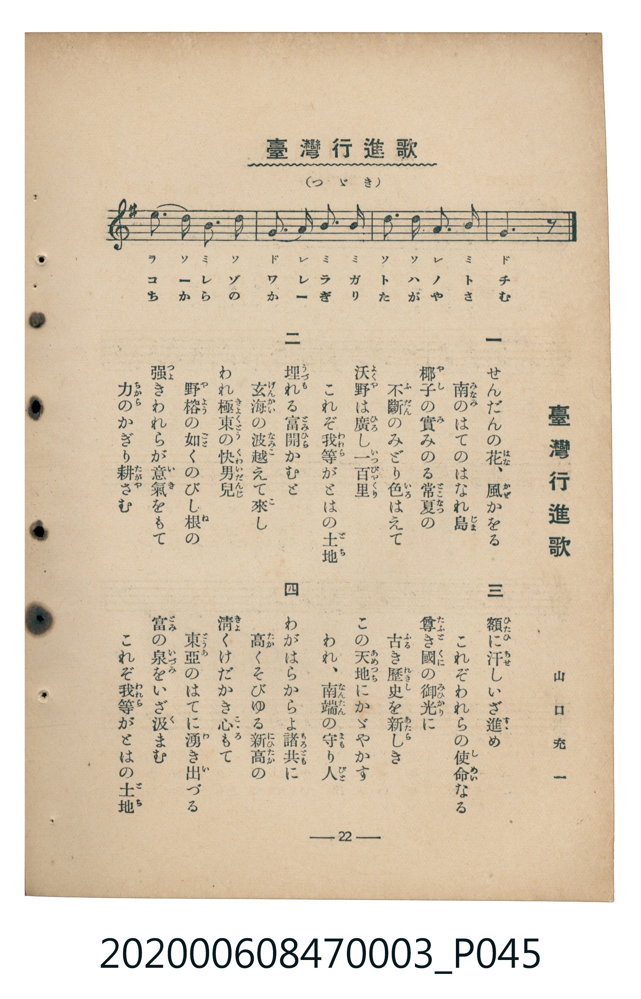

# 臺灣行進歌

> Re:Shōka 使用 AI 協助辨識與重建樂譜，可能會有錯誤。歡迎回報。

- **鋼琴伴奏版**：<br><audio controls src="taiwan_koshinka.mp3"></audio>
- **NEUTRINO 歌聲合成版**：<br><audio controls src="taiwan_koshinka_neutrino.mp3"></audio>

- 詞：山口充一
- 曲：池田玉子
- 臺灣教育會公認《新定兒童唱歌》尋常科第三學年用（2020.006.0847.0003）

## 說明

原書資訊與歌詞全文（對應 P044.jpg – P045.jpg，書頁 pp. 21–22，第二學期第 7 首）：
調性與拍號：と調二拍子（G 大調 2/4 拍），「行進歌體ニ」


## 歌詞

```text
一　せんだんの花、風かをる
南のはてのはなれ島
椰子の實みのる常夏の
不斷のみどり色はえて
沃野は廣し一百里
これぞ我等がととはの土地

二　埋（うづも）れる富開かむと
玄海の波越えて來し
われ極東の快男兒
野榕（やよう）の如くのびし根の
強きわれらが意氣をもて
力のかぎり耕さむ

三　額（ひたひ）に汗しいざ進め
これぞわれらの使命なる
尊き國の御光（みひかり）に
古き歷史を新しき
この天地（あめつち）にかゞやかす
われ、南端の守り人

四　わがはらからよ諸共（もろとも）に
高くそびゆる新高（にひたか）の
清くけだかき心もて
東亞のはてに湧き出づる
富の泉をいざ汲まむ
これぞ我等がととはの土地
```

## ABC

<div class="abc-score" data-abc-src="taiwan_koshinka.abc" aria-label="五線譜載入中"></div>

[下載 ABC 原始檔](taiwan_koshinka.abc)

## TMD 檔案連結

- [主旋律 TMD 檔案](taiwan_koshinka.tmd) [[在 TMD Studio 編輯](https://tmdlang.github.io/Tmd-TS/#tmd=s7IKdvYPcrWy4qpTUCpJTLdSSM7PyUlNLsnMz7MqzsjMK0nNjM_KTMmPL87Iz05Ugisry88pzU21Si9KTEmNN443MjAyiDcwMIs3sDAxBzIMjBFKi_NLi5JTrYqTM_Lzc-JLUitKkvLzsxHyBUX5Zal5iXlANQVFIBtTwIoQClLLMlNSQdKpKZkl-UWZiTlI7kgtKga7FWxJfElRYl5xclFmAcgDCFUlGalAx-Zm5mSWJBZVoosnpxal5ubnoZgLtCY9M8-qJDGzPDEvPj8tLTMZLK-lpfCifdfzxsUvFva8bNj0bG2PgpYWl6KtgqGhEZe9rYI7l42RvokdyJwXK-e93zPr6caNT_sXP21tfbKjAWz8s9mbgMLPNi54PmXD877Op2sngIUhpj6bOvNF06Znc5qftq55sar3cUPXs2kbnq6b9bR10vPVS59O2Qi08HFD99MN3U937Hi-fOLzNWue7ACasePpzi3Pp6x4v6cDFBN6wJjQA8UEkGFg_H5PpxIXl76Wgi21AJeCgsLTvvnPZu94sbn9xYquFx3tQHcB_fu0dcWzae1AVzzd0PusvVMhwMDERC-rIF3hUcNkEMcUxHm_pweo8-WCRoWCAj0FI0OgnJERUBDkl109QL88mzMfyFYwV3i5bBrQ8cDQAln4YtX-Zw3LQVZ1976YOR8o-rhxBVAQqAcoAgxGoLXuCk-XLAeKKQDjQAEoCtYNDLAeeGy9XD3lcXP344ZeLpCZwDh53NDwuHH246bJjxsXgMl1L7o2Pm5ofLloxePG7sdNkx43dYP92zsdKPe4cf3jxmUwxqrHTT1PN28DST9bsgHoBKDE0_VA6f0gFU2gOHq6pB_IhtjV-2zadrBWoPTKx01dLzo3gY3pABoJNmNT88v2PqDQ092LHzdOBzru-cx9L9t7QHKPGycDLXvcOO9Zx8TnazsfNwLZQAcCEdCAdU_nzH86ZwPES7uA_m14Or8bGByPG9seNy593NQEDAeQbqCL1ve8nNYN9hjQ2ytAGp73tTzbCnLXs82LXmzrgjjnyT6gzulgi5v6gVqfLd36bO5GkE37Vz-fsh2YHEFyQNc-WzYVZFFTy-MmkHUgi4CKljU9bgT5-3HjZqAxzxbshIbB0z1Ai3ohRj5uAvniWUv_sw2LwcEM1AMOhqdds8Fagc7sA4VSw9THjVOB7oXGWCfQey8XAqMWaB8w_OYDSbCtq59tBMYQELU8bpwGjOzHTY0oAYdk67one_c_nbgXHIGQyN0A9Hfv0zlAK9c93bfwaSsw2QCNB8YT0AZgWHVBbAAr7V8CVPps7fan_UArJgGzJ9jSXphdQAOWrARGBtiAJqAjHjcCNSyEGAA2DOgSoBOBVs1EhC8wwQET2PPV4MhcBwzPrie7doE9_HT2bFASBaoCRfl6sPuBhgDjs-PF6h1PWzeCgx9oUS8oNUCiGuLSl6tngGNhLigWmtqAXgU6FigIdhnQKZDAA6YTUIiA09-OVrCGiaCsAHJg79P9zYh4ASaAJ7vmIWWC1c92Lgcpat8FTmWQkFwPdCUwKQHdNwkSFc82Ai3aB4o_YpMxUB3lZRQUKGjpc3GFgEtx73xQhZadaBWQmZiX71BjUFMNskrBxtBMyw7MwlZGKoCL2AZgAaKgYQJMKP3P1zfowAs2TSwagDZCDXs5q-_phF4rYBzvBcc0mGzuBJNrgGQNkJ4P58FkQCRQBkUPRBVUBqwaGSBs1AA6VRNk4W6whs1gsgHOBmnuA_P2gMl-MNkFtXA12EKwDITdvAmqB8TDZeGuHpCFjW3g2F0K1twEJnugxnYjLGxcASb3Q2QaQcYDkzJYDKyqCeRUkAxIHRYLaxRM4xV0gRBIGYIZRkAxYygLImIIUgVRBJUBiRiBWRBoAMQ1YPN8DEGWzQaLAgt_IHsBnA2SWQfVAUyeUHoVWLwbypuDYDdNgnoWYQ_IqVB7jEC62qC6loKDCKKrB0UXyOMQej80gCCqOpHsaYAGEFZ7jJF0Nc5HYq8G64LYCuJD_dw4HSzeAuVNA-KZUPZMsMsasdtjApLrh6rsQYQP0KWI8IHwIXQH2DSYr3sRPgWKgXSsxrAHf47cBarSKciR0BwFrFcWomRCUGpHZENYxgTJo2fJlXA2TAZLgkXKklBLQJkNxgZlRZCFkGwIyZLgfIQmA9EDdkrTDqjMPDwWQrPkJLCGySASkr2A8QzJXusQFgJTNHKWhKjuAJPLwCRIBCQzHbuFsOxnAs-GNfCMCMl0xijZ1gzOgotiz5X7oalrFRJ7HdglkLQG4i_DIg7WAcxXEPYMsMw-7KkYnCsnQdMhKPfD8nULWu5fBaUhuXIylNeB5AJIeTEduz3gXAnVBXQZsPqDsvvBaQfiVqTcAvUPxDRQHkTkUHD5g6uUAeVKYK6HqOwGYlgOnQs2bzPcHmhJBDQHkfdAZQWybuQQIDZX7uikYj0JzmAodR4sU6JkPUhewqkHS5JFzpRLwJq3g7VBakZoXodmUUimhMiAakGQDDh3NEHqVkjWhOYrsDpcFkIyJTDKYXUjuCXcDo4lRKUHy5WIHAqSATYR-6DZF1RFwbI1SGoGdiuxZDlENWiIkguNcSvEmjObYGlxOjyFwHIGJJ9CUjByCoPVaqA8BstLS3CkMLA9oJwJq1_AOQYcVBCN4EwDrwARRkADCpbmW8BBBcvbkKDCnTth6X4rkmt7IUbCLYLlE0juhJVJoFwDq5u7cNRlYHvAubMXqhJUdsBcOhGsC-JWSN5Dth9W2gDDDlhvQnRD6kxI2UN07gT2JKiYOxG5DpTwIfkOkS8ReRCSjdBbubBqFkvKRc6dU8EaGsAkJL_BKkbk3AkpFED1GCjVgHN081owCclsoHwF0gOqWnFZCM2d4BwG7slC8yAIgMJ6CsI-aCMWlmvBORVYtoJIUB35uBFkN0wGi33ozVNToIgZmGUGlQFlQIicMTzHwmpVrFkSmGwhiWQBOLFjJlMQfyVKIoVmYnBTDFZxghtpWJIV2B5wloTpAiVfWHMWYs8UuD2w7APJp7ACYjM4eCDstfiyPjg7Qv0DLD4QWQbcVIbyIMUPRBzc8IY2bcGNXng1CmncwnRgy44wt4KiG2YCrkYGuAkNL15A4QYrCJfiqJQJNGGnULEJi5Q3QW4hKqciGwDThCW9ImdIcNJvWg_WB8lo0GzQDG5sQjMkOPOBK1VEhmwGk8DBt8VQA0CaQHkWl43QRixEN6RTCmmW9kLNRapJoX1IaI8TWk-C1IFSB4gE9UghaRurhfBK0CQeqd7El1FhjV6YGqzZEuhgWFZA1JrrwQ6B9MsgGRA5scJULQHiLY-bmuEGgIzrwp6Swc3YJXADYZaCqw_kShSeLyA5CWYVMCUDQwmiClfFArYHuRkLzCXwHANsoKK4oHEhlIZ0OmHVGcgFMDshzQJIVxN_ztyPVIZAmuVL4fZAq2BoCYDciYXl0n3gMGjAsAd_Rdm6FjNngoeuic2ZyBUhavZD71Vi71ui9DqJqCihjVFI7oP0E_dBNUPyKsRAiLNg3VxwboL2MCENXJAISKYRj4XQbLkQpAE6aAPJfKDaDhLdIB7SKBMw2UJkwP4FZ1JoRdsIqt8hEYTVQlh2Q86AsGEfWP2IyKSI3ia-mhKSfiE5ApJG5hHIJ7CUuB4pJa4Ay0DSOfb8CMsDwBoMrVsHyw99cJdAamRYExQ5n0zFkX7B9oDyI9TdyP6BdBFh-RRUH6K2CCCdYVBeh5UooNoZ4VPs-ZG24VbLxaVrp4A6TqsAFFHmAgA)]
- [鋼琴伴奏 TMD 檔案](taiwan_koshinka_piano.tmd) [[在 TMD Studio 編輯](https://tmdlang.github.io/Tmd-TS/#tmd=s7IKdvYPcrWy4tLSUnjRvut54-IXC3teNmx6trbn_Z6Ol917nk_Y8mTPlqdL-593drzf06mgpcWlaKtgaGjEZW-r4M5lY6RvYsdVp6D0YuW893tmPd248Wn_4qetrU92NCiBhJ_N3gQUfrZxwfMpG573dT5dOwEsDLHq2dSZL5o2PZvT_LR1zYtVvY8bup5N2_B03aynrZOer176dMpGoCseN3Q_3dD9dMeO58snPl-z5skOoBk7nu7c8nzKCqADjQyMDPQMDMz0DCxMzIEMA2OgG5W4uEISM8sT87zzizMy87ITrQIyE_PygzwcagxqqrkUgMDG0EzLDszS11KwRQcKYIsagCGhoGGi8HRD__P1DToKAQYmJnpZBemaWDRo6YMNq1EwjVfQBUIgZQhmGAHFjKEsiIghSBVEEVQGJGIEZkGgARDXgM3zMaxReNw4Gyz6uGkykL0AzgbJrIPqeNy4HkqvAot3Q3lzEOymSSCZJggPAkFOhdpjBNLVBtW1FKiuCaqrB0XX48YVUHo_2J5NUFWdSPY0gGUg6jDsMUbS1Tgfib0arAtiK4gP9XPjdLB4C5Q3DYhnQtkzwS5rxG6PCUiuH6qyBxE-QJciwgfCh9AdYNNgvu5F-BQoBtKxGsMe_KlnVw85qQeSHkzgKaYGnmYg6cMYJYWZwVlwUewJaD80IFYhsdeBvQUJFhB_GRZxsA5gEoCwZ4Bl9mEPcHACmgQNMlBChSXBFrSEugpKQxLQZCivA8kFkKQ9Hbs94AQE1QV02ePGeVB2PzgCIW5FiliofyCmgZILIjGBswquDAFKQMAEClHZDcSwxDQXbN5muD3QTAM0B5FMQMkaWTdyCBCbgHZ0Ulb8QBMHomwxREkvxrgVYk1DTbBQmw73CywOISkKEtbIYQErKkCpARbrS3CEBTwNwTItOG57Hze1QzWCoxdeqiCMAIn2I7J6CxCjFpEzsNsFTkewGNqK5NpeiJFwi2AxCklHsNwDil9YgdeFo4BApKNeqEpQKoe5dCJYF8StkFSCbD8sXwDDDlgYQXRDCiJILiE6HT2dPZusdAQ2H1ZBmQJFzMAsM6gMKLVA5IzhyQtWWGFNP8AwhvhoAThmMMMUxF-JEqLQFAcujGHlEbiYxhIGiPQD0wUKa1iFBrFnCtweWFxDEhUsNW8Gp24Iey2-dApOO1D_ANM6In7BlSWUB8krEHFw1Qut3MDVHrx0glRvMB3Y0g7MrW1IJuAqu8GVKDwvgMINlmuX4ijrCFRiU8iqxCAFikk8UmmEL0XBKj2YGqzpBxifsDhDlEXrkRohkJSCHKowVUuAeMvjpma4ASDjurAHObgaWwI3EGYpOFMiF03wCIREOcwqYJADIxuiCld2xajGgNEJj1pgBYXigsaFUBrSPoIVEiAXwOyEFLaQVhH-JLQfKbFDquWlcHugBRs0qSK3t2DJaR84DBow7MFf_LSuxUxCpgSTECRpICcWWGsaVuggEhSiZYSv-IGENST2IP6ZRyBOYaG2HinUVoBlIHGCPe3A4gtYLKA1QWBx1wd3CaSYg1VCyHE6FUdYw9MO1N3I_oE0Z2BpClTIoBazkIYbKF3CUj-oyEOuVbGlHdqGWy32npoPck_NBNFRA_ZLgakJ2KV8uqf_6fZlzzq7IV1TRMIxjFeINozFyjCNB7JM44FMnGqNgAwjkAqwYgNMlcAyLdqESFPhahFKQJJYTMWuBaEQn61wMVBY6topoAZntA9QCouoEVZRY6yiQJuBospcAA)]

## 分析

```text
================================================================================
📊 TMD Song Profile: [ 臺灣行進歌 ]
================================================================================
⏱  Duration:       0:25 (25.7s), 24 measures total
🎼 Key & Tempo:    首調基準 G, != 112.0 BPM, <2/4>
   - 分析範圍：      由實際發聲的音符與和弦推測調性；播放脈絡另行呈現
🎤 人聲音域:    B3 (MIDI 59) – E5 (MIDI 76) [跨度: 17 個半音 / 1.4 個八度, 難度: challenging]
   - 最低音:  B3 in [TaiwanKoshinka #1 @ m.11, 0:10]
   - 最高音: E5 in [TaiwanKoshinka #1 @ m.14, 0:13]
   - 適合: soprano, mezzo-soprano, contralto, tenor, baritone, bass
🏛  結構:      TaiwanKoshinka (25.7s)
⚡ 編曲密度:        Peak 1 軌道同時演奏
🗝  調性診斷：       G 調性不明確（純淨自然大調，未偵測到可信轉調）
   - 風格氣質:    純淨自然大調（陽光明朗、易唱易記，無明顯調外色彩）
   - 轉調歷程:    全曲維持單一推測調性（未偵測到可信轉調）
   - 核心骨幹音:  D, B, G, A, E
   - 調性數值:    G 調性不明確 [相關度: 0.80, 穩定度: Ambiguous, 自然音純度: 100.0%]
   - 候選調性 (K-S): G 大調 (0.80), D 大調 (0.80), B 小調 (0.72)
   - 五度圈歷程:   +1
   - 各段落調性細節:
     • [TaiwanKoshinka #1]: G 調性不明確 (r: 0.80, 自然音純度: 100.0%)

  [ 五度圈游移軌跡 ]
               C  
         F           [G ]*
      Bb               D  
      Eb               A  
         Ab           E  
            Db       B  
               F# 
     (* = active key center)

  [ 十二半音累積音高分佈 ]
     C  : █                          1.7%
     C# :                            0.0%
     D  : ████████████████████████  30.0%
     D# :                            0.0%
     E  : ██████████                12.8%
     F  :                            0.0%
     F# :                            0.0%
     G  : ██████████████            17.8%
     G# :                            0.0%
     A  : ████████████              15.6%
     A# :                            0.0%
     B  : ██████████████████        22.2%
--------------------------------------------------------------------------------
Assignment 軌道音域：
  - Piano         : B3 – E5 (17 個半音 / 1.4 個八度, 78 個音符)
================================================================================
```


## 原書掃描頁






