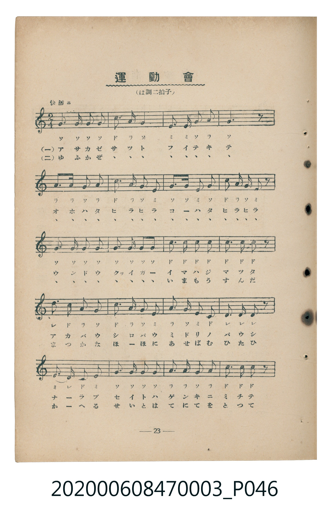
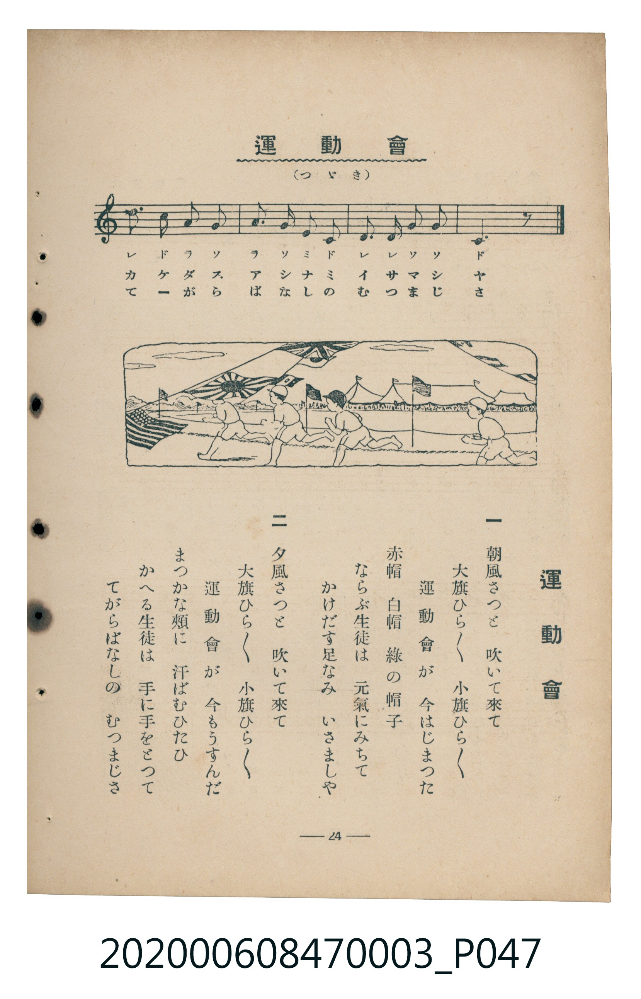

# 運動會

<audio controls src="undokai.mp3"></audio>

- 臺灣教育會公認『新定兒童唱歌』尋常科第三學年用（第二學期・第8首）
- 國立臺灣歷史博物館典藏（典藏號：2020.006.0847.0003）

- note

【曲目說明】
・出處：臺灣教育會公認、臺北新高堂發行《新定兒童唱歌》尋常科第三學年用（昭和6年／1931年），
第二學期第 8 首〈運動會〉，原書第 23–24 頁（掃描檔 P046.jpg–P047.jpg）。
亦收錄於臺灣總督府編《公學校唱歌》第三學年用第十課。
・調性與拍號：ハ調（C 大調），2/4 拍，速度標示「快活ニ」（!= 120）。
・背景與曲風：描寫秋季運動會大小旗幟迎風飄揚、頭戴紅白綠帽的學童精神抖擻列隊起跑，
以及夕陽下運動會圓滿落幕、學童手牽手細數今日佳績的歡樂情景。
・版本說明：本檔案為原書單聲部五線譜（附移動 Do 階名片假名）之忠實數位化版本。

・編曲說明（鋼琴伴奏版）：
1. 前奏 (Intro, 4 小節)：以號角般的同音附點動機與明亮終止式揭開運動會序幕。
2. 主歌伴奏 (Undokai, 24 小節 × 2 段)：右手演奏精神飽滿的進行曲旋律；
左手採用輕快有彈性的八分音符進行曲伴奏，帶出整齊劃一的步伐感。

## 歌詞

```text
一　朝風さつと　吹いて來て
大旗ひらひら　小旗ひらひら
運動會が　今はじまつた
赤帽　白帽　綠の帽子
ならぶ生徒は　元氣にみちて
かけだす足なみ　いさましや

二　夕風さつと　吹いて來て
大旗ひらひら　小旗ひらひら
運動會が　今もうすんだ
まつかな頰に　汗ばむひたひ
かへる生徒は　手に手をとつて
てがらばなしの　むつまじさ
```

## 原書掃描頁





## 調性分析

```text
================================================================================
📊 TMD Song Profile: [ 運動會 ]
================================================================================
⏱  Duration:       0:24 (24.0s), 24 measures total
🎼 Key & Tempo:    首調基準 C, != 120.0 BPM, <2/4>
   - 分析範圍：      由實際發聲的音符與和弦推測調性；播放脈絡另行呈現
🎤 人聲音域:    C4 (MIDI 60) – D5 (MIDI 74) [跨度: 14 個半音 / 1.2 個八度, 難度: moderate]
   - 最低音:  C4 in [Undokai #1 @ m.15, 0:14]
   - 最高音: D5 in [Undokai #1 @ m.13, 0:12]
   - 適合: soprano, mezzo-soprano, contralto, tenor, baritone, bass
🏛  結構:      Undokai (24.0s)
⚡ 編曲密度:        Peak 1 軌道同時演奏
🗝  調性診斷：       C 大調（純淨自然大調，未偵測到可信轉調）
   - 風格氣質:    純淨自然大調（陽光明朗、易唱易記，無明顯調外色彩）
   - 轉調歷程:    全曲維持單一推測調性（未偵測到可信轉調）
   - 核心骨幹音:  G, C, A, E, D
   - 調性數值:    C 大調 [相關度: 0.83, 穩定度: Moderate, 自然音純度: 100.0%]
   - 候選調性 (K-S): C 大調 (0.83), G 大調 (0.75), A 小調 (0.60)
   - 五度圈歷程:   +0
   - 各段落調性細節:
     • [Undokai #1]: C 大調 (r: 0.83, 自然音純度: 100.0%)

  [ 五度圈游移軌跡 ]
              [C ]*
         F            G  
      Bb               D  
      Eb               A  
         Ab           E  
            Db       B  
               F# 
     (* = active key center)

  [ 十二半音累積音高分佈 ]
     C  : ██████████████████        25.0%
     C# :                            0.0%
     D  : ███████                    9.4%
     D# :                            0.0%
     E  : ████████                  11.7%
     F  :                            0.0%
     F# :                            0.0%
     G  : ████████████████████████  33.3%
     G# :                            0.0%
     A  : ███████████████           20.6%
     A# :                            0.0%
     B  :                            0.0%
--------------------------------------------------------------------------------
Assignment 軌道音域：
  - Piano         : C4 – D5 (14 個半音 / 1.2 個八度, 86 個音符)
================================================================================
```

## ABC

```abc
X:1
T:運動會
C:TMD (Chen, Chih-Han / aguai)
M:2/4
L:1/16
Q:1/4=120
K:C

V:V1 name="Piano" snm="Pia"

[V:V1]
g3 g g2 g2 | c3 a g4 | e3 e g2 a2 | g6 z2 |
a3 a a2 a2 | c3 a g2 e2 | a3 a e2 a2 | c2 a g e2 z2 |
g3 g g2 g2 | g3 g g2 g2 | c3 c c2 c2 | c3 c c2 z2 |
d3 c a2 g2 | c3 a g2 e2 | a3 a e2 c2 | d3 d d2 z2 |
e3 d c2 e2 | g3 g g2 g2 | a3 a g2 a2 | c3 c c2 z2 |
d3 c a2 g2 | a3 g e2 c2 | d3 d g2 g2 | c6 z2 |
```

- [主旋律 TMD 檔案](undokai.tmd)
- [鋼琴伴奏 TMD 檔案](undokai_piano.tmd)
