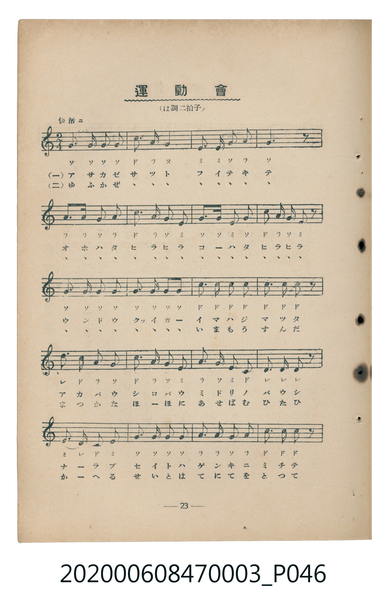
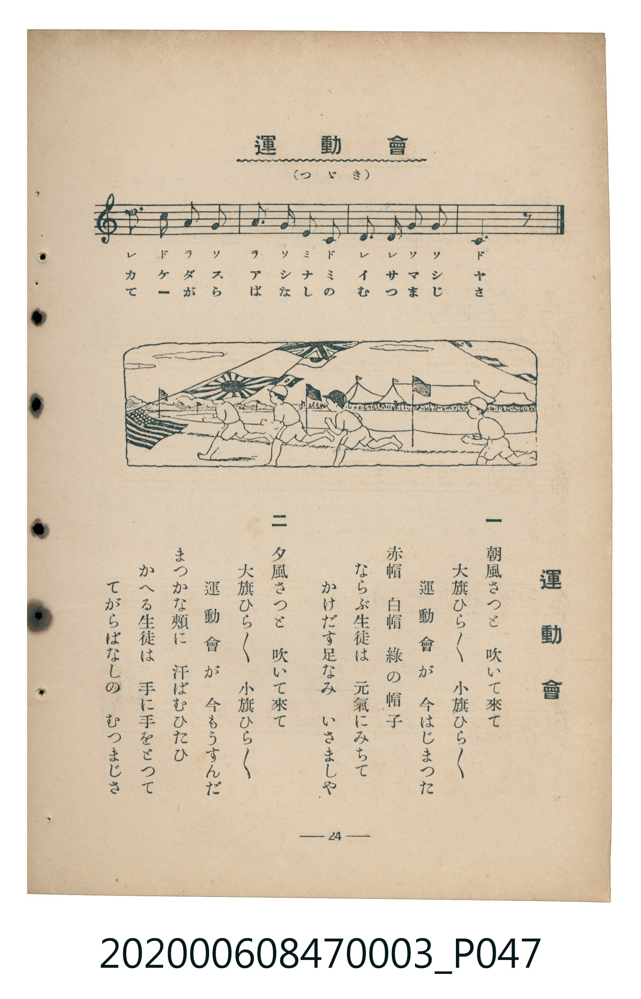

# 運動會

> Re:Shōka 使用 AI 協助辨識與重建樂譜，可能會有錯誤。歡迎回報。

- **NEUTRINO 歌聲合成版**：<br><audio controls src="undokai_neutrino.mp3"></audio>
- **鋼琴伴奏版**：<br><audio controls src="undokai.mp3"></audio>


- 臺灣教育會公認『新定兒童唱歌』尋常科第三學年用（第二學期・第8首）
- 國立臺灣歷史博物館典藏（典藏號：2020.006.0847.0003）

## 說明


- 出處：臺灣教育會公認、臺北新高堂發行《新定兒童唱歌》尋常科第三學年用（昭和6年／1931年），

第二學期第 8 首〈運動會〉，原書第 23–24 頁（掃描檔 P046.jpg–P047.jpg）。
亦收錄於臺灣總督府編《公學校唱歌》第三學年用第十課。
- 調性與拍號：ハ調（C 大調），2/4 拍，速度標示「快活ニ」（!= 120）。

- 背景與曲風：描寫秋季運動會大小旗幟迎風飄揚、頭戴紅白綠帽的學童精神抖擻列隊起跑，

以及夕陽下運動會圓滿落幕、學童手牽手細數今日佳績的歡樂情景。
- 版本說明：本檔案為原書單聲部五線譜（附移動 Do 階名片假名）之忠實數位化版本。


### 編曲說明（鋼琴伴奏版）：

1. 前奏 (Intro, 4 小節)：以號角般的同音附點動機與明亮終止式揭開運動會序幕。
2. 主歌伴奏 (Undokai, 24 小節 × 2 段)：右手演奏精神飽滿的進行曲旋律；
左手採用輕快有彈性的八分音符進行曲伴奏，帶出整齊劃一的步伐感。


## 跨冊／重複收錄參照

> 同曲＋同詞異曲＋同名異曲（《公學校唱歌》與《新定兒童唱歌》三年級為同曲，與《公學校唱歌集》一條慎三郎作曲版同採臺灣總督府讀本歌詞；《新定兒童唱歌》高男用與《共益商社唱歌教科書》卷一為同名異曲）

- **[同曲]** 《公學校唱歌》第三學年（昭和10年／1935）：[**〈うんどうくわい（運動會）〉**](../../../kogakko_shoka/grade_3/10_undokai/index.md)（`C` / `2/4` — [原始 TMD](../../../kogakko_shoka/grade_3/10_undokai/undokai.tmd)）
- **[同詞異曲]** 《公學校唱歌集》（大正4年／1915，國臺圖 0725 26）：[**〈運動會〉**](../../../kogakko_shokashu_1915/3_05_undokai/index.md)（`C` / `2/4` — [原始 TMD](../../../kogakko_shokashu_1915/3_05_undokai/undokai.tmd)）
- **[同名異曲]** 《共益商社唱歌教科書》卷一・生徒用（明治38年／1905）：[**〈運動會〉**](../../../kyoeki_shoka/kan_1_854862/11_undokai/index.md)（`G` / `2/4` — [原始 TMD](../../../kyoeki_shoka/kan_1_854862/11_undokai/undokai.tmd)）
- **[同名異曲]** 《新定兒童唱歌》高等科男子用（2020.006.0848）：[**〈運動會〉**](../../koto_boys_2020.006.0848/1_2_02_undokai/index.md)（`G` / `2/4` — [原始 TMD](../../koto_boys_2020.006.0848/1_2_02_undokai/undokai.tmd)）
- 總表：[跨冊重複與同名歌曲總索引](../../../duplicate_songs.md)

## 歌詞

```text
一　朝風さつと　吹いて來て
大旗ひらひら　小旗ひらひら
運動會が　今はじまつた
赤帽　白帽　綠の帽子
ならぶ生徒は　元氣にみちて
かけだす足なみ　いさましや

二　夕風さつと　吹いて來て
大旗ひらひら　小旗ひらひら
運動會が　今もうすんだ
まつかな頰に　汗ばむひたひ
かへる生徒は　手に手をとつて
てがらばなしの　むつまじさ
```

## ABC

```abc
X:1
T:運動會
M:2/4
L:1/16
Q:1/4=120
K:C
V:V1 name="Piano" snm="Pia"
[V:V1]
G3 G G2 G2 | c3 A G4 | E3 E G2 A2 | G6 z2 |
w: 1.~あ さ か ぜ | さ つ と | ふ い て き | て
w: 2.~ゆ ふ か ぜ | さ つ と | ふ い て き | て
A3 A A2 A2 | c3 A G2 E2 | A3 A E2 A2 | c2 A G E2 z2 |
w: 1.~お ほ は た | ひ ら ひ ら | こ _ は た | ひ ら ひ ら
w: 2.~お ほ は た | ひ ら ひ ら | こ _ は た | ひ ら ひ ら
G3 G G2 G2 | G3 G G2 G2 | c3 c c2 c2 | c3 c c2 z2 |
w: 1.~う ん ど う | くわ い が _ | い ま は じ | ま つ た
w: 2.~う ん ど う | くわ い が _ | い ま も う | す ん だ
d3 c A2 G2 | c3 A G2 E2 | A3 A E2 C2 | D3 D D2 z2 |
w: 1.~あ か ば う | し ろ ば う | み ど り の | ば う し
w: 2.~ま つ か な | ほ _ ほ に | あ せ ば む | ひ た ひ
E3 D C2 E2 | G3 G G2 G2 | A3 A G2 A2 | c3 c c2 z2 |
w: 1.~な _ ら ぶ | せ い と は | げ ん き に | み ち て
w: 2.~か _ へ る | せ い と は | て に て を | と つ て
d3 c A2 G2 | A3 G E2 C2 | D3 D G2 G2 | C6 z2 |
w: 1.~か け だ す | あ し な み | い さ ま し | や
w: 2.~て _ が ら | ば な し の | む つ ま じ | さ
```

## TMD 檔案連結

- [主旋律 TMD 檔案](undokai.tmd) [[在 TMD Studio 編輯](https://tmdlang.github.io/Tmd-TS/#tmd=s7IKdvYPcrWy4qpTUCpJTLdSSM7PyUlNLsnMz7MqzsjMK0nNjM_KTMmPL87Iz05Ugisry88pzU21Si9KTEmNN443MjAyiDcwMIs3sDAxBzIMjBFKi_NLi5JTrYqTM_Lzc-JLUitKkvLzsxHyBUX5Zal5iXlANQVFIBtTwIoQClLLMlNSQdKpKZkl-UWZiTlI7kgtKga7FWxJfElRYl5xclFmAcgDCFUlGalAxxYX5BcBjdXSUnjZ2P20e-qzOc0KWlpcirYKhkYGXPa2Cs5cNkb6JnYgbS_adz1vXPxs6swXTZuA6p62rnmxqvdxQ9-zaRuerpv1tHXS89VLn07Z-Gxtz-OG_qcbup_u2PF8-cTna9Y82dH5dO2Opzu3PJ-y4v2eDpDIrh6gyLM58x837wZyLV4um_Z-TyfYcU_ndD9f3Q21a-32p_2bnvbOet658uWSFU9bd7yY3g80AcJ4MXP--z2zQMGsBwxmPVAwAxkGxmCTuPS1FGypBbgUFBQeN0x4NnvT89nrXqxa9WxG3-OGiWDR5t1P23e9mDkV6BIc4dMIFH_aMx0YSi9Xz3i6oOn5zD0vFgKDqAtbuHXjCbdnM9Y-ndRjBuS_39NvaGlsCGZ1vt_TA3KJggJyuALZChYKwGB93NABj9nHDSDFT_vmP5u9A6TAyPhRw2QjE4WXCxpBxvc1P-vvf7ZqikKAgYmZXlZBOlAWyDQHMYH2PG5ogtjzZNeyZ1O2vexpeTZtD8TPz3fsfT538dNdc55vXwH0GNDnIFcsWAj3FZpngNynvY0vVm2CmgkMxRer9j9rWP6io_1Zdy8kYh839wMFgQ5zVni6ZDmYCXI-MDUqANUAWS8b5j8FOmXFzOdLdj1u6Hm6f_WzLbsfN3c_bgDKdkCSMMLdIDuae57NXA-yY_aml4uAQToL6OGn61c_X979dO1ieDABbXu6of_Z9OlPd85_sb8PqPLl4pZn_bOAUflywdpnHVueb2l9PnPv820LngL9PasF6C1gDD7ftO_50nnPuqY9m7z7acf0l7O6Xmzd_mL7RHj0PNm99Gl_19MlU1_O3PtkRzfCujmTn-3e_2LC3qc7pwKtgJj2rLP7eedeELllw7OpO57s7no2femTvZuf79gHtPHZ2oXPVjQ9a24FegfhveedHc_mANMcKHmC_DZnDTAyny3seN60CxLnT6ete9G46WXziie7pjzfPuvF2jnAcHo5s-X58t1Apyi45Cu8nNX3dELv8872p43tQAYw9J7s7H66f8HT9ctArtjb-7RnGsQakLXQbAExHBjRL1bOe9q64tm0dmAQP9mxFsRYNe_FWqATgaHQ8XRD77P2ThyJC2zWkx0Njxsans2ZCwzyx41THzcuedwITE8NTyfsfNzY8rhx2ZN9bUASpBQYR8AIety46XFTJ5QEqgPHGrIgSCki-TcCk2IDMCgfN65_3DjjceM-sA3zQYpebF0CjEygNDBioYxtCx43rgOyn66dAPZo4yqwsdueT5n_dN8kkBlAG1ubn21Y_Lhx9ePG_Y8bF0Id97ix-3HjxMeNQANmvti2GaQTKN3QAPYE0FtAe6c_bmoBKQWGCySMQBE2cwUorS1aD0RP52wA-vrJrraXjX1AX4OyLdjHwJQIRKBkAvYrhAvKCzBPPu_f93TOipfTup8u7wZqB0YTMLWCfdQI8RowboBee9G5CZRywb4Dan_WNwmYZp9N3fJybxc0RQN92TDxaWsrMG0CYwToS5AtTY3P1i6FpGtwMlz6ZM-Ep0tmvdy152l3-_Oe2ZBMALQUHqW7QGEOSvQ0jtKmpseNQJNmPm6aDAx4SCxA4hcYF6teLtgAiiRg4toINGzD4yZgXGwCRj2QhEfYjsdN3chxC8x8QD0gsgkoAnQ90Cxo9C4D2QtyENBUYNwCjVwHil6QqUBFQGuBiWsqZvTOolb0Pt2-6fm2yc-3Tng2dz48kl82zAIiYLS8aO8E-hcYz0_3rXu2f-rTtklAXwPFXy7sBZZfQNNe7Oh_sqPr2dodLxumIMc2pNB5MXE6kAFStmzV0_VtwCoHWNYAHfyisQsoBQzrp0tWgnTtm_6spf9Zx4Zn8-ZAIxzoYcrrWihQ0NLn4grNSwG2sDKtAjIT8_IdagxqqsFFqY2Flh2Yga2OB1eDOxqerduqoGGiAAzH5-sbdOClDkhWwVABWAFrYtEKtBNqLNAEK4XHTYtA0d20FYhXA_EehRowD1TatgBxB5AFFGmeCla1BMhqA9JrwWJt4DIfBJAM3dUDMhQk9bgRaGhjNxDPASlvBBvRCDSicQXEUKA8SARoTeMyIO4Fiy1DN7RGQcNUQRcITTVVNXR1NRVMgRAoaBgHFjWDi-qCRI3BgsZwQTOgIES7gUIN2DwfQ6Cyx41NYEGgqzSRHAkUnwoVXwISXwExFORSiGgLSBTZsSDheJjJRiC1QL9D1G6ljsn4U8GuHnypwIjoVLAKHOOzgbgfyNsPjt9JYLGVYBaIBqWMzWCxPWjqkFVhpobGLnA87wbi9UA8H-zBTeAE1QlmgWiQ2GSY4SjqkFUhpwozlPg3A0c1ZqowxlRqDFYKVAkUBycqkBBa8uiCRstuULTAXAMU3wQRb-oEicNcDhSfDBYHmoTqdmByADseKA5koCYU2tlBoODoxJdkjIlOMqCc-rh5MxADrQfyQMlj_ePmdZByomkNOCpBgkvACudB08wOcJqZBythgGkIS4oBlx9Nk4EsYMIC8kA-7X_c1ActLnpgZgN54FoQqLgJrnAmXPMCwsUIvrLFMA4qDOQDEXYJtIQDzf1Nk0HRBHM8UBzo-n7krN4DKwBaoKL7YPE6AyK-D7m4mI-ediiyBh5WQPGZyAYtIJx8ns6ejS_5mJBY7wDrnOYJ8OSzHZwq1iKLNc8HiwGTWPMqIO4Di00A6wWWlmAdGKlnHzhRgGoaUPG7CpwodsPLFlA5tBos1gRWByz0GjcAjWpAlEvA8IawEInHCC3mgUUH8eWNIdgEsKARVNAIV4XUDYoIoHtgETQdGkG9aOL7oepXgiK0C8hYBxHfABVvA6mfjp5uUFIVLHSA4rsRZQssfJDcNBtqNziMECVU43xICUVENTUFX6IxJTbRNINrEnD1A6pwpoETDThmwU2TDnARAxIDxyKobAI2VYDdZaSE1AhtuGAkmm54AtkB1AbWAkwasAbKCnDmhDVQQAEErq2bJoHFQA0aSIIDySISDaQ1AotyQ0jiwFrioKYYSLuFiNJmFTzawHXANkj0zEYuAWAuB4pPQs7rvYhohiWlhZA2CFqS6UYkDVjI4LED0nABGg1tz4BDCCgOavDAEx7EDvzlTOtazCQD7kqT2L5dDU4eG4Fx2wCkd4KTB6Ts2Q5OUKCEAa-lQO1gUE0FlAMlGZAYBGAkF0jtB0ouwMoI2n7ZAE4GwGIKmO8g-RGUY2BJA1hJgct2SEsYxVjc5QskXcASC9aSBJKCDMFiaMkDEnXAjjqkcAeV9ij5ejpIHOReUEMOqZIAN4pB7p0O9gNEGC1ZQCIanCxgIYBU-qyClD6wUgkYDEjRjxwSMJNrubh07RSgvSGwPUCuMhcA)]
- [鋼琴伴奏 TMD 檔案](undokai_piano.tmd) [[在 TMD Studio 編輯](https://tmdlang.github.io/Tmd-TS/#tmd=s7IKdvYPcrWy4tLSUnjZ2P20e-qzOc3v93S87N7zfMKWJ3u2PF3a_7yz4_2eTgUtLS5FWwVDIwMue1sFZy4bI30TO646BaUX7bueNy5-NnXmi6ZNQM1PW9e8WNX7uKHv2bQNT9fNeto66fnqpU-nbHy2tudxQ__TDd1Pd-x4vnzi8zVrnuzofLp2x9OdW55PWQG0EiSyqwco8mzO_MfNu4Fci5fLpgFtVgLZ8nRO9_PV3VC71m5_2r_pae-s550rXy5Z8bR1x4vp_UATIIwXM-e_3zPLyMDIQM_AwEzPwMLEHMgwMAabxKWvpWBLLcCloKDwuGHCs9mbns9e92LVqmcz-h43TASLNu9-2r7rxcypQJfgCJ9GoPjTnunAUHq5esbTBU3PZ-55sRAYRF3Ywq0bT7g9m7H26aQeMyD__Z5-Q0tjQzCr8_2eHpBLFBSQwxXIVrBQAAbr44YOeHQ_bgApfto3_9nsHSAFRsaPGiYbmSi8XNAIMr6v-Vl__7NVUxQCDEzM9LIK0oGyQKY5iAm053FDE9THL1btf9aw_EVH-7PuXkgkPG7uBwoCDXFWeLpkOZgJsgqYchSAaoCslw3zn-5a9mzFzOdLdj1u6Hm6f_WzLbsfN3c_bgDKdkCSG4odz7evAAY3JKyxJlOgrRBvG-opPO3sBYoraHjmlRTl6yiYKDzd0P98fYMmUM2T3UuBTnyxfNKLjjXPZ7U8ndDzcv7mlzNbXu6eBwqUlfNB3pjR92TXuudbm56tXfR0T_-z_rUvp3XDQ-3prv6nO6dCXaagYKSn8GTHbmBkQRyjoBGal5KfnZipowAMSYi9CoenKxgpPFu3FeSAp_2bn3V2P9szBeTyTfueL533cvHeZ7v3Ax3zsmETMCUAvflsevfTfd3v98yGWAEET7cvA-nqWwiM-hd7poLCa07n070dwHAH-aJ19dOONqBHnq9ZBjcE4h5QBO_YBkyTz6Zuebm362lX85MdDUAtz9YufbJnwrOW-VCPUJ4poEBBS5-LCxzwVgGZiXn5QR4ONQY11WCf2Fho2YEZNQoapgq6QGiqqaqhq6upYAqEQEHDOLCoGVzUGCRqBBY0QlEKVWmgUMNVi2KfD3b7DOMVog1jFUwhVI2CCZBhEgsTrgFLmELkgRRcPQhD7YDGKx5fYStiwLlwRwMw8hU04OkQizJgqJEUMLogUWOwoDFc0AzkEXi4gMzzMQQqe9zYBBZ83DhVE0h0A_EckHYgHyq-BCS-AmLo48atUNEWkOgyIO4FioNYIOF4mMlGILVNbVC1W6ljMv5w3NVDQjiaoYSYGThwcCQwVKXGYKVAlUBxcDSAhNACtAvqkd0gj6wH4vkQD26CiDd1gsQ3gRgQ8clgcaBJCNUgeWAAdoIYQHEgAzVoaWcHgcTaSWlixZeCDeOgwkA-EGGXQAtsaBprmgzy2kogboN4uP9xUz9yguqBJbMWqOg-WFjMgIjvQ06U89HDmyJrmpoQGmYiG7SAcJA_nT2bhCA3QgsvYCIlPmUbYpanRrgKi26Q8zcgvDUd6q1eNPH9UPUrQcHQBWSsg4hvgIq3gdRPRw9tlLgAFRyrILp2I1LxbiBeDRGFuWk21O6mBpS80DgfkheIKEKmkBDUkPIVFlCGkCDFmrpRwxlSEhORslfBPQvOo9sgnpqNnNpWgJMwWHwScrrqRQQOLAIWQkpVtIDuRgToDqDmbvx2QIpioNHQErppEkQcVITDowtiB_403bqW8jQNCVVYUGNNvdDWAFgMLXAhHn_cOBGSDUH5EiUtTQeJrwLi_ajZGVxJ7gOnWWAJ2gQRRgtUSDCBA7UHUQLDUvwqSIqH5QRgYkUKPJDJoPIIVkeCTEZvXmBtxFCleUGoHQRlQIWR20Wg0KVe9Qy1AG4PurvMgAyz3FgFYyiNrIKwS0ipw6A-NIK1_ND56C5DaxlSr2SHWkwwSLC0WYmIGxLKPRw-Rk8zWBxKOEBIKRZw2AMLB2Ia7bp2CuC-gQKQAc1h0T5AaWSuEZirzAUA)]

## 分析

```text
================================================================================
📊 TMD Song Profile: [ 運動會 ]
================================================================================
⏱  Duration:       0:24 (24.0s), 24 measures total
🎼 Key & Tempo:    首調基準 C, != 120.0 BPM, <2/4>
   - 分析範圍：      由實際發聲的音符與和弦推測調性；播放脈絡另行呈現
🎤 人聲音域:    C4 (MIDI 60) – D5 (MIDI 74) [跨度: 14 個半音 / 1.2 個八度, 難度: moderate]
   - 最低音:  C4 in [Undokai #1 @ m.15, 0:14]
   - 最高音: D5 in [Undokai #1 @ m.13, 0:12]
   - 適合: soprano, mezzo-soprano, contralto, tenor, baritone, bass
🏛  結構:      Undokai (24.0s)
⚡ 編曲密度:        Peak 1 軌道同時演奏
🗝  調性診斷：       C 大調（純淨自然大調，未偵測到可信轉調）
   - 風格氣質:    純淨自然大調（陽光明朗、易唱易記，無明顯調外色彩）
   - 轉調歷程:    全曲維持單一推測調性（未偵測到可信轉調）
   - 核心骨幹音:  G, C, A, E, D
   - 調性數值:    C 大調 [相關度: 0.83, 穩定度: Moderate, 自然音純度: 100.0%]
   - 候選調性 (K-S): C 大調 (0.83), G 大調 (0.75), A 小調 (0.60)
   - 五度圈歷程:   +0
   - 各段落調性細節:
     • [Undokai #1]: C 大調 (r: 0.83, 自然音純度: 100.0%)

  [ 五度圈游移軌跡 ]
              [C ]*
         F            G  
      Bb               D  
      Eb               A  
         Ab           E  
            Db       B  
               F# 
     (* = active key center)

  [ 十二半音累積音高分佈 ]
     C  : ██████████████████        25.0%
     C# :                            0.0%
     D  : ███████                    9.4%
     D# :                            0.0%
     E  : ████████                  11.7%
     F  :                            0.0%
     F# :                            0.0%
     G  : ████████████████████████  33.3%
     G# :                            0.0%
     A  : ███████████████           20.6%
     A# :                            0.0%
     B  :                            0.0%
--------------------------------------------------------------------------------
Assignment 軌道音域：
  - Piano         : C4 – D5 (14 個半音 / 1.2 個八度, 86 個音符)
================================================================================
```


## 原書掃描頁






