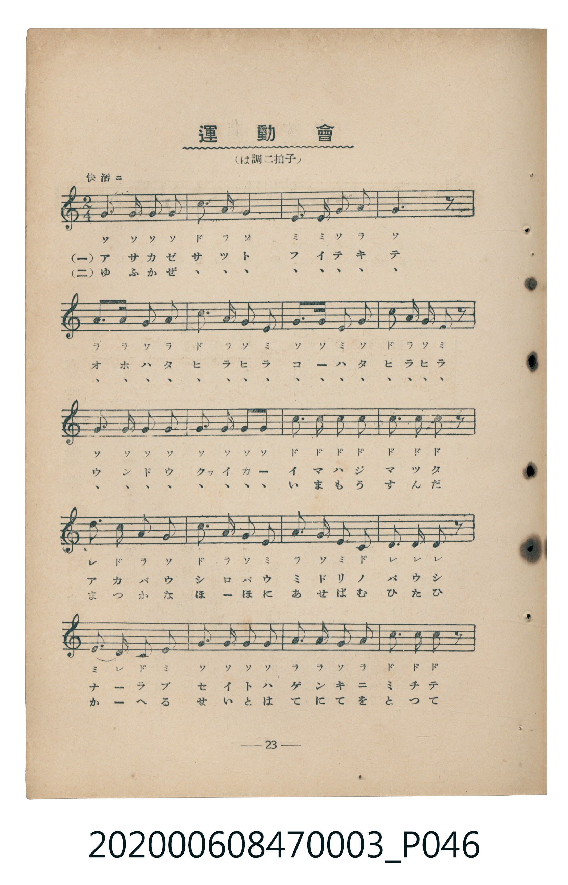
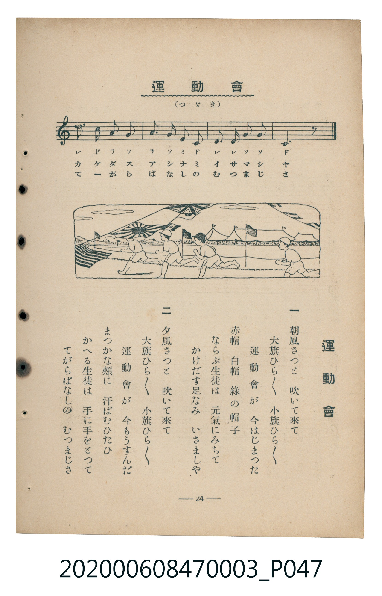

# 運動會

> Re:Shōka 使用 AI 協助辨識與重建樂譜，可能會有錯誤。歡迎[回報](https://github.com/TMDLang/reshoka/issues)。

- **鋼琴伴奏版**：<br><audio controls src="undokai.mp3"></audio>
- **NEUTRINO 歌聲合成版**：<br><audio controls src="undokai_neutrino.mp3"></audio>

- 臺灣教育會公認『新定兒童唱歌』尋常科第三學年用（第二學期・第8首）
- 國立臺灣歷史博物館典藏（典藏號：2020.006.0847.0003）

## 說明


- 出處：臺灣教育會公認、臺北新高堂發行《新定兒童唱歌》尋常科第三學年用（昭和6年／1931年），
第二學期第 8 首〈運動會〉，原書第 23–24 頁（掃描檔 P046.jpg–P047.jpg）。
亦收錄於臺灣總督府編《公學校唱歌》第三學年用第十課。
- 調性與拍號：ハ調（C 大調），2/4 拍，速度標示「快活ニ」（!= 120）。
- 背景與曲風：描寫秋季運動會大小旗幟迎風飄揚、頭戴紅白綠帽的學童精神抖擻列隊起跑，
以及夕陽下運動會圓滿落幕、學童手牽手細數今日佳績的歡樂情景。
- 版本說明：本檔案為原書單聲部五線譜（附移動 Do 階名片假名）之忠實數位化版本。

### 編曲說明（鋼琴伴奏版）：

1. 前奏 (Intro, 4 小節)：以號角般的同音附點動機與明亮終止式揭開運動會序幕。
2. 主歌伴奏 (Undokai, 24 小節 × 2 段)：右手演奏精神飽滿的進行曲旋律；
左手採用輕快有彈性的八分音符進行曲伴奏，帶出整齊劃一的步伐感。


## 歌詞

```text
一　朝風さつと　吹いて來て
大旗ひらひら　小旗ひらひら
運動會が　今はじまつた
赤帽　白帽　綠の帽子
ならぶ生徒は　元氣にみちて
かけだす足なみ　いさましや

二　夕風さつと　吹いて來て
大旗ひらひら　小旗ひらひら
運動會が　今もうすんだ
まつかな頰に　汗ばむひたひ
かへる生徒は　手に手をとつて
てがらばなしの　むつまじさ
```

## ABC

<div class="abc-score" data-abc-src="undokai.abc" aria-label="五線譜載入中"></div>

[下載 ABC 原始檔](undokai.abc)

## TMD 檔案連結

- [主旋律 TMD 檔案](undokai.tmd) [[在 TMD Studio 編輯](https://tmdlang.github.io/Tmd-TS/#tmd=s7IKdvYPcrWy4qpTUCpJTLdSSM7PyUlNLsnMz7MqzsjMK0nNjM_KTMmPL87Iz05Ugisry88pzU21Si9KTEmNN443MjAyiDcwMIs3sDAxBzIMjBFKi_NLi5JTrYqTM_Lzc-JLUitKkvLzs9Hl4wsS01OtAgxMzBAyBUX5Zal5iXlA3QVFILekgLUjFKSWZaakgqSLkxPz4stSizLTMlNTkFyZWlQM9gnEipKixLzi5KLMApD3EKryi0oy8oE-KciotMrILC7JL8pMTsyJz07MQ_JwSUYq0L_FBUDFyDoz0zPzrEoSM8uB9uenpWUmZybmKHFpaSm8bOx-2j312ZxmBS0tLkVbBUMjAy57WwVnLhsjfRM7kAkv2nc9b1z8bOrMF02bgOqetq55sar3cUPfs2kbnq6b9bR10vPVS59O2fhsbc_jhv6nG7qf7tjxfPnE52vWPNnR-XTtjqc7tzyfsuL9ng6QyK4eoMizOfMfN-8Gci1eLpv2fk8n2J1P53Q_X90NtWvt9qf9m572znreufLlkhVPW3e8mN4PNAHCeDFz_vs9s0AxqQeMST1QTAIZBsZgk7j0tRRsqQW4FBQUHjdMeDZ70_PZ616sWvVsRt_jholg0ebdT9t3vZg5FegSHOHTCBR_2jMdGEovV894uqDp-cw9LxYCg6gLW7h14wm3ZzPWPp3UYwbkv9_Tb2hpbAhmdb7f0wNyiYICcrgC2QoWCsBgfdzQAY_Zxw0gxU_75j-bvQOkwMj4UcNkIxOFlwsaQcb3NT_r73-2aooCKFHrZRWkA2WBTHMQE2jP44YmiD1Pdi17NmXby56WZ9P2QPz8fMfe53MXP9015_n2FUCPAX0OcsWChXBfoXkGyH3a2_hi1SaomcBQfLFq_7OG5S862p9190Ii9nFzP1AQ6DBnhadLloOZIOcDU6MCUA2Q9bJh_lOgU1bMfL5k1-OGnqf7Vz_bsvtxc_fjBqBsByQJI9wNsqO559nM9SA7Zm96uQgYpLOAHn66fvXz5d1P1y6GBxPQtqcb-p9Nn_505_wX-_uAKl8ubnnWPwsYlS8XrH3WseX5ltbnM_c-37bgKdDfs1qA3gLG4PNN-54vnfesa9qzybufdkx_OavrxdbtL7ZPhEfPk91Ln_Z3PV0y9eXMvU92dCOsmzP52e79LybsfbpzKtAKiGnPOrufd-4FkVs2PJu648nurmfTlz7Zu_n5jn1AG5-tXfhsRdOz5lagdxDee97Z8WwOMM2BkifIb3PWACPz2cKO5027IHH-dNq6F42bXjaveLJryvPts16snQMMp5czW54v3w10ioJLvsLLWX1PJ_Q-72x_2tgOZABD78nO7qf7Fzxdvwzkir29T3umQawBWQvNFhDDgRH9YuW8p60rnk1rBwbxkx1rQYxV816sBToRGAodTzf0PmvvxJG4wGY92dHwuKHh2Zy5wCB_3Dj1ceOSx43A9NTwdMLOx40tjxuXPdnXBiRBSoFxBIygx42bHjd1QkmgOnCsIQuClCKSfyMwKTYAg_Jx4_rHjTMeN-4D2zAfpOjF1iXAyARKAyMWyti24HHjOiD76doJYI82rgIbu-35lPlP900CmQG0sbX52YbFjxtXP27c_7hxIdRxjxu7HzdOfNwINGDmi22bQTqB0g0NYE8AvQW0d_rjphaQUmC4QMIIFGEzV4DS2qL1QPR0zgagr5_sanvZ2Af0NSjbgn0MTIlABEomYL9CuKC8APPk8_59T-eseDmt--nybqB2YDQBUyvYR40QrwHjBui1F52bQCkX7Dug9md9k4Bp9tnULS_3dkFTNNCXDROftrYC0yYwRoC-BNnS1Phs7VJIugYnw6VP9kx4umTWy117nna3P--ZDckEQEvhUboLFOagRE_jKG1qetwINGnm46bJwICHxAIkfoFxserlgg2gSAImro1AwzY8bgLGxSZg1ANJeITteNzUjRy3wMwH1AMim4AiQNcDzYJG7zKQvSAHAU0Fxi3QyHWg6AWZClQEtBaYuKZiRu8sakXv0-2bnm-b_HzrhGdz58Mj-WXDLCACRsuL9k6gf4Hx_HTfumf7pz5tmwT0NVD85cJeYPkFNO3Fjv4nO7qerd3xsmEKcmxDCp0XE6cDGSBly1Y9Xd8GrHKAZQ3QwS8au4BSwLB-umQlSNe-6c9a-p91bHg2bw40woEepryuhQIFLX0urtC8FGAjLtMqIDMxL9-hxqCmGlyU2hiaadmBWdgqeXA9uKPh2bqtChomCsCAfL6-QQde7IBkFQwVgDWwJhatQEuhxgJNsFJ43LQIFN9NW4F4NRDvUagB80DFbQsQdwBZQJHmqWBVS4CsNiC9FizWBi70QQDJ0F09IENBUo8bgYY2dgPxHJDyRrARjUAjGldADAXKg0SA1jQuA-JesNgydENrFEwVdIHQFEyDcI2CYRxYyAwqBRIyBtPGYBEzsAhMDgQNQCJg43wMQR5cBBaFeRvE2gPWAxIBy0A9DzMdFAAQHZAgALHWQmVAPBiMR9hjBDINIgcLCRBrDkQXMDQgMpDwgNsDVAkRh4QKiNULlQHxUO3Bn0B29eBLIEZEJ5BV4MQwG4j7gbz9YD9PAoutBLNANMivm8Fie9DUIavCTCiNXeAksBuI1wPxfLBHN4HTWieYBaJBYpNhhqOoQ1aFlGBA8Q9LHZC0gJJgQEkFkapAPKRUBVICEkJPMaug6QISDqD43w-N_0lQGYg_ISxIWtoMjS1sOpDDBSPdAIMFkgogAQNizYemgk3QdAjxOIQFkZkMsw2LDuSAIi717OjEl3qMiU49oPz8uHkzEANdAOSBwmX94-Z1kKzUtAYcqyDBJWCF86DJZwc4oObByiFg0GFJPOBSpmkykAUMSyAP5Nv-x0190OzTAzMbyANXlkDFTXCFM-GaF-AvbHAWP0AKzAITGKLoCQiSfWFBAYoSkAg8OOClCzBI4KUBkA_RBAkWkIod0DQ0DyoDCRzMFAQteaChA0oPIBF4CCEKmR6EdUA-RBwSUsiaZiIZt4C4JPR09mx8SciExBoKWDs1T4Anoe3glLEWWax5PlgMmMyaVwFxH1hsAlgvsHoB68BIQfvACQNUBoPqqVVgr-6GFzWg3LcaLNYEVgfM-40bgEY1IIopYC6DsOAJyAieDEBFD5b6ClL8QMooSFljCBYxAosYgWlc9RUkEJATz3ZoOoAEBZIMMDggMpAAAbFA0Q4JFIhpkGDBTDv7oMkAEi4gFkg_JGxgZQyIBQodiDgosYD4kBACmd0AlYGWV9BwIrLmmoIv4ZgSm3CawZULuEYClbXTwOEFjl1wLd4BzlMgMXBMgjImsE4H9q6RElMjEINKGYyE0w1PJDuA2sBagJ6HNWdWgAthWHMGFEzgJk7TJLAYqPkDCVyQLDzhQFowRuDUgFpFIUoenDUbjlIHGASwKghcCAADAZJsIBEJCwhYFQUJDHg5BW7igAIENUFBAgUz2YDUQSIbVEiBQgWSBGZDRSEhA6ugEE0aWPiA9ICqRkgYIZIgSIaY8qZ1LWayAfe-SWwRrwYnkY1AXzYA6Z3gUIGUQdvBIQoKCXiNBWpCgopnoBwojEBiEICRZCA1ISjJACsmaLNmAzgpAIurxulAvA5sbAM8eQCL4cYZYHWgtjOKsdjLGdyFClLlBY0lEEQvZkDZGRQLEL-DWDuhqQJWAEFCAJQKoM0LWBUFDQeIGkh6gchAIHpagTVmIfUPohEDKjwgBQ4oSEAsUNUICRZEigAVUKCgQW5KI9tTy8Wla6cA7VuBbQVylbkA)]
- [鋼琴伴奏 TMD 檔案](undokai_piano.tmd) [[在 TMD Studio 編輯](https://tmdlang.github.io/Tmd-TS/#tmd=s7IKdvYPcrWy4qpTUCpJTLdSyC8qychPL0osyKi0ysgsLskvykxOzInPTsxLVIIrKs4vLUpOjS9ITE-1CjAwMdMFEuZKXFpaCi8bu592T302p_n9no6X3XueT9jyZM-Wp0v7n3d2vN_TqaClxaVoq2BoZMBlb6vgzGVjpG9iBzL1Rfuu542Ln02d-aJpE1Dz09Y1L1b1Pm7oezZtw9N1s562Tnq-eunTKRufre153ND_dEP30x07ni-f-HzNmic7Op-u3fF055bnU1YArQSJ7OoBijybM_9x824g1-LlsmlAm8Fufzqn-_nqbqhda7c_7d_0tHfW886VL5eseNq648X0fqAJEMaLmfPf75llZGBkoGdgYKZnYGFiDmQYGINN4tLXUrClFuBSUFB43DDh2exNz2eve7Fq1bMZfY8bJoJFm3c_bd_1YuZUoEtwhE8jUPxpz3RgKL1cPePpgqbnM_e8WAgMoi5s4daNJ9yezVj7dFKPGZD_fk-_oaWxIZjV-X5PD8glCgrI4QpkK1goAIP1cUMHPLofN4AUP-2b_2z2DpACI-NHDZONTBReLmgEGd_X_Ky__9mqKQqg1KKXVZAOlAWlGRATaM_jhiaoj1-s2v-sYfmLjvZn3b2QSHjc3A8UBBrirPB0yXIwE2QVMOUoANUAWS8b5j_dtezZipnPl-x63NDzdP_qZ1t2P27uftwAlO2AJDcUO55vXwEMbkhYY02mQFsh3jbUU3ja2QsUV9DwzCspytdRMFF4uqH_-foGTaCaJ7uXAp34YvmkFx1rns9qeTqh5-X8zS9ntrzcPQ8UKCvng7wxo-_JrnXPtzY9W7vo6Z7-Z_1rX07rhofa0139T3dOhbpMQcFIT-HJjt3AyII4RkEjNC8lPzsxU0cBGJIQexUOT1cwUni2bivIAU_7Nz_r7H62ZwrI5Zv2PV867-Xivc927wc65mXDJmBKAHrz2fTup_u63--ZDbECCJ5uXwbS1bcQGPUv9kwFhdeczqd7O4DhDvJF6-qnHW1AjzxfswxuCMQ9oAjesQ2YJp9N3fJyb9fTruYnOxqAWp6tXfpkz4RnLfOhHqE8U0CBgpY-Fxc44K0CMhPz8oM8HGoMaqrBPrExNNOyA7NqFEwVdIHQFEyDcI2CYRxYyAzMNQYLGYFFjDAVQaABSIirFsU-H2T7LODWGcYrRBvGKphCqBoFEyDDJBYmDHQOkGEKkQdScPUgbACxAxqv-HyFrYwBZ8MdDcDYV9CAJ0QsyoDBRlTAgGANOHhAgQQSMQOLwOQQ4QIyzsewRuFx0yKw6OOmrUC8GszaA9YDEgHLNLcAcQfc9MfNU6E6lgDZbWDWWqgMiAeD8Qh7jECmQeQeNwLtaewGs-ZAdDVCzWsEmte4AmEPUCVEHGh_4zIwqxcqA-Kh2oM_iHf1EB_EoBCDhSck9LCkPVg8gHhI8QBSAhJCD-NV0JCcDcT94BDbDw2xSVCZlVA2iAUJ_c1Q_2HTAVMPUY0W0o1d0HDbDcTrwaz50HDbBI25TigbxILITIbZhkUHTD1ENTHhvaOTkiSNM5EDKTALTGCIogc6JJE8bt4MxCCHQ0RAMusfN6-DhgQwzTWtgfodJLUEqmkePNx3QMN9HlQGmBrBcYEe6tD03TQZyAbFCkQEJNP_uKkPGrigpNyDsA7Ih4jvA2psQtE0E8m4BcQF-9PZs4kPdiN44IESOc5CFpIbIKnaECwCK3ZBNK6yZDUwnCagBPl2aOitRZdpBqU0kAwwjTWD8snjZlBggWRA6iAqIfrRQ3wfNPBA5QakRAHpB8nshgYxhPW4EVSugcRBQQziA_Nh4waw2Q1QGWjOAKZ7CJuoUmUK8cENKZONwGGIWoQgUjnOkgdHCm-GZHRYofG4eRo0sCHehxTQoIIbkpRBMlBvgvIEuNAGtqrQoqERWoyjBzZIHSSIQBnicRNUHzAoESkbVHhDChBEIQ0KfGjx3QQqukAykEIeEnEgGWLSdutaytI27oSMVMxA_QiC6EkblIRAftgIDB9QonnctBMaprBEvx0aI5CwRCpMQFUruPiAJGNQaENkIBA9pGGVG6SkQBTRoAQLSeSPG6eDWaBCDGQPyD2w8ARliseNM6B6IFUrsj3ojRWsTSKqtFUItaqgDKgwcisL1KiiXoUOtQBuD7q7cPMJu4Okig7iPyNYKxKdj8MdsFYm9Yp-qMU4A8QMyDDLxdr-JSJmSCgUCcUE7pgjHCCklBc47IGFAzEdAF07BXA_QwHIgOavaB-gNDLXCMxV5gIA)]

## 分析

```text
================================================================================
📊 TMD Song Profile: [ 運動會 ]
================================================================================
⏱  Duration:       0:24 (24.0s), 24 measures total
🎼 Key & Tempo:    首調基準 C, != 120.0 BPM, <2/4>
   - 分析範圍：      由實際發聲的音符與和弦推測調性；播放脈絡另行呈現
🎤 人聲音域:    C4 (MIDI 60) – D5 (MIDI 74) [跨度: 14 個半音 / 1.2 個八度, 難度: moderate]
   - 最低音:  C4 in [Undokai #1 @ m.15, 0:14]
   - 最高音: D5 in [Undokai #1 @ m.13, 0:12]
   - 適合: soprano, mezzo-soprano, contralto, tenor, baritone, bass
🏛  結構:      Undokai (24.0s)
⚡ 編曲密度:        Peak 1 軌道同時演奏
🗝  調性診斷：       C 大調（純淨自然大調，未偵測到可信轉調）
   - 風格氣質:    純淨自然大調（陽光明朗、易唱易記，無明顯調外色彩）
   - 轉調歷程:    全曲維持單一推測調性（未偵測到可信轉調）
   - 核心骨幹音:  G, C, A, E, D
   - 調性數值:    C 大調 [相關度: 0.83, 穩定度: Moderate, 自然音純度: 100.0%]
   - 候選調性 (K-S): C 大調 (0.83), G 大調 (0.79), E 小調 (0.57)
   - 五度圈歷程:   +0
   - 各段落調性細節:
     • [Undokai #1]: C 大調 (r: 0.83, 自然音純度: 100.0%)

  [ 五度圈游移軌跡 ]
              [C ]*
         F            G  
      Bb               D  
      Eb               A  
         Ab           E  
            Db       B  
               F# 
     (* = active key center)

  [ 十二半音累積音高分佈 ]
     C  : ████████████████          25.0%
     C# :                            0.0%
     D  : ██████                     9.4%
     D# :                            0.0%
     E  : ███████                   11.7%
     F  :                            0.0%
     F# :                            0.0%
     G  : ████████████████████████  38.3%
     G# :                            0.0%
     A  : ██████████                15.6%
     A# :                            0.0%
     B  :                            0.0%
--------------------------------------------------------------------------------
Assignment 軌道音域：
  - Piano         : C4 – D5 (14 個半音 / 1.2 個八度, 86 個音符)
================================================================================
```


## 原書掃描頁






