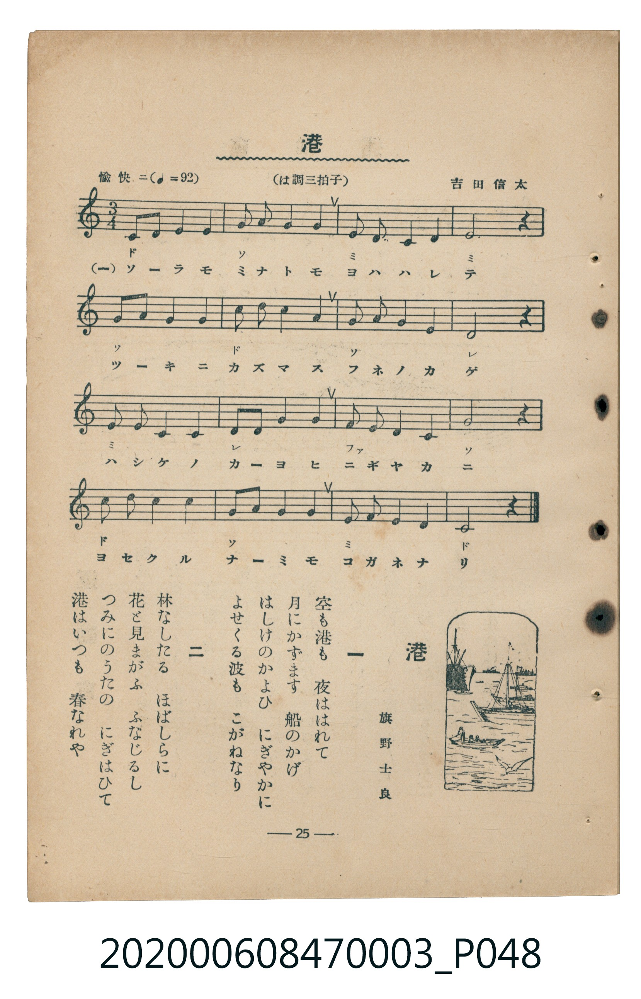

# 港

> Re:Shōka 使用 AI 協助辨識與重建樂譜，可能會有錯誤。歡迎回報。

- **NEUTRINO 歌聲合成版**：<br><audio controls src="minato_neutrino.mp3"></audio>
- **鋼琴伴奏版**：<br><audio controls src="minato.mp3"></audio>


- 詞：吉田信太
- 曲：吉田信太
- 臺灣教育會公認『新定兒童唱歌』尋常科第三學年用（第二學期・第9首）
- 國立臺灣歷史博物館典藏（典藏號：2020.006.0847.0003）

## 說明


- 出處：臺灣教育會公認、臺北新高堂發行《新定兒童唱歌》尋常科第三學年用（昭和6年／1931年），
第二學期第 9 首〈港〉，原書第 25 頁（掃描檔 P048.jpg）。
- 詞曲：旗野士良 作詞／吉田信太 作曲（原曲出自 1896 年《新編教育唱歌集》第五集，日本近代著名海港唱歌經典）。
- 調性與拍號：ハ調（C 大調），3/4 拍，速度標示「愉快ニ != 92」。
- 背景與曲風：以優美搖曳的 3/4 拍圓舞曲節奏，描寫晴朗月夜下船影繁多、駁船（はしけ）往來熱絡、
月映金波的港灣夜景，以及白晝桅檣如林、船旗如花、裝卸貨物歌聲鼎沸的繁榮港都春色。
- 版本說明：本檔案為原書單聲部五線譜（附移動 Do 階名片假名）之忠實數位化版本。

### 編曲說明（鋼琴伴奏版）：

1. 前奏 (Intro, 4 小節)：引用第四段「よせくる波も　こがねなり」優美流暢的波浪樂句揭開序幕。
2. 主歌伴奏 (Minato, 16 小節 × 2 段)：右手演奏 3/4 拍海港旋律，左手以圓舞曲式低音與和弦（`1_ - [1] - [1] -`）
營造港灣水波蕩漾的韻律。


## 歌詞

```text
一　空も港も　夜ははれて
月にかずます　船のかげ
はしけのかよひ　にぎやかに
よせくる波も　こがねなり

二　林なしたる　ほばしらに
花と見まがふ　ふなじるし
つみにのうたの　にぎはひて
港はいつも　春なれや
```

## ABC

```abc
X:1
T:港
C:曲：吉田信太
M:3/4
L:1/16
Q:1/4=92
K:C
V:V1 name="Piano" snm="Pia"
[V:V1]
C2 D2 E4 E4 | G2 A2 G4 G4 | E2 D2 C4 D4 | E8 z4 |
w: 1.~そ _ ら も | み な と も | よ は は れ | て
w: 2.~は _ や し | な し た る | ほ ば し ら | に
G2 A2 G4 G4 | c2 d2 c4 A4 | G2 A2 G4 E4 | D8 z4 |
w: 1.~つ _ き に | か ず ま す | ふ ね の か | げ
w: 2.~は _ な と | み ま が ふ | ふ な じ る | し
D2 D2 C4 C4 | D2 D2 G4 G4 | F2 E2 D4 C4 | G8 z4 |
w: 1.~は し け の | か _ よ ひ | に ぎ や か | に
w: 2.~つ み に の | う _ た の | に ぎ は ひ | て
c2 d2 c4 c4 | G2 A2 G4 G4 | E2 F2 E4 D4 | C8 z4 |
w: 1.~よ せ く る | な _ み も | こ が ね な | り
w: 2.~み な と は | い _ つ も | は る な れ | や
```

## TMD 檔案連結

- [主旋律 TMD 檔案](minato.tmd) [[在 TMD Studio 編輯](https://tmdlang.github.io/Tmd-TS/#tmd=s7IKdvYPcrWy4qpTUCpJTLdSSM7PyUlNLsnMz7MqzsjMK0nNjM_KTMmPL87Iz05Ugisry88pzU21Si9KTEmNN443MjAyiDcwMIs3sDAxBzIMjBFKi_NLi5JTrYqTM_Lzc-JLUitKkvLzsxHyBUX5Zal5iXlANQVFIBtTwIoQClLLMlNSQdKpKZkl-UWZiTlI7kgtKga7FWxJfElRYl5xclFmAcgDCFUlGalAx-YllpQWpSJEgUalZ-ZZ5aZmZmUiuUtLS-HZjvUKWlpcirYKlkZc9rYKzlw2xvomdiCdL1bOe79n1tMJnc-nbHiyf-HTJavABj6bvQmb8Iv2Xc8bFz-bOvNF06Znc5qftq55sar3cUPfs2kbnq6b9bR10vPVS59O2fhsbc_jhv6nG7qf7tjxfPnE52vWPNnR-XTtjqc7tzyfsuL9ng6QyK4eoMizOfMfN-8Gci1fLpv2fk8n2Janc7qfr-6G2rV2-9P-TU97Zz3vXPlyyYqnrTteTO8HmgBhvJg5H-hMUGzpAWNLDxRbQIaBMdgkLn0tBVtqAS4FBYXHDROA4fJ89roXq1Y9m9H3uGEiWLR599P2XS9mTgW6BEf4NALFn_ZMB4bSy9Uzni5oej5zz4uFwCDqwhZu3XjC7dmMtU8n9ZgB-e_39BtaGhuCWZ3v9_SAXKKggByuQLaCpQIwWB83dAATwOMGkLKnffOfzd4BkjIyVXi5oBFkZl_zs_7-Z6umKAQYmFjoZRWkA0183NAE9RswgUASw7Pp01-29z1dvPpF53qFJ3vngFNOP3ISAYmC1XaArdkECpb2VQqGFpZmCkCHQvz7fPsKSPhA_PtydhvQy2B3TwGygU58Nn3pszlrXuyf-GT34hcTpz-d0Pts63agByDqn2-bDIx6VBeu2v-sYfmLjvZn3b2QBPG4uR8oCHSHs8LTJcvBTJDngWleAagGyHrZMP_prmXPVsx8vmTX44aeZy2dT_evftzcrQDOIo8bgHEGN72559nM9SDTZ296uQgYCbOe7F76tGXV8319zyZMezZ78_NZLQpQk5_OmfyiAxRcz9c3PF0KTKY9wJB9un71s5lbns2Z_mxOx9Mlc57s6H7RsfPp3o3PdzY-XTILmDheLm8EigBd-7hx_ePG6Y8bJwKd-3Rfw5N9bc_bNj7fuhCoBhK9QBOezVjwsn3is82LgNYCAwWY2oBmAh0ItAvkrv6u5zP3Pps599nC1merFj9d1vRs3nRQ-uvYCYw-IPdF10YQd_Hcp707XmxaAcxUwDB90bjp5Z6-Z5t2AM0EuurZsnVAk1827302Y-mLzk2IoHje2QGKGXDiByWIOWuAqebZwo7nTbsg6erptHUgs5pXACPz-fZZL9bOAfrq5cyW58t3P-2equCSr_ByVh8wQp93tj9tbAcygB59srP76f4FT9cvezZ1x5O9vU97pkGsAVkLzXQQw0EOXTnvaeuKZ9PagdHxZMdaEGPVvBdrgWkbGGQdTzf0PmvvRE7FYAOe7Gh43NDwfOWux01NoHzQ1ATkAgMNHNpAbs_jxmUgdcDAfdy4-nFj9-PGWY8b9z1unAlUBwy4x43rwIKTwK6BRRFUtAmoBxhCDWCdfY-bWsBKV4OVguRmP27sf9zUDYwviL2PGyc_bgTauPZx46rHTV0gdUCXQ3wBKnCXrAQ6FJTYIEl-zgpw7M4C-gEYZpBkBEpVwJTU2glPSc9aOoAlyvM5-4Dp6f2e2c_6lgKT1NMN_UBZYAJ6uWb50zkboOlp5f5ni9aCTNi5_MmOrqebdrxs6gKlpM2Lnm1d9WTn_JfTml8AfT0RmNUnAuMeaMuLrknAqIAH5i5gCdUASlRA94MCYj7Qd2B_7X7cuAEk0tQJ9T8oqTWueLEMGB7AwAT6eStY3VawzhkgbY3TIUG65HHjfnAAAoO0DWQkkAEPUlCAb4JFETD6QHxgKC-BhCcwiYJDsgcY9OiB-Xz-dGA1AskDQD-C8sDCVqCvgd6H5IeXi1ue9QOTcSdQDTDdAx38fPbsl9O6gWEIzCEv9nRCcghI78z5T9dOgGQVSJC-nDvvaftCUEiCY-rF4oXPNux42bgAmG2eNvcDnQWMSmCsvehY87S19dnu_c-nzH-2cj40JIEOpbxGggIFLX0uLt9MYGMg3yogMzEv36HGoKYaXF7YWGjZgRnYKkJwXbGj4dm6rQoaJgrA1AIss3TgmQckq2CoAKylNLFoBVoJNRZoghUwpe8FFg97gHglEC8CytQA6flA3AXEHUhiK4C4H4rXQMXawEUbBEANrgFabaRgrKALxjUKpgpmQKwLxjVAMSOgvC6QhPB0wdAAxAPr9jEEGts4F8gHJkYw2QRWCUxlQLwKiFcgizYBHdi4HoxBoj1Qtcug5sYjzDUCiUNUtYDIxulQtSAzpwPxfLBcN1R0NxBvgKqCuAQkuhrFXPzRs6sHX_QYERs9zS2Q6GlaC6S7IcHetBqIdwH584D0TmhUTAXiXiDuA8tD1G3CFj2oEWIYp2AUByJ1gcLI8QWJPVA8YYuhJeAw7AWToFABiXUD8Swg3gcWnQkV3QrEQLc3rgOLwsJ3Er4YAsYJiATFNCzm9wExKHZB5iHMBcXdDJR4A8UXsTG0oxNfDBkTHUPADNG0HYg3gkMfHkPgTAXKNJOgMQQMn6Z1QHoJIobAMYoRQ0bQTALCEB4ivkzAWQgmBxLDFj2gLAFK1BPBQQYKekgEgYKqAyy2CZ6kgQU1PFPAghE1oSOiB-h0cHSA5BHmtoF54AwEF4OaC41QmG2oGRNv9DydPRtf9JgQHT3AKGgCZucmYJg0w4IdVLaBogdUzkHLt6bNQLwGmom6oOpWYYsepCwDJjDLOFAkwco4UERhiSJwyTUbiPtR0i8k5e8Hi8FKvsngtA_KRbC8AdLfhSOKUMpJcPCDRCHRC861cHOBAQK0F2onrOwEJwSEubVcXLp2CpAqCmwJkKfMBQA)]
- [鋼琴伴奏 TMD 檔案](minato_piano.tmd) [[在 TMD Studio 編輯](https://tmdlang.github.io/Tmd-TS/#tmd=s7IKdvYPcrWy4tLSUni2Y_37PR0vu_c8n7DlyZ4tT5f2P-_seL-nU0FLi0vRVsHSiMveVsGZy8ZY38SOq05B6UX7rueNi59NnfmiadOzOc1PW9e8WNX7uKHv2bQNT9fNeto66fnqpU-nbHy2tudxQ__TDd1Pd-x4vnzi8zVrnuzofLp2x9OdW55PWQG0ESSyqwco8mzO_MfNu4Fcy5fLpgEtVgLZ8nRO9_PV3VC71m5_2r_pae-s550rXy5Z8bR1x4vp_UATIIwXM-e_3zPLyMDIQM_AwEzPwMLEHMgwMAabxKWvpWBLLcCloKDwuGHCs9mbns9e92LVqmcz-h43TASLNu9-2r7rxcypQJfgCJ9GoPjTnunAUHq5esbTBU3PZ-55sRAYRF3Ywq0bT7g9m7H26aQeMyD__Z5-Q0tjQzCr8_2eHpBLFBSQwxXIVrBUAAbr44YOYDw_bgApe9o3_9nsHSApI1OFlwsaQWb2NT_r73-2aopCgIGJhV5WQTrQxMcNTVC_vVg5D-hpoN-eTZ_-sr3v6eLVLzrXKzzZOwcoAXTE0wmdz6dseLJ_4dMlq0CiQLVIelftf9aw_EVH-7PuXkhUPW7uBwoCbXVWeLpkOZgJchYwfSkA1QBZLxvmP921TAGc-BAGPd--AmgwJNixJlig0ZAQMNRTeNrZCxRX0PDMKynK11EwUXi6of_5-gZNoJqne6YCAxLo_aezZz9bt_VxQ8_jpo7HjbMfN_Y_bup-tnnR46amxw0NjxsnP27sedy49nHjqsdNXY8bep-2rHq-r-_Z1sZnsxY9n9UCVPls66pnK5qe9i991r_25bTup7v6n-6cCnWxgoKRnsKTHbuB8QlxpIKGb2ZeYgnQNYZmUOcoHJ6uYKQAdATYXf2bn3V2P9szBaQWGhjPtm4HRtuz6d1P93WDYm77MqCSJ7uXPp0z-UUHKE6e7ul_srfv5fzNwAAGpoqne5YBgybBMF5BVyHaMBZGJgBDB-ImUPpon_-yYQHQWFAq3bAF6I0XU1c-27MP6KWX83cDLYJ6gPL8AgUKWvpcXOCIsArITMzLD_JwqDGoqQY7yMZCyw7MqFEwjFMwigORugpmQFyjYAqkTYEsEK5RMAZGojGQZQTmGQJJEDQA8bhqUcz3wW6-CThQTMCBAiaBpqCFE8hSsJApWAhMoqiCWweJSjz-wVbugLPmjgZgfCtowFKkDjzHgWSB_gIWCppYtALDEGos0AQrhcdNe4F5Yg8QrwTiRWAPPm6eD8RdQNyBJLYCiPuheA1UrA2WFoAAajAoSI3AAQzCmIFvBA5ySOCDVCACH6TbxxBobONcIP9xUyeYbAKrfNy4H4hXAfEKZNEmoAMb14MxSLQHqnYZ1FxQeEPNNQKJQ1S1gMjG6VC1IDOnA_F8sFw3VHQ3EG-AqoK4BCS6GsVc_NGzqwdf9BgRGz3NLZDoaVoLpLshwd60Goh3AfnzgPROaFRMBeJeIO4Dy0PUbcIWPagRgjOzQGIPFE_YYmgJOAx7wSQoVEBi3UA8C4j3gUVnQkW3AjHQ7Y3rwKKw8J2EL4aAcQIiQTENi_l9QAyKXZB5CHNBcTcDJd5A8UVsDO3oxBdDxkTHEDBDNG0H4o3g0IfHEDhTgTLNJGgMAcOnaR2QXoKIIXCMYsSQETSTgDCEh4gvUNkFihSIHEgMW_SAsgQoUU8EBxko6CERBAqqDrDYJniSftwISjKQTAELRtSEjogeoNPB0QGSR5jbBuaBMxBcDGouNEJhtqFmTLzRA6lUcUaPCdHRA4yCJmB2bgKGSTMs2EFlGyh6QOUctHxr2gzEa6CZqAuqbhW26EHKMmCClAoGHkXgkms2EPejpF9Iyt8PFoOVfJPBaR-Ui2B5A6S_C0cUoZST4OAHiUKiF5xr4eYCAwRoL9ROWNkJTggIc9FqKKw1IrE1FJ7YwlqDYhEyAwuZ5YJ44AoWS6VKUrFMqpuQ6n6wLDB7gkWMwE4COw-l6ifGSWjlEAVOgjVHkN0ElibVTeiZD6-bqNoe0rVTALfAFIAMSMqL9gGpQPCMwDxlLgA)]

## 分析

```text
================================================================================
📊 TMD Song Profile: [ 港 ]
================================================================================
⏱  Duration:       0:31 (31.3s), 16 measures total
🎼 Key & Tempo:    首調基準 C, != 92.0 BPM, <3/4>
   - 分析範圍：      由實際發聲的音符與和弦推測調性；播放脈絡另行呈現
🎤 人聲音域:    C4 (MIDI 60) – D5 (MIDI 74) [跨度: 14 個半音 / 1.2 個八度, 難度: moderate]
   - 最低音:  C4 in [Minato #1 @ m.1, 0:00]
   - 最高音: D5 in [Minato #1 @ m.6, 0:10]
   - 適合: soprano, mezzo-soprano, contralto, tenor, baritone, bass
🏛  結構:      Minato (31.3s)
⚡ 編曲密度:        Peak 1 軌道同時演奏
🗝  調性診斷：       C 調性不明確（純淨自然大調，未偵測到可信轉調）
   - 風格氣質:    純淨自然大調（陽光明朗、易唱易記，無明顯調外色彩）
   - 轉調歷程:    全曲維持單一推測調性（未偵測到可信轉調）
   - 核心骨幹音:  G, C, D, E, A
   - 調性數值:    C 調性不明確 [相關度: 0.84, 穩定度: Ambiguous, 自然音純度: 100.0%]
   - 候選調性 (K-S): C 大調 (0.84), G 大調 (0.83), E 小調 (0.60)
   - 五度圈歷程:   +0
   - 各段落調性細節:
     • [Minato #1]: C 調性不明確 (r: 0.84, 自然音純度: 100.0%)

  [ 五度圈游移軌跡 ]
              [C ]*
         F            G  
      Bb               D  
      Eb               A  
         Ab           E  
            Db       B  
               F# 
     (* = active key center)

  [ 十二半音累積音高分佈 ]
     C  : ███████████████████       23.9%
     C# :                            0.0%
     D  : █████████████████         20.5%
     D# :                            0.0%
     E  : ██████████████            17.0%
     F  : ██                         2.3%
     F# :                            0.0%
     G  : ████████████████████████  29.5%
     G# :                            0.0%
     A  : ██████                     6.8%
     A# :                            0.0%
     B  :                            0.0%
--------------------------------------------------------------------------------
Assignment 軌道音域：
  - Piano         : C4 – D5 (14 個半音 / 1.2 個八度, 52 個音符)
================================================================================
```


## 原書掃描頁




