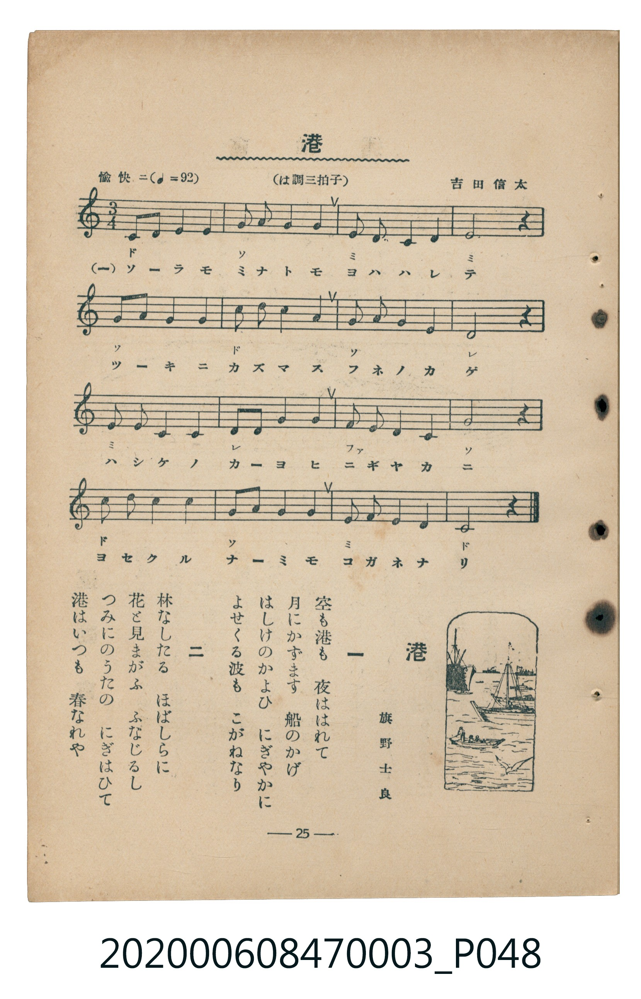

# 港

> Re:Shōka 使用 AI 協助辨識與重建樂譜，可能會有錯誤。歡迎回報。

- **鋼琴伴奏版**：<br><audio controls src="minato.mp3"></audio>
- **NEUTRINO 歌聲合成版**：<br><audio controls src="minato_neutrino.mp3"></audio>

- 詞：吉田信太
- 曲：吉田信太
- 臺灣教育會公認『新定兒童唱歌』尋常科第三學年用（第二學期・第9首）
- 國立臺灣歷史博物館典藏（典藏號：2020.006.0847.0003）

## 說明


- 出處：臺灣教育會公認、臺北新高堂發行《新定兒童唱歌》尋常科第三學年用（昭和6年／1931年），
第二學期第 9 首〈港〉，原書第 25 頁（掃描檔 P048.jpg）。
- 詞曲：旗野士良 作詞／吉田信太 作曲（原曲出自 1896 年《新編教育唱歌集》第五集，日本近代著名海港唱歌經典）。
- 調性與拍號：ハ調（C 大調），3/4 拍，速度標示「愉快ニ != 92」。
- 背景與曲風：以優美搖曳的 3/4 拍圓舞曲節奏，描寫晴朗月夜下船影繁多、駁船（はしけ）往來熱絡、
月映金波的港灣夜景，以及白晝桅檣如林、船旗如花、裝卸貨物歌聲鼎沸的繁榮港都春色。
- 版本說明：本檔案為原書單聲部五線譜（附移動 Do 階名片假名）之忠實數位化版本。

### 編曲說明（鋼琴伴奏版）：

1. 前奏 (Intro, 4 小節)：引用第四段「よせくる波も　こがねなり」優美流暢的波浪樂句揭開序幕。
2. 主歌伴奏 (Minato, 16 小節 × 2 段)：右手演奏 3/4 拍海港旋律，左手以圓舞曲式低音與和弦（`1_ - [1] - [1] -`）
營造港灣水波蕩漾的韻律。


## 歌詞

```text
一　空も港も　夜ははれて
月にかずます　船のかげ
はしけのかよひ　にぎやかに
よせくる波も　こがねなり

二　林なしたる　ほばしらに
花と見まがふ　ふなじるし
つみにのうたの　にぎはひて
港はいつも　春なれや
```

## ABC

<div class="abc-score" data-abc-src="minato.abc" aria-label="五線譜載入中"></div>

[下載 ABC 原始檔](minato.abc)

## TMD 檔案連結

- [主旋律 TMD 檔案](minato.tmd) [[在 TMD Studio 編輯](https://tmdlang.github.io/Tmd-TS/#tmd=s7IKdvYPcrWy4qpTUCpJTLdSSM7PyUlNLsnMz7MqzsjMK0nNjM_KTMmPL87Iz05Ugisry88pzU21Si9KTEmNN443MjAyiDcwMIs3sDAxBzIMjBFKi_NLi5JTrYqTM_Lzc-JLUitKkvLzsxHyBUX5Zal5iXlANQVFIBtTwIoQClLLMlNSQdKpKZkl-UWZiTlI7kgtKga7FWxJfElRYl5xclFmAcgDCFUlGalAx-YllpQWpSJEgUalZ-ZZ5aZmZmVicVd-UUlGPtCDBRmVVhmZxSCbkxNz4rMT85DCAWpvQWJ6qlWAgYmFEpeWlsKzHesVtLS4FG0VLI247G0VnLlsjPVN7ECaXqyc937PrKcTOp9P2fBk_8KnS1aBzXo2exM24Rftu543Ln42deaLpk3P5jQ_bV3zYlXv44a-Z9M2PF0362nrpOerlz6dsvHZ2p7HDf1PN3Q_3bHj-fKJz9esebKj8-naHU93bnk-ZcX7PR0gkV09QJFnc-Y_bt4N5Fq-XDbt_Z5OsC1P53Q_X90NtWvt9qf9m572znreufLlkhVPW3e8mN4PNAHCeDFzPtCZoMjWA0a2HiiygQwDY7BJXPpaCrbUAlwKCgqPGyYAw-X57HUvVq16NqPvccNEsGjz7qftu17MnAp0CY7waQSKP-2ZDgyll6tnPF3Q9HzmnhcLgUHUhS3cuvGE27MZa59O6jED8t_v6Te0NDYEszrf7-kBuURBATlcgWwFSwVgsD5u6AAmgMcNIGVP--Y_m70DJGVkqvByQSPIzL7mZ_39z1ZNUQClF72sgnSgiY8bmqB-AyYQSGJ4Nn36y_a-p4tXv-hcr_Bk7xxwyulHTiIgUbDaDrA1m0DB0r5KwdDC0kwB6FCIf59vXwEJH4h_X85uA3oZ7O4pQDbQic-mL302Z82L_ROf7F78YuL0pxN6n23dDvQARP3zbZOBUY_qwlX7nzUsf9HR_qy7F5IgHjf3AwWB7nBWeLpkOZgJ8jwwzSsA1QBZLxvmP9217NmKmc-X7Hrc0POspfPp_tWPm7sVwFnkcQMwzuCmN_c8m7keZPrsTS8XASNh1pPdS5-2rHq-r-_ZhGnPZm9-PqtFAWry0zmTX3SAguv5-oanS4HJtAcYsk_Xr342c8uzOdOfzel4umTOkx3dLzp2Pt278fnOxqdLZgETx8vljUARoGsfN65_3Dj9ceNEoHOf7mt4sq_tedvG51sXAtVAohdowrMZC162T3y2eRHQWmCgAFMb0EygA4F2gdzV3_V85t5nM-c-W9j6bNXip8uans2bDkp_HTuB0QfkvujaCOIunvu0d8eLTSuAmQoYpi8aN73c0_ds0w6gmUBXPVu2Dmjyy-a9z2YsfdG5CREUzzs7QDEDTvygBDFnDTDVPFvY8bxpFyRdPZ22DmRW8wpgZD7fPuvF2jlAX72c2fJ8-e6n3VMVXPIVXs7qA0bo8872p43tQAbQo092dj_dv-Dp-mXPpu54srf3ac80iDUga6GZDmI4yKEr5z1tXfFsWjswOp7sWAtirJr3Yi0wbQODrOPpht5n7Z3IqRhswJMdDY8bGp6v3PW4qQmUD5qagFxgoIFDG8jtedy4DKQOGLiPG1c_bux-3DjrceO-x40zgeqAAfe4cR1YcBLYNbAogoo2AfUAQ6gBrLPvcVMLWOlqsFKQ3OzHjf2Pm7qB8QWx93Hj5MeNQBvXPm5c9bipC6QO6HKIL0AF7pKVQIeCEhskyc9ZAY7dWUA_AMMMkoxAqQqYklo74SnpWUsHsER5PmcfMD293zP7Wd9SYJJ6uqEfKAtMQC_XLH86ZwM0Pa3c_2zRWpAJO5c_2dH1dNOOl01doJS0edGzraue7Jz_clrzC6CvJwKz-kRg3ANtedE1CRgV8MDcBSyhGkCJCuh-UEDMB_oO7K_djxs3gESaOqH-ByW1xhUvlgHDAxiYQD9vBavbCtY5A6StcTokSJc8btwPDkBgkLaBjAQy4EEKCvBNsCgCRh-IDwzlJZDwBCZRcEj2AIMePTCfz58OrEYgeQDoR1AeWNgK9DXQ-5D88HJxy7N-YDLuBKoBpnugg5_Pnv1yWjcwDIE55MWeTkgOAemdOf_p2gmQrAIJ0pdz5z1tXwgKSXBMvVi88NmGHS8bFwCzzdPmfqCzgFEJjLUXHWuetrY-273_-ZT5z1bOh4Yk0KGU10hQoKClz8XlmwlsS-RbBWQm5uU71BjUVIPLCxsLLTswA1tFCK4rdjQ8W7dVQcNEAZhagGWWDjzzgGQVDBWAtZQmFq1AK6HGAk2wAqb0vcDiYQ8QrwTiRUCZGiA9H4i7gLgDSWwFEPdD8RqoWBu4aIMAqME1QKuNFIwVdMG4RsFUwQyIdcG4BihmBJTXBZIQni4YGoB4YN0-hkBjG-cC-cDECCabwCqBqQyIVwHxCmTRJqADG9eDMUi0B6p2GdTceIS5RiBxiKoWENk4HaoWZOZ0IJ4PluuGiu4G4g1QVRCXgERXo5iLP3p29eCLHiNio6e5BRI9TWuBdDck2JtWA_EuIH8ekN4JjYqpQNwLxH1geYi6TdiiBzVCDOMUjOJApC5QGDm-ILEHiidsMbQEHIa9YBIUKiCxbiCeBcT7wKIzoaJbgRjo9sZ1YFFY-E7CF0PAOAGRoJiGxfw-IAbFLsg8hLmguJuBEm-g-CI2hnZ04oshY6JjCJghmrYD8UZw6MNjCJypQJlmEjSGgOHTtA5IL0HEEDhGMWLICJpJQBjCQ8SXCTgLweRAYtiiB5QlQIl6IjjIQEEPiSBQUHWAxTbBkzSwoIZnClgwoiZ0RPQAnQ6ODpA8wtw2MA-cgeBiUHOhEQqzDTVj4o2ep7Nn44seE6KjBxgFTcDs3AQMk2ZYsIPKNlD0gMo5aPnWtBmI10AzURdU3Sps0YOUZcAEZhkHiiRYGQeKKCxRBC65ZgNxP0r6haT8_WAxWMk3GZz2QbkIljdA-rtwRBFKOQkOfpAoJHrBuRZuLjBAgPZC7YSVneCEgDC3lotL104BUkWBLQHylLkA)]
- [鋼琴伴奏 TMD 檔案](minato_piano.tmd) [[在 TMD Studio 編輯](https://tmdlang.github.io/Tmd-TS/#tmd=s7IKdvYPcrWy4qpTUCpJTLdSyC8qychPL0osyKi0ysgsLskvykxOzInPTsxLVIIrKs4vLUpOjS9ITE-1CjAwsVDi0tJSeLZj_fs9HS-79zyfsOXJni1Pl_Y_7-x4v6dTQUuLS9FWwdKIy95WwZnLxljfxA5k0ov2Xc8bFz-bOvNF06Znc5qftq55sar3cUPfs2kbnq6b9bR10vPVS59O2fhsbc_jhv6nG7qf7tjxfPnE52vWPNnR-XTtjqc7tzyfsgJoI0hkVw9Q5Nmc-Y-bdwO5li-XTQNaDHbv0zndz1d3Q-1au_1p_6anvbOed658uWTF09YdL6b3A02AMF7MnP9-zywjAyMDPQMDMz0DCxNzIMPAGGwSl76Wgi21AJeCgsLjhgnPZm96Pnvdi1Wrns3oe9wwESzavPtp-64XM6cCXYIjfBqB4k97pgND6eXqGU8XND2fuefFQmAQdWELt2484fZsxtqnk3rMgPz3e_oNLY0NwazO93t6QC5RUEAOVyBbwVIBGKyPGzqA8fy4AaTsad_8Z7N3gKSMTBVeLmgEmdnX_Ky__9mqKQqgZKGXVZAONPFxQxPUby9WzgN6Gui3Z9Onv2zve7p49YvO9QpP9s4BSgAd8XRC5_MpG57sX_h0ySqQKFAtkt5V-581LH_R0f6suxcSVY-b-4GCQFudFZ4uWQ5mgpwFTF8KQDVA1suG-U93LVMAJz6EQc-3rwAaDAl2rAkWaDQkBAz1FJ529gLFFTQ880qK8nUUTBSebuh_vr5BE6jm6Z6pwIAEev_p7NnP1m193NDzuKnjcePsx439j5u6n21e9Lip6XFDw-PGyY8bex43rn3cuOpxU9fjht6nLaue7-t7trXx2axFz2e1AFU-27rq2Yqmp_1Ln_WvfTmt--mu_qc7p0JdrKBgpKfwZMduYHxCHKmg4ZuZl1gCdI2hGdQ5CoenKxgpAB0Bdlf_5med3c_2TAGphQbGs63bgdH2bHr3033doJjbvgyo5MnupU_nTH7RAYqTp3v6n-ztezl_MzCAgani6Z5lwKBJMIxX0FWINoyFkQnA0IG4CZQ-2ue_bFgANBaUSjdsAXrjxdSVz_bsA3rp5fzdQIugHqA8v0CBgpY-Fxc4IqwCMhPz8oM8HGoMaqrBDrKx0LIDM2oUDOMUjOJApK6CGRDXKJgCaVMgC4RrFIyBkWgMZBmBeYZAEgQNQDyuWhTzfZDNN4GbbxKvEG0SC8ZA_UAOMGRAGGgRkGMK5AAxXMYAYiwkyvC4G1v5As6COxqA8aqgAUt5OvCcBZIFuh-Y-TWxaAWGFdRYoAlWCo-b9gLT_h4gXgnEi8Aeedw8H4i7gLgDSWwFEPdD8RqoWBsszoEAajAo6IzAAQnCmIFsBA5aSCCDVCACGaTbxxBobONcIP9xUyeYbAKrfNy4H4hXAfEKZNEmoAMb14MxSLQHqnYZ1FxQKoWaawQSh6hqAZGN06FqQWZOB-L5YLluqOhuIN4AVQVxCUh0NYq5-KNnVw--6DEiNnqaWyDR07QWSHdDgr1pNRDvAvLnAemd0KiYCsS9QNwHloeo24QtelAjBGemgMQeKJ6wxdAScBj2gklQqIDEuoF4FhDvA4vOhIpuBWKg2xvXgUVh4TsJXwwB4wREgmIaFvP7gBgUuyDzEOaC4m4GSryB4ovYGNrRiS-GjImOIWCGaNoOxBvBoQ-PIXCmAmWaSdAYAoZP0zogvQQRQ-AYxYghI2gmAWEIDxFfoDIKFCkQOZAYtugBZQlQop4IDjJQ0EMiCBRUHWCxTfAk_bgRlGQgmQIWjKgJHRE9QKeDowMkjzC3DcwDZyC4GNRcaITCbEPNmHijB1J54oweE6KjBxgFTcDs3AQMk2ZYsIPKNlD0gMo5aPnWtBmI10AzURdU3Sps0YOUZcAEKRUJPIrAJddsIO5HSb-QlL8fLAYr-SaD0z4oF8HyBkh_F44oQiknwcEPEoVELzjXws0FBgjQXqidsLITnBAQ5qLVUFhrPmJrKDyxhVZfonDMgByz3FhQJYpSeZJU_BJvN7QWB4oBsx6QbQS0GugEeCVO2Gq0coVkqyENCJjdQEHi7UbPNHjtJqu9omunAG4JKQAZkJQR7QNqASJ4RmCeMhcA)]

## 分析

```text
================================================================================
📊 TMD Song Profile: [ 港 ]
================================================================================
⏱  Duration:       0:31 (31.3s), 16 measures total
🎼 Key & Tempo:    首調基準 C, != 92.0 BPM, <3/4>
   - 分析範圍：      由實際發聲的音符與和弦推測調性；播放脈絡另行呈現
🎤 人聲音域:    C4 (MIDI 60) – D5 (MIDI 74) [跨度: 14 個半音 / 1.2 個八度, 難度: moderate]
   - 最低音:  C4 in [Minato #1 @ m.1, 0:00]
   - 最高音: D5 in [Minato #1 @ m.6, 0:10]
   - 適合: soprano, mezzo-soprano, contralto, tenor, baritone, bass
🏛  結構:      Minato (31.3s)
⚡ 編曲密度:        Peak 1 軌道同時演奏
🗝  調性診斷：       C 調性不明確（純淨自然大調，未偵測到可信轉調）
   - 風格氣質:    純淨自然大調（陽光明朗、易唱易記，無明顯調外色彩）
   - 轉調歷程:    全曲維持單一推測調性（未偵測到可信轉調）
   - 核心骨幹音:  G, C, D, E, A
   - 調性數值:    C 調性不明確 [相關度: 0.84, 穩定度: Ambiguous, 自然音純度: 100.0%]
   - 候選調性 (K-S): C 大調 (0.84), G 大調 (0.83), E 小調 (0.60)
   - 五度圈歷程:   +0
   - 各段落調性細節:
     • [Minato #1]: C 調性不明確 (r: 0.84, 自然音純度: 100.0%)

  [ 五度圈游移軌跡 ]
              [C ]*
         F            G  
      Bb               D  
      Eb               A  
         Ab           E  
            Db       B  
               F# 
     (* = active key center)

  [ 十二半音累積音高分佈 ]
     C  : ███████████████████       23.9%
     C# :                            0.0%
     D  : █████████████████         20.5%
     D# :                            0.0%
     E  : ██████████████            17.0%
     F  : ██                         2.3%
     F# :                            0.0%
     G  : ████████████████████████  29.5%
     G# :                            0.0%
     A  : ██████                     6.8%
     A# :                            0.0%
     B  :                            0.0%
--------------------------------------------------------------------------------
Assignment 軌道音域：
  - Piano         : C4 – D5 (14 個半音 / 1.2 個八度, 52 個音符)
================================================================================
```


## 原書掃描頁




