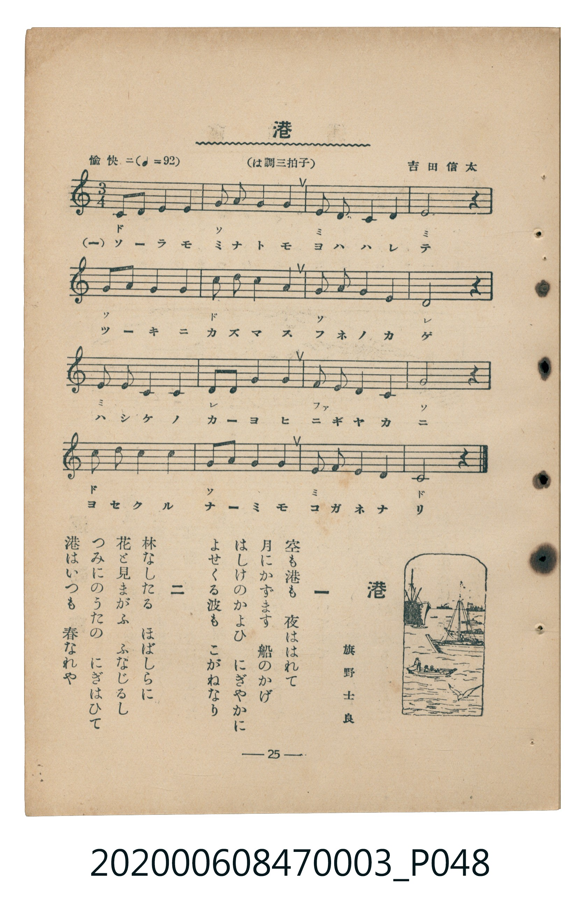

# 港

<audio controls src="minato.mp3"></audio>

- 臺灣教育會公認『新定兒童唱歌』尋常科第三學年用（第二學期・第9首）
- 國立臺灣歷史博物館典藏（典藏號：2020.006.0847.0003）

## 說明

【曲目說明】
・出處：臺灣教育會公認、臺北新高堂發行《新定兒童唱歌》尋常科第三學年用（昭和6年／1931年），
第二學期第 9 首〈港〉，原書第 25 頁（掃描檔 P048.jpg）。
・詞曲：旗野士良 作詞／吉田信太 作曲（原曲出自 1896 年《新編教育唱歌集》第五集，日本近代著名海港唱歌經典）。
・調性與拍號：ハ調（C 大調），3/4 拍，速度標示「愉快ニ != 92」。
・背景與曲風：以優美搖曳的 3/4 拍圓舞曲節奏，描寫晴朗月夜下船影繁多、駁船（はしけ）往來熱絡、
月映金波的港灣夜景，以及白晝桅檣如林、船旗如花、裝卸貨物歌聲鼎沸的繁榮港都春色。
・版本說明：本檔案為原書單聲部五線譜（附移動 Do 階名片假名）之忠實數位化版本。

・編曲說明（鋼琴伴奏版）：
1. 前奏 (Intro, 4 小節)：引用第四段「よせくる波も　こがねなり」優美流暢的波浪樂句揭開序幕。
2. 主歌伴奏 (Minato, 16 小節 × 2 段)：右手演奏 3/4 拍海港旋律，左手以圓舞曲式低音與和弦（`1_ - [1] - [1] -`）
營造港灣水波蕩漾的韻律。

## 歌詞

```text
一　空も港も　夜ははれて
月にかずます　船のかげ
はしけのかよひ　にぎやかに
よせくる波も　こがねなり

二　林なしたる　ほばしらに
花と見まがふ　ふなじるし
つみにのうたの　にぎはひて
港はいつも　春なれや
```

## ABC

```abc
X:1
T:港
C:TMD (Chen, Chih-Han / aguai)
M:3/4
L:1/16
Q:1/4=92
K:C
V:V1 name="Piano" snm="Pia"
[V:V1]
C2 D2 E4 E4 | G2 A2 G4 G4 | E2 D2 C4 D4 | E8 z4 |
G2 A2 G4 E4 | c2 B2 A4 G4 | G2 F2 E4 C4 | D8 z4 |
E2 D2 C4 C4 | D2 E2 F4 F4 | F2 E2 D4 C4 | G8 z4 |
c2 c2 B4 A4 | G2 A2 G4 E4 | E2 E2 D4 D4 | C8 z4 |
```

## TMD 檔案連結

- [主旋律 TMD 檔案](minato.tmd)
- [鋼琴伴奏 TMD 檔案](minato_piano.tmd)

## 分析

```text
================================================================================
📊 TMD Song Profile: [ 港 ]
================================================================================
⏱  Duration:       0:31 (31.3s), 16 measures total
🎼 Key & Tempo:    首調基準 C, != 92.0 BPM, <3/4>
   - 分析範圍：      由實際發聲的音符與和弦推測調性；播放脈絡另行呈現
🎤 人聲音域:    C4 (MIDI 60) – C5 (MIDI 72) [跨度: 12 個半音 / 1.0 個八度, 難度: easy]
   - 最低音:  C4 in [Minato #1 @ m.1, 0:00]
   - 最高音: C5 in [Minato #1 @ m.6, 0:09]
   - 適合: soprano, mezzo-soprano, contralto, tenor, baritone, bass
🏛  結構:      Minato (31.3s)
⚡ 編曲密度:        Peak 1 軌道同時演奏
🗝  調性診斷：       C 大調（純淨自然大調，未偵測到可信轉調）
   - 風格氣質:    純淨自然大調（陽光明朗、易唱易記，無明顯調外色彩）
   - 轉調歷程:    全曲維持單一推測調性（未偵測到可信轉調）
   - 核心骨幹音:  E, C, G, D, A
   - 調性數值:    C 大調 [相關度: 0.86, 穩定度: Moderate, 自然音純度: 100.0%]
   - 候選調性 (K-S): C 大調 (0.86), G 大調 (0.74), E 小調 (0.70)
   - 五度圈歷程:   +0
   - 各段落調性細節:
     • [Minato #1]: C 大調 (r: 0.86, 自然音純度: 100.0%)

  [ 五度圈游移軌跡 ]
              [C ]*
         F            G  
      Bb               D  
      Eb               A  
         Ab           E  
            Db       B  
               F# 
     (* = active key center)

  [ 十二半音累積音高分佈 ]
     C  : ██████████████████████    20.5%
     C# :                            0.0%
     D  : ███████████████████       18.2%
     D# :                            0.0%
     E  : ████████████████████████  22.7%
     F  : ███████                    6.8%
     F# :                            0.0%
     G  : ██████████████████████    20.5%
     G# :                            0.0%
     A  : ████████                   8.0%
     A# :                            0.0%
     B  : ████                       3.4%
--------------------------------------------------------------------------------
Assignment 軌道音域：
  - Piano         : C4 – C5 (12 個半音 / 1.0 個八度, 52 個音符)
================================================================================
```


## 原書掃描頁




