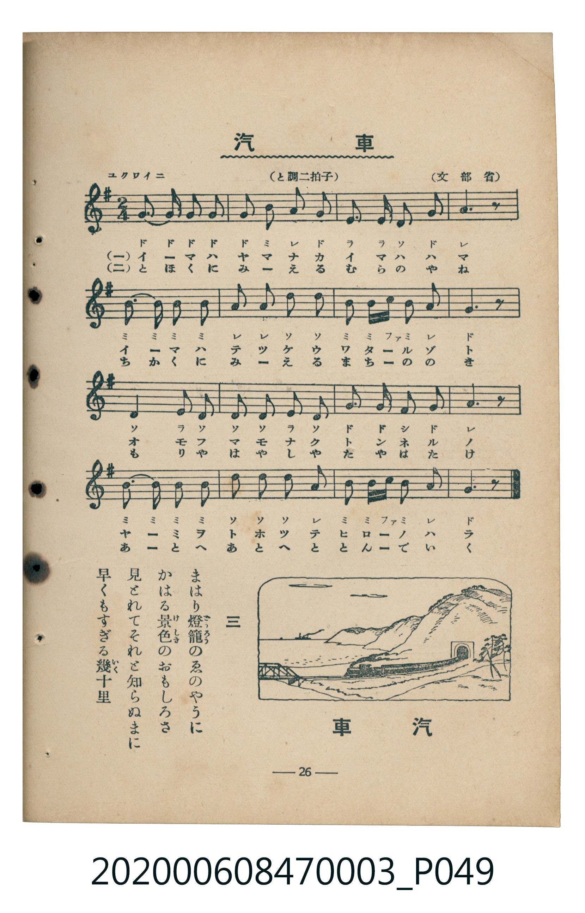

# 汽車（火車）

> Re:Shōka 使用 AI 協助辨識與重建樂譜，可能會有錯誤。歡迎回報。

- **鋼琴伴奏版**：<br><audio controls src="kisha.mp3"></audio>
- **NEUTRINO 歌聲合成版**：<br><audio controls src="kisha_neutrino.mp3"></audio>

- 詞：文部省
- 曲：文部省
- 臺灣教育會公認『新定兒童唱歌』尋常科第三學年用（第二學期・第10首）
- 國立臺灣歷史博物館典藏（典藏號：2020.006.0847.0003）

## 說明

【曲目說明】
・出處：臺灣教育會公認、臺北新高堂發行《新定兒童唱歌》尋常科第三學年用（昭和6年／1931年），
第二學期第 10 首〈汽車〉（火車），原書第 26 頁（掃描檔 P049.jpg）。
亦收錄於臺灣總督府編《公學校唱歌》第三學年用第十一課。
・出處原曲：文部省唱歌（1912年《尋常小學唱歌》第三學年，大和田愛羅作曲）。
・調性與拍號：ト調（G 大調），2/4 拍，速度標示「ユクワイニ」（!= 92）。
・背景與曲風：描寫搭乘蒸汽火車飛馳過山林、海濱、鐵橋、隧道與廣闊原野，窗外遠村屋頂、近鎮屋簷、
森林田野有如走馬燈（まはり燈籠）般向後飛逝的鐵道唱歌經典。
・版本說明：本檔案為原書單聲部五線譜（附移動 Do 階名片假名）之忠實數位化版本。

・編曲說明（鋼琴伴奏版）：
1. 前奏 (Intro, 4 小節)：引用第四段衝出隧道、馳騁原野的明亮樂句，有如火車鳴笛啟程。
2. 主歌伴奏 (Kisha, 16 小節 × 3 段)：右手演奏節奏鮮明的主旋律；
左手以持續不斷的八分音符交替音型，模擬蒸汽火車車輪在鐵軌上奔馳的推進力。

## 跨冊／重複收錄參照

> 同曲＋同名異曲（《公學校唱歌》第三學年與《新定兒童唱歌》三年級為大和田愛羅作曲同曲；《唱歌帖》P071 為《大正幼年唱歌》同名異曲）

- **[同曲]** 《公學校唱歌》第三學年（昭和10年／1935）：[**〈きしゃ（火車）〉**](../../../kogakko_shoka/grade_3/11_kisha/index.md)（`G` / `2/4` — [原始 TMD](../../../kogakko_shoka/grade_3/11_kisha/kisha.tmd)）
- **[同名異曲]** 楊金土手抄《唱歌帖》第 2 冊・II（2020.006.0843）：[**〈汽車〉**](../../../shokacho/vol_02/p071_kisha/index.md)（`C` / `2/4` — [原始 TMD](../../../shokacho/vol_02/p071_kisha/kisha.tmd)）
- 總表：[跨冊重複與同名歌曲總索引](../../../duplicate_songs.md)

## 歌詞

```text
一　今は山中　今ははま
今はてつけう　わたるぞと
おもふまもなく　トンネルの
やみをとほつて　ひろのはら

二　とほくに見える　むらのかね［やね］
ちかくに見える　まちののき
もりやはやしや　たやはたけ
あとへあとへと　とんでいく

三　まはり燈籠（どうろう）のゑのやうに
かはる景色（けしき）のおもしろさ
見とれてそれと知らぬまに
早くもすぎる幾十里（いくじふり）
```

## ABC

```abc
X:1
T:汽車（火車）
C:曲：文部省
M:2/4
L:1/16
Q:1/4=92
K:G
V:V1 name="Piano" snm="Pia"
[V:V1]
G3 G G2 G2 | G2 B2 A2 G2 | E3 E D2 G2 | A6 z2 |
w: 1.~い _ ま は | や ま な か | い ま は は | ま
w: 2.~と ほ く に | み _ え る | む ら の や | ね
w: 3.~ま は り ど | う ろ う の | ゑ の や う | に
B3 B B2 B2 | A2 A2 d2 d2 | B2 B c B2 A2 | G6 z2 |
w: 1.~い _ ま は | て つ け う | わ た _ る ぞ | と
w: 2.~ち か く に | み _ え る | ま ち _ の の | き
w: 3.~か _ は る | け し き の | お も _ し ろ | さ
D4 E2 D2 | D2 D2 E2 D2 | G3 G F2 G2 | A6 z2 |
w: 1.~お も ふ | ま も な く | ト ン ネ ル | の
w: 2.~も り や | は や し や | た や は た | け
w: 3.~み と れ | て そ れ と | し ら ぬ ま | に
B3 B B2 B2 | d2 d2 d2 A2 | B2 B c B2 A2 | G6 z2 |
w: 1.~や _ み を | と ほ つ て | ひ ろ _ の は | ら
w: 2.~あ _ と へ | あ と へ と | と ん _ で い | く
w: 3.~は や く も | す _ ぎ る | い く _ じ ふ | り
```

## TMD 檔案連結

- [主旋律 TMD 檔案](kisha.tmd) [[在 TMD Studio 編輯](https://tmdlang.github.io/Tmd-TS/#tmd=s7IKdvYPcrWy4qpTUCpJTLdSSM7PyUlNLsnMz7MqzsjMK0nNjM_KTMmPL87Iz05Ugisry88pzU21Si9KTEmNN443MjAyiDcwMIs3sDAxBzIMjBFKi_NLi5JTrYqTM_Lzc-JLUitKkvLzsxHyBUX5Zal5iXlANQVFIBtTwIoQClLLMlNSQdKpKZkl-UWZiTlI7kgtKga7FWxJfElRYl5xclFmAcgDCFUlGalAx4IlC_KLgEZraSk827j3xe6u93s6njeuBjM6FbS0uBRtFSyNuOxtFdy5bIz0TexARrxYOe_9nlnPprW_bF7xfE4j2NhnszdhiL1o3_W8cfGzqTNfNG16Nqf5aeuaF6t6Hzf0PZu24em6WU9bJz1fvfTplI3P1vY8buh_uqH76Y4dz5dPfL5mzZMdnU_X7ni6c8vzKStADgKK7OoBijybM_9x824g19Dg5bJpQBeCrXk6p_v56m6oZWu3P-3f9LR31vPOlS-XrHjauuPF9H6gERDGi5nzgY4ExY0eMG70QHEDZBgYg03i0tdSsKUW4FJQUHjcMAEYKs9nr3uxatWzGX2PGyaCRZt3P23f9WLmVKBLcARQI1D8ac90YDC9XD3j6YKm5zP3vFgIDKMubAHXjSfgns1Y-3RSjxmQ_35Pv6GlsSGY1fl-Tw_IJQoKyAELZCsYGigAw_VxQwckLTxuACpFJAegtqd985_N3gFSamSm8HJBI8iOvuZn_f3PVk1RCDAwsdTLKkgHKn3c0ASx4cmuZc-mbHvZ0_Js2h6Ib5_v2Pt87uKnu-Y8374C6CWgn0H2L1gI9w-aN4Dcp72NT3Y0vFi1CWosPAjBzkFJdxBTgM4ytDQ0AhoAsgEcPk839IOMxGYJyF9LlgMD6vmUDc9aZj_f1_pk7xywuTB_AC18sWr_s4blLzran3X3QpLR4-YOoCDQKncFoHYwExREwEyiAFQDZL1smP8U6P0VM58v2fW4oedx87LHTesfN69_3LTkcXP34wagmg5w9kK1qLnn2cz1IItmb3q5CBiLs4DB-3T96mcT1j7ZOePFpB3AuIFEycvFs18u2_yyse_pxo3P5k0HpptnW7c_278RyHg5YeuzlUArGl_OWv6ycTLQtKe7F7-c3gUMsJftfUC3PV81_emSaS8bFzybO_Hpxu6XC5pAyW7_xJd964Dc5xu2A7mQGHy2eB3QcGDQADU-m9P5dFnTi60bXi5b87y9A-j-x437HjcCfdQF5D7fuADokxcda55OmPh0Xw_IeQ1zn89qAToG6AZI0D_fNhmYFRG-fd7Z8WwOMNWDMgjIq3PWAFPSs4Udz5t2QdLa02nrXjRuAkbuk11Tnm-f9WLtHKCtL2e2PF---2n3VAWXfIWXs_qeTuh93tn-tLEdyAA64cnO7qf7Fzxdv-zZ1B1P9vY-7ZkGsQZkLTRjQgwHOghYlj1tXQFMP8AwerJjLYixat6LteuBuRVUbGzofdbeiZyywQYAU-PjhoYnwBzSuB4Y-EB9cC4Y7QMrgvKXPW5c8rhx4uPGNqCix039jxvnP27qftw473HjCrBrGrseNzU9btwKCksQY9Xjxn6Q0uaOx82bHzf3Pm5e_bhxHVhpU8vjxv2PmyYBtT5u3A02eBlIaeOmx029QEXguOgEKQU6HuIRYKg-7Zz9rLP3ZVPL0zkrIM4FpoAXezufz9nzdPumpx0bgOnmZRMwi4OUgRQ3b34xcfrz_n1A9S-WNQJTGCQ9PdnVBtU4b83LaZOf7NsP1P585X6QAnA6A0X27onPZk0HKnuyrw1oMiTZAcUhKQ8YA_Aw3AXMh0CXQzwCDJXVL5YBQ6UDFDagcAKiTrCPgIJA9-4G-x3I2AsJs4VgCQxtoOQIlAJqA6JeSJg1AZMnWDcwbIDkdBAJUgqMBrAgkNEIKZobgaEPdM8OJAawjAI7smny48bljxuBGvrRgxeYi4Bl0fM53U_3TQc6BpijXvSBvQzOV6AQ2z8RWcGLhdOB2QyiAJjTQMEOzmOgDLxiJ5SxAVj2bQCVAtM3AhmgIqp1xcvmvcCU93TnVBDa1wDJY0-XTnnRACyYdyOH7Q5ggQIJDOS8CcytK0HJEJRUgDEJDt4mYMIEkkB_tQHDEhIKwPAEausGFUOdwFIQqA2oaDowPKF6oAkWGJBAg6aC9IDjABhIPeDkPhfMWPF8_lJwHK4BOwRs9rPpQAf0g3XPfNzYB7Tk6c59wOL9ZTuozIYE7-PGGaDMAEqPmCl5w8anzf3wAujJDnA4z5n2fOpqYMg8W7EYlPB29D6btv3Fuq5n_bOBshBfPF0y6-WuPcDy68U2oJrZz9YuhkTH09alz5fOAwY4UBfQvUDyxbJdwPIDmLyBRgGdC0zhoEDev_rpnA0vl88GJnVgLgCWKxBHv9gOLCjAwQ50KOWtBihQ0NLn4vLOLM5ItArITMzLd6gxqKkGl8Y2Flp2YAa2tgq4OgeGwrqtChomCsAK7_n6Bh142QWSVTBUADYkNLFoBdoINRZoghUw0ywBl897gHgeEPcr1ADJJVBeF1B-NVAeKAZVB1EDUzcPXHGAAJKxu3qAxjauACew3UAMVN64GqS8cT_EosYOoHHdUGMbwDm3Eyi6DlTqgdWtRTe2RkHDUEEXCA01VTV0dTWB3jMEChoqGCsYgVkaZvFgebN4qALTeLC4EVjUQKEGbIyPIVAlMO2BBYGKgMkViNeD3dEC5a0CZQuQiTB1QGGQyvUwlUBVIOF4mJlGYLUroGp3g9Qi-xgkCPEvSB3Qu2B1TZ0gdcg-RjHTGGwmxCKgtUC1TcCoaFwJVtsG5PVCaKAJYFMnQlWuA6kE-aQNrHI13FT8SWlXD76kZERRUgK6shnooqaNQLwMEufNwLBsgqaF5tVA9j6waAfOtLQQUlgRSkvg-FsIFQeGLTh0gIUZZmIyBgeMMTStGAMhKKkYKZgCYQ2QB1RgApIEyRmBExqRyahxGRADc0_jRFgkNPWD1M4HqwM6FNgaAKuDpBe0RLQQGo3d-BIRyDaIWmgSgnsTSxLqRrgRFOgQ_SC3TQfrgOntAiWiJog6oAwweYFEpxKZfHZ04ks-xkQnn1Xg5LMIiKdCEwooGYH4oHJoPVQMlEyAzSUgBrofmHxAYn3oBQY87QB9BSpfQAa0QFMJKCBAeQTkUZjYfLAqkCgon8-HBhNGwgGWKqAyBkSDOUAE46EVUOa4yh9QYIMKgCYgayss1YJ5oJIHlGc0QH4EJ4TmzcAIQXgTGFnoiQYca3D_YfoOnAiAiQ-sqAVWjsH8h55gYEltBVBxDzw5zwXzQKJg06Yjl2BrwO4noax5Ons2vsRiQmxiAVZRsLJmPhBvgiaNx82zIeUNsNyBJJdJQLwWqrIPXiqtxJVeGsHpBVyCAEOhcQfYb6DYgfAg9RokAwNbilCVy4EYEvr9GEkGa1kDKmdMwSULcWUNMCbh-RhY8DVNgjkBXMGCyptlYJFNILXAggBWMkCqtk5sZQ0o3UBNxOVRiB1AEydD1CF7E0tZsx45mQFLL2DSBKmdCU5SwKCHlj4tILVAA0CqZsAyATABw0ys5eLStVMAN4rApgM5ylwA)]
- [鋼琴伴奏 TMD 檔案](kisha_piano.tmd) [[在 TMD Studio 編輯](https://tmdlang.github.io/Tmd-TS/#tmd=s7IKdvYPcrWy4tLSUni2ce-L3V3v93Q8b1wNZDxu3v2ye8_zCVue7NnydGn_886O93s6FbS0uBRtFSyNuOxtFdy5bIz0Tey46hSUXrTvet64-NnUmS-aNj2b0_y0dc2LVb2PG_qeTdvwdN2sp62Tnq9e-nTKxmdrex439D_d0P10x47nyyc-X7PmyY7Op2t3PN255fmUFSCrgSK7eoAiz-bMBzoAyDU0eLlsGtBmJZA1T-d0P1_dDbVs7fan_Zue9s563rny5ZIVT1t3vJjeDzQCwngxc_77PbOMDIwM9AwMzPQMLEzMgQwDY7BJXPpaCrbUAlwKCgqPGyY8m73p-ex1L1atejaj73HDRLBo8-6n7btezJwKdAmOAGoEij_tmQ4MpperZzxd0PR85p4XC4Fh1IUt4LrxBNyzGWufTuoxA_Lf7-k3tDQ2BLM63-_pAblEQQE5YIFsBUMDBWC4Pm7ogMT64wagUmjEQ7Q97Zv_bPYOkFIjM4WXCxpBdvQ1P-vvf7ZqikKAgYmlXlZBOlDp44YmFL-C9W0C-vjZtPaXzSuez2mEOB8UM0uWA934fMqGZy2zn-9rfbJ3DlglkhEvVu1_1rD8RUf7s-5eSAw-bu4ACgI1uysAtYOZINcB050CUA2Q9bJh_tNdyxTAiRJh0PPtK4BmQ2IDqBkzIQONhgSMoZ7C085eoLiChmdeSVG-joKJwtMN_c_XN2gC1TzdMxUYvsBQeDp79rN1W18snAv05ctZy182TgZG3stlm1-uaAT6-GV73_NZLUC7nuxa92xF09P-pUCXPZvT-XRZEyRMX27e8nzN7KdT5z9f0Q11pYKCkZ7Ckx27gWEDcZiChndmcUaijoKhGdQFCoenKxgrAO0FO6V_87PO7md7poD8sL4BSL5ctw5oJdBikCnTu5_u636_ZzbEaCB4un0ZUP2T3Uuf9TQ-39XzZEfvs2nbgYqftq5-2tH2cv7m52uWPdm15Nns_UD203lAvT3PVix8NnnNi0k7gIkC4m4Q2rPq6ZwVLydsfbEbaEjX06VTgN4G-bZvxcuGTU-7ZkP9Q3lOggIFLX0uLnBcWAVkJublB3k41BjUVIM9ZmOhZQdm1ChoGCvoAqGxpqqGrq4mMJyMgYKmYGgEZBmDFJiAJEFyIBFDsHoDhRquWhTzfbCbbxivEG0Yq2AKoYBGAxmmED6QQpFH5oMw1A5wdOLxA7ZSCJxRdzQA41xBA54QsSgDhhE0GCDeMoQGgyEQgrwK8jKIpWEWD5Y3i4cqALoXJG4EDwyQMT6GQJWPG1vAgkBFjxv3AfF6oLrHTS1Q3iog7gaZCFMHFAapXA9TCVQFEo6HmWkEVrsCqnY3SG0_EK8Gq90PFuwAmg8xs6kBoq6pE6RuHdhekLq1qGYag82EWAS0Fqi2qQvIWAlW2wbk9UJooAlgUydCVa4DqQT5pA2scjXcVPwRsauHhIjAlh6NgBCUIvGnRwJR0LgMiJcA8USYB5qAhcXjxvlgdcAAfNw4D6wOEtZoEbAQGgTd-CIAZBtELTT4wQH4uLEXW_B3I9wIjHyofpDbpoN1wPR2gSKgCaIOKAOMGpDoVCKDfkcn8UEPTNOgFA6iwRwggvHQsoc5rtQPci4o-TUBWVuhAQLhgdJ9Pzg1NXdAgrJ5M9BLzUCPNkOCch1GsIP9DUmb0HQMCihQ-gMFBEgEEn1gRS2wXDQfGpDoQQ6LrBVAxT3wBDEXzAOJgk2bjpx_1oDdT0JKh1RvlKR04kpeREoHhgI8Fe0HunsSNAUDSwpoal8GFtkEUgtMhrB0CSmUOrGldFCYQ00EmbMDrB8UhRAeJKhAJNDEyRB1y4EYEkH92FL6euQoAuYdYLSC1M4ER0cfPO23gNQCDQCpmgFLQMDIh5mIWhdgrW-oUhegV1nofGCmiDbLjYXTyJUaKHaoVxiSWXkCKcLuILFkAFlgBLMHnY_bnQTdQVKWobwxoWunAG6zKAAZ4MQU7QOURHCMkDnGYI4yFwA)]

## 分析

```text
================================================================================
📊 TMD Song Profile: [ 汽車（火車） ]
================================================================================
⏱  Duration:       0:20 (20.9s), 16 measures total
🎼 Key & Tempo:    首調基準 G, != 92.0 BPM, <2/4>
   - 分析範圍：      由實際發聲的音符與和弦推測調性；播放脈絡另行呈現
🎤 人聲音域:    D4 (MIDI 62) – D5 (MIDI 74) [跨度: 12 個半音 / 1.0 個八度, 難度: easy]
   - 最低音:  D4 in [Kisha #1 @ m.3, 0:03]
   - 最高音: D5 in [Kisha #1 @ m.6, 0:07]
   - 適合: soprano, mezzo-soprano, contralto, tenor, baritone, bass
🏛  結構:      Kisha (20.9s)
⚡ 編曲密度:        Peak 1 軌道同時演奏
🗝  調性診斷：       G 大調（純淨自然大調，未偵測到可信轉調）
   - 風格氣質:    純淨自然大調（陽光明朗、易唱易記，無明顯調外色彩）
   - 轉調歷程:    全曲維持單一推測調性（未偵測到可信轉調）
   - 核心骨幹音:  G, B, D, A, E
   - 調性數值:    G 大調 [相關度: 0.85, 穩定度: High, 自然音純度: 100.0%]
   - 候選調性 (K-S): G 大調 (0.85), D 大調 (0.71), B 小調 (0.65)
   - 五度圈歷程:   +1
   - 各段落調性細節:
     • [Kisha #1]: G 大調 (r: 0.85, 自然音純度: 100.0%)

  [ 五度圈游移軌跡 ]
               C  
         F           [G ]*
      Bb               D  
      Eb               A  
         Ab           E  
            Db       B  
               F# 
     (* = active key center)

  [ 十二半音累積音高分佈 ]
     C  : ██                         1.7%
     C# :                            0.0%
     D  : ██████████████████        20.0%
     D# :                            0.0%
     E  : ██████                     6.7%
     F  :                            0.0%
     F# : ██                         1.7%
     G  : ████████████████████████  26.7%
     G# :                            0.0%
     A  : ██████████████████        20.0%
     A# :                            0.0%
     B  : █████████████████████     23.3%
--------------------------------------------------------------------------------
Assignment 軌道音域：
  - Piano         : D4 – D5 (12 個半音 / 1.0 個八度, 53 個音符)
================================================================================
```


## 原書掃描頁




