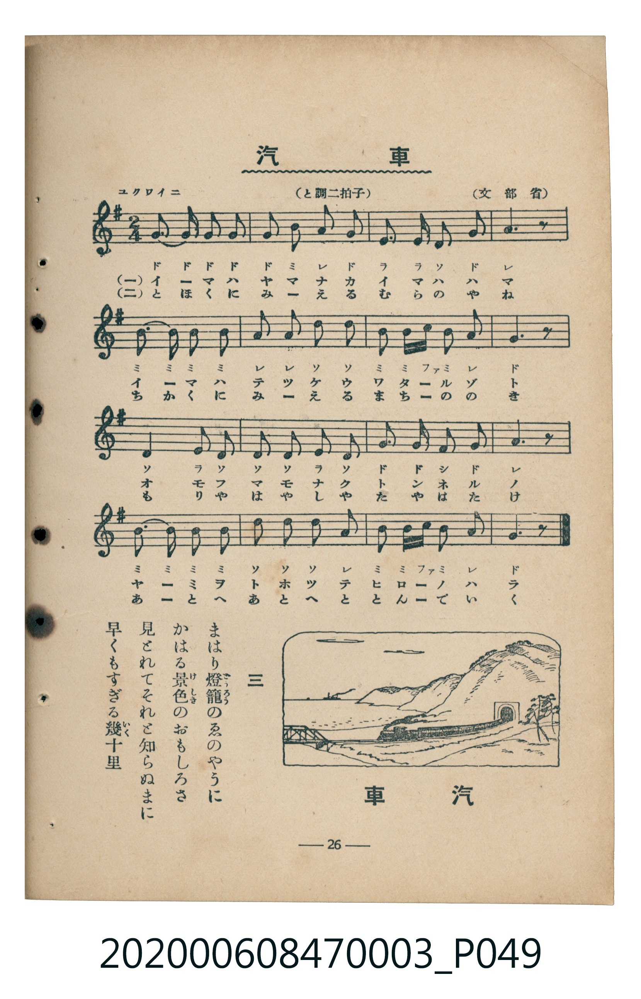

# 汽車（火車）

<audio controls src="kisha.mp3"></audio>

- 臺灣教育會公認『新定兒童唱歌』尋常科第三學年用（第二學期・第10首）
- 國立臺灣歷史博物館典藏（典藏號：2020.006.0847.0003）

## 說明

【曲目說明】
・出處：臺灣教育會公認、臺北新高堂發行《新定兒童唱歌》尋常科第三學年用（昭和6年／1931年），
第二學期第 10 首〈汽車〉（火車），原書第 26 頁（掃描檔 P049.jpg）。
亦收錄於臺灣總督府編《公學校唱歌》第三學年用第十一課。
・出處原曲：文部省唱歌（1912年《尋常小學唱歌》第三學年，大和田愛羅作曲）。
・調性與拍號：ト調（G 大調），2/4 拍，速度標示「ユクワイニ」（!= 92）。
・背景與曲風：描寫搭乘蒸汽火車飛馳過山林、海濱、鐵橋、隧道與廣闊原野，窗外遠村屋頂、近鎮屋簷、
森林田野有如走馬燈（まはり燈籠）般向後飛逝的鐵道唱歌經典。
・版本說明：本檔案為原書單聲部五線譜（附移動 Do 階名片假名）之忠實數位化版本。

・編曲說明（鋼琴伴奏版）：
1. 前奏 (Intro, 4 小節)：引用第四段衝出隧道、馳騁原野的明亮樂句，有如火車鳴笛啟程。
2. 主歌伴奏 (Kisha, 16 小節 × 3 段)：右手演奏節奏鮮明的主旋律；
左手以持續不斷的八分音符交替音型，模擬蒸汽火車車輪在鐵軌上奔馳的推進力。

## 歌詞

```text
一　今は山中　今ははま
今はてつけう　わたるぞと
おもふまもなく　トンネルの
やみをとほつて　ひろのはら

二　とほくに見える　むらのかね［やね］
ちかくに見える　まちののき
もりやはやしや　たやはたけ
あとへあとへと　とんでいく

三　まはり燈籠（どうろう）のゑのやうに
かはる景色（けしき）のおもしろさ
見とれてそれと知らぬまに
早くもすぎる幾十里（いくじふり）
```

## ABC

```abc
X:1
T:汽車（火車）
C:TMD (Chen, Chih-Han / aguai)
M:2/4
L:1/16
Q:1/4=92
K:G
V:V1 name="Piano" snm="Pia"
[V:V1]
G3 G G2 G2 | G2 B2 A2 G2 | E3 E D2 G2 | A6 z2 |
B3 B B2 B2 | A2 A2 d2 d2 | B2 B c B2 A2 | G6 z2 |
D4 E2 D2 | D2 D2 E2 D2 | G3 G F2 G2 | A6 z2 |
B3 B B2 B2 | d2 d2 d2 A2 | B2 B c B2 A2 | G6 z2 |
```

## TMD 檔案連結

- [主旋律 TMD 檔案](kisha.tmd) [[在 TMD Studio 編輯](https://tmdlang.github.io/Tmd-TS/#tmd=s7IKdvYPcrWy4tLSUni2ce-L3V3v93Q8b1wNZnQqaGlxKdoqWBpx2dsquHPZGOmb2HHVKSi9aN_1vHHxs6kzXzRtejan-Wnrmhereh839D2btuHpullPWyc9X7306ZSNz9b2PG7of7qh--mOHc-XT3y-Zs2THZ1P1-54unPL8ykrQBYBRXb1AEWezZn_uHk3kGto8HLZNKDNSiBrns7pfr66G2rZ2u1P-zc97Z31vHPlyyUrnrbueDG9H2gEhPFi5vz3e2YZGRgZ6BkYmOkZWJiYAxkGxmCTuPS1FGypBbgUFBQeN0x4NnvT89nrXqxa9WxG3-OGiWDR5t1P23e9mDkV6BIcAdQIFH_aMx0YTC9Xz3i6oOn5zD0vFgLDqAtbwHXjCbhnM9Y-ndRjBuS_39NvaGlsCGZ1vt_TA3KJggJywALZCoYGCsBwfdzQAYnjxw1ApYhoBmp72jf_2ewdIKVGZgovFzSC7Ohrftbf_2zVFIUAAxNLvayCdKDSxw1NEBue7Fr2bMq2lz0tz6btgfj2-Y69z-cufrprzvPtK4BeAvoZZP-ChXD_oHkDyH3a2_hkR8OLVZugxsKDEOycTcCAfDat_WXziudzGiGmAJ1laGloBDQAZAM4fJ5u6AcZic0SkL-WLAcG1PMpG561zH6-r_XJ3jlgc2H-AFr4YtX-Zw3LX3S0P-vuhSSjx80dQEGgVe4KQO1gJiiIgIlfAagGyHrZMP8p0PsrZj5fsutxQ8_j5mWPm9Y_bl7_uGnJ4-buxw1ANR3gbINqUXPPs5nrQRbN3vRyETAWZwGD9-n61c8mrH2yc8aLSTuAcQOJkpeLZ79ctvllY9_TjRufzZsOTDfPtm5_tn8jkPFywtZnK4FWNL6ctfxl42SgaU93L345vQsYYC_b-4Bue75q-tMl0142Lng2d-LTjd0vFzSBkt3-iS_71gG5zzdsB3IhMfhs8Tqg4cCgAWp8Nqfz6bKmF1s3vFy25nl7B9D9jxv3PW4E-qgLyH2-cQHQJy861jydMPHpvh6Q8xrmPp_VAnQM0A2QoH--bTIwKyJ8-7yz49kcYKoHZRCQV-esAaakZws7njftgqS1p9PWvWjcBIzcJ7umPN8-68XaOUBbX85seb5899PuqQou-QovZ_U9ndD7vLP9aWM7kAF0wpOd3U_3L3i6ftmzqTue7O192jMNYg3IWmjGhBgOdNCLlfOetq4Aph9gGD3ZsRbEWDXvxdr1wNwKKjY29D5r70RO2WADgKnxcUPDE2AOaVwPDHygPjgXjPaBFUH5yx43LnncOPFxYxtQ0eOm_seN8x83dT9unPe4cQXYNY1dj5uaHjduBYUliLHqcWM_SGlzx-PmzY-bex83r37cuA6stKnlceP-x02TgFofN-4GG7wMpLRx0-OmXqAicFx0gpQCHQ_xCDBUn3bOftbZ-7Kp5emcFRDnAlPAi72dz-fsebp909OODcB087IJmMVBykCKmze_mDj9ef8-oPoXyxqBKQySnp7saoNqnLfm5bTJT_btB2p_vnI_SAE4nYEie_fEZ7OmA5U92dcGNBmS7IDikJQHjAF4GO4C5kOgyyEeAYbK6hfLgKHSAQobUDgBUSfYR0BBoHt3g_0OZOyFhNlCsASGNlByBEoBtQFRLyTMmoDJE6wbGDZAcjqIBCkFRgNYEMhohBTNjcDQB7pnBxIDWEaBHdk0-XHj8seNQA396MELzEXAsuj5nO6n-6YDHQPMUS_6wF4G5ytQiO2fiKzgxcLpwGwGUQDMaaBgB-cxUAZesRPK2AAs-zaASoHpG4EMUBHVuuJl815gynu6cyoI7WuA5LGnS6e8aAAWzLuRw3YHsECBBAZy3gTm1pWgZAhKKsCYBAdvEzBhAkmgv9qAYQkJBWB4ArV1g4qhTmApCNQGVDQdGJ5QPdAECwxIoEFTQXrAcQAMpB5wcp8LZqx4Pn8pOA7XgB0CNvvZdKAD-sG6Zz5u7ANa8nTnPmDx_rIdVGZDgvdx4wxQZgClR8yUvGHj0-Z-eAH0ZAc4nOdMez51NTBknq1YDEp4O3qfTdv-Yl3Xs_7ZQFmIL54umfVy1x5g-fViG1DN7GdrF0Oi42nr0udL5wEDHKgL6F4g-WLZLmD5AUzeQKOAzgWmcFAg71_9dM6Gl8tnA5M6MBcAyxWIo19sBxYU4GAHOpTyVgMUKGjpc3F5ZxZnJFoFZCbm5TvUGNQoVIOLYxsLLTswA1tjBVyfA4Nh3VYFDRMFYI33fH2DDrzwAskqGCoAWxKaWLQCrYQaCzTBCphrloAL6D1APA-I-xVqgOQSKK8LKL8aKA8Ug6qDqIGpmweuOUAAydhdPUBjG1eAU9huIAYqb1wNUt64H2JRYwfQuG6osQ3grNsJFF0HKvbA6taiG1ujoGGooKurYKipqqGrqwn0nSFQzFDBWMEIzNIwiwdJm8VD5U3jwcJGCrpAaKBQA84suINyVw--oDSiKCjbgLgFKLcRiJdB_Ny8HsiGhkXzaiB7H1i0A2dYLoTkVkJh2bgPrBYiDgxNIAaJ9mIGpjEotIyhgWUMhKCwMlIwBcIaIA8obwKSBMkZgQOauHDc0YkvHI2JDsdV4HBcBMRToSEGCk8QH5Qg10PFQOEFrDiBuBccjiCxPpwJsqkJnNBABrRAgwsUDcCoaZyOJDYfrAokCpQF8kBiEzGTIzCBgZIbiAZzgAjGQ02p5iSlxKezZ-MLQRNiQxCYgWEpcT4Qb4KG1-Pm2ZDUCEyVkDCcBMRroSr74Gl2Jc6UCA5EcPpaAcQ7wMHTBOdBcj1IDMhvmgxVuRyIIfm6n6iUCEqFpuB0hy8l1nJx6dopgAtPEEOZiwsA)]
- [鋼琴伴奏 TMD 檔案](kisha_piano.tmd) [[在 TMD Studio 編輯](https://tmdlang.github.io/Tmd-TS/#tmd=s7IKdvYPcrWy4tLSUni2ce-L3V3v93Q8b1wNZDxu3v2ye8_zCVue7NnydGn_886O93s6FbS0uBRtFSyNuOxtFdy5bIz0Tey46hSUXrTvet64-NnUmS-aNj2b0_y0dc2LVb2PG_qeTdvwdN2sp62Tnq9e-nTKxmdrex439D_d0P10x47nyyc-X7PmyY7Op2t3PN255fmUFSCrgSK7eoAiz-bMBzoAyDU0eLlsGtBmJZA1T-d0P1_dDbVs7fan_Zue9s563rny5ZIVT1t3vJjeDzQCwngxc_77PbOMDIwM9AwMzPQMLEzMgQwDY7BJXPpaCrbUAlwKCgqPGyY8m73p-ex1L1atejaj73HDRLBo8-6n7btezJwKdAmOAGoEij_tmQ4MpperZzxd0PR85p4XC4Fh1IUt4LrxBNyzGWufTuoxA_Lf7-k3tDQ2BLM63-_pAblEQQE5YIFsBUMDBWC4Pm7ogMT64wagUmjEQ7Q97Zv_bPYOkFIjM4WXCxpBdvQ1P-vvf7ZqikKAgYmlXlZBOlDp44YmFL-C9W0C-vjZtPaXzSuez2mEOB8UM0uWA934fMqGZy2zn-9rfbJ3DlglkhEvVu1_1rD8RUf7s-5eSAw-bu4ACgI1uysAtYOZINcB050CUA2Q9bJh_tNdyxTAiRJh0PPtK4BmQ2IDqBkzIQONhgSMoZ7C085eoLiChmdeSVG-joKJwtMN_c_XN2gC1TzdMxUYvsBQeDp79rN1W18snAv05ctZy182TgZG3stlm1-uaAT6-GV73_NZLUC7nuxa92xF09P-pUCXPZvT-XRZEyRMX27e8nzN7KdT5z9f0Q11pYKCkZ7Ckx27gWEDcZiChndmcUaijoKhGdQFCoenKxgrAO0FO6V_87PO7md7poD8sL4BSL5ctw5oJdBikCnTu5_u636_ZzbEaCB4un0ZUP2T3Uuf9TQ-39XzZEfvs2nbgYqftq5-2tH2cv7m52uWPdm15Nns_UD203lAvT3PVix8NnnNi0k7gIkC4m4Q2rPq6ZwVLydsfbEbaEjX06VTgN4G-bZvxcuGTU-7ZkP9Q3lOggIFLX0uLnBcWAVkJublB3k41BjUKFSDfWZjoWUHZtQoaBgr6OoqGGuqaujqagLDyRgoZgqGRkCWMUjeBCQJkgOJGCroAqGBQg1XLYr5PjjMN4xXiDaMVTCFUECzgQxTCB9Iocgj80EYagk4PvF5Als5BM6qOxqAsa6gAU-KWJQBQwkaDkCP6SoYQsPBEAhBfgX5GcTSMIsHSZvFQ-WBzgUJG8EDA79DdvWQ4BAsEWIEhKAowR8hBAKjk3g3AL0H8iyIBnOACMZDDSdzksIBkv0pCAeiEyZSmsGeMKmSZtDTNjofGGbRZrmxcBo59VM30ZCZy4AU1RMOyAIjmD3ofNzupG7iobzU0bVTAJduCkAGODVhZyhzcQEA)]

## 分析

```text
================================================================================
📊 TMD Song Profile: [ 汽車（火車） ]
================================================================================
⏱  Duration:       0:20 (20.9s), 16 measures total
🎼 Key & Tempo:    首調基準 G, != 92.0 BPM, <2/4>
   - 分析範圍：      由實際發聲的音符與和弦推測調性；播放脈絡另行呈現
🎤 人聲音域:    D4 (MIDI 62) – D5 (MIDI 74) [跨度: 12 個半音 / 1.0 個八度, 難度: easy]
   - 最低音:  D4 in [Kisha #1 @ m.3, 0:03]
   - 最高音: D5 in [Kisha #1 @ m.6, 0:07]
   - 適合: soprano, mezzo-soprano, contralto, tenor, baritone, bass
🏛  結構:      Kisha (20.9s)
⚡ 編曲密度:        Peak 1 軌道同時演奏
🗝  調性診斷：       G 大調（純淨自然大調，未偵測到可信轉調）
   - 風格氣質:    純淨自然大調（陽光明朗、易唱易記，無明顯調外色彩）
   - 轉調歷程:    全曲維持單一推測調性（未偵測到可信轉調）
   - 核心骨幹音:  G, B, D, A, E
   - 調性數值:    G 大調 [相關度: 0.85, 穩定度: High, 自然音純度: 100.0%]
   - 候選調性 (K-S): G 大調 (0.85), D 大調 (0.71), B 小調 (0.65)
   - 五度圈歷程:   +1
   - 各段落調性細節:
     • [Kisha #1]: G 大調 (r: 0.85, 自然音純度: 100.0%)

  [ 五度圈游移軌跡 ]
               C  
         F           [G ]*
      Bb               D  
      Eb               A  
         Ab           E  
            Db       B  
               F# 
     (* = active key center)

  [ 十二半音累積音高分佈 ]
     C  : ██                         1.7%
     C# :                            0.0%
     D  : ██████████████████        20.0%
     D# :                            0.0%
     E  : ██████                     6.7%
     F  :                            0.0%
     F# : ██                         1.7%
     G  : ████████████████████████  26.7%
     G# :                            0.0%
     A  : ██████████████████        20.0%
     A# :                            0.0%
     B  : █████████████████████     23.3%
--------------------------------------------------------------------------------
Assignment 軌道音域：
  - Piano         : D4 – D5 (12 個半音 / 1.0 個八度, 53 個音符)
================================================================================
```


## 原書掃描頁




