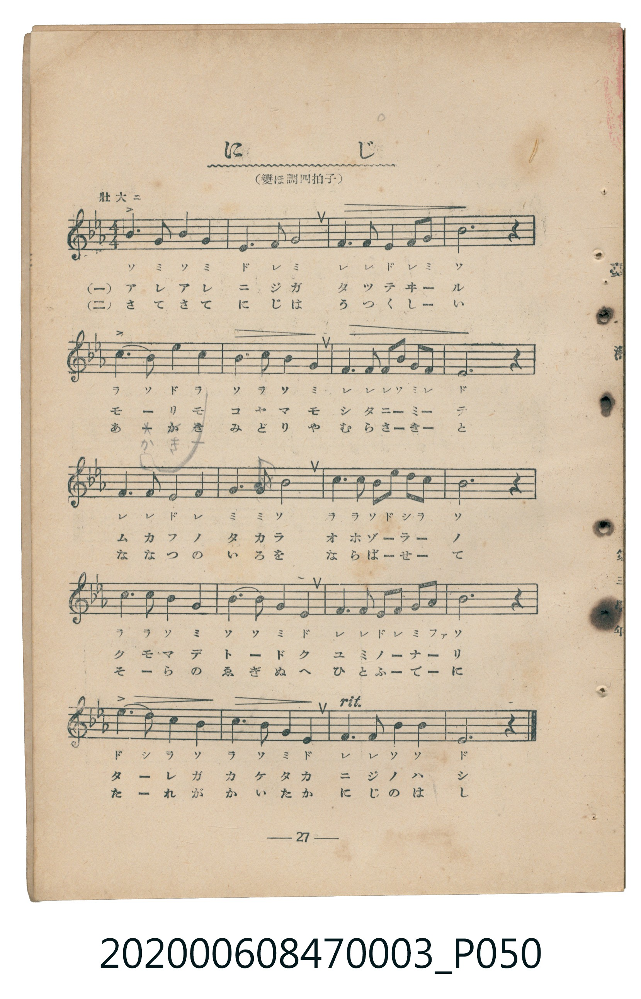
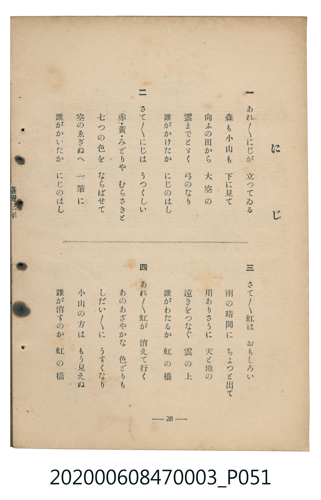

# にじ（彩虹）

> Re:Shōka 使用 AI 協助辨識與重建樂譜，可能會有錯誤。歡迎回報。

- **鋼琴伴奏版**：<br><audio controls src="niji.mp3"></audio>
- **NEUTRINO 歌聲合成版**：<br><audio controls src="niji_neutrino.mp3"></audio>

- 臺灣教育會公認『新定兒童唱歌』尋常科第三學年用（第二學期・第11首）
- 國立臺灣歷史博物館典藏（典藏號：2020.006.0847.0003）

## 說明


- 出處：臺灣教育會公認、臺北新高堂發行《新定兒童唱歌》尋常科第三學年用（昭和6年／1931年），
第二學期第 11 首〈にじ〉（彩虹），原書第 27–28 頁（掃描檔 P050.jpg–P051.jpg）。
- 出處原曲：文部省唱歌（1911年《尋常小學唱歌》第二學年〈虹〉）。
- 調性與拍號：變ホ調（Eb 大調），4/4 拍，速度標示「壯大ニ」（!= 88）。
- 背景與曲風：以寬廣宏大的 4/4 拍附點四分音符節奏，描寫雨後高聳於森林與小山之上、直抵雲端的虹橋，
將七彩長虹比作畫在天空畫絹（ゑぎぬ）上的一筆彩畫、連結天地的雲上之橋，至第四段漸次消散於天際。
- 版本說明：本檔案為原書單聲部五線譜（附移動 Do 階名片假名）之忠實數位化版本。

### 編曲說明（鋼琴伴奏版）：

1. 前奏 (Intro, 4 小節)：引用第五段「誰がかけたか　にじのはし」壯麗寬廣的虹橋拱形樂句作為前奏。
2. 主歌伴奏 (Niji, 20 小節 × 4 段)：右手演奏莊嚴宏大的 4/4 拍主旋律，左手以穩健的四分音符和弦伴奏支撐。


## 歌詞

```text
一　あれあれにじが　立つてゐる
森も小山も　下に見て
向ふの田から　大空の
雲までとゞく　弓のなり
誰がかけたか　にじのはし

二　さてさてにじは　うつくしい
赤・黃・みどりや　むらさきと
七つの色を　ならばせて
空のゑぎぬへ　一筆に
誰がかいたか　にじのはし

三　さてさて虹は　おもしろい
雨の晴間に　ちよつと出て
用ありさうに　天と地の
遠きをつなぐ　雲の上
誰がわたるか　虹の橋

四　あれあれ虹が　消えて行く
あのあざやかな　色どりも
しだいしだいに　うすくなり
小山の方は　もう見えぬ
誰が消すのか　虹の橋
```

## ABC

<div class="abc-score" data-abc-src="niji.abc" aria-label="五線譜載入中"></div>

[下載 ABC 原始檔](niji.abc)

## TMD 檔案連結

- [主旋律 TMD 檔案](niji.tmd) [[在 TMD Studio 編輯](https://tmdlang.github.io/Tmd-TS/#tmd=s7IKdvYPcrWy4qpTUCpJTLdSSM7PyUlNLsnMz7MqzsjMK0nNjM_KTMmPL87Iz05Ugisry88pzU21Si9KTEmNN443MjAyiDcwMIs3sDAxBzIMjBFKi_NLi5JTrYqTM_Lzc-JLUitKkvLzsxHyBUX5Zal5iXlANQVFIBtTwIoQClLLMlNSQdKpKZkl-UWZiTlI7kgtKga7FWxJfElRYl5xclFmAcgDCFUlGalAx-YllpQWpSJEgUalZ-ZZ5ebnJZUCvYcsUZKRD_RaQUalVUZmMcjO5MSc-OzEPKQQgNpYkJieahVgYGqgCyQMlbi0tBQeN65-3Djj_Z6Op3tXvpi58_2eTgUtLS5FWwULCy57WwXXJC4bE30TO5BJL9p3PW9c_GzqzBdNm57NaX7auubFqt7HDX3Ppm14um7W09ZJz1cvfTpl47O1PY8b-p9u6H66Y8fz5ROfr1nzZEfn07U7nu7c8nzKCqBNIJFdPUCRZ3PmP27eDeQaGr5cNg1oNdjBT-d0P1_dDbVs7fan_Zue9s563rny5ZIVT1t3vJjeD3IsmPFi5vz3e2aBolMPGJ16oOgEMgyMwSZx6Wsp2FILcCkoKDxumPBs9qbns9e9WLXq2Yy-xw0TwaLNu5-273oxcyrQJTgCqBEo_rRnOjCYXq6e8XRB0_OZe14sBIZRF7aA68YTcM9mrH06qccMyH-_p9_Q0tgQzOp8v6cH5BIFBeSABbIVDA0VgOH6uKEDEsmPG4BKEfEM1Pa0b_6z2TtASo3MHzVMNrJQeLmgEWRRX_Oz_v5nq6YogBKLXlZBOlAWlGRATKDWxw1NKH4Hm7MJGALPprW_bF7xfE4jxDtAowwtDUHOBPoW4rGnG_pBXoL5Fu5ksJoOoMvArkSy4cWq_c8alr_oaH_W3QuJ8Bfruh43zwaKA413TVJ4umQ5mA3yEDCpKgDVAVkvG-Y_3bXs2YqZz5fsetzQ83TxeqC6x83djxuAsh3g9I1qTXPPs5nrQdbM3vRyETC0Zz3ZvfTp-jVPdy9-uq4fqPf5rBYFqPEvZ7a83D3v6ezZTzvaXs7f_HzNsufrG54uBSbMHmCwPV2_-uXsFU_39QBj-0Xj5mfT9jxbvO7ZvOlAs0Ge37jxyc7uJzu6gOni-ewtz7q2vgQmqtXrgcYDPf9sZTc8Np9uaH-yoxkYXS-nbgdJrZ_yZO-c51NXP52z4umSlc9X7gKyn28FxmTH46aJjxv7HjeuAfoIaDLQqCc7Gp6vbQPqBaoBWvSyYfHzrROAup7O2QCUBdoIVAZ0BsS6F-1AL6wBeufZuq3P9ux4tmbhs20dz6YuBrocqOXlrNmIUHre2fFsDjBVgzIAKLrnrAEmkmcLO5437YKkpafT1r1o3ARMA092TXm-fdaLtXOA7gOG1_Plu592T1VwyVd4Oavv6YTe553tTxvbgQyQk3d2P92_4On6Zc-m7niyt_dpzzSINSBroRkPYjgwybxYOe9p6wpgMgOG5pMda0GMVfNerF0PzI2gtL2h91l7J45ECzYLGDCPGxoeNzY9buqBkeC80QhMjQ3Acudx45LHjcseN0143NQN0gCMu8dNTZCIAzKAip7sACpa_WIZkFwGUvF0AjD0tz5uXPd8yobHjd2Pm4CpqgGUYFbuAgqCVADD-3HjvseNyx83rnjcNO9xYz9IxZ7JQOnHjaseN3WBFL1YBdQNdA3QWKB580EMkEMhjgOqW_-4cTpIHdCbEC8Dw__5nO6nExsgJCRfg0rOrduf7Gt7sqsNlBy7utAS38vmvU_2r38-bwMwGb1o3Qz0zPs9s5_umwcMupdzFwETB9AXL9v7QAlo9panu7c92bPjaQeo4AJ6B5JSQeXG3j4QWtYE9ARQy9O9i553NwDFn6_c9nz1_Gcz1gM982zeNpBLdrW9bJj5dNdyiPPACQ6Yh6GRsQsU6I8bp4JCHEpC_AuMT6B4Gzgy-oEef9zYAg6jrUuAifDl7mYg-bhx_-PGlcDAe9zUAlLdBESdYFN6gcEMietmsAHrXnRuetw0CWwkMLSBioAhPRsae5BYguegx407wFEMyj5Ax6BFTAvxEQMKhef7-l7umv68ZSEw74KDCRQET6d2gUJqSysoXwJ9AiwGti0ARs_zLatBIQvO9M9XrHu5sB_o7Cc7lj3rmwSMKqCLgKEJUgDP_cCoAhcAoKwMdu-z_nVPN2xEiwZQgdG-C3807AClWORoABXD0DgABm8TKAKagKEKjgNg2Qb09rOZW15OAyZgYOkCVLTwcROwjgEG9QqgXbCAnQJUB8xgXWAjQYEJzhYrQYrmAEMUkjMaF4DiCxg5IN2rHjdOACoCZ5d1QG8hhX4TMBXMB2ZJSOiD3bcO6Avs4f50afvTZTOfzel8sW0xWrgDgw9SOD-bsg_oB1AgrtwFLMOer-gFopdzNgEzATiBb3-6dz_QhCe7G17u2vNiWeOTXd1P9uwBuhxmCCgrQEpySOkKjJ6XjTOBHgLZuGQlKMOBFSNHBtCcF1s3vGzswx0ZwGIYrYACexaUUYCl8uNGIFoGaj009oOLRqAKUBoEktNA-QCUSFeBAgiY4qGZA1J0g7IQMKiBKuAMSNQBI2YmOI_ByiFoUQcM3mmwRABKAW3gAg9o-xpErIAdBNQNdACBWEEvpkDVDBBt63i6ZCOkpHrZtPjlunUvNk55unQVsI0Fqg47NwEVP9k5H5i6gdUthATW_c-2LwRnFHBpBtS1YO3T7Zueb5sMNP_Jjl6gMyEGopRFXTuf9u3GmQmAzqW8iQgFClr6XFx-mVmZVgGZiXn5DjUGNdXg-tzGQssOzMDWLgU33XY0ACtgBQ0TUBQAGxQ68HoMJKtgqACMdk0sWoEWQo0FmmCl8LhpEbiuXgNmgegaINkNEmvaAcRrwI0LoFjTfrC6FiBuA-INQLwHrHY1WAUMIBm_qwdofONUcHpaBmaBaKCWRpAWYHkIxOthxje2gcWWAHE_KP3BjG9swWZ8jYKpgi4QGoNpYyCuAfoYJGIE5oFgDZANEQHJgMRhuiDQAKQGbJqPIciiJrAoMAdB2SAWyBSQc8EyYAeDxCCmA0sYqDjI0cvAOiZAZJq6keyJR9hjBNI1FaoLEiQQFqY965HsaUOypx_Mmg6VacFujzF59nRBQ6AJagOwFMdvjwl54QYyFSTeAQ83kA9BMiDfodqDPw_s6sGXB4yIzQPNkDywB4hXgXmgONwMFgOGefM8qAqQ6HZwztgPziMQHfPhOQGUhHHmgyZw-gZqAnofkuLBGapxJdC4LiAGpXOQBQ1gCzoh-QVkAVA9LC-swJYTzMChZapgGAekQBxYMjdDyhywrGAEFDMGkrDsgjUrABMARBzkMkiCgETPZKgosBBo3IciA0ouoCgFBgY42kG-g8iAIhhXVoDbAwwXEAlLbiC9ID4kbCA2QjJWA9QFkPBB1rMCuz3grIDwTyNYzzqoHkjihyRdsH_AbgfJgJooUEeAch3IcGCDHL-XkHMD0ApobmicBnU6LA_BPLsKahpEHJTXQB6GBTpyNBCbG3Z04ssNxkTnhgXgJLgayAIlwT5E6Q8WWwlOfiCxVeAcMhvI2gfNC8AIg-aFPnx5AawRSEICdx28nAcHQtMkmAUQdeC4hlQ3wHY4PC8sw5YXUEt8UChCagNIPQEpfyD5BZQ5gDnGHMjAWy3AUhw4525FST2w4h8oA3QjoniDFqONu4F4HjhCQbIgGZBOXHkBlBwgyQIUKsj2ICUQYNgg7IHqgIYPSMdsqAyOBArKC_BkDazEocU1NLnBKwyQDKToRjbtcdNkeEZYiN8_4IwAKxEWQH2AqLQWQGVApQiyPbBqbiYQQ6o5aBYBu5CEjAAZm8CZEUyIbhqBWiegoh9SBbSDE3YHWAyU2IHhDlYBEgWlRkhV0AeVBZbp0KwASsU4s8JcmHHgaARnhaaJ4OwBNKgR2Cpr3AHNDJvAoivAyRCSGZbDMwNyGwytYkCuBSDpHFQD6IKzCHKGATWQTPDnBWj1DGkgQMpLWJEIK32hRRhYJcgrsDgFVpjg1IIvThF5YS7MNHDOgecEYMBATIMEDYi1A2r_JqgMJHiQXQZLYVjyAtTVkJzaC7YPlL9AMqAcCMuPIBLasEMJAYh_YE0XkEtw5QWMehOtBoKZA-Ejin5IXgTVhqDGEkQHyN8k5AXgwBq-vGBKdF6ANP9BKRvUVQB3E4DVAah83ghpEIF5oPQO7zyA80I_RBTccMKTD-bD8wGoMu4BexVsELiYADUrQDxYWoe0KUF1LDQDAgsXLMYDWzmgRpEuuJgHJXxE-Y8tE4DkIWrwNI6gxT6k2QCKGFhrF9LmBw7HQdVARBBJEOZmpGiGFpLYMwEheyDhQpE94EyAw54maFIHhT24P0OBPeBMgMs_sEwNKvYhppFjTy0Xl66dAqgnDbYSyFbmAgA)]
- [鋼琴伴奏 TMD 檔案](niji_piano.tmd) [[在 TMD Studio 編輯](https://tmdlang.github.io/Tmd-TS/#tmd=s7IKdvYPcrWy4qpTUCpJTLdSyC8qychPL0osyKi0ysgsLskvykxOzInPTsxLVIIrKs4vLUpOjS9ITE-1CjAwNdAFEoZKXFpaCo8bVz9unPF-T8fTvStfzNz5uHn3y-49zydsebJny9Ol_c87O97v6VTQ0uJStFWwsOCyt1VwTeKyMdE3sQOZ_aJ91_PGxc-mznzRtOnZnOanrWterOp93ND3bNqGp-tmPW2d9Hz10qdTNj5b2_O4of_phu6nO3Y8Xz7x-Zo1T3Z0Pl274-nOLc-nrADaDRLZ1QMUeTZnPtAFQK6h4ctl04BWg73wdE7389XdUMvWbn_av-lp76znnStfLlnxtHXHi-n9IOeDGS9mzn-_Z5aRgZGBnoGBmZ6BhYk5kGFgDDaJS19LwZZagEtBQeFxw4Rnszc9n73uxapVz2b0PW6YCBZt3v20fdeLmVOBLsERQI1A8ac904HB9HL1jKcLmp7P3PNiITCMurAFXDeegHs2Y-3TST1mQP77Pf2GlsaGYFbn-z09IJcoKCAHLJCtYGioAAzXxw0dkGh_3ABUCo15iLanffOfzd4BUmpk_qhhspGFwssFjSCL-pqf9fc_WzVFAZR89LIK0oGyoEQEYgK1Pm5oQvE72JxNwBB4Nq39ZfOK53MaId4BGmVoaQhyJtC3EI893dAP8hLMt3Ang9V0gNIkyJVINrxYtf9Zw_IXHe3PunshEf5iXdfj5tlAcaDxrkkKT5csB7NBHgImVQWgOiDrZcP8p7uWPVsx8_mSXY8bep4uXg9U97i5-3EDULYDnL5RrHm-fQXQC5CoBSrAzBZAiyGhbKin8LSzFyiuoOGZV1KUr6NgogD01fP1DZpANU_3TAVGFthbU56t2wq0-sWqDY8bex43dj9unPi4cT6I0dAAjZHGdY8b1z9unA50FdCFL3dNf7p-zdPdi5_PagGGxLOV3c-6Nz7du-jZiqan_Uuf7J3zvGkXxGqouxUUjPQUnuzYDQxLiFMVNPwyszJ1FIwMoE5SODwd6DygQ8Bu69_8rLP72Z4pQJUv-rqeztrydF0_MFiA1ilAQw5k2PTup_u6Qalj-zKg8ie7lz5fufJp41KgqqezZz_taHs5f_PzNcuAKfHpnmUQa59NWf9s0gSooyjPbVCgoKXPxQUOYquAzMS8_CAPhxqDmmqwx20stOzAjBoFwzgFXSA0VzADkqZAXANmgdjGQNIQLGIEFjECy5vGg4VAEjBoABLhqkWxzgfZOhOEdfEK0YaxCiZAyiQWyIcyoMI1INOjTWNhFFw9CBtA7ABFER4fYSu3wFl7RwMwHhU04KkNizJgiEFcCfKnLtD_IBoUCjDvGoF5IIgIE5AMSBymCzlIQKb5GNYAK44msOjjph4oG8QCmQJMyRCZxhlADBKDmA5M6lDxJUC8DMxqgcg0dSPZA44MiD1GIF1TobqWQdkQvej2rEeypw3Jnn4wazpUBmQfFnuMybOnCxoCTVAbHjf14rfHhLxwA5kKEu-AhVsTyIcgGZDvUO3Bn2J29RCfYmB5BpydQBxYcjBDSkSwJAPKSMZAElsugicZYEBBxB83gYIOwgd5YzJUtAXI3ociAwpWkNfnQ4PnceN-qAwoIHAlGbg9jaCEBQlAkDhIL4i_Eu4CWAJsgLqgEx75MD0rsNsDTjII_zSC9ayD6oEkEkgUg_0DdjtIZuHjpg6oI0CpE2T448bl-L2EnGqAVkBTTeM0qNNhaQ3m2VVQ0yDioDQJ8jAs0JGjgdhUs6OT-FSDWoaA7IOUL5CSB5KiISkLlIyAaQtUTOMtaGBxA_Te48atKOEMK1CAMsCYQ2QYaMZs3A3E88BeB8mCZEA6caUaUMBBAhAUOcj2IAVl0yQke6A6wKlmA1jHbKgMjqgEpRp4AmiDFwDQiIEXQSAZSGGAbNrjpsnwJLMQv3_ASQaWdxZAfYAoBhdAZUD5DdkeWME5E4ghBSc0MYFdSEKSAbYLSC1okEsVSGrAVl0bgismEwJVE6RYhBTMkPwHy2Kw3AzNEmCVIP_BfL4fGqb4fI5IMXNhpoHTFyK9wGK4D4jXgFk7oDKboDIr4GkZ5jJYPGBJMVBXQ9JzL9g-UCoEyYDSKSzVgsgJUHHkEID4B1ZlgFyCK8VglMNoJRrMHAgfUZRAUiyodIX4HaQD5G8SUgykdUxkiiG9hQcWwVM1QYsSSKEN8gasToa0TIAtdagaiAh6bQ0JYmigQDMe9iRDyB5Q0FNoDzjJ4LCnCZowQBUquNVFgT3gJIPLPxOhpoGKEohp5NiD0jjG2v6mSuMY2iSHN9nR-Tia8EA-qAVPvSYXtOsA70oQ6Q5YV4J6tTgOi-AOgbrQCEgZ5SK5DIQJuoSkygG9NwVlmAEpM2SbyYsbUsocirt5unYK4N6kApABStXRPkA5ONsIiW2MxAbaAWQrcwEA)]

## 分析

```text
================================================================================
📊 TMD Song Profile: [ にじ（彩虹） ]
================================================================================
⏱  Duration:       0:54 (54.5s), 20 measures total
🎼 Key & Tempo:    首調基準 E,, != 88.0 BPM, <4/4>
   - 分析範圍：      由實際發聲的音符與和弦推測調性；播放脈絡另行呈現
🎤 人聲音域:    D#4 (MIDI 63) – D#5 (MIDI 75) [跨度: 12 個半音 / 1.0 個八度, 難度: easy]
   - 最低音:  D#4 in [Niji #1 @ m.2, 0:02]
   - 最高音: D#5 in [Niji #1 @ m.5, 0:12]
   - 適合: soprano, mezzo-soprano, contralto, tenor, baritone, bass
🏛  結構:      Niji (54.5s)
⚡ 編曲密度:        Peak 1 軌道同時演奏
🗝  調性診斷：       A# 大調（純淨自然大調，未偵測到可信轉調）
   - 風格氣質:    純淨自然大調（陽光明朗、易唱易記，無明顯調外色彩）
   - 轉調歷程:    全曲維持單一推測調性（未偵測到可信轉調）
   - 核心骨幹音:  A#, D#, F, G, C
   - 調性數值:    A# 大調 [相關度: 0.87, 穩定度: Moderate, 自然音純度: 99.3%]
   - 候選調性 (K-S): A# 大調 (0.87), D# 大調 (0.80), G 小調 (0.61)
   - 五度圈歷程:   -2
   - 各段落調性細節:
     • [Niji #1]: A# 大調 (r: 0.87, 自然音純度: 99.3%, 調外音: G#)

  [ 五度圈游移軌跡 ]
               C  
         F            G  
     [Bb]*              D  
      Eb               A  
         Ab           E  
            Db       B  
               F# 
     (* = active key center)

  [ 十二半音累積音高分佈 ]
     C  : ██████████                13.3%
     C# :                            0.0%
     D  : █                          1.3%
     D# : ███████████████           20.0%
     E  :                            0.0%
     F  : ██████████████            18.0%
     F# :                            0.0%
     G  : ███████████               14.7%
     G# : █                          0.7%
     A  :                            0.0%
     A# : ████████████████████████  32.0%
     B  :                            0.0%
--------------------------------------------------------------------------------
Assignment 軌道音域：
  - Piano         : D#4 – D#5 (12 個半音 / 1.0 個八度, 70 個音符)
================================================================================
```


## 原書掃描頁






