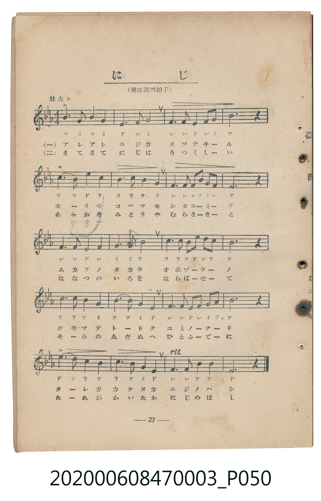
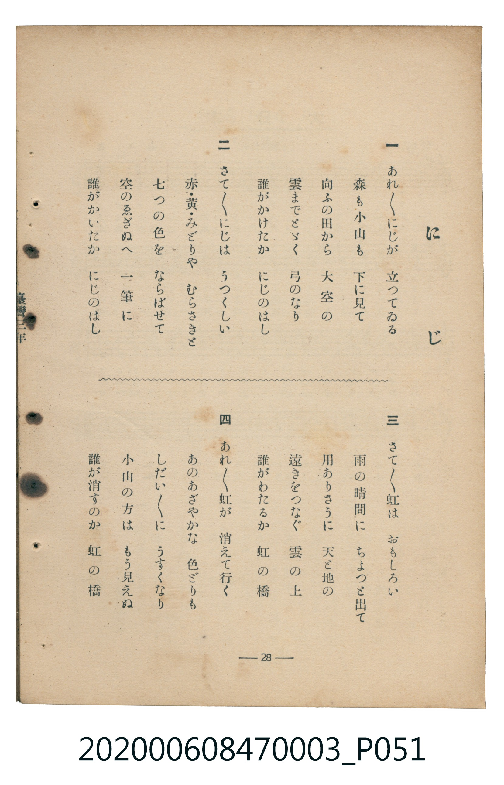

# にじ（彩虹）

> Re:Shōka 使用 AI 協助辨識與重建樂譜，可能會有錯誤。歡迎回報。

- **NEUTRINO 歌聲合成版**：<br><audio controls src="niji_neutrino.mp3"></audio>
- **鋼琴伴奏版**：<br><audio controls src="niji.mp3"></audio>


- 臺灣教育會公認『新定兒童唱歌』尋常科第三學年用（第二學期・第11首）
- 國立臺灣歷史博物館典藏（典藏號：2020.006.0847.0003）

## 說明


- 出處：臺灣教育會公認、臺北新高堂發行《新定兒童唱歌》尋常科第三學年用（昭和6年／1931年），
第二學期第 11 首〈にじ〉（彩虹），原書第 27–28 頁（掃描檔 P050.jpg–P051.jpg）。
- 出處原曲：文部省唱歌（1911年《尋常小學唱歌》第二學年〈虹〉）。
- 調性與拍號：變ホ調（Eb 大調），4/4 拍，速度標示「壯大ニ」（!= 88）。
- 背景與曲風：以寬廣宏大的 4/4 拍附點四分音符節奏，描寫雨後高聳於森林與小山之上、直抵雲端的虹橋，
將七彩長虹比作畫在天空畫絹（ゑぎぬ）上的一筆彩畫、連結天地的雲上之橋，至第四段漸次消散於天際。
- 版本說明：本檔案為原書單聲部五線譜（附移動 Do 階名片假名）之忠實數位化版本。

### 編曲說明（鋼琴伴奏版）：

1. 前奏 (Intro, 4 小節)：引用第五段「誰がかけたか　にじのはし」壯麗寬廣的虹橋拱形樂句作為前奏。
2. 主歌伴奏 (Niji, 20 小節 × 4 段)：右手演奏莊嚴宏大的 4/4 拍主旋律，左手以穩健的四分音符和弦伴奏支撐。


## 歌詞

```text
一　あれあれにじが　立つてゐる
森も小山も　下に見て
向ふの田から　大空の
雲までとゞく　弓のなり
誰がかけたか　にじのはし

二　さてさてにじは　うつくしい
赤・黃・みどりや　むらさきと
七つの色を　ならばせて
空のゑぎぬへ　一筆に
誰がかいたか　にじのはし

三　さてさて虹は　おもしろい
雨の晴間に　ちよつと出て
用ありさうに　天と地の
遠きをつなぐ　雲の上
誰がわたるか　虹の橋

四　あれあれ虹が　消えて行く
あのあざやかな　色どりも
しだいしだいに　うすくなり
小山の方は　もう見えぬ
誰が消すのか　虹の橋
```

## ABC

```abc
X:1
T:にじ（彩虹）
M:4/4
L:1/16
Q:1/4=88
K:Eb
V:V1 name="Piano" snm="Pia"
[V:V1]
B6 G2 B4 G4 | E6 F2 G8 | F6 F2 E4 F2 G2 | B12 z4 |
w: 1.~あ れ あ れ | に じ が | た つ て ゐ _ | る
w: 2.~さ て さ て | に じ は | う つ く し _ | い
w: 3.~さ て さ て | に じ は | お も し ろ _ | い
w: 4.~あ れ あ れ | に じ が | き え て ゆ _ | く
c6 B2 e4 c4 | B6 c2 B4 G4 | F6 F2 F2 B2 G2 F2 | E12 z4 |
w: 1.~も _ り も | こ や ま も | し た に _ み _ | て
w: 2.~あ _ か き | み ど り や | む ら さ _ き _ | と
w: 3.~あ _ め の | は れ ま に | ちよ つ と _ で _ | て
w: 4.~あ の あ ざ | や _ か な | い ろ ど _ り _ | も
F6 F2 E4 F4 | G6 G2 B8 | c6 c2 B2 e2 d2 c2 | B12 z4 |
w: 1.~む か ふ の | た か ら | お ほ ぞ _ ら _ | の
w: 2.~な な つ の | い ろ を | な ら ば _ せ _ | て
w: 3.~よ う あ り | さ う に | て ん と _ ち _ | の
w: 4.~し だ い し | だ い に | う す く _ な _ | り
c6 c2 B4 G4 | B6 B2 G4 E4 | F6 F2 E2 F2 G2 A2 | B12 z4 |
w: 1.~く も ま で | と _ ど く | ゆ み の _ な _ | り
w: 2.~そ _ ら の | ゑ ぎ ぬ へ | ひ と ふ _ で _ | に
w: 3.~と ほ き を | つ _ な ぐ | く も の _ う _ | へ
w: 4.~こ や ま の | は _ う は | も う み _ え _ | ぬ
e6 d2 c4 B4 | c6 B2 G4 E4 | F6 F2 B4 B4 | E12 z4 |
w: 1.~た _ れ が | か け た か | に じ の は | し
w: 2.~た _ れ が | か い た か | に じ の は | し
w: 3.~た _ れ が | わ た る か | に じ の は | し
w: 4.~た _ れ が | け す の か | に じ の は | し
```

## TMD 檔案連結

- [主旋律 TMD 檔案](niji.tmd) [[在 TMD Studio 編輯](https://tmdlang.github.io/Tmd-TS/#tmd=s7IKdvYPcrWy4qpTUCpJTLdSSM7PyUlNLsnMz7MqzsjMK0nNjM_KTMmPL87Iz05Ugisry88pzU21Si9KTEmNN443MjAyiDcwMIs3sDAxBzIMjBFKi_NLi5JTrYqTM_Lzc-JLUitKkvLzsxHyBUX5Zal5iXlANQVFIBtTwIoQClLLMlNSQdKpKZkl-UWZiTlI7kgtKga7FWxJfElRYl5xclFmAcgDCFUlGalAx-YllpQWpSpxaWkpPG5c_bhxxvs9HU_3rnwxc-f7PZ0KWlpcirYKFhZc9rYKrklcNib6JnYgA16073reuPjZ1JkvmjY9m9P8tHXNi1W9jxv6nk3b8HTdrKetk56vXvp0ysZna3seN_Q_3dD9dMeO58snPl-z5smOzqdrdzzdueX5lBVAm0Aiu3qAIs_mzH_cvBvINTR8uWwa0GqwO5_O6X6-uhtq2drtT_s3Pe2d9bxz5cslK5627ngxvR_kWDDjxcz57_fMAoW4HjDE9UAhDmQYGINN4tLXUrClFuBSUFB43DDh2exNz2eve7Fq1bMZfY8bJoJFm3c_bd_1YuZUoEtwBFAjUPxpz3RgML1cPePpgqbnM_e8WAgMoy5sAdeNJ-CezVj7dFKPGZD_fk-_oaWxIZjV-X5PD8glCgrIAQtkKxgaKgDD9XFDBySSHzcAlSLiGajtad_8Z7N3gJQamT9qmGxkofByQSPIor7mZ_39z1ZNUQgwMDXQyypIB8oCmYYgJlDr44YmFL-DzdkEDIFn09pfNq94PqcR4h2gUYaWhiBnAn0L8djTDf0gL8F8C3cyWE0H0GVgVyLZ8GLV_mcNy190tD_r7oVE-It1XY-bZwPFgca7Jik8XbIczAZ5CJhUFYDqgKyXDfOf7lr2bMXM50t2PW7oebp4PVDd4-buxw1A2Q5w-ka1prnn2cz1IGtmb3q5CBjas57sXvp0_Zqnuxc_XdcP1Pt8VosC1PiXM1te7p73dPbspx1tL-dvfr5m2fP1DU-XAhNmDzDYnq5f_XL2iqf7eoCx_aJx87Npe54tXvds3nSg2SDPb9z4ZGf3kx1dwHTxfPaWZ11bXwIT1er1QOOBnn-2shsem083tD_Z0QyMrpdTt4Ok1k95snfO86mrn85Z8XTJyucrdwHZz7cCY7LjcdPEx419jxvXAH0ENBlo1JMdDc_XtgH1AtUALXrZsPj51glAXU_nbADKAm0EKgM6A2Ldi3agF9YAvfNs3dZne3Y8W7Pw2baOZ1MXA10O1PJy1mxEKD3v7Hg2B5iqQRkAFN1z1gATybOFHc-bdkHS0tNp6140bgKmgSe7pjzfPuvF2jlA9wHD6_ny3U-7pyq45Cu8nNX3dELv8872p43tQAbIyTu7n-5f8HT9smdTdzzZ2_u0ZxrEGpC10IwHMRyYZF6snPe0dQUwmQFD88mOtSDGqnkv1q4H5kZQ2t7Q-6y9E0eiBZsFDJjHDQ2PG5seN_XASHDeaASmxgZgufO4ccnjxmWPmyY8buoGaQDG3eOmJkjEARlARU92ABWtfrEMSC4DqXg6ARj6Wx83rns-ZcPjxu7HTcBU1QBKMCt3AQVBKoDh_bhx3-PG5Y8bVzxumve4sR-kYs9koPTjxlWPm7pAil6sAuoGugZoLNC8-SAGyKEQxwHVrX_cOB2kDuhNiJeB4f98TvfTiQ0QEpKvQSXn1u1P9rU92dUGSo5dXWiJ72Xz3if71z-ftwGYjF60bgZ65v2e2U_3zQMG3cu5i4CJA-iLl-19oAQ0e8vT3due7NnxtANUcAG9A0mpoHJjbx8ILWsCegKo5eneRc-7G4Diz1due756_rMZ64GeeTZvG8glu9peNsx8ums5xHngBAfMw9DI2AUK9MeNU0EhDiUh_gXGJ1C8DRwZ_UCPP25sAYfR1iXARPhydzOQfNy4_3HjSmDgPW5qAaluAqJOsCm9wGCGxHUz2IB1Lzo3PW6aBDYSGNpARcCQng2NPUgswXPQ48Yd4CgGZR-gY9AipoX4iAGFwvN9fS93TX_eshCYd8HBBAqCp1O7QCG1pRWUL4E-ARYD2xYAo-f5ltWgkAVn-ucr1r1c2A909pMdy571TQJGFdBFwNAEKYDnfmBUgQsAUFYGu_dZ_7qnGzaiRQOowGjfhT8adoBSLHI0gIphaBwAg7cJFAFNwFAFxwGwbAN6-9nMLS-nARMwsHQBKlr4uAlYxwCDegXQLljATgGqA2awLrCRoMAEZ4uVIEVzgCEKyRmNC0DxBYwckO5VjxsnABWBs8s6oLeQQr8JmArmA7MkJPTB7lsH9AX2cH-6tP3pspnP5nS-2LYYLdyBwQcpnJ9N2Qf0AygQV-4ClmHPV_QC0cs5m4CZAJzAtz_dux9owpPdDS937XmxrPHJru4ne_YAXQ4zBJQVICU5pHQFRs_LxplAD4FsXLISlOHAipEjA2jOi60bXjb24Y4MYDGMVkCBPQvKKMBS-XEjEC0DtR4a-8FFI1AFKA0CyWmgfABKpKtAAQRM8dDMASm6QVkIGNRAFXAGJOqAETMTnMdg5RC0qAMG7zRYIgClgDZwgQe0fQ0iVsAOAuoGOoBArKAXU6BqBoi2dTxdshFSUr1sWvxy3boXG6c8XboK2MYCVYedm4CKn-ycD0zdwOoWQgLr_mfbF4IzCrg0A-pasPbp9k3Pt00Gmv9kRy_QmRADUcqirp1P-3bjzARA51LeRIQCBS19Li6_zKxMq4DMxLx8hxqDmmpwfW5joWUHZmBrl4KbbjsagBWwgoYJKAqADQodeD0GklUwVABGuyYWrUALocYCTbBSeNy0CFxXrwGzQHQNkOwGiTXtAOI14MYFUKxpP1hdCxC3AfEGIN4DVrsarAIGkIzf1QM0vnEqOD0tA7NANFBLI0gLsDwE4vUw4xvbwGJLgLgflP5gxje2YDO-RsFUQRcIjcG0MRDXAH0MEjEC80CwBsiGiIBkQOIwXRBoAFIDNs3HEGRRE1gUmIOgbBALZArIuWAZsINBYhDTgSUMVBzk6GVgHRMgMk3dSPbEI-wxAumaCtUFCRIIC9Oe9Uj2tCHZ0w9mTYfKtGC3x5g8e7qgIdAEtQFYiuO3x4S8cAOZChLvgIcbyIcgGZDvUO3Bnwd29eDLA0bE5oFmSB7YA8SrwDxQHG4GiwHDvHkeVAVIdDs4Z-wH5xGIjvnwnABKwjjzQRM4fQM1Ab0PSfHgDNW4EmhcFxCD0jnIggawBZ2Q_AKyAKgelhdWYMsJZuDQMlUwjANSIA4smZshZQ5YVjACihkDSVh2wZoVgAkAIg5yGSRBQKJnMlQUWAg07kORASUXUJQCAwMc7SDfQWRAEYwrK8DtAYYLiIQlN5BeEB8SNhAbIRmrAeoCSPgg61mB3R5wVkD4pxGsZx1UDyTxQ5Iu2D9gt4NkQE0UqCNAuQ5kOLBBjt9LyLkBaAU0NzROgzodlodgnl0FNQ0iDsprIA_DAh05GojNDTs68eUGY6JzwwJwElwNZIGSYB-i9AeLrQQnP5DYKnAOmQ1k7YPmBWCEQfNCH768ANYIJCGBuw5ezoMDoWkSzAKIOnBcQ6obYDscnheWYcsLqCU-KBQhtQGknoCUP5D8AsocwBxjDmTgrRZgKQ6cc7eipB5Y8Q-UAboRUbxBi9HG3UA8DxyhIFmQDEgnrrwASg6QZAEKFWR7kBIIMGwQ9kB1QMMHpGM2VAZHAgXlBXiyBlbi0OIamtzgFQZIBlJ0I5v2uGkyPCMsxO8fcEaAlQgLoD5AVFoLoDKgUgTZHlg1NxOIIdUcNIuAXUhCRoCMTeDMCCZEN41ArRNQ0Q-pAtrBCbsDLAZK7MBwB6sAiYJSI6Qq6IPKAst0aFYApWKcWWEuzDhwNIKzQtNEcPYAGtQIbJU17oBmhk1g0RXgZAjJDMvhmQG5DYZWMSDXApB0DqoBdMFZBDnDgBpIJvjzArR6hjQQIOUlrEiElb7QIgysEuQVWJwCK0xwasEXp4i8MBdmGjjnwHMCMGAgpkGCBsTaAbV_E1QGEjzILoOlMCx5AepqSE7tBdsHyl8gGVAOhOVHEAlt2KGEAMQ_sKYLyCW48gJGvYlWA8HMgfARRT8kL4JqQ1BjCaID5G8S8gJwYA1fXjAlOi9Amv-glA3qKoC7CcDqAFQ-b4Q0iMA8UHqHdx7AeaEfIgpuOOHJB_Ph-QBUGfeAvQo2CFxMgJoVIB4srUPalKA6FpoBgYULFuOBrRxQo0gXXMyDEj6i_MeWCUDyEDV4GkfQYh_SbABFDKy1C2nzA4fjoGogIogkCHMzUjRDC0nsmYCQPZBwocgecCbAYU8TNKmDwh7cn6HAHnAmwOUfWKYGFfsQ08ixp5aLS9dOAdSTBlsJZCtzAQA)]
- [鋼琴伴奏 TMD 檔案](niji_piano.tmd) [[在 TMD Studio 編輯](https://tmdlang.github.io/Tmd-TS/#tmd=s7IKdvYPcrWy4tLSUnjcuPpx44z3ezqe7l35YubOx827X3bveT5hy5M9W54u7X_e2fF-T6eClhaXoq2ChQWXva2CaxKXjYm-iR1XnYLSi_ZdzxsXP5s680XTpmdzmp-2rnmxqvdxQ9-zaRuerpv1tHXS89VLn07Z-Gxtz-OG_qcbup_u2PF8-cTna9Y82dH5dO2Opzu3PJ-yAmg3SGRXD1Dk2Zz5QBcAuYaGL5dNA1qtBLLm6Zzu56u7oZat3f60f9PT3lnPO1e-XLLiaeuOF9P7Qc4HM17MnP9-zywjAyMDPQMDMz0DCxNzIMPAGGwSl76Wgi21AJeCgsLjhgnPZm96Pnvdi1Wrns3oe9wwESzavPtp-64XM6cCXYIjgBqB4k97pgOD6eXqGU8XND2fuefFQmAYdWELuG48Afdsxtqnk3rMgPz3e_oNLY0NwazO93t6QC5RUEAOWCBbwdBQARiujxs6INH-uAGoFBrzEG1P--Y_m70DpNTI_FHDZCMLhZcLGkEW9TU_6-9_tmqKQoCBqYFeVkE6UBbINAQxgVofNzSh-B1sziZgCDyb1v6yecXzOY0Q7wCNMrQ0BDkT6FuIx55u6Ad5CeZbuJPBajpAaRLkSiQbXqza_6xh-YuO9mfdvZAIf7Gu63HzbKA40HjXJIWnS5aD2SAPAZOqAlAdkPWyYf7TXcuerZj5fMmuxw09TxevB6p73Nz9uAEo2wFO3yjWPN--AugFSNQCFWBmC6DFkFA21FN42tkLFFfQ8MwrKcrXUTBRAPrq-foGTaCap3umAiML7K0pz9ZtBVr9YtWGx409jxu7HzdOfNw4H8RoaIDGSOO6x43rHzdOB7oK6MKXu6Y_Xb_m6e7Fz2e1AEPi2cruZ90bn-5d9GxF09P-pU_2znnetAtiNdTdCgpGegpPduwGhiXEqQoafplZmToKRgZQJykcng50HtAhYLf1b37W2f1szxSgyhd9XU9nbXm6rh8YLEDrFKAhBzJsevfTfd2g1LF9GVD5k91Ln69c-bRxKVDV09mzn3a0vZy_-fmaZcCU-HTPMoi1z6asfzZpAtRRlOc2KFDQ0ufiAgexVUBmYl5-kIdDjUFNNdjjNhZadmBGjYJhnIIuEJormAFJUyCuAbNAbGMgaQgWMQKLGIHlTePBQiAJGDQAiXDVoljng8M6kO5ow1ggaQJmmoCYNcgcJCU1ENuiTUEcJCaKORAS7gZQFOLxMbZyDZz1dzQA41lBA54asSgDhijEF6Bw0AWGD4gGhRIsOIzAPBBEhBlIBiQO04UcZCDTfAxrgBVLE1j0cVMPlA1igUwBpnSITOMMIAaJQUwHZgWo-BIgXgbWMQEi09SNZA84siD2GIF0TYXqWgZlQ_Si27MeyZ42JHv6wazpUJkW7PYYk2dPFzQEmqA2PG7qxW-PCXnhBjIVJN4BDzeQD0EyIN-h2oM_xezqIT7FwPIUOLuBOLDkYIaUiGBJBpTRjIEktlwGTzLAgIKIP24CBR2ED_LGZKhoC5C9D0UGFKwgr8-HBs_jxv1QGVBA4EoycHsaQQkLEoAgcZBeEH8l3AWgiAK5rAHqgk545MP0rMBuDzjJIPzTCNazDqoHkkggUQz2D9jtIJmFj5s6oI4ApU6Q4Y8bl-P3EnKqAVoBTTWN06BOh6U1mGdXQU2DiIPSJMjDsEBHjgZiU82OTuJTDWoZArIPUr5ASh5IioakLFAyAqYtUDGOt6CBxQ3Qe48bt6KEM6xAAcoAYw6RYaAZs3E3EM8Dex0kC5IB6cSVakABBwlAUOQg24MUlE2TkOyB6gCnmg1gHbOhMjiiEpRq4AmgDV4AQCMGXgSBZCCFAbJpj5smw5PMQvz-AScZWN5ZAPUBohhcAJUB5Tdke2AF50wghhSc0MQEdiEJSQbYbiC1oEEuVSCpAVt1bgiumEwIVE2QYhFSMEPyHyyLwXIzNEuAVYL8B_P5fmiY4vM5IsXMhZkGTl_w9NI0EWpaHxCvAbN2QO3fBJVZAU_LMJfB4gFLioG6GpKee8H2gVIhSAaUTmGpFkRCK1SUEID4B1ZlgFyCK8VglMNoJRrMHAgfUZRAUiyodAVVUhAdIH-TkGIgrWciUwzpLUCwCJ6qCVqUQAptkDdgdTKkZQJsyUPVQETQa2tIEEMDBZrxsCcZQvaAgp5Ce8BJBoc9TdCEAapQwa0uCuwBJxlc_oFlAVBRAjGNHHtQGsdY2-dUaRwjNc1RmvK4xIlo4oPFIYmMek0ypC4HSleEAncid0Wo1wogwmIUhyL5xgjMNMrF8AGEJMKlJFU-uHpxSBwzMNMM00WUxz0pZR7CfBp1Q3XtFMC9YQUgA5Tron1A8jC2ERLbGIkNstlOQZkLAA)]

## 分析

```text
================================================================================
📊 TMD Song Profile: [ にじ（彩虹） ]
================================================================================
⏱  Duration:       0:54 (54.5s), 20 measures total
🎼 Key & Tempo:    首調基準 E,, != 88.0 BPM, <4/4>
   - 分析範圍：      由實際發聲的音符與和弦推測調性；播放脈絡另行呈現
🎤 人聲音域:    D#4 (MIDI 63) – D#5 (MIDI 75) [跨度: 12 個半音 / 1.0 個八度, 難度: easy]
   - 最低音:  D#4 in [Niji #1 @ m.2, 0:02]
   - 最高音: D#5 in [Niji #1 @ m.5, 0:12]
   - 適合: soprano, mezzo-soprano, contralto, tenor, baritone, bass
🏛  結構:      Niji (54.5s)
⚡ 編曲密度:        Peak 1 軌道同時演奏
🗝  調性診斷：       A# 大調（純淨自然大調，未偵測到可信轉調）
   - 風格氣質:    純淨自然大調（陽光明朗、易唱易記，無明顯調外色彩）
   - 轉調歷程:    全曲維持單一推測調性（未偵測到可信轉調）
   - 核心骨幹音:  A#, D#, F, G, C
   - 調性數值:    A# 大調 [相關度: 0.87, 穩定度: Moderate, 自然音純度: 99.3%]
   - 候選調性 (K-S): A# 大調 (0.87), D# 大調 (0.80), G 小調 (0.61)
   - 五度圈歷程:   -2
   - 各段落調性細節:
     • [Niji #1]: A# 大調 (r: 0.87, 自然音純度: 99.3%, 調外音: G#)

  [ 五度圈游移軌跡 ]
               C  
         F            G  
     [Bb]*              D  
      Eb               A  
         Ab           E  
            Db       B  
               F# 
     (* = active key center)

  [ 十二半音累積音高分佈 ]
     C  : ██████████                13.3%
     C# :                            0.0%
     D  : █                          1.3%
     D# : ███████████████           20.0%
     E  :                            0.0%
     F  : ██████████████            18.0%
     F# :                            0.0%
     G  : ███████████               14.7%
     G# : █                          0.7%
     A  :                            0.0%
     A# : ████████████████████████  32.0%
     B  :                            0.0%
--------------------------------------------------------------------------------
Assignment 軌道音域：
  - Piano         : D#4 – D#5 (12 個半音 / 1.0 個八度, 70 個音符)
================================================================================
```


## 原書掃描頁






