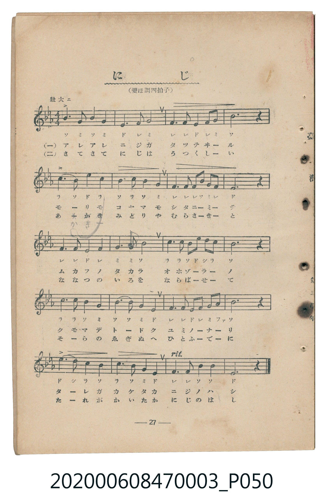
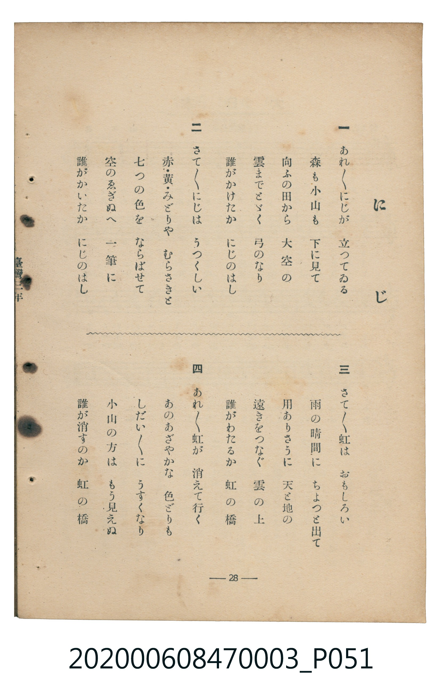

# にじ（彩虹）

<audio controls src="niji.mp3"></audio>

- 臺灣教育會公認『新定兒童唱歌』尋常科第三學年用（第二學期・第11首）
- 國立臺灣歷史博物館典藏（典藏號：2020.006.0847.0003）

## 說明

【曲目說明】
・出處：臺灣教育會公認、臺北新高堂發行《新定兒童唱歌》尋常科第三學年用（昭和6年／1931年），
第二學期第 11 首〈にじ〉（彩虹），原書第 27–28 頁（掃描檔 P050.jpg–P051.jpg）。
・出處原曲：文部省唱歌（1911年《尋常小學唱歌》第二學年〈虹〉）。
・調性與拍號：變ホ調（Eb 大調），4/4 拍，速度標示「壯大ニ」（!= 88）。
・背景與曲風：以寬廣宏大的 4/4 拍附點四分音符節奏，描寫雨後高聳於森林與小山之上、直抵雲端的虹橋，
將七彩長虹比作畫在天空畫絹（ゑぎぬ）上的一筆彩畫、連結天地的雲上之橋，至第四段漸次消散於天際。
・版本說明：本檔案為原書單聲部五線譜（附移動 Do 階名片假名）之忠實數位化版本。

・編曲說明（鋼琴伴奏版）：
1. 前奏 (Intro, 4 小節)：引用第五段「誰がかけたか　にじのはし」壯麗寬廣的虹橋拱形樂句作為前奏。
2. 主歌伴奏 (Niji, 20 小節 × 4 段)：右手演奏莊嚴宏大的 4/4 拍主旋律，左手以穩健的四分音符和弦伴奏支撐。

## 歌詞

```text
一　あれあれにじが　立つてゐる
森も小山も　下に見て
向ふの田から　大空の
雲までとゞく　弓のなり
誰がかけたか　にじのはし

二　さてさてにじは　うつくしい
赤・黃・みどりや　むらさきと
七つの色を　ならばせて
空のゑぎぬへ　一筆に
誰がかいたか　にじのはし

三　さてさて虹は　おもしろい
雨の晴間に　ちよつと出て
用ありさうに　天と地の
遠きをつなぐ　雲の上
誰がわたるか　虹の橋

四　あれあれ虹が　消えて行く
あのあざやかな　色どりも
しだいしだいに　うすくなり
小山の方は　もう見えぬ
誰が消すのか　虹の橋
```

## 原書掃描頁





## 分析

```text
================================================================================
📊 TMD Song Profile: [ にじ（彩虹） ]
================================================================================
⏱  Duration:       0:54 (54.5s), 20 measures total
🎼 Key & Tempo:    首調基準 E,, != 88.0 BPM, <4/4>
   - 分析範圍：      由實際發聲的音符與和弦推測調性；播放脈絡另行呈現
🎤 人聲音域:    A#3 (MIDI 58) – D#5 (MIDI 75) [跨度: 17 個半音 / 1.4 個八度, 難度: challenging]
   - 最低音:  A#3 in [Niji #1 @ m.19, 0:51]
   - 最高音: D#5 in [Niji #1 @ m.5, 0:12]
   - 適合: soprano, mezzo-soprano, contralto, tenor, baritone, bass
🏛  結構:      Niji (54.5s)
⚡ 編曲密度:        Peak 1 軌道同時演奏
🗝  調性診斷：       A# 大調（純淨自然大調，未偵測到可信轉調）
   - 風格氣質:    純淨自然大調（陽光明朗、易唱易記，無明顯調外色彩）
   - 轉調歷程:    全曲維持單一推測調性（未偵測到可信轉調）
   - 核心骨幹音:  A#, D#, F, G, C
   - 調性數值:    A# 大調 [相關度: 0.87, 穩定度: Moderate, 自然音純度: 99.3%]
   - 候選調性 (K-S): A# 大調 (0.87), D# 大調 (0.80), G 小調 (0.61)
   - 五度圈歷程:   -2
   - 各段落調性細節:
     • [Niji #1]: A# 大調 (r: 0.87, 自然音純度: 99.3%, 調外音: G#)

  [ 五度圈游移軌跡 ]
               C  
         F            G  
     [Bb]*              D  
      Eb               A  
         Ab           E  
            Db       B  
               F# 
     (* = active key center)

  [ 十二半音累積音高分佈 ]
     C  : ██████████                13.3%
     C# :                            0.0%
     D  : █                          1.3%
     D# : ███████████████           20.0%
     E  :                            0.0%
     F  : ██████████████            18.0%
     F# :                            0.0%
     G  : ███████████               14.7%
     G# : █                          0.7%
     A  :                            0.0%
     A# : ████████████████████████  32.0%
     B  :                            0.0%
--------------------------------------------------------------------------------
Assignment 軌道音域：
  - Piano         : A#3 – D#5 (17 個半音 / 1.4 個八度, 70 個音符)
================================================================================
```

## ABC

```abc
X:1
T:にじ（彩虹）
C:TMD (Chen, Chih-Han / aguai)
M:4/4
L:1/16
Q:1/4=88
K:Eb

V:V1 name="Piano" snm="Pia"

[V:V1]
b6 g2 b4 g4 | e6 f2 g8 | f6 f2 e4 f2 g2 | b12 z4 |
c6 b2 e4 c4 | b6 c2 b4 g4 | f6 f2 f2 b2 g2 f2 | e12 z4 |
f6 f2 e4 f4 | g6 g2 b8 | c6 c2 b2 e2 d2 c2 | b12 z4 |
c6 c2 b4 g4 | b6 b2 g4 e4 | f6 f2 e2 f2 g2 a2 | b12 z4 |
e6 d2 c4 b4 | c6 b2 g4 e4 | f6 f2 b4 B4 | e12 z4 |
```

- [主旋律 TMD 檔案](niji.tmd)
- [鋼琴伴奏 TMD 檔案](niji_piano.tmd)
