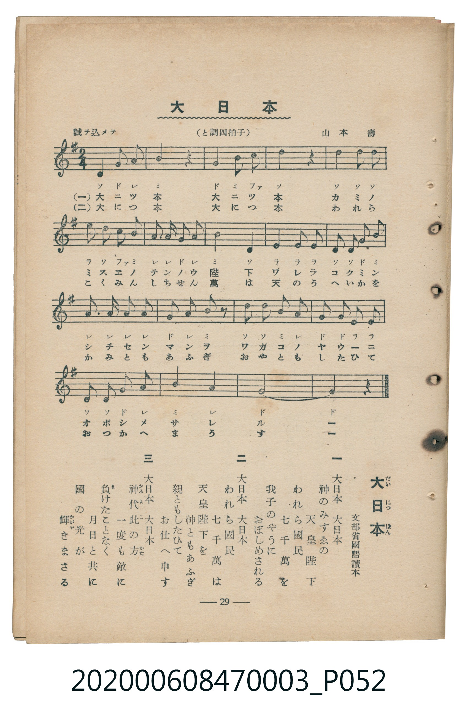

# 大日本

> Re:Shōka 使用 AI 協助辨識與重建樂譜，可能會有錯誤。歡迎回報。

- **NEUTRINO 歌聲合成版**：<br><audio controls src="dainippon_neutrino.mp3"></audio>
- **鋼琴伴奏版**：<br><audio controls src="dainippon.mp3"></audio>


- 曲：山本壽
- 臺灣教育會公認『新定兒童唱歌』尋常科第三學年用（第三學期・第1首）
- 國立臺灣歷史博物館典藏（典藏號：2020.006.0847.0003）

## 說明


- 出處：臺灣教育會公認、臺北新高堂發行《新定兒童唱歌》尋常科第三學年用（昭和6年／1931年），

第三學期第 1 首〈大日本〉，原書第 29 頁（掃描檔 P052.jpg）。
亦收錄於臺灣總督府編《公學校唱歌》第三學年用第十二課。
- 詞曲：文部省國語讀本 作詞／山本壽 作曲。

- 調性與拍號：ト調（G 大調），2/4 拍（原書副標題誤植「と調四拍子」，五線譜拍號與小節線實為 2/4 拍），

速度標示「誠ヲ込メテ」（!= 100）。
- 背景與曲風：日治時期兒童教材中之臣民教化歌曲，反映昭和初期（書載「七千萬」國民）國家意識形態。

全曲共 18 小節，結尾樂句擴充為 6 小節並以長音終止。
- 版本說明：本檔案為原書單聲部五線譜（附移動 Do 階名片假名）之忠實數位化版本，作為歷史教材史料保存。


### 編曲說明（鋼琴伴奏版）：

1. 前奏 (Intro, 4 小節)：取開頭「大日本」上行四度與大三和弦動機，以二分與四分音符和聲莊重起音。
2. 主歌伴奏 (Dainippon, 18 小節 × 3 段)：右手演奏主旋律；左手在開頭與結尾長音處採用厚實的拍點和弦支撐，
中段則以穩健的八分音符進行曲低音推展。


## 跨冊／重複收錄參照

> 同曲（山本壽作曲；《公學校唱歌》第三學年、《新定兒童唱歌》第三學年與楊金土《唱歌帖》P008 皆收錄同曲）

- **[同曲]** 《公學校唱歌》第三學年（昭和10年／1935）：[**〈大日本〉**](../../../kogakko_shoka/grade_3/12_dainippon/index.md)（`G` / `2/4` — [原始 TMD](../../../kogakko_shoka/grade_3/12_dainippon/dainippon.tmd)）
- **[同曲]** 楊金土手抄《唱歌帖》第 8 冊・VIII（2020.006.0843）：[**〈大日本（日本）〉**](../../../shokacho/vol_08/p008_dainippon/index.md)（`G` / `2/4` — [原始 TMD](../../../shokacho/vol_08/p008_dainippon/dainippon.tmd)）
- 總表：[跨冊重複與同名歌曲總索引](../../../duplicate_songs.md)

## 歌詞

```text
一　大日本　大日本
神のみすゑの　天皇陛下
われら國民　七千萬を
我子のやうに　おぼしめされる

二　大日本　大日本
われら國民　七千萬は
天皇陛下を　神ともあふぎ
親ともしたひて　お仕へ申す

三　大日本　大日本
神代（かみよ）此（こ）の方（かた）　一度も敵に
負けたことなく　月日と共に
國の光が　輝きまさる
```

## ABC

```abc
X:1
T:大日本
C:曲：山本壽
M:2/4
L:1/16
Q:1/4=100
K:G
V:V1 name="Piano" snm="Pia"
[V:V1]
D4 G2 A2 | B4 z4 | G4 B2 c2 | d4 z4 |
w: 1.~だい に つ | ぽん | だい に つ | ぽん
w: 2.~だい に つ | ぽん | だい に つ | ぽん
w: 3.~だい に つ | ぽん | だい に つ | ぽん
d4 d2 d2 | e2 d2 c2 B2 | A3 A G2 A2 | B2 B2 D4 |
w: 1.~か み の | み す ゑ の | て ん の う | へい _ か
w: 2.~わ れ ら | こ く み ん | し ち せ ん | まん _ は
w: 3.~か み よ | こ の か た | い ち ど も | て き に
D4 D2 D2 | E2 D2 F2 G2 | A3 A A2 A2 | G2 A2 B2 z2 |
w: 1.~わ れ ら | こ く み ん | し ち せ ん | ま ん を
w: 2.~てん の う | へ い か を | か み と も | あ ふ ぎ
w: 3.~ま け た | こ と な く | つ き ひ と | と も に
d2 d2 B2 A2 | G2 E2 E2 E2 | D2 D2 G2 A2 | B4 A4 |
w: 1.~わ が こ の | や う _ に | お ぼ し め | さ れ
w: 2.~お や と も | し た ひ て | お つ か へ | ま う
w: 3.~く _ に の | ひ か り が | か が や き | ま さ
G8- | G4 z4 |
w: 1.~る | _
w: 2.~す | _
w: 3.~る | _
```

## TMD 檔案連結

- [主旋律 TMD 檔案](dainippon.tmd) [[在 TMD Studio 編輯](https://tmdlang.github.io/Tmd-TS/#tmd=s7IKdvYPcrWy4qpTUCpJTLdSSM7PyUlNLsnMz7MqzsjMK0nNjM_KTMmPL87Iz05Ugisry88pzU21Si9KTEmNN443MjAyiDcwMIs3sDAxBzIMjBFKi_NLi5JTrYqTM_Lzc-JLUitKkvLzsxHyBUX5Zal5iXlANQVFIBtTwIoQClLLMlNSQdKpKZkl-UWZiTlI7kgtKga7FWxJfElRYl5xclFmAcgDCFUlGalAx2bmFqRCdGtpKTxdsvzZ9KXP5qxR0NLiUrRVMDQw4LK3VXDnsjHSN7ED6Xw2e9P7PbOebtwIVPR08V6waS_adz1vXPxs6swXTZuezWl-2rrmxarexw19z6ZteLpu1tPWSc9XL306ZeOztT2PG_qfbuh-umPH8-UTn69Z82RH59O1O57u3PJ8yor3ezrgIs_mzH_cvBvINXy5bNr7PZ1gW57O6X6-uhtq19rtT_s3Pe2d9bxz5cslK5627ngxvR9oAoTxYuZ8oBtBoa8HDH09UOgDGQbGYJO49LUUbKkFuBQUFB43TAAGyvPZ616sWvVsRt_jholg0ebdT9t3vZg5FegSHOHTCBR_2jMdGEovV894uqDp-cw9LxYCg6gLW7h14wm3ZzPWPp3UYwbkv9_Tb2hpbAhmdb7f0wNyiYICcrgC2QqGCsBgfdzQAY_txw0gxU_75j-bvQOkwMhS4eWCRpDJfc3P-vufrZqiEGBgaqSXVZAONPdxQxPE3Ce7lj2bsu1lT8uzaXsgfny-Y-_zuYuf7przfPsKoEeAPgXZumAh3Bdojgdyn_Y2PtnV82LVJqixwIB7sXIeJJk9m9b-snnF8zmNwLh_sWrei3UNoKT5ZO8coAqgV-GpECQE1IFkwqr9zxqWv-hof9bdC0kNj5s7gIJAL7mDEjmYCfIzMFkrANWAkg7Y90871z9bMfPlQqCDljxbAoyknseNK4Cqn86eDVT2dO2Exw1AxT1Pdk15vn3Wi7VzIOYDLXq6of_5-gag4NP1y5437VKAG4yIhpcN858CQ2zFzOdLdgENfrFqwePmTS_27XncvPBxcxvY4A5InkMEMsgvzT3PZq4H-WX2ppeLgPE9CxRpm3Y_m9kEjE9IKgGmrWdzJzzZsfbJTmAOWfxsw0SgyNOeacBAB4dkz9P-3mczFkASytOOuUCNoNidveMFyKaeJzuan_Y2v5gATAi9wKAGage6AMh4um7bs5b-F2tnPN276FlrNzzin7auABr7tHWjgqGFAsTnQDueb53wdMO-ZyuanvYvfTZ5y9PWVlBAmEEVPNmx7MnupS-nbn85f_PzrU3P1i5CePF5ZwcwIiH5B-S_OWuASe7Zwg6gfmi0TFv3onETMC3AAx7o_JczW54v3_20e6qCS77Cy1l9Tyf0Pu9sf9rYDmQA3Q8Miqf7FwCj49nUHU_29gJDA2INKPr2zgEaDSlEIEEHYkyb-WT_3KdrZ4DcBc3YENuBoQhMcCBPT2sHxgMwmEEMYHpcux6Y20FpZ0Pvs_ZO5DwCNuDJjobHDQ1IuQzBBkk_XzrvceO6x437HzfOfNw0EcQGqVj5fFb7y5mzn-zoBjuiqf9xU8_jJlB0AOMFqAIRWU2TQCqedUwEpUug7qaWx41tjxtXAxU9bux63LjnceP0x02Njxungo0Amwd0LcTloFIc5hpQAkFiAx0GSkeLpzxdu_r5rBZkJ4FUbmgHWdkwEe4QWJLpebFs2tNlTU-3bwQVfR1A8Q3P52x_uXD5s5bZL9ZuB4YrPGR2AQsD3CGDz9ON60EqkN0EDAegCnBornjc1PS4EYi2Pm7sA6l7sWwVTHT648b5jxs3PW5cBgmfJ7unPm7c8XzKZmDwExsyuDwODBNkFwEDAegcYGIGBsKzqWue7N4ALO1Bgh3bnq3vBQnOXA8UBIXP6rXAcuDp0s4n-4CFDSJ8dgCzJd6U82T3YqCDHzd2g9JPUwdQ47O1S8Aik0GlR-O6Z9N2whQA8zrIOGByBJY_wLB4NhUYPKvBwbNpweNGYMoDBsxkUDg1AkOrH6j02ZwOoG1AEWAehyoF-hVo6tNWoNmguHuxZ-7jxt7HjfvAqYvopPWifRXE8cCy4Mm-tmdzVj2bve_Z1OnPtwKz6dYnu3YB1bycteLFxOnP1gLrSpArQGTfipcN4GIMXCaBcnZr57OWDmCN-XJa8wuwa563Ap0FDkCgUyiv2aFAQUufi8slMTMvs6AA2KAKyEzMy3eoMaipBheENhZadmAGtjYFpNpteLZuq4KGKbQQ1IGXESBZYEUMrPA1sWgF2go1FmiCFajGAheU3UDcolCjAKoFYaCGgOzjptVg2flA3AdkQY2uUTCNV9AFusAIyDQGsgyAuAbI1wXyTEDScDEQyxQIa8AafQyBZjYCk00LUBiYNoB4Cciaxr2PmyYDhUCmEqeiGyy9H4jXwcw2opLZTf0g6aYeIO6EmW1MdXc3dQDNxh__u3rwxb8RkfEPjr2mnUB6IzgWga5obgPH6mYw_3HTMqAYsOwBFx3dsJhvXg9WswaIV0LTAlB903poatiMSAtmwOg1AUZ8jYKGEdB3ugpGmqoaurqa8PRhDEku0FQDJIAIqA1Mm8cDlSEnDlCUzgRaNBEStQoawDIXbCowHDXBYsB6ChyUO2CBDQpTjHgDik8G4n5oaE9GSSVoMiBLpkMsaVwIsmQ2VBxURIGjD1hzQCMQWAZCBJAcAsQtYHcAaxOUFAOyB6QOKNM4H2IPyMlwe1YCdTRBjAXiXnDCgVizD6wIFAggfRCTVgDxKrDLCaWcHZ3glGOCPeUYE5tymraD00AjkLUbHOegdDEPmnI2wdPJ4yZgKgGlDmjqWgJOU4-b94DLFXg6QUsdRuDUAUojxsCyAlRSmAJZEDFg2oAgRMrAE0VgFijoQckKlAyAtQw88EEioMhpg-ZLRDIAmghKOeD8CDIRGLzQyGgC4q1A3AcxsbELagZCxXRwxABbBOCoQ0Q50MwlUDN7QWaC5FeAdUD0glwAMROcWMHlBNiNYJWgBAS0C-h6AhEM6lHgiWAToiMYmJya54AjGtiRAIfVVmi2h0QuqPiHFQh74BUDcjUARIh6ABTDkHoABGvAJLgeQMrgIA8CUwYoCJsawV6fCs23kFwMiROYbnDBgZRzQbqB6Quco3Yg5RRQ9IJ4M3HpBudHkC5Q-QCKzF4k3SAX4LK7lotL104BXo2DTQMKKHMBAA)]
- [鋼琴伴奏 TMD 檔案](dainippon_piano.tmd) [[在 TMD Studio 編輯](https://tmdlang.github.io/Tmd-TS/#tmd=s7IKdvYPcrWy4tLSUni6ZPmz6UufzVnzfk_Hy-49zydsebJny9Ol_c87O97v6VTQ0uJStFUwNDDgsrdVcOeyMdI3seOqU1B6NnvT-z2znm7cCNT5dPFeJZDYi_ZdzxsXP5s680XTpmdzmp-2rnmxqvdxQ9-zaRuerpv1tHXS89VLn07Z-Gxtz-OG_qcbup_u2PF8-cTna9Y82dH5dO2Opzu3PJ-yAugMuMizOfMfN-8Gcg1fLpsGdA3Ylqdzup-v7obatXb70_5NT3tnPe9c-XLJiqetO15M7weaAGG8mDkf6EYjAyMDPQMDMz0DCxNzIMPAGGwSl76Wgi21AJeCgsLjhgnAQHk-e92LVauezeh73DARLNq8-2n7rhczpwJdgiN8GoHiT3umA0Pp5eoZTxc0PZ-558VCYBB1YQu3bjzh9mzG2qeTesyA_Pd7-g0tjQ3BrM73e3pALlFQQA5XIFvBUAEYrI8bOuBJ4HEDSPHTvvnPZu8AKTCyVHi5oBFkcl_zs_7-Z6umKAQYmBrpZRWkA8193NAE9eGLlfMg6eHZtPaXzSuez2kERtKLVfNerGsAmqrwZO8coAqgm-DJBSQE1IFkwqr9zxqWv-hof9bdC4m2x80dQEGg3e6gJApmghwHTH8KQDVA1suG-U93LVOApE6ESc-3rwCaDIkDrEkaaDYkOAz1FJ529gLFFTQ880qK8nUUTBSebuh_vr5BE5S0-6e9nNb9csHaxw09SAHU-2RHFzB2ns6eDbQc6F6gFChMJ_U83bPsaffUZyuBbu95snvpk109TzvaQAqAKjvaXs7f_HzNMqCyF42bXvR1vWzvfbF1O1AQ6m4FBSM9hSc7dgOjGOJUBQ2XxMy8zIKC_DwdBUMLqLsUDk9XMFZ4tm4rxIGbn3V2P9szBagcpHV699N93e_3zH66fRlQ_OmcFRDnA53wfOuEpxv2vZwKshCYEp_1LQSml6d9s56uX_Z8VgswNF_ungfxwbMp659NmgBPMEDwZMdaoH1PO9uBfnq-cuXTxqVALU9bV8P99LJhEzA8gEH-ZG8fUORZ34qnG6dCvUV5xoICBS19Li5wJFkFZCbm5Qd5ONQY1FSDXWljoWUHZtQomMYr6AJTtRGQaQxkmQIxhGUEZhkCSV0FA4UarloU03ywm2YIMi3aMBaiF5kDtifaFE0GajA84vA4FVvZA8meDcDQVtAwhSVELMqAQYHVtwZwPxoDEzJQGi4GYpkCYQ1Yo49hjcLjxgWPG1uAwo8bVwPxEqCix417HzdNBgqBTCVORTdYej8Qr4OZbUQls5v6QdJNPUDcCTPbmOrubuoAmo0_Qnb1EB8hZsAwNgGGfo2CBijBAZOdpqqGrq4mPJKMIXEGjTogAURAbWDaPB6oDDmGQOE6E-jGiZDwVdB43LgMbCrQM5pgsceNbWD_7ID5GOQxjMADik8G4n6olyejRBWaDMiS6RBLGheCLJkNFX_cuA8Sho8b10NDcRlMAMkhQNwCdsfjpkko0QayB6QOKNM4H2IPyMlwe1YCdTRBjAXiXnDsQazZB1YECgSQPohJK4B4FdjlhKJvRyc4-uAFO77oQ4s0I3CkgaLOGJS1wTnIGCoGjDIIQkQYnpADs0AhAoptUOw8bgTGDTRMQCKgMGuDpllE7ABNBEUoOK2CTAT6GhpGTUC8FYj7ICY2dkHNQKiYDg6vx42bwCGKiAmgmUugZvaCzATJrwDrgOgFuQBiJjgNgfMQ2I1glaB4BdoFdD2BcAdWesSHOyQfIAoy5MIaxIIU2kAWUuYAuWIPxJ9NjWD3TYWmeUgOgAQcTDc40yGlepDuJdDUuAMplYHiAMSbiUs3OC2DdIHyFijEe5F0g1yAy27MegFrpUOVegG93gIxgQEMSsPotRioDkNIQRWCKGoWiyZAI01iYRYg2wuikG1GcpURTBZNNxXzOw53QKty9AAB5fZos9xYmIOomQOgVsFMxtG-AHEgNCQ3ANOUrp0CuB2jAGTA01e0D0gRioARuoAxWECZCwA)]

## 分析

```text
================================================================================
📊 TMD Song Profile: [ 大日本 ]
================================================================================
⏱  Duration:       0:21 (21.6s), 18 measures total
🎼 Key & Tempo:    首調基準 G, != 100.0 BPM, <2/4>
   - 分析範圍：      由實際發聲的音符與和弦推測調性；播放脈絡另行呈現
🎤 人聲音域:    D4 (MIDI 62) – E5 (MIDI 76) [跨度: 14 個半音 / 1.2 個八度, 難度: moderate]
   - 最低音:  D4 in [Dainippon #1 @ m.1, 0:00]
   - 最高音: E5 in [Dainippon #1 @ m.6, 0:06]
   - 適合: soprano, mezzo-soprano, contralto, tenor, baritone, bass
🏛  結構:      Dainippon (21.6s)
⚡ 編曲密度:        Peak 1 軌道同時演奏
🗝  調性診斷：       D 大調（純淨自然大調，未偵測到可信轉調）
   - 風格氣質:    純淨自然大調（陽光明朗、易唱易記，無明顯調外色彩）
   - 轉調歷程:    全曲維持單一推測調性（未偵測到可信轉調）
   - 核心骨幹音:  D, G, A, B, E
   - 調性數值:    D 大調 [相關度: 0.87, 穩定度: Moderate, 自然音純度: 96.9%]
   - 候選調性 (K-S): D 大調 (0.87), G 大調 (0.83), B 小調 (0.61)
   - 五度圈歷程:   +2
   - 各段落調性細節:
     • [Dainippon #1]: D 大調 (r: 0.87, 自然音純度: 96.9%, 調外音: C)

  [ 五度圈游移軌跡 ]
               C  
         F            G  
      Bb              [D ]*
      Eb               A  
         Ab           E  
            Db       B  
               F# 
     (* = active key center)

  [ 十二半音累積音高分佈 ]
     C  : ██                         3.1%
     C# :                            0.0%
     D  : ████████████████████████  30.8%
     D# :                            0.0%
     E  : ██████                     7.7%
     F  :                            0.0%
     F# : █                          1.5%
     G  : █████████████████         21.5%
     G# :                            0.0%
     A  : ████████████████          20.0%
     A# :                            0.0%
     B  : ████████████              15.4%
--------------------------------------------------------------------------------
Assignment 軌道音域：
  - Piano         : D4 – E5 (14 個半音 / 1.2 個八度, 51 個音符)
================================================================================
```


## 原書掃描頁




