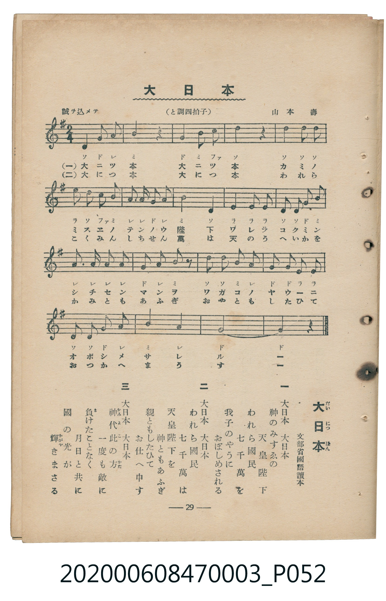

# 大日本

> Re:Shōka 使用 AI 協助辨識與重建樂譜，可能會有錯誤。歡迎回報。

- **鋼琴伴奏版**：<br><audio controls src="dainippon.mp3"></audio>
- **NEUTRINO 歌聲合成版**：<br><audio controls src="dainippon_neutrino.mp3"></audio>

- 曲：山本壽
- 臺灣教育會公認『新定兒童唱歌』尋常科第三學年用（第三學期・第1首）
- 國立臺灣歷史博物館典藏（典藏號：2020.006.0847.0003）

## 說明


- 出處：臺灣教育會公認、臺北新高堂發行《新定兒童唱歌》尋常科第三學年用（昭和6年／1931年），
第三學期第 1 首〈大日本〉，原書第 29 頁（掃描檔 P052.jpg）。
亦收錄於臺灣總督府編《公學校唱歌》第三學年用第十二課。
- 詞曲：文部省國語讀本 作詞／山本壽 作曲。
- 調性與拍號：ト調（G 大調），2/4 拍（原書副標題誤植「と調四拍子」，五線譜拍號與小節線實為 2/4 拍），
速度標示「誠ヲ込メテ」（!= 100）。
- 背景與曲風：日治時期兒童教材中之臣民教化歌曲，反映昭和初期（書載「七千萬」國民）國家意識形態。
全曲共 18 小節，結尾樂句擴充為 6 小節並以長音終止。
- 版本說明：本檔案為原書單聲部五線譜（附移動 Do 階名片假名）之忠實數位化版本，作為歷史教材史料保存。

### 編曲說明（鋼琴伴奏版）：

1. 前奏 (Intro, 4 小節)：取開頭「大日本」上行四度與大三和弦動機，以二分與四分音符和聲莊重起音。
2. 主歌伴奏 (Dainippon, 18 小節 × 3 段)：右手演奏主旋律；左手在開頭與結尾長音處採用厚實的拍點和弦支撐，
中段則以穩健的八分音符進行曲低音推展。


## 歌詞

```text
一　大日本　大日本
神のみすゑの　天皇陛下
われら國民　七千萬を
我子のやうに　おぼしめされる

二　大日本　大日本
われら國民　七千萬は
天皇陛下を　神ともあふぎ
親ともしたひて　お仕へ申す

三　大日本　大日本
神代（かみよ）此（こ）の方（かた）　一度も敵に
負けたことなく　月日と共に
國の光が　輝きまさる
```

## ABC

<div class="abc-score" data-abc-src="dainippon.abc" aria-label="五線譜載入中"></div>

[下載 ABC 原始檔](dainippon.abc)

## TMD 檔案連結

- [主旋律 TMD 檔案](dainippon.tmd) [[在 TMD Studio 編輯](https://tmdlang.github.io/Tmd-TS/#tmd=s7IKdvYPcrWy4qpTUCpJTLdSSM7PyUlNLsnMz7MqzsjMK0nNjM_KTMmPL87Iz05Ugisry88pzU21Si9KTEmNN443MjAyiDcwMIs3sDAxBzIMjBFKi_NLi5JTrYqTM_Lzc-JLUitKkvLzsxHyBUX5Zal5iXlANQVFIBtTwIoQClLLMlNSQdKpKZkl-UWZiTlI7kgtKga7FWxJfElRYl5xclFmAcgDCFUlGalAx2bmFqSi6gYalp6ZZ5Wbn5dUCvQghkRJYiZQGOT38sT43MTMvJzEvBRkVSUZ-cAgKMiotMrILAa5LTkxJz47MQ8ppKAuK0hMT7UKMDA1UuLS0lJ4umT5s-lLn81Zo6ClxaVoq2BoYMBlb6vgzmVjpG9iB9L7bPam93tmPd24Eajo6eK9YPNetO963rj42dSZL5o2PZvT_LR1zYtVvY8b-p5N2_B03aynrZOer176dMrGZ2t7Hjf0P93Q_XTHjufLJz5fs-bJjs6na3c83bnl-ZQV7_d0wEWezZn_uHk3kGv4ctm093s6wbY8ndP9fHU31K6125_2b3raO-t558qXS1Y8bd3xYno_0AQI48XM-UA3guJeDxj3eqC4BzIMjMEmcelrKdhSC3ApKCg8bpgADJTns9e9WLXq2Yy-xw0TwaLNu5-273oxcyrQJTjCpxEo_rRnOjCUXq6e8XRB0_OZe14sBAZRF7Zw68YTbs9mrH06qccMyH-_p9_Q0tgQzOp8v6cH5BIFBeRwBbIVDBWAwfq4oQMe248bQIqf9s1_NnsHSIGRpcLLBY0gk_uan_X3P1s1RQGURPSyCtKB5j5uaIKY-2TXsmdTtr3saXk2bQ_Ej8937H0-d_HTXXOeb18B9AjQpyBbFyyE-wLN8UDu097GJ7t6XqzaBDUWGHAvVs6DJLNn09pfNq94PqcRGPcvVs17sa4BlDSf7J0DVAH0KjwVgoSAOpBMWLX_WcPyFx3tz7p7IanhcXMHUBDoJXdQIgczQX4GJmsFoBpQ0gH7_mnn-mcrZr5cCHTQkmdLgJHU87hxBVD109mzgcqerp3wuAGouOfJrinPt896sXYOxHygRU839D9f3wAUfLp-2fOmXQpwgxHR8LJh_lNgiK2Y-XzJLqDBL1YteNy86cW-PY-bFz5ubgMb3AHJc4hABvmluefZzPUgv8ze9HIRML5ngSJt0-5nM5uA8QlJJcC09WzuhCc71j7ZCcwhi59tmAgUedozDRjo4JDsedrf-2zGAkhCedoxF6gRFLuzd7wA2dTzZEfz097mFxOACaEXGNRA7UAXABlP12171tL_Yu2Mp3sXPWvthkf809YVQGOftm5UMLRQgPgcaMfzrROebtj3bEXT0_6lzyZvedraCgoIM6iCJzuWPdm99OXU7S_nb36-tenZ2kUILz7v7ABGJCT_gPw3Zw0wyT1b2AHUD42WaeteNG4CpgV4wAOd_3Jmy_Plu592T1VwyVd4Oavv6YTe553tTxvbgQyg-4FB8XT_AmB0PJu648neXmBoQKwBRd_eOUCjIYUIJOhAjGkzn-yf-3TtDJC7oBkbYjswFIEJDuTpae3AeAAGM4gBTI9r1wNzOyjtbOh91t6JnEfABjzZ0fC4oQEplyHYIOnnS-c9blz3uHH_48aZj5smgtggFSufz2p_OXP2kx3dYEc09T9u6nncBIoOYLwAVSAiq2kSSMWzjomgdAnU3dTyuLHtceNqoKLHjV2PG_c8bpz-uKnxceNUsBFg84CuhbgcVIrDXANKIEhsoMNA6WjxlKdrVz-f1YLsJJDKDe0gKxsmwh0CSzI9L5ZNe7qs6en2jaCirwMovuH5nO0vFy5_1jL7xdrtwHCFh8wuYGGAO2TwebpxPUgFspuA4QBUAQ7NFY-bmh43AtHWx419IHUvlq2CiU5_3Dj_ceOmx43LIOHzZPfUx407nk_ZDAx-YkMGl8eBYYLsImAgAJ0DTMzAQHg2dc2T3RuApT1IsGPbs_W9IMGZ64GCoPBZvRZYDjxd2vlkH7CwQYTPDmC2xJtynuxeDHTw48ZuUPpp6gBqfLZ2CVhkMqj0aFz3bNpOmAJgXgcZB0yOwPIHGBbPpgKDZzU4eDYteNwITHnAgJkMCqdGYGj1A5U-m9MBtA0oAszjUKVAvwJNfdoKNBsUdy_2zH3c2Pu4cR84dRGdtF60r4I4HlgWPNnX9mzOqmez9z2bOv35VmA23fpk1y6gmpezVryYOP3ZWmBdCXIFiOxb8bIBXIyByyRQzm7tfNbSAawxX05rfgF2zfNWoLPAAQh0CuU1OxQoaOlzcbkAW1iZBQXA5lxAZmJevkONQU01uCC0sdCyAzOwtSkg1W7Ds3VbFTRMoYWgDryMAMkCK2Jgha-JRSvQVqixQBOsQDUWuKDsBuIWhRoFUC0IAzUEZB83rQbLzgfiPiALanSNgmm8gi7QBUZApjGQZQDENUC-LpBnApKGi4FYpkBYA9boYwg0sxGYbFqAwsC0AcRLQNY07n3cNBkoBDKVOBXdYOn9QLwOZrYRlcxu6gdJN_UAcSfMbGOqu7upA2g2_vjf1YMv_o2IjH9w7DXtBNIbwbEIdEVzGzhWN4P5j5uWAcWAZQ-46OiGxXzzerCaNUC8EpoWgOqb1kNTw2ZEWjADRq8JMOJrFDSMgL7TVTDSVNXQ1dWEpw9jSHKBphogAURAbWDaPB6oDDlxgKJ0JtCiiZCoVdAAlrlgU4HhqAkWA9ZT4KDcAQtsUJhixBtQfDIQ90NDezJKKkGTAVkyHWJJ40KQJbOh4qAiChx9wJoDGoHAMhAigOQQIG4BuwNYm6CkGJA9IHVAmcb5EHtATobbsxKoowliLBD3ghMOxJp9YEWgQADpg5i0AohXgV1OKOXs6ASnHBPsKceY2JTTtB2cBhqBrN3gOAeli3nQlLMJnk4eNwFTCSh1QFPXEnCaety8B1yuwNMJWuowAqcOUBoxBpYVoJLCFMiCiAHTBgQhUgaeKAKzQEEPSlagZACsZeCBDxIBRU4bNF8ikgHQRFDKAedHkInA4IVGRhMQbwXiPoiJjV1QMxAqpoMjBtgiAEcdIsqBZi6BmtkLMhMkvwKsA6IX5AKImeDECi4nwG4EqwQlIKBdQNcTiGBQjwJPBJsQHcHA5NQ8BxzRwI4EOKy2QrM9JHJBxT-sQNgDrxiQqwEgQtQDoBiG1AMgWAMmwfUAUgYHeRCYMkBB2NQI9vpUaL6F5GJInMB0gwsOpJwL0g1MX-ActQMpp4CiF8SbiUs3OD-CdIHKB1Bk9iLpBrkAl921XFy6dgrwahxsGlBAmQsA)]
- [鋼琴伴奏 TMD 檔案](dainippon_piano.tmd) [[在 TMD Studio 編輯](https://tmdlang.github.io/Tmd-TS/#tmd=s7IKdvYPcrWy4qpTUCpJTLdSyC8qychPL0osyKi0ysgsLskvykxOzInPTsxLVIIrKs4vLUpOjS9ITE-1CjAwNVLi0tJSeLpk-bPpS5_NWfN-T8fL7j3PJ2x5smfL06X9zzs73u_pVNDS4lK0VTA0MOCyt1Vw57Ix0jexAxn4bPam93tmPd24Eajz6eK9YEtetO963rj42dSZL5o2PZvT_LR1zYtVvY8b-p5N2_B03aynrZOer176dMrGZ2t7Hjf0P93Q_XTHjufLJz5fs-bJjs6na3c83bnl-ZQVQGfARZ7Nmf-4eTeQa_hy2TSga8C2PJ3T_Xx1N9Sutduf9m962jvreefKl0tWPG3d8WJ6P9AECOPFzPlANxoZGBnoGRiY6RlYmJgDGQbGYJO49LUUbKkFuBQUFB43TAAGyvPZ616sWvVsRt_jholg0ebdT9t3vZg5FegSHOHTCBR_2jMdGEovV894uqDp-cw9LxYCg6gLW7h14wm3ZzPWPp3UYwbkv9_Tb2hpbAhmdb7f0wNyiYICcrgC2QqGCsBgfdzQAU8CjxtAip_2zX82ewdIgZGlwssFjSCT-5qf9fc_WzVFAZRu9LIK0oHmPm5ogvrwxcp5kPTwbFr7y-YVz-c0AiPpxap5L9Y1AE1VeLJ3DlAF0E3w5AISAupAMmHV_mcNy190tD_r7oVE2-PmDqAg0G53UBIFM0GOA6Y_BaAaIOtlw_ynu5YpQFInwqTn21cATYbEAdYkDTQbEhyGegpPO3uB4goannklRfk6CiYKTzf0P1_foAlK2v3TXk7rfrlg7eOGHqQA6n2yowsYO09nzwZaDnQvUAoUppN6nu5Z9rR76rOVQLf3PNm99MmunqcdbSAFQJUdbS_nb36-ZhlQ2YvGTS_6ul62977Yuh0oCHW3goKRnsKTHbuBUQxxqoKGS2JmXmZBQX6ejoKhBdRdCoenKxgrPFu3FeLAzc86u5_tmQJUDtI6vfvpvu73e2Y_3b4MKP50zgqI84FOeL51wtMN-15OBVkITInP-hYC08vTvllP1y97PqsFGJovd8-D-ODZlPXPJk2AJxggeLJjLdC-p53tQD89X7nyaeNSoJanravhfnrZsAkYHsAgf7K3DyjyrG_F041Tod6iPGNBgYKWPhcXOJKsAjIT8_KDPBxqDGqqwa60sdCyAzNqFEzjFXSBqdoIyDQGskyBGMIyArMMgaSugoFCDVctimk-2E0zBJkWbRgL0YvMAdsTbYomAzUYHnF4nIqt7IFkzwZgaCtomMISIhZlwKDA6lsDuB-NgQkZKA0XA7FMgbAGrNHHsEbhceOCx40tQOHHjauBeAlQ0ePGvY-bJgOFQKYSp6IbLL0fiNfBzDaiktlN_SDpph4g7oSZbUx1dzd1AM3GHyG7eoiPEDNgGJsAQ79GQQOU4IDJTlNVQ1dXEx5JxpA4g0YdkAAioDYwbR4PVIYcQ6BwnQnEHZDwVdB43LgMbCrQM5pgsceNbWD_7ID5GOQxjMADik8G4n6olyejRBWaDMiS6RBLGheCLJkNFX_cuA8Sho8b10NDcRlMAMkhQNwCdsfjpkko0QayB6QOKNM4H2IPyMlwe1YCdTRBjAXiXnDsQazZB1Y0EaoPYtIKIF4Fdjmh6NvRCY4-eMGOL_rQIs0IHGmgqDMGZW1wDjKGigGjDIIQEYYn5MAsUIiAYhsUO48bgXEDDROQCCjM2qBpFhE7QBNBEQpOqyATgb6GhlETEG8F4j6IiY1dUDMQKqaDw-tx4yZwiCJiAmjmEqiZvSAzQfIrwDogekEugJgJTkPgPAR2I1glKF6BdgFdTyDcgZUe8eEOyQeIggy5sAaxIIU2kIWUOUCu2APxZ1Mj2H1ToWkekgMgAQfTDc50SKkepHsJNDXuQEploDgA8Wbi0g1OyyBdoLwFCvFeJN0gF-CyG7NewFrpUKVeQK-3QExgAIPSMHotBqrDEFJQhSCKmsWiCdBIk1iYBcj2gihkm5FcZQSTRdNNxfyOwx3Qqhw9QEC5PdosNxbmIGrmAKhVMJNxtC9AHAgNyQ3ANKVrpwBuxygAGfD0Fe0DUoQiYIQuYAwWUOYCAA)]

## 分析

```text
================================================================================
📊 TMD Song Profile: [ 大日本 ]
================================================================================
⏱  Duration:       0:21 (21.6s), 18 measures total
🎼 Key & Tempo:    首調基準 G, != 100.0 BPM, <2/4>
   - 分析範圍：      由實際發聲的音符與和弦推測調性；播放脈絡另行呈現
🎤 人聲音域:    D4 (MIDI 62) – E5 (MIDI 76) [跨度: 14 個半音 / 1.2 個八度, 難度: moderate]
   - 最低音:  D4 in [Dainippon #1 @ m.1, 0:00]
   - 最高音: E5 in [Dainippon #1 @ m.6, 0:06]
   - 適合: soprano, mezzo-soprano, contralto, tenor, baritone, bass
🏛  結構:      Dainippon (21.6s)
⚡ 編曲密度:        Peak 1 軌道同時演奏
🗝  調性診斷：       D 大調（純淨自然大調，未偵測到可信轉調）
   - 風格氣質:    純淨自然大調（陽光明朗、易唱易記，無明顯調外色彩）
   - 轉調歷程:    全曲維持單一推測調性（未偵測到可信轉調）
   - 核心骨幹音:  D, G, A, B, E
   - 調性數值:    D 大調 [相關度: 0.87, 穩定度: Moderate, 自然音純度: 96.9%]
   - 候選調性 (K-S): D 大調 (0.87), G 大調 (0.83), B 小調 (0.61)
   - 五度圈歷程:   +2
   - 各段落調性細節:
     • [Dainippon #1]: D 大調 (r: 0.87, 自然音純度: 96.9%, 調外音: C)

  [ 五度圈游移軌跡 ]
               C  
         F            G  
      Bb              [D ]*
      Eb               A  
         Ab           E  
            Db       B  
               F# 
     (* = active key center)

  [ 十二半音累積音高分佈 ]
     C  : ██                         3.1%
     C# :                            0.0%
     D  : ████████████████████████  30.8%
     D# :                            0.0%
     E  : ██████                     7.7%
     F  :                            0.0%
     F# : █                          1.5%
     G  : █████████████████         21.5%
     G# :                            0.0%
     A  : ████████████████          20.0%
     A# :                            0.0%
     B  : ████████████              15.4%
--------------------------------------------------------------------------------
Assignment 軌道音域：
  - Piano         : D4 – E5 (14 個半音 / 1.2 個八度, 51 個音符)
================================================================================
```


## 原書掃描頁




