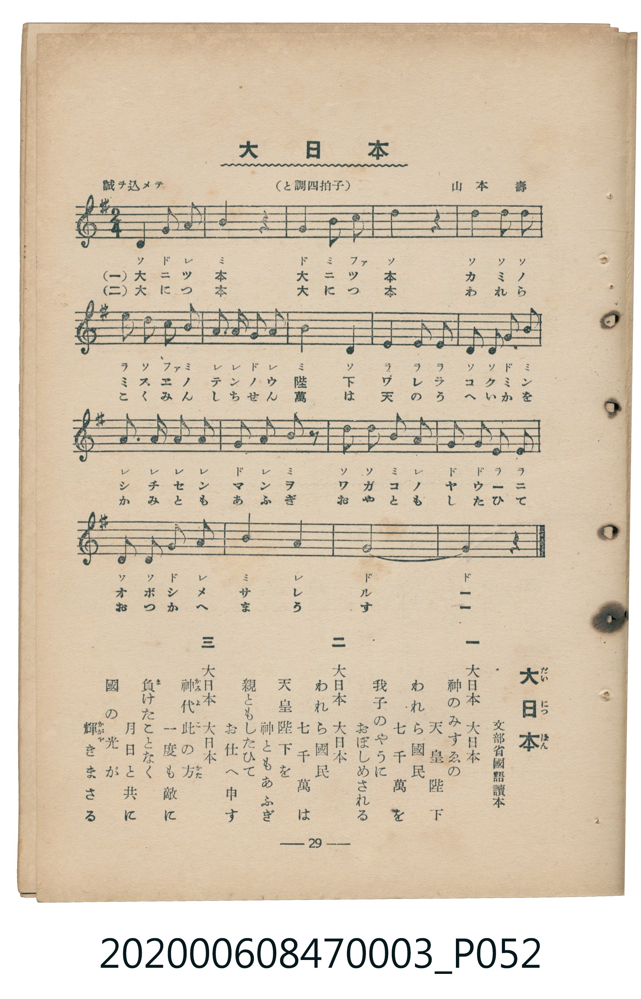

# 大日本

<audio controls src="dainippon.mp3"></audio>

- 臺灣教育會公認『新定兒童唱歌』尋常科第三學年用（第三學期・第1首）
- 國立臺灣歷史博物館典藏（典藏號：2020.006.0847.0003）

## 說明

【曲目說明】
・出處：臺灣教育會公認、臺北新高堂發行《新定兒童唱歌》尋常科第三學年用（昭和6年／1931年），
第三學期第 1 首〈大日本〉，原書第 29 頁（掃描檔 P052.jpg）。
亦收錄於臺灣總督府編《公學校唱歌》第三學年用第十二課。
・詞曲：文部省國語讀本 作詞／山本壽 作曲。
・調性與拍號：ト調（G 大調），2/4 拍（原書副標題誤植「と調四拍子」，五線譜拍號與小節線實為 2/4 拍），
速度標示「誠ヲ込メテ」（!= 100）。
・背景與曲風：日治時期兒童教材中之臣民教化歌曲，反映昭和初期（書載「七千萬」國民）國家意識形態。
全曲共 18 小節，結尾樂句擴充為 6 小節並以長音終止。
・版本說明：本檔案為原書單聲部五線譜（附移動 Do 階名片假名）之忠實數位化版本，作為歷史教材史料保存。

・編曲說明（鋼琴伴奏版）：
1. 前奏 (Intro, 4 小節)：取開頭「大日本」上行四度與大三和弦動機，以二分與四分音符和聲莊重起音。
2. 主歌伴奏 (Dainippon, 18 小節 × 3 段)：右手演奏主旋律；左手在開頭與結尾長音處採用厚實的拍點和弦支撐，
中段則以穩健的八分音符進行曲低音推展。

## 歌詞

```text
一　大日本　大日本
神のみすゑの　天皇陛下
われら國民　七千萬を
我子のやうに　おぼしめされる

二　大日本　大日本
われら國民　七千萬は
天皇陛下を　神ともあふぎ
親ともしたひて　お仕へ申す

三　大日本　大日本
神代（かみよ）此（こ）の方（かた）　一度も敵に
負けたことなく　月日と共に
國の光が　輝きまさる
```

## 原書掃描頁



## 分析

```text
================================================================================
📊 TMD Song Profile: [ 大日本 ]
================================================================================
⏱  Duration:       0:21 (21.6s), 18 measures total
🎼 Key & Tempo:    首調基準 G, != 100.0 BPM, <2/4>
   - 分析範圍：      由實際發聲的音符與和弦推測調性；播放脈絡另行呈現
🎤 人聲音域:    D4 (MIDI 62) – E5 (MIDI 76) [跨度: 14 個半音 / 1.2 個八度, 難度: moderate]
   - 最低音:  D4 in [Dainippon #1 @ m.1, 0:00]
   - 最高音: E5 in [Dainippon #1 @ m.6, 0:06]
   - 適合: soprano, mezzo-soprano, contralto, tenor, baritone, bass
🏛  結構:      Dainippon (21.6s)
⚡ 編曲密度:        Peak 1 軌道同時演奏
🗝  調性診斷：       D 大調（純淨自然大調，未偵測到可信轉調）
   - 風格氣質:    純淨自然大調（陽光明朗、易唱易記，無明顯調外色彩）
   - 轉調歷程:    全曲維持單一推測調性（未偵測到可信轉調）
   - 核心骨幹音:  D, G, A, B, E
   - 調性數值:    D 大調 [相關度: 0.87, 穩定度: Moderate, 自然音純度: 96.9%]
   - 候選調性 (K-S): D 大調 (0.87), G 大調 (0.83), B 小調 (0.61)
   - 五度圈歷程:   +2
   - 各段落調性細節:
     • [Dainippon #1]: D 大調 (r: 0.87, 自然音純度: 96.9%, 調外音: C)

  [ 五度圈游移軌跡 ]
               C  
         F            G  
      Bb              [D ]*
      Eb               A  
         Ab           E  
            Db       B  
               F# 
     (* = active key center)

  [ 十二半音累積音高分佈 ]
     C  : ██                         3.1%
     C# :                            0.0%
     D  : ████████████████████████  30.8%
     D# :                            0.0%
     E  : ██████                     7.7%
     F  :                            0.0%
     F# : █                          1.5%
     G  : █████████████████         21.5%
     G# :                            0.0%
     A  : ████████████████          20.0%
     A# :                            0.0%
     B  : ████████████              15.4%
--------------------------------------------------------------------------------
Assignment 軌道音域：
  - Piano         : D4 – E5 (14 個半音 / 1.2 個八度, 51 個音符)
================================================================================
```

## ABC

```abc
X:1
T:大日本
C:TMD (Chen, Chih-Han / aguai)
M:2/4
L:1/16
Q:1/4=100
K:G
V:V1 name="Piano" snm="Pia"
[V:V1]
d4 g2 a2 | b4 z4 | g4 b2 c2 | d4 z4 |
d4 d2 d2 | e2 d2 c2 b2 | a3 a g2 a2 | b2 b2 d4 |
d4 d2 d2 | e2 d2 f2 g2 | a3 a a2 a2 | g2 a2 b2 z2 |
d2 d2 b2 a2 | g2 e2 e2 e2 | d2 d2 g2 a2 | b4 a4 |
g8- | g4 z4 |
```

- [主旋律 TMD 檔案](dainippon.tmd)
- [鋼琴伴奏 TMD 檔案](dainippon_piano.tmd)
