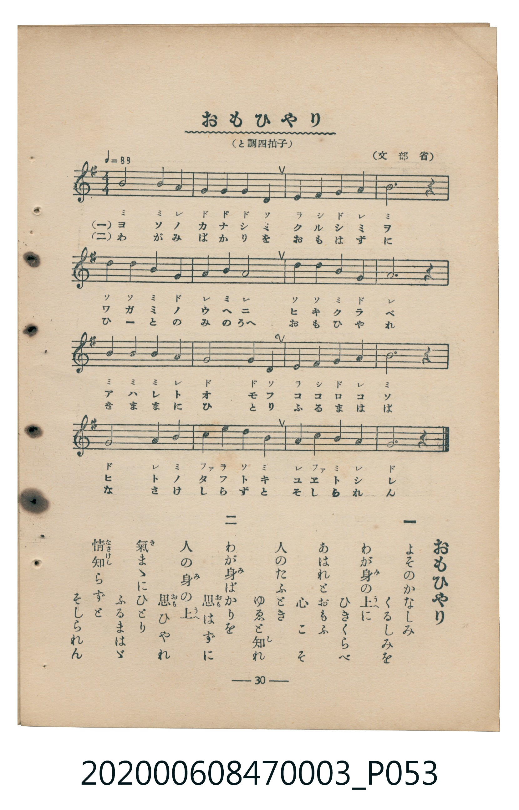

# おもひやり（體貼同理）

> Re:Shōka 使用 AI 協助辨識與重建樂譜，可能會有錯誤。歡迎回報。

- **NEUTRINO 歌聲合成版**：<br><audio controls src="omoiyari_neutrino.mp3"></audio>
- **鋼琴伴奏版**：<br><audio controls src="omoiyari.mp3"></audio>


- 臺灣教育會公認『新定兒童唱歌』尋常科第三學年用（第三學期・第2首）
- 國立臺灣歷史博物館典藏（典藏號：2020.006.0847.0003）

## 說明


- 出處：臺灣教育會公認、臺北新高堂發行《新定兒童唱歌》尋常科第三學年用（昭和6年／1931年），

第三學期第 2 首〈おもひやり〉（體貼同理），原書第 30 頁（掃描檔 P053.jpg）。
- 出處原曲：文部省唱歌（1911年《尋常小學唱歌》第二學年）。

- 調性與拍號：ト調（G 大調），4/4 拍，速度 != 88。

- 背景與曲風：以溫厚平和的 4/4 拍四分音符與二分音符旋律，勸勉學童將他人的悲傷與苦楚比作自身處境，

培養慈悲同理（あはれとおもふ心）的美德，莫只顧自己而遭人譏為無情。
- 版本說明：本檔案為原書單聲部五線譜（附移動 Do 階名片假名）之忠實數位化版本。


### 編曲說明（鋼琴伴奏版）：

1. 前奏 (Intro, 4 小節)：引用第四段溫厚端莊的結尾樂句作為前導。
2. 主歌伴奏 (Omoiyari, 16 小節 × 2 段)：右手演奏聖詠般平和的四分／二分音符旋律，
左手以溫暖柔和的四分音符和弦伴奏支撐。


## 跨冊／重複收錄參照

> 同曲（文部省『尋常小學唱歌』〈同情〉；《公學校唱歌集》題為〈同情〉，《新定兒童唱歌》第三學年題為〈おもひやり〉）

- **[同曲]** 《公學校唱歌集》（大正4年／1915，國臺圖 0725 26）：[**〈同情〉**](../../../kogakko_shokashu_1915/4_03_dojo/index.md)（`G` / `4/4` — [原始 TMD](../../../kogakko_shokashu_1915/4_03_dojo/dojo.tmd)）
- 總表：[跨冊重複與同名歌曲總索引](../../../duplicate_songs.md)

## 歌詞

```text
一　よそのかなしみ　くるしみを
わが身（み）の上（うへ）に　ひきくらべ
あはれとおもふ　心こそ
人のたふとき　ゆゑと知（し）れ

二　わが身ばかりを　思（おも）はずに
人の身の上　思ひやれ
氣（き）まゝにひとり　ふるまはゞ
情知（なさけし）らずと　そしられん
```

## ABC

```abc
X:1
T:おもひやり（體貼同理）
M:4/4
L:1/16
Q:1/4=88
K:G
V:V1 name="Piano" snm="Pia"
[V:V1]
B8 B4 A4 | G4 G4 G4 D4 | E4 F4 G4 A4 | B12 z4 |
w: 1.~よ そ の | か な し み | く る し み | を
w: 2.~わ が み | ば か り を | お も は ず | に
d4 d4 B4 G4 | A4 B4 A8 | d4 d4 B4 G4 | A12 z4 |
w: 1.~わ が み の | う へ に | ひ き く ら | べ
w: 2.~ひ _ と の | み の うへ | お も ひ や | れ
B4 B4 B4 A4 | G8 G4 D4 | E4 F4 G4 A4 | B12 z4 |
w: 1.~あ は れ と | お も ふ | こ こ ろ こ | そ
w: 2.~き ま ま に | ひ と り | ふ る ま は | ば
G8 A4 B4 | c4 e4 d4 B4 | A4 c4 B4 A4 | G12 z4 |
w: 1.~ひ と の | た ふ と き | ゆ ゑ と し | れ
w: 2.~な さ け | し ら ず と | そ し ら れ | ん
```

## TMD 檔案連結

- [主旋律 TMD 檔案](omoiyari.tmd) [[在 TMD Studio 編輯](https://tmdlang.github.io/Tmd-TS/#tmd=s7IKdvYPcrWy4qpTUCpJTLdSSM7PyUlNLsnMz7MqzsjMK0nNjM_KTMmPL87Iz05Ugisry88pzU21Si9KTEmNN443MjAyiDcwMIs3sDAxBzIMjBFKi_NLi5JTrYqTM_Lzc-JLUitKkvLzsxHyBUX5Zal5iXlANQVFIBtTwIoQClLLMlNSQdKpKZkl-UWZiTlI7kgtKga7FWxJfElRYl5xclFmAcgDCFUlGalAx6YVZabmpQB9VaDEpaWl8Lix63FT0-PGTY-bWh43db3f0_Fy9ZQXm_Y8ndDzfELb-z2dClpaXIq2ChYWXPa2Cu5cNib6JnYgI1-073reuPjZ1JkvmjY9m9P8tHXNi1W9jxv6nk3b8HTdrKetk56vXvp0ysZna3seN_Q_3dD9dMeO58snPl-z5smOzqdrdzzdueX5lBVA6-Aiz-bMf9y8G8g1erlsGtBisMOfzul-vrobatfa7U_7Nz3tnfW8c-XLJSuetu54Mb0faAKE8WLm_Pd7ZoGiQA8YBXqgKAAyDIzBJnHpaynYUgtwKSgoPG6Y8Gz2puez171YterZjL7HDRPBos27n7bvejFzKtAlOMKnESj-tGc6MJRerp7xdEHT85l7XiwEBlEXtnDrxhNuz2asfTqpxwzIf7-n39DS2BDM6ny_pwfkEgUF5HAFshWMFIDB-rihAy3CHzcAtaDHOdCQp33zn83eAdJobKDwckEjyMa-5mf9_c9WTVEIMDA11ssqSAcqfdzQhOJzsL5NQP8_m9b-snnF8zmNEM8A9RtaGoIcCfQrxFtPN_SDPATzK8jBu3ogXkQx-MWq_c8alr_oaH_W3QuJ5cfNHUBBoJHuCk-XLAczQW4GJk0FoBog62XD_Ke7limA0y2SQc09z2auBxk0e9PLRcBAnPVk99Jnu1Y_7Zv1dOdmYGg-n9WiADXk6ezZTzvaXs7f_HzNMqAOkMtg3GfTu5_u6waFUfeOp92gIAZF2Yb2J7unPdm1C2jGs6ZNT5u2A3W96F72bOmsZ-unPNk750X7qhe7VoNCaFEzPJKezt_5cknXs9YOkBZo6ANjCBg96x839TxuXAGLra1P9wN1dQINf76v7-m-7UATXvStftq_6uXC5UCTn27f-KKh52XjWqADXqztf96063nLwmfNrQi_P-_seDYHmARBqRUUO3PWACPy2cIOoFJIVD-dtu5F4yZglD3ZNeX59lkv1s4BpYuZLc-X737aPVXBJV_h5ay-pxN6n3e2P21sBzKAznmys_vp_gVP1y97NnXHk729T3umQawBWQvNJRDDgTH8YuW8p60rgKkCFJo71oIYq-a9WLsemHVAeXhD77P2TuSEBTbgyY6Gxw0Nj5uAYTL3ceO6x43djxtXPW6c_rhxP0i8sf9xE1AEzG2aBLaxqf9xYw8woMHhCEoXQG1PdoDKtceNbY8bd4BFVoM1b3rc2As2AiiyE6wZW8ADlQLD_nHjZKATwE7atQvskvkgOZA6YKYGurDtcdNEIPf5_KVgq6aD7GkCxzKQD_EpKNi7up52LEVLJc-nzwYmFGCMQhIKsER4PmX-0zkroPG6azXQ_cCAeNGx5v2e2S-WNQJj8PnMvS-bFj_ZvRfoNKDiZ20TnrWtBhoFTEPAWAcaDhR_1gIsHHuerV38bMZ6oI3AuHrW2QBM8E83dL3YtAWUkrYvfj5lIzCu4KG9C5gPgX6BBuHjxg2gAAeWEU2TgOLPGuaCvQYKF3Aorn_cOAsYlohAAesBhTZENayMAYfCsw2LwbpByeZx477HTUBpoGpgHKwAl0LA-NgKjsx94CiYB9YD9Ao0PIGRPvVxIzCEIQELNAJo9QqwNqBB00EiwGhrmowe4E929AJDDJJPnu7fCglSYLA82TkfKA4p9l6sWPuseTM8XmBZFBgpS0FBt3s3sPR5OmfD815g6t0OJIHlNSjzb2gHFusvFq0GZblNa542zQQp3gFMxk1AEUgsgIIFErxAZ1Fe8UCBgpY-F5d_bn5mZWJRplVAZmJevkONQU01uEixsdCyAzOw1XiQSqHh2bqtChomCsDy9_n6Bh14pgPJKhgqAL2niUUr0FKosUATrIBFygpwCfa4aS-Q3adQA2StBrK6gPR2ID0fKAcSWw9kA8WRxZo3gXXCAJLBu3qABjf1Qwxu7AHi_SANjRuAuBsoAzJ8EsSQRhC7CUgDLWicBRVbjc3gGgVjBV0wBNFGQFwD9KUuHJvGg4XMQJQ5iAAJQpTBNIKgAUgEbKCPIchjHVBxYAIEk-vAOkDuBPFWgcnpYHI_VKYfxGuCyKPIAP2EsAfsGog9RiA5kC6IPT0opm0A88CmAcMFRIJMgYQMiNcEll8PJmdBZVZj2IM_qezqwZdUjIhOKuuhSWUNOBGAkkAfkLcMSM8A4m5ospgEFFsLTTIroWIz8SaVRkhKApYE4AgAeXE_mAUs64F4B1pS2QSkW6Dpsgd7UjEFJQhoUgGlgxpwSoAlHBDEpQZXOgHHOlLcIVJKG5i3A0zCYgYkvgks0gsmIWmmEyqzE3c6AeuCpJMVKLYg7IRUgEgWIScUsKXA0IEkSJBzSUkoOzrxJRRjYhNK0yJIfDb3A_EacALoAIqugoouAotMBYpshuDmtdDYBPH34ksovdCEsg-MIXkBOfmADAEmk8at4BwKUgNJOqDSZQO2hAKKfBhGlCkgSH6Z0oiUZ8FRAIlLWFSBYxcaXVuh4pPBPDDZBEkxIDZIBlQq4UorEJX7kEhQ-sOSisAlC0gcZB-s7ILoALkSVg6RkFSA7Wp8ScWE6DIFVA-AEgUwgUCrH2DWByUOcJKBJoxmUBmzESq2HSq2Bik-sSQVaGprBBrVOBHsxengLAgqRkHBAkkYcxHi4LIE5IDJ2AxGJAxYSVID9KWughkomcBFQHIgUczkhC2d4Mrr8-FpAyYDimmQ08BlTdNEJBlQDYQ9qyPSCagWg9gzFUyC9EMCBFYqQeoWRDqF1IVI8mDzIYGDbk8tF5eunQKsIQO2FshX5gIA)]
- [鋼琴伴奏 TMD 檔案](omoiyari_piano.tmd) [[在 TMD Studio 編輯](https://tmdlang.github.io/Tmd-TS/#tmd=s7IKdvYPcrWy4tLSUnjc2PW4qelx46bHTS2Pm7re7-l4uXrKi017nk7oeT6h7XHz7pfde55P2PJkz5anS_ufd3a839OpoKXFpWirYGHBZW-r4M5lY6JvYsdVp6D0on3X88bFz6bOfNG06dmc5qeta16s6n3c0Pds2oan62Y9bZ30fPXSp1M2Plvb87ih_-mG7qc7djxfPvH5mjVPdnQ-Xbvj6c4tz6esADoALvJsznygA4Bco5fLpgEtVgLZ8nRO9_PV3VC71m5_2r_pae-s550rXy5Z8bR1x4vp_UATIIwXM-e_3zPLyMDIQM_AwEzPwMLEHMgwMAabxKWvpWBLLcCloKDwuGHCs9mbns9e92LVqmcz-h43TASLNu9-2r7rxcypQJfgCJ9GoPjTnunAUHq5esbTBU3PZ-55sRAYRF3Ywq0bT7g9m7H26aQeMyD__Z5-Q0tjQzCr8_2eHpBLFBSQwxXIVjBSAAbr44YOtCTwuAGoBSUVQAx52jf_2ewdII3GBgovFzSCbOxrftbf_2zVFIUAA1NjvayCdKDSxw1NKD4H69sE9P-zae0vm1c8n9MI8wxM3YtV-581LH_R0f6suxcSaY-bO4CCQBvcFZ4uWQ5mgpwATGkKQDVA1suG-U93LVMAJ0OEQc-3rwBaBYkAkB8wki7QaEhYGOopPO3sBYoraHjmlRTl6yiYKDzd0P98fYMmUM3TPVOBQQr06tPZs5-t2_ps1-qnfbOer17_oq_r-ayW51snPN2w79mKpqf9S5_snfO8aRfIqA3AKAe7Q0HBSE_hyY7dQC9CrFbQ8M_Nz6xMLMrUUTA0g1qjcHg6MAKAhoPt69_8rLP72Z4pQNUvGqe9WLngRceapzs3A6MTaB_QEU87gJHQ_2RXD5Dxcv7m52uWPZve_XRfNzxugeDp9mVAQ57sXgp07rNZ057Nn4KsHaILKPJ0zzKIs55NWf9s0gSooynPA1CgoKXPxQUOUquAzMS8_CAPhxqDmmqwK20stOzAjBoFQwVdMDQCYmMgrgGGv66CGRCbwkVAciBREA_ERugCQQOQCFctimU-OCyLB6qNNowFmY5gAq0Ec0xAHCQlNVBFpgj1YCaKORAS7gZYBOPxM7byBpIlG4CpQEEDlv504HkJJAv0MrAw0MSiFRjOUGOBJlgBU_8KcCp43LQXyO4DuvZx02ogqwtIbwfS88Eh8bhpPZANFEcWa94ES0JggGTwrh6gwU39EIMbe4B4P0hD4wYg7gbKgAyfBDGkEcRuAtJACxpnQcVWYzO4BhyhIIgasTAMDvIaBTMQZQ4iQIIQZTCNiPgHGehjCPJYB1T8ceNcMLkOrAPkThBvFZicDib3Q2X6QbwmiDyKDNBPCHvAroHYYwSSA-mC2NODYtoGMA9sGjBcQCTIFEjIgHhNYPn1YHIWVGY1hj34k8quHnxJxYjopLIemlTWgBMBKAn0AXnLgPQMIO6GJotJQLG10CSzEio2E29SaYSkpMeNK8ARAPLifjDrcWMbEO9ASyqbgHQLNF32YE8qoNIAViKA0gGkVIAlHBDEpQZXOgHHOlLcIVJKG5i3A0zCYgYkvgks0gsmIWmmEyqzE3c6AeuCpJMVKLYg7ATaCLEOZhFyQgFbCgwdSIIEOZeUhLKjE19CMSY2oTQtgsRncz8QrwEngA6g6Cqo6CKwyFSgyGYIbl4LjU0Qfy--hNILTSj7wBiSF5CTD8gQYDJp3ArOoSA1kKQDKl02YEsooMiHYdTKgvwypREpz4KjABKXsKgCxy40urZCxSeDeWCyCZJiQGyQDKhUwpVWICr3IZGg9IclFYFLFpA4yD5Y2QXRAXIlrBwiIalAWjg4k4oJ0WUKqB4AJQpgAoFWP8CsD0oc4CQDTRjNoDJmI1RsO1RsDVJ8Ykkq0NTWCDSqcSLYi9PBWRBUjIKCBZIw5iLEwWUJyAGTsRlMvbYHIp3gyuvz4WkDJgOKaZDTwGVN00QkGVANhD2rI9IJqBaD2DMVTIL0QwIEVipB6hZEOoXUhUjyYPMhgYNuD0Y7Bmtzith2DJ5Eg9KSAjOR82e0WS5IHNw4A0uiNNSIaZCRVImS5E5YCxHZocgeQFKErASlSQkhiXEpWilOlkvBFqM3gKkbouhFCLHupFFbXNdOAdwlUAAyYOk52gekBplvBOYrcwEA)]

## 分析

```text
================================================================================
📊 TMD Song Profile: [ おもひやり（體貼同理） ]
================================================================================
⏱  Duration:       0:43 (43.6s), 16 measures total
🎼 Key & Tempo:    首調基準 G, != 88.0 BPM, <4/4>
   - 分析範圍：      由實際發聲的音符與和弦推測調性；播放脈絡另行呈現
🎤 人聲音域:    D4 (MIDI 62) – E5 (MIDI 76) [跨度: 14 個半音 / 1.2 個八度, 難度: moderate]
   - 最低音:  D4 in [Omoiyari #1 @ m.2, 0:04]
   - 最高音: E5 in [Omoiyari #1 @ m.14, 0:36]
   - 適合: soprano, mezzo-soprano, contralto, tenor, baritone, bass
🏛  結構:      Omoiyari (43.6s)
⚡ 編曲密度:        Peak 1 軌道同時演奏
🗝  調性診斷：       G 大調（純淨自然大調，未偵測到可信轉調）
   - 風格氣質:    純淨自然大調（陽光明朗、易唱易記，無明顯調外色彩）
   - 轉調歷程:    全曲維持單一推測調性（未偵測到可信轉調）
   - 核心骨幹音:  B, G, A, D, E
   - 調性數值:    G 大調 [相關度: 0.74, 穩定度: Moderate, 自然音純度: 100.0%]
   - 候選調性 (K-S): G 大調 (0.74), B 小調 (0.65), D 大調 (0.56)
   - 五度圈歷程:   +1
   - 各段落調性細節:
     • [Omoiyari #1]: G 大調 (r: 0.74, 自然音純度: 100.0%)

  [ 五度圈游移軌跡 ]
               C  
         F           [G ]*
      Bb               D  
      Eb               A  
         Ab           E  
            Db       B  
               F# 
     (* = active key center)

  [ 十二半音累積音高分佈 ]
     C  : ███                        3.3%
     C# :                            0.0%
     D  : █████████                 11.7%
     D# :                            0.0%
     E  : ████                       5.0%
     F  :                            0.0%
     F# : ███                        3.3%
     G  : ████████████████████      25.0%
     G# :                            0.0%
     A  : █████████████████         21.7%
     A# :                            0.0%
     B  : ████████████████████████  30.0%
--------------------------------------------------------------------------------
Assignment 軌道音域：
  - Piano         : D4 – E5 (14 個半音 / 1.2 個八度, 48 個音符)
================================================================================
```


## 原書掃描頁




