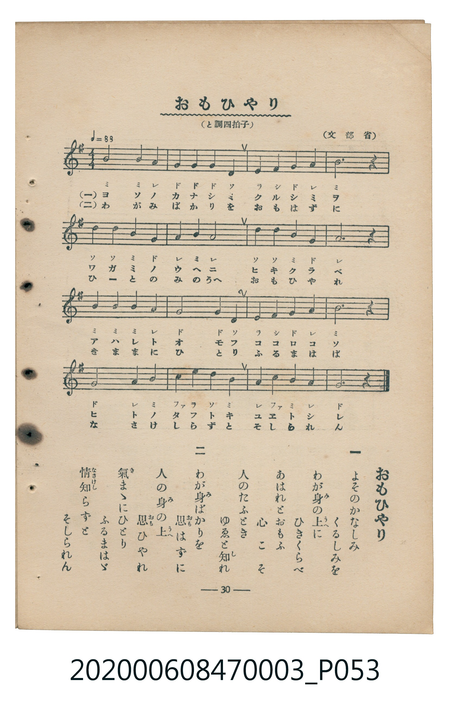

# おもひやり（體貼同理）

> Re:Shōka 使用 AI 協助辨識與重建樂譜，可能會有錯誤。歡迎回報。

- **鋼琴伴奏版**：<br><audio controls src="omoiyari.mp3"></audio>
- **NEUTRINO 歌聲合成版**：<br><audio controls src="omoiyari_neutrino.mp3"></audio>

- 臺灣教育會公認『新定兒童唱歌』尋常科第三學年用（第三學期・第2首）
- 國立臺灣歷史博物館典藏（典藏號：2020.006.0847.0003）

## 說明


- 出處：臺灣教育會公認、臺北新高堂發行《新定兒童唱歌》尋常科第三學年用（昭和6年／1931年），
第三學期第 2 首〈おもひやり〉（體貼同理），原書第 30 頁（掃描檔 P053.jpg）。
- 出處原曲：文部省唱歌（1911年《尋常小學唱歌》第二學年）。
- 調性與拍號：ト調（G 大調），4/4 拍，速度 != 88。
- 背景與曲風：以溫厚平和的 4/4 拍四分音符與二分音符旋律，勸勉學童將他人的悲傷與苦楚比作自身處境，
培養慈悲同理（あはれとおもふ心）的美德，莫只顧自己而遭人譏為無情。
- 版本說明：本檔案為原書單聲部五線譜（附移動 Do 階名片假名）之忠實數位化版本。

### 編曲說明（鋼琴伴奏版）：

1. 前奏 (Intro, 4 小節)：引用第四段溫厚端莊的結尾樂句作為前導。
2. 主歌伴奏 (Omoiyari, 16 小節 × 2 段)：右手演奏聖詠般平和的四分／二分音符旋律，
左手以溫暖柔和的四分音符和弦伴奏支撐。


## 歌詞

```text
一　よそのかなしみ　くるしみを
わが身（み）の上（うへ）に　ひきくらべ
あはれとおもふ　心こそ
人のたふとき　ゆゑと知（し）れ

二　わが身ばかりを　思（おも）はずに
人の身の上　思ひやれ
氣（き）まゝにひとり　ふるまはゞ
情知（なさけし）らずと　そしられん
```

## ABC

<div class="abc-score" data-abc-src="omoiyari.abc" aria-label="五線譜載入中"></div>

[下載 ABC 原始檔](omoiyari.abc)

## TMD 檔案連結

- [主旋律 TMD 檔案](omoiyari.tmd) [[在 TMD Studio 編輯](https://tmdlang.github.io/Tmd-TS/#tmd=s7IKdvYPcrWy4qpTUCpJTLdSSM7PyUlNLsnMz7MqzsjMK0nNjM_KTMmPL87Iz05Ugisry88pzU21Si9KTEmNN443MjAyiDcwMIs3sDAxBzIMjBFKi_NLi5JTrYqTM_Lzc-JLUitKkvLzsxHyBUX5Zal5iXlANQVFIBtTwIoQClLLMlNSQdKpKZkl-UWZiTlI7kgtKga7FWxJfElRYl5xclFmAcgDCFUlGalAx6YVZabmpQB9VYCQARqXnplnlZufl1QK9CKyRElGPtB7BRmVVhmZxSB7kxNz4rMT85BCAWprQWJ6qlWAgSnQ01paCo8bux43NT1u3PS4qeVxU9f7PR0vV095sWnP0wk9zye0vd_TqaClxaVoq2BhwWVvq-DOZWOib2IHMvJF-67njYufTZ35omnTsznNT1vXvFjV-7ih79m0DU_XzXraOun56qVPp2x8trbncUP_0w3dT3fseL584vM1a57s6Hy6dsfTnVueT1kBtA4u8mzO_MfNu4Fco5fLpgEtBjv86Zzu56u7oXat3f60f9PT3lnPO1e-XLLiaeuOF9P7gSZAGC9mzn-_ZxYoavWAUasHilogw8AYbBKXvpaCLbUAl4KCwuOGCc9mb3o-e92LVauezeh73DARLNq8-2n7rhczpwJdgiN8GoHiT3umA0Pp5eoZTxc0PZ-558VCYBB1YQu3bjzh9mzG2qeTesyA_Pd7-g0tjQ3BrM73e3pALlFQQA5XIFvBSAEYrI8bOtAi_HEDUAt6nAMNedo3_9nsHSCNxgYKLxc0gmzsa37W3_9s1RQFUOrRyypIByp93NCE4nOwvk1A_z-b1v6yecXzOY0QzwD1G1oaghwJ9CvEW0839IM8BPMryMG7eiBeRDH4xar9zxqWv-hof9bdC4nlx80dQEGgke4KT5csBzNBbgYmTQWgGiDrZcP8p7uWKYDTLZJBzT3PZq4HGTR708tFwECc9WT30me7Vj_tm_V052ZgaD6f1aIANeTp7NlPO9pezt_8fM0yoA6Qy2DcZ9O7n-7rBoVR946n3aAgBkXZhvYnu6c92bULaMazpk1Pm7YDdb3oXvZs6axn66c82TvnRfuqF7tWg0JoUTM8kp7O3_lySdez1g6QFmjoA2MIGD3rHzf1PG5cAYutrU_3A3V1Ag1_vq_v6b7tQBNe9K1-2r_q5cLlQJOfbt_4oqHnZeNaoANerO1_3rTrecvCZ82tCL8_7-x4NgeYBEGpFRQ7c9YAI_LZwg6gUkhUP5227kXjJmCUPdk15fn2WS_WzgGli5ktz5fvfto9VcElX-HlrL6nE3qfd7Y_bWwHMoDOebKz--n-BU_XL3s2dceTvb1Pe6ZBrAFZC80lEMOBMfxi5bynrSuAqQIUmjvWghir5r1Yux6YdUB5eEPvs_ZO5IQFNuDJjobHDQ2Pm4BhMvdx47rHjd2PG1c9bpz-uHE_SLyx_3ETUATMbZoEtrGp_3FjDzCgweEIShdAbU92gMq1x41tjxt3gEVWgzVvetzYCzYCKLITrBlbwAOVAsP-ceNkoBPATtq1C-yS-SA5kDpgpga6sO1x00Qg9_n8pWCrpoPsaQLHMpAP8Sko2Lu6nnYsRUslz6fPBiYUYIxCEgqwRHg-Zf7TOSug8bprNdD9wIB40bHm_Z7ZL5Y1AmPw-cy9L5sWP9m9F-g0oOJnbROeta0GGgVMQ8BYBxoOFH_WAiwce56tXfxsxnqgjcC4etbZAEzwTzd0vdi0BZSSti9-PmUjMK7gob0LmA-BfoEG4ePGDaAAB5YRTZOA4s8a5oK9BgoXcCiuf9w4CxiWiEAB6wGFNkQ1rIwBh8KzDYvBukHJ5nHjvsdNQGmgamAcrACXQsD42AqOzH3gKJgH1gP0CjQ8gZE-9XEjMIQhAQs0Amj1CrA2oEHTQSLAaGuajB7gT3b0AkMMkk-e7t8KCVJgsDzZOR8oDin2XqxY-6x5MzxeYFkUGClLQUG3ezew9Hk6Z8PzXmDq3Q4kgeU1KPNvaAcW6y8WrQZluU1rnjbNBCneAUzGTUARSCyAggUSvEBnUV7xQIGClj4Xl39ufmZlYlGmVUBmYl6-Q41BTTW4SLEx0bIDM7DVeJBKoeHZuq0KGiYKwPL3-foGHXimA8kqGCoAvaeJRSvQUqixQBOsgEXKCnAJ9rhpL5Ddp1ADZK0GsrqA9HYgPR8oBxJbD2QDxZHFmjeBdcIAksG7eoAGN_VDDG7sAeL9IA2NG4C4GygDMnwSxJBGELsJSAMtaJwFFVuNzeAaBWMFXSA2ArIMwdA0Hsg0i1cwjwdyQMIgBboKBgo1YA0-hiCHdwBFgIkLiNeBzQba37gKiKfDXdUPVAUShYsA3QYyB2g6xBwjkFg_2BxcfsH0CcQfMHPwR-WuHnxRaUR0VK6HRuUacCSBoqgPyFsGpGcAcTc02iYBxdZCo3QlVGwm3qhshMQ0MKfCg3E_mAUsi4F4B1pUbgLSLdB004M9Kk2B0BgYazVA34GiVBdNDDMegbEEDX2YEyBWQ0IZxAda29gLjc9OsMhOzHgEqgLFIxaPgAyDGITqD4gviIvIHZ34ItKY2IhsWgQJ72agV5rXgCOoAyi6Ciq6CCwyFSiyGYKb10JDG8Tfiy8ie6ERuQ-MIWkUOXpBhgC937gVmif2QaMWlKY3YItIYzCE5EldIvNkIzSXAIMVaicwyIGxAg70rWD-ZAhuAsXnZLDIXCxxCZKF-ATkD5TYBfoCxEf4A2QjJN8SFZXAdiO-qDQhOk-CyjlQpAEjEFq8AlMcKPLAUQqNuGZQHt0IFdsOFVuDFN5YohKaGhqBRjVOBHsNWIABEz6o8AEFASTiQAUfVBycF0EOmIzNYEgEgnJjDdB3ZuC8CMqJJkjRix6P6HlpPiTEwSK9YKuAebRpIlRkOlpWQsTjKrA5uDyC6Q2IJ2Dm1HJx6dopwCpSsLFAvjIXAA)]
- [鋼琴伴奏 TMD 檔案](omoiyari_piano.tmd) [[在 TMD Studio 編輯](https://tmdlang.github.io/Tmd-TS/#tmd=s7IKdvYPcrWy4qpTUCpJTLdSyC8qychPL0osyKi0ysgsLskvykxOzInPTsxLVIIrKs4vLUpOjS9ITE-1CjAwNVbi0tJSeNzY9bip6XHjpsdNLY-but7v6Xi5esqLTXueTuh5PqHtcfPul917nk_Y8mTPlqdL-593drzf06mgpcWlaKtgYcFlb6vgzmVjom9iB7LkRfuu542Ln02d-aJp07M5zU9b17xY1fu4oe_ZtA1P18162jrp-eqlT6dsfLa253FD_9MN3U937Hi-fOLzNWue7Oh8unbH051bnk9ZAXQAXOTZnPlABwC5Ri-XTQNaDPbK0zndz1d3Q-1au_1p_6anvbOed658uWTF09YdL6b3A02AMF7MnP9-zywjAyMDPQMDMz0DCxNzIMPAGGwSl76Wgi21AJeCgsLjhgnPZm96Pnvdi1Wrns3oe9wwESzavPtp-64XM6cCXYIjfBqB4k97pgND6eXqGU8XND2fuefFQmAQdWELt2484fZsxtqnk3rMgPz3e_oNLY0NwazO93t6QC5RUEAOVyBbwUgBGKyPGzrQksDjBqAWlFQAMeRp3_xns3eANBobKLxc0Aiysa_5WX__s1VTFEDpSS-rIB2o9HFDE4rPwfo2Af3_bFr7y-YVz-c0wjwDU_di1f5nDctfdLQ_6-6FRNrj5g6gINAGd4WnS5aDmSAnAFOaAlANkPWyYf7TXcsUwMkQYdDz7SuAVkEiAOQHjKQLNBoSFoZ6Ck87e4HiChqeeSVF-ToKJgpPN_Q_X9-gCVTzdM9UYJACvfp09uxn67Y-27X6ad-s56vXv-jrej6r5fnWCU837Hu2oulp_9Ine-c8b9oFMmoDMMrB7lBQMNJTeLJjN9CLEKsVNPxz8zMrE4sydRQMzaDWKByeDowAoOFg-_o3P-vsfrZnClD1i8ZpL1YueNGx5unOzcDoBNoHdMTTDmAk9D_Z1QNkvJy_-fmaZc-mdz_d1w2PWyB4un0Z0JAnu5cCnfts1rRn86cga4foAoo83bMM4qxnU9Y_mzQB6mjK8wAUKGjpc3GBg9QqIDMxLz_Iw6HGoKYa7EobEy07MKNGwVBBF-h9YyDLRMFMwRTMMgKyjYEkRFZXwUChhqsWxTAfHIbFK0QbxiqYQiigkUCGSSxMuAYsYQqRB1Jw9SAMtQMWQXjcjK28gGSpBmAsKmjA0o8OPC-AZIFeAWZmTSxageEENRZoghUw9a4Ax-Ljpr1Adh_QlY-bVgNZXUB6O5CeD_bp46b1QDZQHFmseRMsCYABksG7eoAGN_VDDG7sAeL9IA2NG4C4GygDMnwSxJBGELsJSAMtaJwFFVuNzeAaYCTpwiMKBIEBW6NgFq9gHg_kgIRBCiDxB9LgYwhyeAdQ5HHjXCBeBzYbaH_jKiCeDndVP1AVSBQuAnQbyByg6RBzjEBi_WBzcPkF0ycQf8DMwR-Vu3rwRaUR0VG5HhqVa8CRBIqiPiBvGZCeAcTd0GibBBRbC43SlVCxmXijshES048bV8CDcT-Y9bixDYh3oEXlJiDdAk03Pdij0hSc9wzBuQ8UpbpoYpjxCIwlaOjDnACxGhLKID7Q2sZeaHx2gkV2YsYjUBUoHrF4BGQYxCBUf0B8QVxE7ujEF5HGxEZk0yJIeDcDvdK8BhxBHUDRVVDRRWCRqUCRzRDcvBYa2iD-XnwR2QuNyH1gDEmjyNELMgTo_cat0DyxDxq1oDS9AVtEGoMhrPAkLk82QnMJMFihdgKDHBgr4EDfCuZPhuAmUHxOBovMxRKXIFmIT0D-QIldoC9AfIQ_QDZC8i1RUQmpgXFGpQnReRJUzoEiDRiB0OIVmOJAkQeOUmjENYPy6Eao2Hao2Bqk8MYSldDU0Ag0qnEi2GvAAgyY8EGFDygIIBEHKvig4uC8CHLAZGwGE183IuIRPS_Nh4Q4WKQXbBUwjzZNhIpMR8tKiHhcBTYHl0cwvQHxBMwcjHoUa3VNbD2KJ1LhNTiQgqXzaLPcWFDFDxSCNwBwVfgkVQJEugPS0oA5BOYwqARMGN4UAWHCLkErxUhyCdAiRLOIshBBz4LEuIOCtpiunQK4yacAZMDSU7QPUB6FbwTmK3MBAA)]

## 分析

```text
================================================================================
📊 TMD Song Profile: [ おもひやり（體貼同理） ]
================================================================================
⏱  Duration:       0:43 (43.6s), 16 measures total
🎼 Key & Tempo:    首調基準 G, != 88.0 BPM, <4/4>
   - 分析範圍：      由實際發聲的音符與和弦推測調性；播放脈絡另行呈現
🎤 人聲音域:    D4 (MIDI 62) – E5 (MIDI 76) [跨度: 14 個半音 / 1.2 個八度, 難度: moderate]
   - 最低音:  D4 in [Omoiyari #1 @ m.2, 0:04]
   - 最高音: E5 in [Omoiyari #1 @ m.14, 0:36]
   - 適合: soprano, mezzo-soprano, contralto, tenor, baritone, bass
🏛  結構:      Omoiyari (43.6s)
⚡ 編曲密度:        Peak 1 軌道同時演奏
🗝  調性診斷：       G 大調（純淨自然大調，未偵測到可信轉調）
   - 風格氣質:    純淨自然大調（陽光明朗、易唱易記，無明顯調外色彩）
   - 轉調歷程:    全曲維持單一推測調性（未偵測到可信轉調）
   - 核心骨幹音:  B, G, A, D, E
   - 調性數值:    G 大調 [相關度: 0.74, 穩定度: Moderate, 自然音純度: 100.0%]
   - 候選調性 (K-S): G 大調 (0.74), B 小調 (0.65), D 大調 (0.56)
   - 五度圈歷程:   +1
   - 各段落調性細節:
     • [Omoiyari #1]: G 大調 (r: 0.74, 自然音純度: 100.0%)

  [ 五度圈游移軌跡 ]
               C  
         F           [G ]*
      Bb               D  
      Eb               A  
         Ab           E  
            Db       B  
               F# 
     (* = active key center)

  [ 十二半音累積音高分佈 ]
     C  : ███                        3.3%
     C# :                            0.0%
     D  : █████████                 11.7%
     D# :                            0.0%
     E  : ████                       5.0%
     F  :                            0.0%
     F# : ███                        3.3%
     G  : ████████████████████      25.0%
     G# :                            0.0%
     A  : █████████████████         21.7%
     A# :                            0.0%
     B  : ████████████████████████  30.0%
--------------------------------------------------------------------------------
Assignment 軌道音域：
  - Piano         : D4 – E5 (14 個半音 / 1.2 個八度, 48 個音符)
================================================================================
```


## 原書掃描頁




