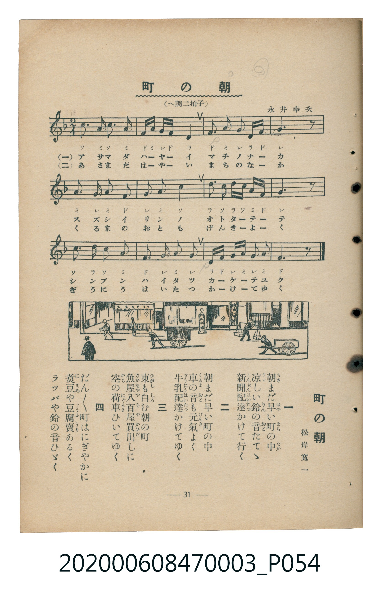

# 町の朝（街鎮之晨）

> Re:Shōka 使用 AI 協助辨識與重建樂譜，可能會有錯誤。歡迎回報。

- **NEUTRINO 歌聲合成版**：<br><audio controls src="machi_no_asa_neutrino.mp3"></audio>
- **鋼琴伴奏版**：<br><audio controls src="machi_no_asa.mp3"></audio>


- 臺灣教育會公認『新定兒童唱歌』尋常科第三學年用（第三學期・第3首）
- 國立臺灣歷史博物館典藏（典藏號：2020.006.0847.0003）

## 說明


- 出處：臺灣教育會公認、臺北新高堂發行《新定兒童唱歌》尋常科第三學年用（昭和6年／1931年），
第三學期第 3 首〈町の朝〉（街鎮之晨），原書第 31 頁（掃描檔 P054.jpg）。
- 詞曲：松岸寬一 作詞／永井幸次 作曲。
- 調性與拍號：ヘ調（F 大調），2/4 拍，速度 != 108。
- 背景與曲風：描寫清晨街鎮從破曉到熱鬧甦醒的生動畫面：第一段送報員搖著清脆鈴聲奔跑送報；
第二段送牛奶的推車精神奕奕地駛過；第三段東方泛白、魚店與蔬果店（八百屋）拉著空板車去批貨；
第四段賣滷豆（煮豆）與賣豆腐的小販吹著喇叭、搖著鈴走街串巷。
- 版本說明：本檔案為原書單聲部五線譜（附移動 Do 階名片假名）之忠實數位化版本。

### 編曲說明（鋼琴伴奏版）：

1. 前奏 (Intro, 4 小節)：引用第三段送報與送牛奶小販奔馳於清晨街道的輕快樂句開場。
2. 主歌伴奏 (MachiNoAsa, 12 小節 × 4 段)：右手演奏活潑的切分與附點旋律，左手以輕快的八分音符伴奏模擬清晨腳步與車輪聲。


## 歌詞

```text
一　朝（あさ）まだ早（はや）い町（まち）の中（なか）
涼（すゞ）しい鈴（りん）の音（おと）たてゝ
新聞配達（しんぶんはいたつ）かけて行（ゆ）く

二　朝まだ早い町の中
車（くるま）の音（おと）も元氣（げんき）よく
牛乳配達（ぎうにうはいたつ）かけてゆく

三　東（ひがし）も白（しろ）む朝の町
魚屋（さかなや）八百屋（やおや）買出（かひだ）しに
空（から）の荷車（にぐるま）ひいてゆく

四　だんだん町はにぎやかに
煮豆（にまめ）や豆腐賣（とうふうり）あるく
ラツパや鈴の音ひゞく
```

## ABC

```abc
X:1
T:町の朝（街鎮之晨）
M:2/4
L:1/16
Q:1/4=108
K:F
V:V1 name="Piano" snm="Pia"
[V:V1]
c2 A3 c A2 | F A G F D4 | F2 A2 G2 D F | G6 z2 |
w: 1.~あ さ ま だ | は _ や _ い | ま ち の な _ | か
w: 2.~あ さ ま だ | は _ や _ い | ま ち の な _ | か
w: 3.~ひ が し も | し _ ろ _ む | あ さ の ま _ | ち
w: 4.~だ ん だ ん | ま _ ち _ は | に ぎ や か _ | に
A2 G3 A F2 | G2 A2 c4 | d2 c2 d c A F | G6 z2 |
w: 1.~す づ し い | り ん の | お と た _ て _ | て
w: 2.~く る ま の | お と も | げ ん き _ よ _ | く
w: 3.~さ か な や | や を や | か ひ だ _ し _ | に
w: 4.~に ま め や | と う ふ | う り あ _ る _ | く
c2 d3 c A2 | F2 G2 A2 G2 | D F G A G2 A2 | F6 z2 |
w: 1.~し ん ぶ ん | は い た つ | か _ け _ て ゆ | く
w: 2.~ぎ う に う | は い た つ | か _ け _ て ゆ | く
w: 3.~か ら _ の | に ぐ る ま | ひ _ い _ て ゆ | く
w: 4.~ラ ツ パ や | り ん の お | と _ ひ _ び _ | く
```

## TMD 檔案連結

- [主旋律 TMD 檔案](machi_no_asa.tmd) [[在 TMD Studio 編輯](https://tmdlang.github.io/Tmd-TS/#tmd=s7IKdvYPcrWy4qpTUCpJTLdSSM7PyUlNLsnMz7MqzsjMK0nNjM_KTMmPL87Iz05Ugisry88pzU21Si9KTEmNN443MjAyiDcwMIs3sDAxBzIMjBFKi_NLi5JTrYqTM_Lzc-JLUitKkvLzsxHyBUX5Zal5iXlANQVFIBtTwIoQClLLMlNSQdKpKZkl-UWZiTlI7kgtKga7FWxJfElRYl5xclFmAcgDCFUlGalAx5Zk5qbG56fFpyRWIqSA5qVn5lmVJGYCfQjyZXlifG5iZl5OYl6KEpeWlsLzKbseN657Nmfu-z0dLxZOf9m37snO7mczV7zf06mgpcWlaKtgaGDBZW-r4MZlY6RvYgcy-UX7rueNi59NnfmiadOzOc1PW9e8WNX7uKHv2bQNT9fNeto66fnqpU-nbHy2tudxQ__TDd1Pd-x4vnzi8zVrnuzofLp2x9OdW55PAVrQARd5Nmf-4-bdQK7xy2XTgDaD3f90Tvfz1d1Qu9Zuf9q_6WnvrOedK18uWfG0dceL6f1AEyCMFzPnv98zCxRJesBI0gNFEpBhYAw2iUtfS8GWWoBLQUHhccOEZ7M3PZ-97sWqVc9m9D1umAgWbd79tH3Xi5lTgS7BET6NQPGnPdOBofRy9YynC5qez9zzYiEwiLqwhVs3nnB7NmPt00k9ZkD--z39hpbGhmBW5_s9PSCXKCgghyuQrWCsAAzWxw0d8Lh-3ABUjB7dQO1P--Y_m70DrMVQ4eWCRpBdfc3P-vufrZqiEGBgaqKXVZAOVPq4oQnq5xcr5wEDA-jnZ3P3Pd204-l6oM0NCk_2zgFKAB33bMOOJ7umPt2549mahSBRoFokvav2P2tY_qKj_Vl3LyQKHzfPAAoCbXVTeLpkOZgJchYw3SkA1QBZLxvmP921TAGSKpFMau55NnM9yKTZm14uAnpmFtDNT9evfrajFeg3iD-f7pv3fMGWZ7M7n3ZseN628eWa5c-nLHvZNun5rJbnU-Y_7Z76fOrql3MXAfWCg6_h2bqtLxsany7Y-HTywmcTpr2YOB1o2ouWtpcdW140bnq6dMqL7RMhCt7vmY0I9109EI3PO2c_XboNaPizvhUvdnc937Tv-dJ5T5dOBaE5G14un_2ysQ-oERJVQC3P5m58Nm3ns82zn8_cC0wqL9fOerprOtBHL6aseTZvDpANTu2rn8_c93RjNzBYnnV3Ap30fOWuZ3P3A81_2rf7WefOF5uAfkc45uns2UCTX2xe_Gz39hcb20A5rnUdmNEJMnnzYiD7ResEoCOfbuh_sWnl0wk7gWY-ndb-tH8t0A0QX4P8u3UDMAyf7Nj0dPt2RKA_7-x4NgeYskGZABTic9YAU8mzhR3Pm3ZB0tHTaeuAIfWyecWTXVOeb5_1Yu0coAtezmx5vnw3MLgVXPIVXs7qezqh93ln-9PGdiAD6C5gany6f8HT9cueTd3xZG_v055pEGtA1kIzH8RwYCYBJrGnrSueTWsHeubJjrUgxqp5L9auB-ZIUGBt6H3W3omcasEGAGP2cUMDpLx73Nj0uBGYYTsfN-573Ljg2fSVYMH1j5tawILAhLELLAKUXQgWWQe0Byyy6nEjKBZAJj7btgcsNPNxEzDJAxVNB-oEhhpIsKnrcdNkiM6X8zeDlXU9bgTltseN8x83LnvcNBdsxLQNLxrnvWztfdk4BaxoOlDb48ZtYHI90Diw6iVgbd2PGycCdQJLDrAFoMh83NgPMgWUpcEBAIyNp3NWPF2y8kXnpqcbZgH9BYxiSC54sRjokR5gzL6cvx-SnoHOf96xF6gAkrDBmQya7IFh9WL7elDagCX1Fw3AMmI3MDLgwbkLWFaBghMehJBggwQVSAUwcYK91P-4Cej0fdgDo6npaWvzsw2LwYKTwN4GpYbHTSCNIFOA2enJzs1IIdT3uLHtceNqMIk9hIBhQ3LAAB37Ys8qYDA82Tn_aWvrs937gV4DuwsUKvA8_WTXLmjYLJ3yctlmzFDZASwiG4BZGuzUTY8be4BRCvEnMHvDYhjiQ0jgrQOGGUgnKN-D8jdQxVSwT1ZBEiNS1gdGOtC3wIQFEn-xaTuw2gGrByoG2rQAlgRXg4NtJUyuCViQgkL-Re92WIwAA28CUqQANQPNxRFskOIJEnLP9uwA-gJUtE1fCS9eQSG0dhaoEJnUAy2zprYBi4Inu9qQyqYeeLEFQkATwIUXsHwBloaoQQgsu4BBCPQPODGASHCqAkY10Nl94CAAuhziSWihBvHSvsdNwHoLGLAtkNINWMyBpVaAk8pWENkE9D_Qw01gz4O9-rh55ePmlsfNE4HagPkAkkJBQdI0D0tgQHwMDAZQSICrEqAvX2zd_mQf0BU98PIWaxmLXJaCalxwYQtMcEDF0Jpl9mxgK-LF_i3AHAoND6D1lDddoEBBS5-LyzcxOSPTL9-xONEqIDMxL9-hxqCmGlxt2Fho2YEZ2FpNkIYFqGZU0DBRAPrn-foGHXgJC5JVMFQAFkyaWLQCrYUaCzTBSuFx0yIg3goO-nlA3KBQAyT7gXgPEC-B0E1LgPIgcZCKRiDuA-IusBxQtGk1uJ4DAajhNQqmChrGCrpAaKqpqqGrqwls-tQoaBgqGIO4mgoaRgqGEJZZPFBRDdC5xgpGChpAHlS8BsgF6TdQqAEb6WMItKmxSUEDmB_BEsAEpgkkFoDMBSZHBZCpwEQDooH5B2woUAkQLwTidSA1q0ByINFusAHxMJONaGayMUhsE0hFD9Tk6UAzmpogJk-HmtwLNrmpAWpyExBPhZm8D2byQlSTTUBiC0C6J0NNXgAyYzLEZLAuIA3UBHIz0AtgM1YDMTDmgF4BygGdCjF5Ndxk_OkN3KDCmd6MiE5vO4F4Fyi9NW0HpyxQuloFxJvB6QqSfB43gUQ6gPR-aEpsg6U2IAsjtRmDEhTIF-DkBfSXITj9GAOTIcjnZqDkCCSgac8YfxqbCQqdpUjxBYxzkIuA6R0YvqB4gYQmkN-4AqR2PjS0l8FCFMjASF_9oLiCJA9o-lqHZAooTUBMnQS2BWgaOFUA9XTATO3HkramQmMSbOoqUAqAuLUFiEEmwVJrNywdLoC6FZz2UGMfka5WQ9MQyNSmRripIHc2AuOhcSvUVCAbGCpAtUDHg90KT1MItxIow0AtbpxpypjoNAVMScD0AyrDpoFZ0DIMmLogKagFmqqAOQBcnm1ESlXLwDLrsZZhZhhlmCE4XRmB8hmisAKmPmjBBpIEKcJMVtORM-s2WGYFZU5QAgOlImCzCZJ9wcEIpCdCsu8yoNo2bEkAnLD6QCrboOauBqmHqKXAXHDS6ga5txMsAVYNSa6gImQCUB8oQe2DmLoJaiq0gMRpKihpNa8EqgTGBti1zRMRCRaRuUBZAmzuCqi5YPMfN26GJjqEqbVcXLp2CogqFGwNUESZCwA)]
- [鋼琴伴奏 TMD 檔案](machi_no_asa_piano.tmd) [[在 TMD Studio 編輯](https://tmdlang.github.io/Tmd-TS/#tmd=s7IKdvYPcrWy4tLSUng-ZdfjxnXP5sx9v6fjxcLpL_vWPdnZ_WzmisfNu19273k-YcuTPVueLu1_3tnxfk-ngpYWl6KtgqGBBZe9rYIbl42RvokdV52C0ov2Xc8bFz-bOvNF06Znc5qftq55sar3cUPfs2kbnq6b9bR10vPVS59O2fhsbc_jhv6nG7qf7tjxfPnE52vWPNnR-XTtjqc7tzyfsgLoArjIsznzgS4Aco1fLpsGtFkJZMvTOd3PV3dD7Vq7_Wn_pqe9s553rny5ZMXT1h0vpvcDTYAwXsyc_37PLCMDIwM9AwMzPQMLE3Mgw8AYbBKXvpaCLbUAl4KCwuOGCc9mb3o-e92LVauezeh73DARLNq8-2n7rhczpwJdgiN8GoHiT3umA0Pp5eoZTxc0PZ-558VCYBB1YQu3bjzh9mzG2qeTesyA_Pd7-g0tjQ3BrM73e3pALlFQQA5XIFvBWAEYrI8bOuCx_7gBqBglAUC0P-2b_2z2DrAWQ4WXCxpBdvU1P-vvf7ZqikKAgamJXlZBOlDp44YmqJ9frJwHDAygn5_N3fd0046n64E2Nyg82TsHKAF03LMNO57smvp0545naxaCRIFqkfSu2v-sYfmLjvZn3b2QKHzcPAMoCLTVTeHpkuVgJshZwHSnAFQDZL1smP901zIFSKpEmPR8-wqgyZD4AOrGTMpAsyFBY6in8LSzFyiuoOGZV1KUr6NgovB0Q__z9Q2aQDVP90wFhjAk-J6t2_qyofHpgo1ABwIZzztnP126Daj0xaaVT5dOebls87Npe57taAWGHSgcGyc_n9XyYs_Up_tXP1vR9LR_6ctp3U8XbIE6UUHBSE_hyY7dwJiFuEpBwzcxOSPTL9-xOFFHwdAI6gaFw9OB7gHaDHZM_-Znnd3P9kwBqn-2ZfezvROBVjztaH_a0QZy0syWl7vnPZve_XRfNyjmti8DKn6yeynEDSCVrauBKl_O3_x8zTKIpc9WLHw2eQ3Uza2bn61dCjTnxe6uF3tWvWiExQvleQQKFLT0ubjAYWwVkJmYlx_k4VBjUFMNDg4bCy07MKNGwVRBw0xBFwhNNVU1dHU1gYm1RsFQwQhIGwFZGmbxCoYgGU0FDaAYhAWSBCkCaTNQqOGqRbHIB7tFhvEK0YaxCqYQqkYBaHC0WS5EwBQkYAJkmCDxoRpAGGoJIs7weAlbcQPJkQ3AiFXQgKc3LMqAQQYPFWOMUNEwhAUAMCiggQL0hS44LEDBhRRYNUAuLHhARvoY1ig8bmxS0HjcOBUs8bhxnyaQWAAy93HjegWQqY-bWkD040YgBRQHKgHihUC8DqRmFUgOJNoNNiAeZrIRzUw2BoltAqnogZo8HWhGUxPE5OlQk3vBJjc1QE1uAuKpMJP3wUxeiGqyCUhsAUj3ZKjJC0BmTIaYDNYFpIGaQG4GegFsxmog7gOqagHJAZ0KMXk13GT80b-rh_joNwbFMMhYcHwDLTIER6gxMF2AnGIGyTXgtAF0qDH-SJ8Jcu5SpAAERgJQvKkL7GFQQEG8B-Q3rgCpnQ_1_jKYF4EMjAgHFmGPmyDxBY3wdUimgCIJYuoksC1A08DRBNTTATO1H0tkT4UGLdjUVaAogbi1BYhBJsGSTzcsYSyAuhWcGFCjAxHRq6GRCjK1qRFuKsidjW1AvBVqKpANDBWgWqDjwW6FRzLCrQTyOKjaID6PU1zyIWJ5OnJi3gZLzKDEC4pvUKQ-blwCSd5gXwHpiZDkvQyotg1bjIDjuQ-ksg1q7mqQeohaCswFx3Q3yL2dYAmwakjqAWWxCUB9oPjdBzF1E9RUaAGC01RQTDevBKpsBiUSoGubJyLSDyKtg1Io2NwVUHPB5j9u3AxNAwhTsRT4WKsWqhT46LUTlA-rpLAIQOspIAVKCNQre9BdArUHKgyvJuF8UtxBSvagQn2ta6cAbhcoABmIqIz2AapAEzHCEDHGEAHaBRRR5gIA)]

## 分析

```text
================================================================================
📊 TMD Song Profile: [ 町の朝（街鎮之晨） ]
================================================================================
⏱  Duration:       0:13 (13.3s), 12 measures total
🎼 Key & Tempo:    首調基準 F, != 108.0 BPM, <2/4>
   - 分析範圍：      由實際發聲的音符與和弦推測調性；播放脈絡另行呈現
🎤 人聲音域:    D4 (MIDI 62) – D5 (MIDI 74) [跨度: 12 個半音 / 1.0 個八度, 難度: easy]
   - 最低音:  D4 in [MachiNoAsa #1 @ m.2, 0:01]
   - 最高音: D5 in [MachiNoAsa #1 @ m.7, 0:06]
   - 適合: soprano, mezzo-soprano, contralto, tenor, baritone, bass
🏛  結構:      MachiNoAsa (13.3s)
⚡ 編曲密度:        Peak 1 軌道同時演奏
🗝  調性診斷：       C 調性不明確（純淨自然大調，未偵測到可信轉調）
   - 風格氣質:    純淨自然大調（陽光明朗、易唱易記，無明顯調外色彩）
   - 轉調歷程:    全曲維持單一推測調性（未偵測到可信轉調）
   - 核心骨幹音:  G, A, F, C, D
   - 調性數值:    C 調性不明確 [相關度: 0.67, 穩定度: Ambiguous, 自然音純度: 100.0%]
   - 候選調性 (K-S): C 大調 (0.67), F 大調 (0.63), G 大調 (0.59)
   - 五度圈歷程:   +0
   - 各段落調性細節:
     • [MachiNoAsa #1]: C 調性不明確 (r: 0.67, 自然音純度: 100.0%)

  [ 五度圈游移軌跡 ]
              [C ]*
         F            G  
      Bb               D  
      Eb               A  
         Ab           E  
            Db       B  
               F# 
     (* = active key center)

  [ 十二半音累積音高分佈 ]
     C  : ████████████              14.4%
     C# :                            0.0%
     D  : ███████████               13.3%
     D# :                            0.0%
     E  :                            0.0%
     F  : ███████████████           18.9%
     F# :                            0.0%
     G  : ████████████████████████  30.0%
     G# :                            0.0%
     A  : ███████████████████       23.3%
     A# :                            0.0%
     B  :                            0.0%
--------------------------------------------------------------------------------
Assignment 軌道音域：
  - Piano         : D4 – D5 (12 個半音 / 1.0 個八度, 44 個音符)
================================================================================
```


## 原書掃描頁




