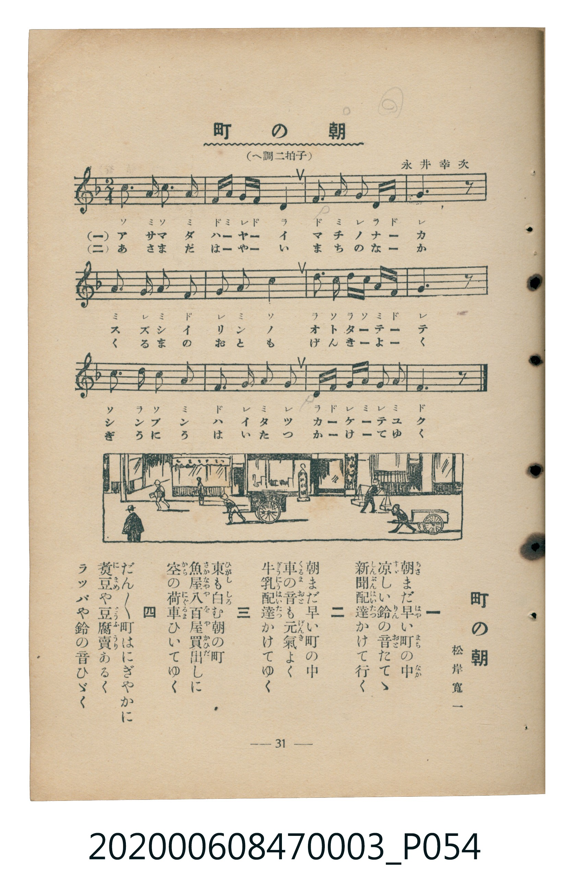

# 町の朝（街鎮之晨）

> Re:Shoka 使用 AI 協助辨識與重建樂譜，可能會有錯誤。歡迎回報。

<audio controls src="machi_no_asa.mp3"></audio>

- 臺灣教育會公認『新定兒童唱歌』尋常科第三學年用（第三學期・第3首）
- 國立臺灣歷史博物館典藏（典藏號：2020.006.0847.0003）

## 說明

【曲目說明】
・出處：臺灣教育會公認、臺北新高堂發行《新定兒童唱歌》尋常科第三學年用（昭和6年／1931年），
第三學期第 3 首〈町の朝〉（街鎮之晨），原書第 31 頁（掃描檔 P054.jpg）。
・詞曲：松岸寬一 作詞／永井幸次 作曲。
・調性與拍號：ヘ調（F 大調），2/4 拍，速度 != 108。
・背景與曲風：描寫清晨街鎮從破曉到熱鬧甦醒的生動畫面：第一段送報員搖著清脆鈴聲奔跑送報；
第二段送牛奶的推車精神奕奕地駛過；第三段東方泛白、魚店與蔬果店（八百屋）拉著空板車去批貨；
第四段賣滷豆（煮豆）與賣豆腐的小販吹著喇叭、搖著鈴走街串巷。
・版本說明：本檔案為原書單聲部五線譜（附移動 Do 階名片假名）之忠實數位化版本。

・編曲說明（鋼琴伴奏版）：
1. 前奏 (Intro, 4 小節)：引用第三段送報與送牛奶小販奔馳於清晨街道的輕快樂句開場。
2. 主歌伴奏 (MachiNoAsa, 12 小節 × 4 段)：右手演奏活潑的切分與附點旋律，左手以輕快的八分音符伴奏模擬清晨腳步與車輪聲。

## 歌詞

```text
一　朝（あさ）まだ早（はや）い町（まち）の中（なか）
涼（すゞ）しい鈴（りん）の音（おと）たてゝ
新聞配達（しんぶんはいたつ）かけて行（ゆ）く

二　朝まだ早い町の中
車（くるま）の音（おと）も元氣（げんき）よく
牛乳配達（ぎうにうはいたつ）かけてゆく

三　東（ひがし）も白（しろ）む朝の町
魚屋（さかなや）八百屋（やおや）買出（かひだ）しに
空（から）の荷車（にぐるま）ひいてゆく

四　だんだん町はにぎやかに
煮豆（にまめ）や豆腐賣（とうふうり）あるく
ラツパや鈴の音ひゞく
```

## ABC

```abc
X:1
T:町の朝（街鎮之晨）
M:2/4
L:1/16
Q:1/4=108
K:F
V:V1 name="Piano" snm="Pia"
[V:V1]
c2 A3 c A2 | F A G F D4 | F2 A2 G2 D F | G6 z2 |
A2 G3 A F2 | G2 A2 c4 | d2 c2 d c A F | G6 z2 |
c2 d3 c A2 | F2 G2 A2 G2 | D F G A G2 A2 | F6 z2 |
```

## TMD 檔案連結

- [主旋律 TMD 檔案](machi_no_asa.tmd) [[在 TMD Studio 編輯](https://tmdlang.github.io/Tmd-TS/#tmd=s7IKdvYPcrWy4qpTUCpJTLdSSM7PyUlNLsnMz7MqzsjMK0nNjM_KTMmPL87Iz05Ugisry88pzU21Si9KTEmNN443MjAyiDcwMIs3sDAxBzIMjBFKi_NLi5JTrYqTM_Lzc-JLUitKkvLzsxHyBUX5Zal5iXlANQVFIBtTwIoQClLLMlNSQdKpKZkl-UWZiTlI7kgtKga7FWxJfElRYl5xclFmAcgDCFUlGalAx5Zk5qbG56fFpyRWKnFpaSk8n7LrceO6Z3Pmvt_T8WLh9Jd9657s7H42c8X7PZ0KWlpcirYKhgYWXPa2Cm5cNkb6JnYg416073reuPjZ1JkvmjY9m9P8tHXNi1W9jxv6nk3b8HTdrKetk56vXvp0ysZna3seN_Q_3dD9dMeO58snPl-z5smOzqdrdzzdueX5FKAFHXCRZ3PmP27eDeQav1w2DWgz2NFP53Q_X90NtWvt9qf9m572znreufLlkhVPW3e8mN4PNAHCeDFz_vs9s0DBrwcMfj1Q8AMZBsZgk7j0tRRsqQW4FBQUHjdMeDZ70_PZ616sWvVsRt_jholg0ebdT9t3vZg5FegSHOHTCBR_2jMdGEovV894uqDp-cw9LxYCg6gLW7h14wm3ZzPWPp3UYwbkv9_Tb2hpbAhmdb7f0wNyiYICcrgC2QrGCsBgfdzQAY_rxw1AxejRDdT-tG_-s9k7wFoMFV4uaATZ1df8rL__2aopCgEGpiZ6WQXpQKWPG5qgfn6xch4wMIB-fjZ339NNO56uB9rcoPBk7xygBNBxzzbseLJr6tOdO56tWQgSBapF0rtq_7OG5S862p9190Ki8HHzDKAg0FY3hadLloOZIGcB050CUA2Q9bJh_tNdyxQgqRLJpOaeZzPXg0yavenlIqBnZgHd_HT96mc7WoF-g_jz6b55zxdseTa782nHhudtG1-uWf58yrKXbZOez2p5PmX-0-6pz6eufjl3EVAvOPganq3b-rKh8emCjU8nL3w2YdqLidOBpr1oaXvZseVF46anS6e82D4RouD9ntmIcN_VA9H4vHP206XbgIY_61vxYnfX8037ni-d93TpVBCas-Hl8tkvG_uAGiFRBdTybO7GZ9N2Pts8-_nMvcCk8nLtrKe7pgN99GLKmmfz5gDZ4NS--vnMfU83dgOD5Vl3J9BJz1fuejZ3P9D8p327n3XufLEJ6HeEY57Ong00-cXmxc92b3-xsQ2U41rXgRmdIJM3LwayX7ROADry6Yb-F5tWPp2wE2jm02ntT_vXAt0A8TXIv1s3AMPwyY5NT7dvRwT6886OZ3OAKRuUCUAhPmcNMJU8W9jxvGkXJB09nbYOGFIvm1c82TXl-fZZL9bOAbrg5cyW58t3A4NbwSVf4eWsvqcTep93tj9tbAcygO4Cpsan-xc8Xb_s2dQdT_b2Pu2ZBrEGZC0080EMB2YSYBJ72rri2bR2oGee7FgLYqya92LtemCOBAXWht5n7Z3IqRZsADBmHzc0QMq7x41NjxuBGbbzceO-x40Lnk1fCRZc_7ipBSwITBi7wCJA2YVgkXVAe8Aiqx43gmIBZOKzbXvAQjMfNwGTPFDRdKBOYKiBBJu6HjdNhuh8OX8zWFnX40ZQbnvcOP9x47LHTXPBRkzb8KJx3svW3peNU8CKpgO1PW7cBibXA40Dq14C1tb9uHEiUCew5ABbAIrMx439IFNAWRocAMDYeDpnxdMlK190bnq6YRbQX8AohuSCF4uBHukBxuzL-fsh6Rno_Ocde4EKIAkbnMmgyR4YVi-2rwelDVhSf9EALCN2AyMDHpy7gGUVKDjhQQgJNkhQgVQAEyfYS_2Pm4BO34c9MJqanrY2P9uwGCw4CextUGp43ATSCDIFmJ2e7NyMFEJ9jxvbHjeuBpPYQwgYNiQHDNCxL_asAgbDk53zn7a2Ptu9H-g1sLtAoQLP00927YKGzdIpL5dtxgyVHcAisgGYpcFO3fS4sQcYpRB_ArM3LIYhPoQE3jpgmIF0gvI9KH8DVUwF-2QVJDEiZX1gpAN9C0xYIPEXm7YDqx2weqBioE0LYElwNTjYVsLkmoAFKSjkX_Ruh8UIMPAmIEUKUDPQXBzBBimeICH3bM8OoC9ARdv0lfDiFRRCa2eBCpFJPdAya2obsCh4sqsNqWzqgRdbIAQ0AVx4AcsXYGmIGoTAsgsYhED_gBMDiASnKmBUA53dBw4CoMshnoQWahAv7XvcBKy3gAHbAindgMUcWGoFOKlsBZFNQP8DPdwE9jzYq4-bVz5ubnncPBGoDZgPICkUFCRN87AEBsTHwGAAhQS4KgH68sXW7U_2AV3RAy9vsZaxyGUpqMYFF7bABAdUDK1ZZs8GtiJe7N8CzKHQ8ABaT3nTBQoUtPS5uHwTkzMy_fIdixOtAjIT8_IdagxqFKrB9YaNhZYdmIGt2QRpWYCqRgUNEwWgh56vb9CBF7EgWQVDBWDJpIlFK9BeqLFAE6wUHjctAuKt4LCfB8QNCjVAsh-I9wDxEgjdtAQoDxIHqWgE4j4g7gLLAUWbVoMrOhCAGl6jYKqgYaygq6tgqqmqoaurCWz61ChoGCoYg7iaChpGCoYQllm8gi5QCiijYKSgAeRBxWuAXF0gNFCoASdD3MEAruhxBoMR0cGwE4h3gYKhaTvYwyDvrgLizWDvQnz1uAkk0gGk90MDqA0WCEAWRiAYgzwKDASwr4GeMgR7yxgYOCA_m4ECCUhAg8SYdK-DGyw4vW5MtNeBHgZ6E5QCpoFZ0BQADASIR1ugnl8NTQ0bkTy_DCyzHmsKMENPAYZg7xuB0gIiqoFhBE0WIEmQIpjva7m4dO0UEJkExFPm4gIA)]
- [鋼琴伴奏 TMD 檔案](machi_no_asa_piano.tmd) [[在 TMD Studio 編輯](https://tmdlang.github.io/Tmd-TS/#tmd=s7IKdvYPcrWy4tLSUng-ZdfjxnXP5sx9v6fjxcLpL_vWPdnZ_WzmisfNu19273k-YcuTPVueLu1_3tnxfk-ngpYWl6KtgqGBBZe9rYIbl42RvokdV52C0ov2Xc8bFz-bOvNF06Znc5qftq55sar3cUPfs2kbnq6b9bR10vPVS59O2fhsbc_jhv6nG7qf7tjxfPnE52vWPNnR-XTtjqc7tzyfsgLoArjIsznzgS4Aco1fLpsGtFkJZMvTOd3PV3dD7Vq7_Wn_pqe9s553rny5ZMXT1h0vpvcDTYAwXsyc_37PLCMDIwM9AwMzPQMLE3Mgw8AYbBKXvpaCLbUAl4KCwuOGCc9mb3o-e92LVauezeh73DARLNq8-2n7rhczpwJdgiN8GoHiT3umA0Pp5eoZTxc0PZ-558VCYBB1YQu3bjzh9mzG2qeTesyA_Pd7-g0tjQ3BrM73e3pALlFQQA5XIFvBWAEYrI8bOuCx_7gBqBglAUC0P-2b_2z2DrAWQ4WXCxpBdvU1P-vvf7ZqikKAgamJXlZBOlDp44YmqJ9frJwHDAygn5_N3fd0046n64E2Nyg82TsHKAF03LMNO57smvp0545naxaCRIFqkfSu2v-sYfmLjvZn3b2QKHzcPAMoCLTVTeHpkuVgJshZwHSnAFQDZL1smP901zIFSKpEmPR8-wqgyZD4AOrGTMpAsyFBY6in8LSzFyiuoOGZV1KUr6NgovB0Q__z9Q2aQDVP90wFhjAk-J6t2_qyofHpgo1ABwIZzztnP126Daj0xaaVT5dOebls87Npe57taAWGHSgcGyc_n9XyYs_Up_tXP1vR9LR_6ctp3U8XbIE6UUHBSE_hyY7dwJiFuEpBwzcxOSPTL9-xOFFHwdAI6gaFw9OB7gHaDHZM_-Znnd3P9kwBqn-2ZfezvROBVjztaH_a0QZy0syWl7vnPZve_XRfNyjmti8DKn6yeynEDSCVrauBKl_O3_x8zTKIpc9WLHw2eQ3Uza2bn61dCjTnxe6uF3tWvWiExQvleQQKFLT0ubjAYWwVkJmYlx_k4VBjUKNQDQ4PGwstOzCjRsFUQcNMQVdXwVRTVUNXVxOYWGsUDBWMgLQRkKVhFq9gCJLRVNAAikFYIEmQIl0gNFCo4apFscgHh0WG8QrRhrEKphCqRgFocrRZLkTAFCRgAmSYIPGhGkAYagsi0vD5CVuBA8mTDcCoVdCApzgsyoCBBg8WY_Rg0TCEhQAwLKChAvSFLjgwQOGFFFo1QC4sfPC7alcP8a4yBtkMdBXYGUBbDMH2GANdC3KEGSQywU4GutGYdLeAsx3xIUSFhIMepdhTD1WiFD0BQvmwdIhFAJoUgRR1oxHdJVB7oMLwnADnk-IOUqKQCllS104BnPcVgAxEXJLGU-biAgA)]

## 分析

```text
================================================================================
📊 TMD Song Profile: [ 町の朝（街鎮之晨） ]
================================================================================
⏱  Duration:       0:13 (13.3s), 12 measures total
🎼 Key & Tempo:    首調基準 F, != 108.0 BPM, <2/4>
   - 分析範圍：      由實際發聲的音符與和弦推測調性；播放脈絡另行呈現
🎤 人聲音域:    D4 (MIDI 62) – D5 (MIDI 74) [跨度: 12 個半音 / 1.0 個八度, 難度: easy]
   - 最低音:  D4 in [MachiNoAsa #1 @ m.2, 0:01]
   - 最高音: D5 in [MachiNoAsa #1 @ m.7, 0:06]
   - 適合: soprano, mezzo-soprano, contralto, tenor, baritone, bass
🏛  結構:      MachiNoAsa (13.3s)
⚡ 編曲密度:        Peak 1 軌道同時演奏
🗝  調性診斷：       C 調性不明確（純淨自然大調，未偵測到可信轉調）
   - 風格氣質:    純淨自然大調（陽光明朗、易唱易記，無明顯調外色彩）
   - 轉調歷程:    全曲維持單一推測調性（未偵測到可信轉調）
   - 核心骨幹音:  G, A, F, C, D
   - 調性數值:    C 調性不明確 [相關度: 0.67, 穩定度: Ambiguous, 自然音純度: 100.0%]
   - 候選調性 (K-S): C 大調 (0.67), F 大調 (0.63), G 大調 (0.59)
   - 五度圈歷程:   +0
   - 各段落調性細節:
     • [MachiNoAsa #1]: C 調性不明確 (r: 0.67, 自然音純度: 100.0%)

  [ 五度圈游移軌跡 ]
              [C ]*
         F            G  
      Bb               D  
      Eb               A  
         Ab           E  
            Db       B  
               F# 
     (* = active key center)

  [ 十二半音累積音高分佈 ]
     C  : ████████████              14.4%
     C# :                            0.0%
     D  : ███████████               13.3%
     D# :                            0.0%
     E  :                            0.0%
     F  : ███████████████           18.9%
     F# :                            0.0%
     G  : ████████████████████████  30.0%
     G# :                            0.0%
     A  : ███████████████████       23.3%
     A# :                            0.0%
     B  :                            0.0%
--------------------------------------------------------------------------------
Assignment 軌道音域：
  - Piano         : D4 – D5 (12 個半音 / 1.0 個八度, 44 個音符)
================================================================================
```


## 原書掃描頁




