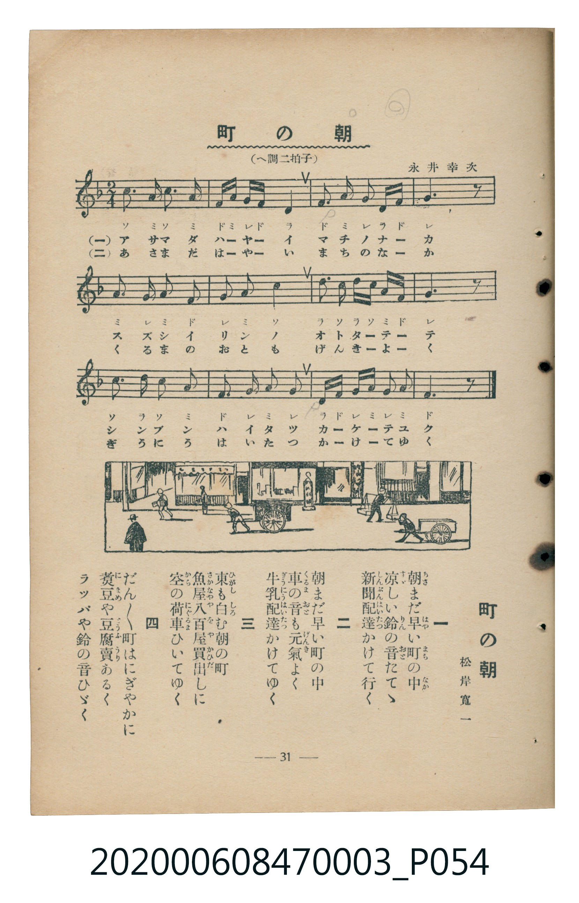

# 町の朝（街鎮之晨）

> Re:Shōka 使用 AI 協助辨識與重建樂譜，可能會有錯誤。歡迎回報。

- **鋼琴伴奏版**：<br><audio controls src="machi_no_asa.mp3"></audio>
- **NEUTRINO 歌聲合成版**：<br><audio controls src="machi_no_asa_neutrino.mp3"></audio>

- 臺灣教育會公認『新定兒童唱歌』尋常科第三學年用（第三學期・第3首）
- 國立臺灣歷史博物館典藏（典藏號：2020.006.0847.0003）

## 說明


- 出處：臺灣教育會公認、臺北新高堂發行《新定兒童唱歌》尋常科第三學年用（昭和6年／1931年），
第三學期第 3 首〈町の朝〉（街鎮之晨），原書第 31 頁（掃描檔 P054.jpg）。
- 詞曲：松岸寬一 作詞／永井幸次 作曲。
- 調性與拍號：ヘ調（F 大調），2/4 拍，速度 != 108。
- 背景與曲風：描寫清晨街鎮從破曉到熱鬧甦醒的生動畫面：第一段送報員搖著清脆鈴聲奔跑送報；
第二段送牛奶的推車精神奕奕地駛過；第三段東方泛白、魚店與蔬果店（八百屋）拉著空板車去批貨；
第四段賣滷豆（煮豆）與賣豆腐的小販吹著喇叭、搖著鈴走街串巷。
- 版本說明：本檔案為原書單聲部五線譜（附移動 Do 階名片假名）之忠實數位化版本。

### 編曲說明（鋼琴伴奏版）：

1. 前奏 (Intro, 4 小節)：引用第三段送報與送牛奶小販奔馳於清晨街道的輕快樂句開場。
2. 主歌伴奏 (MachiNoAsa, 12 小節 × 4 段)：右手演奏活潑的切分與附點旋律，左手以輕快的八分音符伴奏模擬清晨腳步與車輪聲。


## 歌詞

```text
一　朝（あさ）まだ早（はや）い町（まち）の中（なか）
涼（すゞ）しい鈴（りん）の音（おと）たてゝ
新聞配達（しんぶんはいたつ）かけて行（ゆ）く

二　朝まだ早い町の中
車（くるま）の音（おと）も元氣（げんき）よく
牛乳配達（ぎうにうはいたつ）かけてゆく

三　東（ひがし）も白（しろ）む朝の町
魚屋（さかなや）八百屋（やおや）買出（かひだ）しに
空（から）の荷車（にぐるま）ひいてゆく

四　だんだん町はにぎやかに
煮豆（にまめ）や豆腐賣（とうふうり）あるく
ラツパや鈴の音ひゞく
```

## ABC

<div class="abc-score" data-abc-src="machi_no_asa.abc" aria-label="五線譜載入中"></div>

[下載 ABC 原始檔](machi_no_asa.abc)

## TMD 檔案連結

- [主旋律 TMD 檔案](machi_no_asa.tmd) [[在 TMD Studio 編輯](https://tmdlang.github.io/Tmd-TS/#tmd=s7IKdvYPcrWy4qpTUCpJTLdSSM7PyUlNLsnMz7MqzsjMK0nNjM_KTMmPL87Iz05Ugisry88pzU21Si9KTEmNN443MjAyiDcwMIs3sDAxBzIMjBFKi_NLi5JTrYqTM_Lzc-JLUitKkvLzsxHyBUX5Zal5iXlANQVFIBtTwIoQClLLMlNSQdKpKZkl-UWZiTlI7kgtKga7FWxJfElRYl5xclFmAcgDCFUlGalAx5Zk5qbG56fFpyRWIqSA5qVn5lmVJGYCfQjyZXlifG5iZl5OYl4KsqqSjHygZwsyKq0yMotBrkhOzInPTsxDChOoGwoS01OtAgxMTZS4tLQUnk_Z9bhx3bM5c9_v6XixcPrLvnVPdnY_m7ni_Z5OBS0tLkVbBUMDCy57WwU3LhsjfRM7kGkv2nc9b1z8bOrMF02bns1pftq65sWq3scNfc-mbXi6btbT1knPVy99OmXjs7U9jxv6n27ofrpjx_PlE5-vWfNkR-fTtTue7tzyfArQgg64yLM58x837wZyjV8umwa0Gezmp3O6n6_uhtq1dvvT_k1Pe2c971z5csmKp607XkzvB5oAYbyYOf_9nlmgONYDxrEeKI6BDANjsElc-loKttQCXAoKCo8bJjybven57HUvVq16NqPvccNEsGjz7qftu17MnAp0CY7waQSKP-2ZDgyll6tnPF3Q9HzmnhcLgUHUhS3cuvGE27MZa59O6jED8t_v6Te0NDYEszrf7-kBuURBATlcgWwFYwVgsD5u6IDH9eMGoGL06AZqf9o3_9nsHWAthgovFzSC7Oprftbf_2zVFAVQktHLKkgHKn3c0AT184uV84CBAfTzs7n7nm7a8XQ90OYGhSd75wAlgI57tmHHk11Tn-7c8WzNQpAoUC2S3lX7nzUsf9HR_qy7FxKFj5tnAAWBtropPF2yHMwEOQuY7hSAaoCslw3zn-5apgBJlUgmNfc8m7keZNLsTS8XAT0zC-jmp-tXP9vRCvQbxJ9P9817vmDLs9mdTzs2PG_b-HLN8udTlr1sm_R8VsvzKfOfdk99PnX1y7mLgHrBwdfwbN3Wlw2NTxdsfDp54bMJ015MnA407UVL28uOLS8aNz1dOuXF9okQBe_3zEaE-64eiMbnnbOfLt0GNPxZ34oXu7ueb9r3fOm8p0ungtCcDS-Xz37Z2AfUCIkqoJZnczc-m7bz2ebZz2fuBSaVl2tnPd01HeijF1PWPJs3B8gGp_bVz2fue7qxGxgsz7o7gU56vnLXs7n7geY_7dv9rHPni01AvyMc83T2bKDJLzYvfrZ7-4uNbaAc17oOzOgEmbx5MZD9onUC0JFPN_S_2LTy6YSdQDOfTmt_2r8W6AaIr0H-3boBGIZPdmx6un07ItCfd3Y8mwNM2aBMAArxOWuAqeTZwo7nTbsg6ejptHXAkHrZvOLJrinPt896sXYO0AUvZ7Y8X74bGNwKLvkKL2f1PZ3Q-7yz_WljO5ABdBcwNT7dv-Dp-mXPpu54srf3ac80iDUga6GZD2I4MJMAk9jT1hXPprUDPfNkx1oQY9W8F2vXA3MkKLA29D5r70ROtWADgDH7uKEBUt49bmx63AjMsJ2PG_c9blzwbPpKsOD6x00tYEFgwtgFFgHKLgSLrAPaAxZZ9bgRFAsgE59t2wMWmvm4CZjkgYqmA3UCQw0k2NT1uGkyROfL-ZvByroeN4Jy2-PG-Y8blz1umgs2YtqGF43zXrb2vmycAlY0HajtceM2MLkeaBxY9RKwtu7HjROBOoElB9gCUGQ-buwHmQLK0uAAAMbG0zkrni5Z-aJz09MNs4D-AkYxJBe8WAz0SA8wZl_O3w9Jz0DnP-_YC1QASdjgTAZN9sCwerF9PShtwJL6iwZgGbEbGBnw4NwFLKtAwQkPQkiwQYIKpAKYOMFe6n_cBHT6PuyB0dT0tLX52YbFYMFJYG-DUsPjJpBGkCnA7PRk52akEOp73Nj2uHE1mMQeQsCwITlggI59sWcVMBie7Jz_tLX12e79QK-B3QUKFXiefrJrFzRslk55uWwzZqjsABaRDcAsDXbqpseNPcAohfgTmL1hMQzxISTw1gHDDKQTlO9B-RuoYirYJ6sgiREp6wMjHehbYMICib_YtB1Y7YDVAxUDbVoAS4KrwcG2EibXBCxIQSH_onc7LEaAgTcBKVKAmoHm4gg2SPEECblne3YAfQEq2qavhBevoBBaOwtUiEzqgZZZU9uARcGTXW1IZVMPvNgCIaAJ4MILWL4AS0PUIASWXcAgBPoHnBhAJDhVAaMa6Ow-cBAAXQ7xJLRQg3hp3-MmYL0FDNgWSOkGLObAUivASWUriGwC-h_o4Saw58Fefdy88nFzy-PmiUBtwHwASaGgIGmahyUwID4GBgMoJMBVCdCXL7Zuf7IP6IoeeHmLtYxFLktBNS64sAUmOKBiaM0yezawFfFi_xZgDoWGB9B6ypsuUKCgpc_F5ZuYnJHpl-9YnGgVkJmYl-9QY1BTDa42bCy07MAMbK0mSMMCVDMqaJgoAP3zfH2DDryEBckqGCoACyZNLFqB1kKNBZpgpfC4aREQbwUH_TwgblCoAZL9QLwHiJdA6KYlQHmQOEhFIxD3AXEXWA4o2rQaXM-BANTwGgVTBQ1jBV0gNNVU1dDV1QQ2fWoUNAwVjEFcTQUNIwVDCMssHqioBuhcYwUjBQ0gDypeA-SC9Bso1ICN9DEE2tTYpKABzI9gCWAC0wQSC0DmApOjAshUYKIB0cD8AzYUqASIFwLxOpCaVSA5kGg32IB4mMlGNDPZGCS2CaSiB2rydKAZTU0Qk6dDTe4Fm9zUADW5CYinwkzeBzN5IarJJiCxBSDdk6EmLwCZMRliMlgXkAZqArkZ6AWwGauBGBhzQK8A5YBOhZi8Gm4y_vQGblDhTG9GRKe3nUC8C5TemraDUxYoXa0C4s3gdAVJPo-bQCIdQHo_NCW2wVIbkIWR2oxBCQrkC3DyAvrLEJx-jIHJEORzM1ByBBLQtGeMP43NBIXOUqT4AsY5yEXA9A4MX1C8QEITyG9cAVI7Hxray2AhCmRgpK9-UFxBkgc0fa1DMgWUJiCmTgLbAjQNnCqAejpgpvZjSVtToTEJNnUVKAVA3NoCxCCTYKm1G5YOF0DdCk57qLGPSFeroWkIZGpTI9xUkDsbgfHQuBVqKpANDBWgWqDjwW6FpymEWwmUYaAWN840ZUx0mgKmJGD6AZVh08AsaBkGTF2QFNQCTVXAHAAuzzYipaplYJn1WMswM4wyzBCcroxA-QxRWAFTH7RgA0mCFGEmq-nImXUbLLOCMicogYFSEbDZBMm-4GAE0hMh2XcZUG0btiQATlh9IJVtUHNXg9RD1FJgLjhpdYPc2wmWAKuGJFdQETIBqA-UoPZBTN0ENRVaQOI0FZS0mlcCVQJjA-za5omIBIvIXKAsATZ3BdRcsPmPGzdDEx3C1FouLl07BUQVCrYGKKLMBQA)]
- [鋼琴伴奏 TMD 檔案](machi_no_asa_piano.tmd) [[在 TMD Studio 編輯](https://tmdlang.github.io/Tmd-TS/#tmd=s7IKdvYPcrWy4qpTUCpJTLdSyC8qychPL0osyKi0ysgsLskvykxOzInPTsxLVIIrKs4vLUpOjS9ITE-1CjAwNVHi0tJSeD5l1-PGdc_mzH2_p-PFwukv-9Y92dn9bOaKx827X3bveT5hy5M9W54u7X_e2fF-T6eClhaXoq2CoYEFl72tghuXjZG-iR3I_Bftu543Ln42deaLpk3P5jQ_bV3zYlXv44a-Z9M2PF0362nrpOerlz6dsvHZ2p7HDf1PN3Q_3bHj-fKJz9esebKj8-naHU93bnk-ZQXQBXCRZ3PmA10A5Bq_XDYNaDPYF0_ndD9f3Q21a-32p_2bnvbOet658uWSFU9bd7yY3g80AcJ4MXP--z2zjAyMDPQMDMz0DCxMzIEMA2OwSVz6Wgq21AJcCgoKjxsmPJu96fnsdS9WrXo2o-9xw0SwaPPup-27XsycCnQJjvBpBIo_7ZkODKWXq2c8XdD0fOaeFwuBQdSFLdy68YTbsxlrn07qMQPy3-_pN7Q0NgSzOt_v6QG5REEBOVyBbAVjBWCwPm7ogMf-4wagYpQEANH-tG_-s9k7wFoMFV4uaATZ1df8rL__2aopCqBEpJdVkA5U-rihCernFyvnAQMD6Odnc_c93bTj6XqgzQ0KT_bOAUoAHfdsw44nu6Y-3bnj2ZqFIFGgWiS9q_Y_a1j-oqP9WXcvJAofN88ACgJtdVN4umQ5mAlyFjDdKQDVAFkvG-Y_3bVMAZIqESY9374CaDIkPoC6MZMy0GxI0BjqKTzt7AWKK2h45pUU5esomCg83dD_fH2DJlDN0z1TgSEMCb5n67a-bGh8umAj0IFAxvPO2U-XbgMqfbFp5dOlU14u2_xs2p5nO1qBYQcKx8bJz2e1vNgz9en-1c9WND3tX_pyWvfTBVugTlRQMNJTeLJjNzBmIa5S0PBNTM7I9Mt3LE7UUTA0grpB4fB0oHuANoMd07_5WWf3sz1TgOqfbdn9bO9EoBVPO9qfdrSBnDSz5eXuec-mdz_d1w2Kue3LgIqf7F4KcQNIZetqoMqX8zc_X7MMYumzFQufTV4DdXPr5mdrlwLNebG768WeVS8aYfFCeR6BAgUtfS4ucBhbBWQm5uUHeTjUGNRUg4PDxkLLDsyoUTBV0DBT0AVCU01VDV1dTWBirVEwVDAC0kZAloZZvIIhSEZTQQMoBmGBJEGKQNoMFGq4alEs8sFukWG8QrRhrIIphKpRABocbZYLETAFCZgAGSZIfKgGEIZagogzPF7CVtxAcmQDMGIVNODpDYsyYJDBQ8UYI1Q0DGEBAAwKaKAAfaELDgtQcCEFVg2QCwsekJE-hjUKjxubFDQeN04FSzxu3KcJJBaAzH3cuF4BZOrjphYQ_bgRSAHFgUqAeCEQrwOpWQWSA4l2gw2Ih5lsRDOTjUFim0AqeqAmTwea0dQEMXk61OResMlNDVCTm4B4KszkfTCTF6KabAISWwDSPRlq8gKQGZMhJoN1AWmgJpCbgV4Am7EaiPuAqlpAckCnQkxeDTcZf_Tv6iE--o1BMQwyFhzfQIsMwRFqDEwXIKeYQXINOG0AHWqMP9Jngpw7CykAgZEAFG_qAnsYFFAQ7wH5jStAaudDvb8M5kUgAyPCgUXY4yZIfEEjfB2SKaBIgpg6CWwL0DRwNAH1dMBM7ccS2VOhQQs2dRUoSiBubQFikEmw5NMNSxgLoG4FJwbU6EBE9GpopIJMbWqEmwpyZ2MbEG-FmgpkA0MFqBboeLBb4ZGMcCuBPA6qNojP4xSXfIhYno6cmLfBEjMo8YLiGxSpjxuXQJI32FdAeiIkeS8Dqm3DFiPgeO4DqWyDmrsapB6ilgJzwTHdDXJvJ1gCrBqSekBZbAJQHyh-90FM3QQ1FVqA4DQVFNPNK4Eqm0GJBOja5omI9INI66AUCjZ3BdRcsPmPGzdD0wDCVCwFPtaqhSoFPnrtBOXDKiksAtB6CkiBEgL1yh50l0DtgQrDq0k4nxR3kJI9qFBf69opgNsFCkAGIiqjfYAq0ESMMESMMUSAdgFFlLkA)]

## 分析

```text
================================================================================
📊 TMD Song Profile: [ 町の朝（街鎮之晨） ]
================================================================================
⏱  Duration:       0:13 (13.3s), 12 measures total
🎼 Key & Tempo:    首調基準 F, != 108.0 BPM, <2/4>
   - 分析範圍：      由實際發聲的音符與和弦推測調性；播放脈絡另行呈現
🎤 人聲音域:    D4 (MIDI 62) – D5 (MIDI 74) [跨度: 12 個半音 / 1.0 個八度, 難度: easy]
   - 最低音:  D4 in [MachiNoAsa #1 @ m.2, 0:01]
   - 最高音: D5 in [MachiNoAsa #1 @ m.7, 0:06]
   - 適合: soprano, mezzo-soprano, contralto, tenor, baritone, bass
🏛  結構:      MachiNoAsa (13.3s)
⚡ 編曲密度:        Peak 1 軌道同時演奏
🗝  調性診斷：       C 調性不明確（純淨自然大調，未偵測到可信轉調）
   - 風格氣質:    純淨自然大調（陽光明朗、易唱易記，無明顯調外色彩）
   - 轉調歷程:    全曲維持單一推測調性（未偵測到可信轉調）
   - 核心骨幹音:  G, A, F, C, D
   - 調性數值:    C 調性不明確 [相關度: 0.67, 穩定度: Ambiguous, 自然音純度: 100.0%]
   - 候選調性 (K-S): C 大調 (0.67), F 大調 (0.63), G 大調 (0.59)
   - 五度圈歷程:   +0
   - 各段落調性細節:
     • [MachiNoAsa #1]: C 調性不明確 (r: 0.67, 自然音純度: 100.0%)

  [ 五度圈游移軌跡 ]
              [C ]*
         F            G  
      Bb               D  
      Eb               A  
         Ab           E  
            Db       B  
               F# 
     (* = active key center)

  [ 十二半音累積音高分佈 ]
     C  : ████████████              14.4%
     C# :                            0.0%
     D  : ███████████               13.3%
     D# :                            0.0%
     E  :                            0.0%
     F  : ███████████████           18.9%
     F# :                            0.0%
     G  : ████████████████████████  30.0%
     G# :                            0.0%
     A  : ███████████████████       23.3%
     A# :                            0.0%
     B  :                            0.0%
--------------------------------------------------------------------------------
Assignment 軌道音域：
  - Piano         : D4 – D5 (12 個半音 / 1.0 個八度, 44 個音符)
================================================================================
```


## 原書掃描頁




