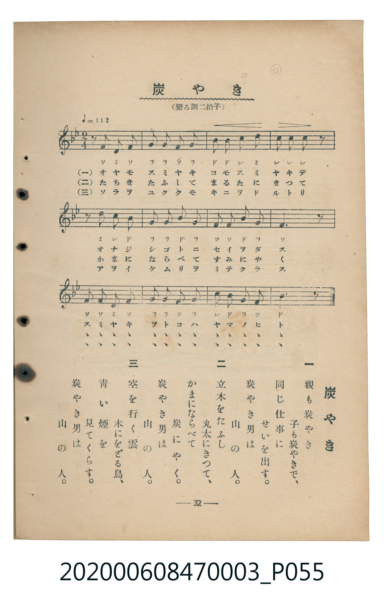

# 炭やき（燒炭）

<audio controls src="sumiyaki.mp3"></audio>

- 臺灣教育會公認『新定兒童唱歌』尋常科第三學年用（第三學期・第4首）
- 國立臺灣歷史博物館典藏（典藏號：2020.006.0847.0003）

## 說明

【曲目說明】
・出處：臺灣教育會公認、臺北新高堂發行《新定兒童唱歌》尋常科第三學年用（昭和6年／1931年），
第三學期第 4 首〈炭やき〉（燒炭），原書第 32 頁（掃描檔 P055.jpg）。
亦收錄於臺灣總督府編《公學校唱歌》第三學年用第十四課。
・調性與拍號：變ロ調（Bb 大調），2/4 拍，速度 != 112。
・背景與曲風：描寫深山裡的燒炭職人父子世代相傳、伐木截成圓木、排入炭窯燒炭，
伴著天上流雲、林間飛鳥與裊裊青煙度日的山林生活。第一、二段皆以「前半拍八分休止符」弱起進入，
第三段副歌「炭やき男は山の人」則轉為正拍強起，質樸而堅定。
・版本說明：本檔案為原書單聲部五線譜（附移動 Do 階名片假名）之忠實數位化版本。

・編曲說明（鋼琴伴奏版）：
1. 前奏 (Intro, 4 小節)：引用第三段正拍強起的「炭やき男は山の人」五聲音階主題，確立山林民謠風格。
2. 主歌伴奏 (Sumiyaki, 12 小節 × 3 段)：當右手在第一、二段第 1 小節以後半拍弱起進入時，
左手先一步在正拍敲響低音 `1_`，給予歌者清晰的拍點引導與穩健支撐。

## 歌詞

```text
一　親も炭やき　子も炭やきで、
同じ仕事に　せいを出す。
炭やき男は　山の人。

二　立木をたふし　丸太にきつて、
かまにならべて　炭にやく。
炭やき男は　山の人。

三　空を行く雲　木にをどる鳥、
青い煙を　見てくらす。
炭やき男は　山の人。
```

## 原書掃描頁



## 分析

```text
================================================================================
📊 TMD Song Profile: [ 炭やき（燒炭） ]
================================================================================
⏱  Duration:       0:12 (12.9s), 12 measures total
🎼 Key & Tempo:    首調基準 B,, != 112.0 BPM, <2/4>
   - 分析範圍：      由實際發聲的音符與和弦推測調性；播放脈絡另行呈現
🎤 人聲音域:    D4 (MIDI 62) – D5 (MIDI 74) [跨度: 12 個半音 / 1.0 個八度, 難度: easy]
   - 最低音:  D4 in [Sumiyaki #1 @ m.1, 0:00]
   - 最高音: D5 in [Sumiyaki #1 @ m.3, 0:02]
   - 適合: soprano, mezzo-soprano, contralto, tenor, baritone, bass
🏛  結構:      Sumiyaki (12.9s)
⚡ 編曲密度:        Peak 1 軌道同時演奏
🗝  調性診斷：       F 調性不明確（純淨自然大調，未偵測到可信轉調）
   - 風格氣質:    純淨自然大調（陽光明朗、易唱易記，無明顯調外色彩）
   - 轉調歷程:    全曲維持單一推測調性（未偵測到可信轉調）
   - 核心骨幹音:  F, G, A#, C, D
   - 調性數值:    F 調性不明確 [相關度: 0.75, 穩定度: Ambiguous, 自然音純度: 100.0%]
   - 候選調性 (K-S): F 大調 (0.75), A# 大調 (0.75), G 小調 (0.64)
   - 五度圈歷程:   -1
   - 各段落調性細節:
     • [Sumiyaki #1]: F 調性不明確 (r: 0.75, 自然音純度: 100.0%)

  [ 五度圈游移軌跡 ]
               C  
        [F ]*          G  
      Bb               D  
      Eb               A  
         Ab           E  
            Db       B  
               F# 
     (* = active key center)

  [ 十二半音累積音高分佈 ]
     C  : ███████████               14.0%
     C# :                            0.0%
     D  : ███████                    9.3%
     D# :                            0.0%
     E  :                            0.0%
     F  : ████████████████████████  30.2%
     F# :                            0.0%
     G  : ████████████████████      25.6%
     G# :                            0.0%
     A  :                            0.0%
     A# : █████████████████         20.9%
     B  :                            0.0%
--------------------------------------------------------------------------------
Assignment 軌道音域：
  - Piano         : D4 – D5 (12 個半音 / 1.0 個八度, 39 個音符)
================================================================================
```

## ABC

```abc
X:1
T:炭やき（燒炭）
C:TMD (Chen, Chih-Han / aguai)
M:2/4
L:1/16
Q:1/4=112
K:Bb
V:V1 name="Piano" snm="Pia"
[V:V1]
z2 f2 d2 f2 | g2 g2 f2 g2 | b2 b2 c2 d2 | c2 c2 c2 z2 |
z2 d2 c2 b2 | g2 g2 b2 g2 | f2 f2 b2 g2 | f6 z2 |
f2 f2 d2 f2 | g2 g2 f2 g2 | c2 b2 g2 f2 | b6 z2 |
```

- [主旋律 TMD 檔案](sumiyaki.tmd)
- [鋼琴伴奏 TMD 檔案](sumiyaki_piano.tmd)
