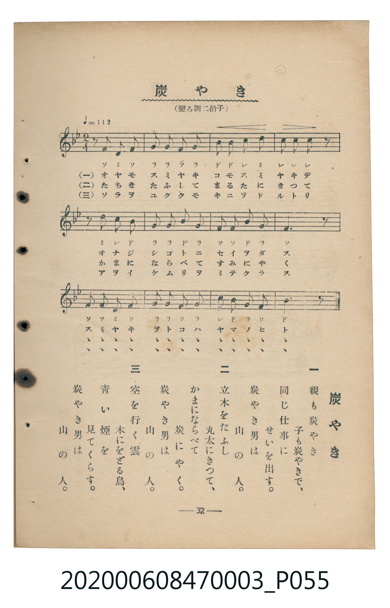

# 炭やき（燒炭）

> Re:Shōka 使用 AI 協助辨識與重建樂譜，可能會有錯誤。歡迎[回報](https://github.com/TMDLang/reshoka/issues)。

- **鋼琴伴奏版**：<br><audio controls src="sumiyaki.mp3"></audio>
- **NEUTRINO 歌聲合成版**：<br><audio controls src="sumiyaki_neutrino.mp3"></audio>

- 臺灣教育會公認『新定兒童唱歌』尋常科第三學年用（第三學期・第4首）
- 國立臺灣歷史博物館典藏（典藏號：2020.006.0847.0003）

## 說明


- 出處：臺灣教育會公認、臺北新高堂發行《新定兒童唱歌》尋常科第三學年用（昭和6年／1931年），
第三學期第 4 首〈炭やき〉（燒炭），原書第 32 頁（掃描檔 P055.jpg）。
亦收錄於臺灣總督府編《公學校唱歌》第三學年用第十四課。
- 調性與拍號：變ロ調（Bb 大調），2/4 拍，速度 != 112。
- 背景與曲風：描寫深山裡的燒炭職人父子世代相傳、伐木截成圓木、排入炭窯燒炭，
伴著天上流雲、林間飛鳥與裊裊青煙度日的山林生活。第一、二段皆以「前半拍八分休止符」弱起進入，
第三段副歌「炭やき男は山の人」則轉為正拍強起，質樸而堅定。
- 版本說明：本檔案為原書單聲部五線譜（附移動 Do 階名片假名）之忠實數位化版本。

### 編曲說明（鋼琴伴奏版）：

1. 前奏 (Intro, 4 小節)：引用第三段正拍強起的「炭やき男は山の人」五聲音階主題，確立山林民謠風格。
2. 主歌伴奏 (Sumiyaki, 12 小節 × 3 段)：當右手在第一、二段第 1 小節以後半拍弱起進入時，
左手先一步在正拍敲響低音 `1_`，給予歌者清晰的拍點引導與穩健支撐。


## 歌詞

```text
一　親も炭やき　子も炭やきで、
同じ仕事に　せいを出す。
炭やき男は　山の人。

二　立木をたふし　丸太にきつて、
かまにならべて　炭にやく。
炭やき男は　山の人。

三　空を行く雲　木にをどる鳥、
青い煙を　見てくらす。
炭やき男は　山の人。
```

## ABC

<div class="abc-score" data-abc-src="sumiyaki.abc" aria-label="五線譜載入中"></div>

[下載 ABC 原始檔](sumiyaki.abc)

## TMD 檔案連結

- [主旋律 TMD 檔案](sumiyaki.tmd) [[在 TMD Studio 編輯](https://tmdlang.github.io/Tmd-TS/#tmd=s7IKdvYPcrWy4qpTUCpJTLdSSM7PyUlNLsnMz7MqzsjMK0nNjM_KTMmPL87Iz05Ugisry88pzU21Si9KTEmNN443MjAyiDcwMIs3sDAxBzIMjBFKi_NLi5JTrYqTM_Lzc-JLUitKkvLzsxHyBUX5Zal5iXlANQVFIBtTwIoQClLLMlNSQdKpKZkl-UWZiTlI7kgtKga7FWxJfElRYl5xclFmAcgDCFUlGalAx5bnFyFZCzQoPTPPqiQxszwxLz4_LS0zGcXk_KKSjHyg_woyKq0yMotBFicn5sRnJ-YhBQPU2oLE9FSrAANTUyUuLS2F501rHze1PG7sfb-n43n7JCD3_Z5OBS0tLkVbBUNDIy57WwWnJC4bI30TO5BBL9p3PW9c_GzqzBdNm57NaX7auubFqt7HDX3Ppm14um7W09ZJz1cvfTpl47O1PY8b-p9u6H66Y8fz5ROfr1nzZEfn07U7nu7c8nzKCpBVMJFnc-Y_bt4N5Jq8XDYNaDXYuU_ndD9f3Q21a-32p_2bnvbOet658uWSFU9bd7yY3g80AcJ4MXP--z2zQDGqB4xRPVCMAhkGxmCTuPS1FGypBbgUFBQeN0x4NnvT89nrXqxa9WxG3-OGiWDR5t1P23e9mDkV6BIc4dMIFH_aMx0YSi9Xz3i6oOn5zD0vFgKDqAtbuHXjCbdnM9Y-ndRjBuS_39NvaGlsCGZ1vt_TA3KJggJyuALZCiYKwGB93NABj-bHDUDFiJgGanzaN__Z7B0gxcZGCi8XNIJs6Wt-1t__bNUUBVA60csqSAcqfdzQBLHjya5lz6Zse9nT8mzaHoh_n-_Y-3zu4qe75jzfvgLoKaCvQS5YsBDuIzSPALlPexufzp79YtUmqLHAQHyxav-zhuUvOtqfdfdC4vXFuq7HzWuB4kA3OSUpPF2yHMwGuRqYIBWA6oCslw3zn-5apgBJr0imNfc8m7keZNrsTS8XAcNuFtBLT9evfrZ949ONG18sXvh8VgskGF40bn-ya9fzjm1P1054smPak92Ln8_e8bRpMzDanuyZ8GzOimcdq551THg6ZzKQDRR81jfpaetSoMbnq9bDAhIa_E_2bHkxcfrTJSuf7Oh6trXx5Wyg9xqfzZv-ctrkl4tnv9y8FOieF4u7gOjl3EnPW2cCHf5s-lKgS4BOAip7PmX-sy27gX4Ah1cDyAG7ep6t2_p8VtuT3UsfN_Q87ex92tsF9PfT1tVPO9qe7Jn4bO2i52uWPW7ofbpn44ut2182bAK6DS05AE142rkeHBM98ITwfMr2x43rgfY-blwH9D7IhM72F3s7nzfterZ2MciKPduBBgKNerF51bMVO14AbV_QCkysiCB-3tnxbA4wgYPyAih856wBJplnC4GJbRckUT2dtu5F46aXzSue7JryfPusF2vnACPy5cyW58t3P-2equCSr_ByVt_TCb3PO9ufNrYDGcC4fbKz--n-BU_XL3s2dceTvb1Pe6ZBrAFZC82DEMOB_nmxct7T1hXPprUDg_XJjrUgxqp5L9auB2ZMUAmxofdZeydyEgYbAA7YhhfLVj1uakLKFg3A2EcRaVwODH-QhqcTeh43zniye-qTXd2PG1cDlT5unP24seVx0yRgvn_cOBMaImhBCzISEbpgFUBHQRwIDC1gegO64dkMaBICKgLlxbUrQYlw53w08ZfNe4GBCkpaE3qerVgMSjDblz7ZO-fF5sVPu2Y_65z8rBsULxAtz_YsAhoCNAGeziEugAfALmBCaAAWsKDk3DTpceP8x41bHzdOBwo-2bHj6ZJVIE-CAmDJ40ZgygKHweNGoNf3gSWA4db5uHEnWK4B5GegIMjb_eQFw4LeJzu6gWkfmrfAWQ0YRcA0C0q24DwHDIBnU7e83NsFynkd05_OWQHJfCDPtU8CqgeqAdlKdADsABZmDc9X7gL6HlQMN_aDM2oDyAkgzwCDZOXjpm5gdoX6HphZgfENzK8gOVDaAQbGMpCPQSFBXvRDSgqgG4Dp9uXilpeNfUBnQooMUJkFLjJebN_8YlcvUBxSdoCCYfpSEJozG6gXUo487W0H5lKQGqQChaiQADqI8loRChS09Lm4gktzMysTszOtAjIT8_IdagxqqsGlkI2Flh2Yga06hhRRoOhW0DBReLqh__n6Bh14ngXJKhgqACNJE4tWoKVQY4EmWIFSadMqYLm0BIgXAXk1QP5OIHs-RKxpLVRsM1geJgcWg8o_bm4HF5tIBu_qARvcCDSkcSEQ90INmQQV2wrE0yFijfuA4t1Q8dVQsV4gBhreuAzd4B2dEBfvBdq6Eog3QV2yDCi2HoLhvgC5DGgwUM3j5k6outVA3AHEq5ANrlEwUDCNVzCOB5E1CmbxIARkAskaYDgaKhgpGANZRmBooFAD1uRjWKMQD3RiF9CmFiBuAjt8JhDvh4gAPQESmQyWg8mA3AWRA5aUQP1Qs4wgZiGCCzOwMIMKNaDgZhlDzJoLVNsJNgVkVhtQpB-CoS4F6QSGBtiWlWA1IJNXAOkusFn40x64gsWZ9oxITHugMNwBjbXtQLwFGkvdULHdQAxKn6CYbICnUQTAkvJAngEGFzxFAa0BBUcjMPmCUxVSZIGDoQUq1o_dWFi6A-YAkCuAroG4YiOQvwCcnhBpEZRzgOENTosrcbsWlOqMgUFlCE9yhpAUB0x5QITg6AIhllQH8lLjDLCjpwPxFEjsQdPFbCAGpUpQ7C6AehZkDnqKQwQTZiBhBhEkgFDMgaY2YAoH2wVRMxHIawCnJGj6A5sBzKPg9NeJ5h4CpRyoIYYzpRkTmdKwlmng9ARMZ-CyDRTx0DKteR4Q9wHxJKhYB-60hp7lEeUcKDKAmb9xPVQMJA8K6nVADE0qQDU4UxvVXQxLWNiLOVA6hHBBRR56ksNSsKH5EdOHEP-hJzoqmQRMdpSbVMvFpWunAKuAwQYD-cpcAA)]
- [鋼琴伴奏 TMD 檔案](sumiyaki_piano.tmd) [[在 TMD Studio 編輯](https://tmdlang.github.io/Tmd-TS/#tmd=s7IKdvYPcrWy4qpTUCpJTLdSyC8qychPL0osyKi0ysgsLskvykxOzInPTsxLVIIrKs4vLUpOjS9ITE-1CjAwNVXi0tJSeN609nFTy-PG3vd7Op63TwJxm3e_7N7zfMKWJ3u2PF3a_7yz4_2eTgUtLS5FWwVDQyMue1sFpyQuGyN9EzuQ0S_adz1vXPxs6swXTZuezWl-2rrmxarexw19z6ZteLpu1tPWSc9XL306ZeOztT2PG_qfbuh-umPH8-UTn69Z82RH59O1O57u3PJ8ygqQ5TCRZ3PmA50A5Jq8XDYNaDXYA0_ndD9f3Q21a-32p_2bnvbOet658uWSFU9bd7yY3g80AcJ4MXP--z2zjAyMDPQMDMz0DCxMzIEMA2OwSVz6Wgq21AJcCgoKjxsmPJu96fnsdS9WrXo2o-9xw0SwaPPup-27XsycCnQJjvBpBIo_7ZkODKWXq2c8XdD0fOaeFwuBQdSFLdy68YTbsxlrn07qMQPy3-_pN7Q0NgSzOt_v6QG5REEBOVyBbAUTBWCwPm7ogEf84wagYmjcQzQ-7Zv_bPYOkGJjI4WXCxpBtvQ1P-vvf7ZqigIo5ehlFaQDlT5uaIL69sWq_c8alr_oaH_W3QuJgBfruh43rwWKAzU7JSk8XbIczAYZD0w5CkB1QNbLhvlPdy1TgCQshGnPt68ABiokRIHaMVMj0HyI5wz1FJ529gLFFTQ880qK8nWA3nu6of_5-gZNoJqne6YCwwgSAM_WbX22djHQ2qd7tr_Yuv35rJbHDT3wMHg-ZfvjxvVPN2583Ljuya5djxt6n-ya8qJx08v5m1_O6nuyY_fLhT1A9z5ftAuYCoHKns2b_mzDxBdrFrxctOLZgj1QpysoGOkpABUD4wziWgWN4NLczMrE7EwdBUMjqMsUDk9XMFYAugfkxOdTtz3t3_yss_vpHIhDG4BJ48muHqA0KPwNoXqe7F76dF_P094usAc2Aj3wsmHT09alz2Y2wSMaCJ5uXwYyqrUDaM6ztUuBZkL8_Gwq0Cf7n-ztA_pHIcEwPgHkl63LnuzqADr1RUPrsx2tz2ZuAIYJUO3L3fOA4fZ0Qx8wNp-vXPm0cemzKeufTZoA9SPl2QYKFLT0ubjAkWYVkJmYlx_k4VBjUFMN9ouNhZYdmFGjYBoPQsZgskbBLB6EgEwgWaNgBAwfCLcGyNIFQgOFGq5aFGN9sBtrGK8QbRgL0gqiahRMgAyTWJgw2NpoU4g8kIKrB2GoHbCYxeN6bIUNJD82AONXQQOeVrEoA4YOxKUGuP1vCIRGwLQECgkQBLkMpMnHsEYhXuFxY5cCMHUDcRNQxePGmUC8HyLS2AsWmQyWg8kARaByjxuXA_VDzTKCmDUfiBfCdDZNgopsBeLpYLP2AUW7oaKrwSIgc5YA8TKEWcYQs-YC1XaCTQGZ1QYU6YdgqEtBOldDbVkJVgMyeQWQ7gKbhT9wwZmH6MA1BqciWMiC0xMs0SE4sKSFFriNq4B4BtjJ04F4CsSRUO_PBmJQ4IM8sQAaASBz0AMW5DVg4EF1AU0EBU3jTnDAIUUbOEBawCL9qOZAAxUYkWC7IGomAnkN4ACDBjPYjGXQYO5Ecw-B1AoqPIkMUNKzKyxMsSRQsH9AIQpMqI3r4QkUFFrrgHgT2BcrMEKVSiYBw5VykzAKCqzlEVUKCkJFGpQBjIFos1zUMg4UD9TLVDgcAqUodAgpiZHyQl7XTgFclygAGbB4jPYByqPwjdD4xmC-MhcA)]

## 分析

```text
================================================================================
📊 TMD Song Profile: [ 炭やき（燒炭） ]
================================================================================
⏱  Duration:       0:12 (12.9s), 12 measures total
🎼 Key & Tempo:    首調基準 B,, != 112.0 BPM, <2/4>
   - 分析範圍：      由實際發聲的音符與和弦推測調性；播放脈絡另行呈現
🎤 人聲音域:    D4 (MIDI 62) – D5 (MIDI 74) [跨度: 12 個半音 / 1.0 個八度, 難度: easy]
   - 最低音:  D4 in [Sumiyaki #1 @ m.1, 0:00]
   - 最高音: D5 in [Sumiyaki #1 @ m.3, 0:02]
   - 適合: soprano, mezzo-soprano, contralto, tenor, baritone, bass
🏛  結構:      Sumiyaki (12.9s)
⚡ 編曲密度:        Peak 1 軌道同時演奏
🗝  調性診斷：       F 調性不明確（純淨自然大調，未偵測到可信轉調）
   - 風格氣質:    純淨自然大調（陽光明朗、易唱易記，無明顯調外色彩）
   - 轉調歷程:    全曲維持單一推測調性（未偵測到可信轉調）
   - 核心骨幹音:  F, G, A#, C, D
   - 調性數值:    F 調性不明確 [相關度: 0.75, 穩定度: Ambiguous, 自然音純度: 100.0%]
   - 候選調性 (K-S): F 大調 (0.75), A# 大調 (0.75), G 小調 (0.64)
   - 五度圈歷程:   -1
   - 各段落調性細節:
     • [Sumiyaki #1]: F 調性不明確 (r: 0.75, 自然音純度: 100.0%)

  [ 五度圈游移軌跡 ]
               C  
        [F ]*          G  
      Bb               D  
      Eb               A  
         Ab           E  
            Db       B  
               F# 
     (* = active key center)

  [ 十二半音累積音高分佈 ]
     C  : ███████████               14.0%
     C# :                            0.0%
     D  : ███████                    9.3%
     D# :                            0.0%
     E  :                            0.0%
     F  : ████████████████████████  30.2%
     F# :                            0.0%
     G  : ████████████████████      25.6%
     G# :                            0.0%
     A  :                            0.0%
     A# : █████████████████         20.9%
     B  :                            0.0%
--------------------------------------------------------------------------------
Assignment 軌道音域：
  - Piano         : D4 – D5 (12 個半音 / 1.0 個八度, 39 個音符)
================================================================================
```


## 原書掃描頁




