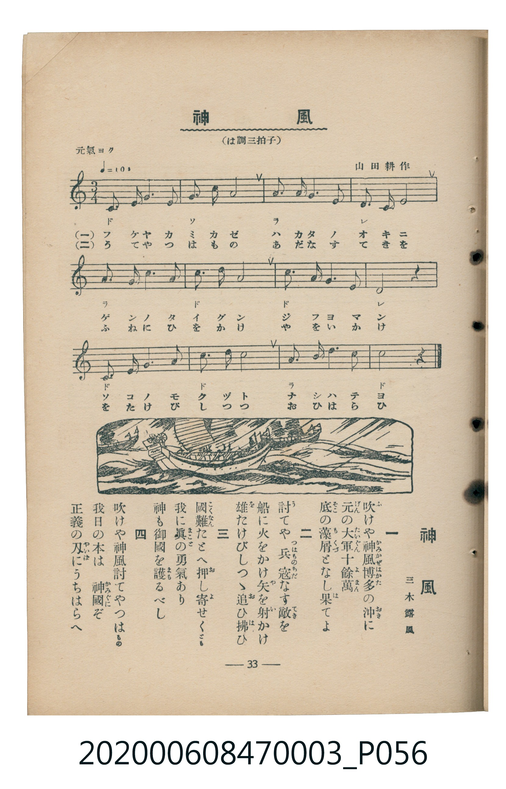

# 神風

> Re:Shōka 使用 AI 協助辨識與重建樂譜，可能會有錯誤。歡迎回報。

- **鋼琴伴奏版**：<br><audio controls src="kamikaze.mp3"></audio>
- **NEUTRINO 歌聲合成版**：<br><audio controls src="kamikaze_neutrino.mp3"></audio>

- 臺灣教育會公認『新定兒童唱歌』尋常科第三學年用（第三學期・第5首）
- 國立臺灣歷史博物館典藏（典藏號：2020.006.0847.0003）

## 說明


- 出處：臺灣教育會公認、臺北新高堂發行《新定兒童唱歌》尋常科第三學年用（昭和6年／1931年），
第三學期第 5 首〈神風〉，原書第 33 頁（掃描檔 P056.jpg）。
- 詞曲：三木露風 作詞／山田耕作 作曲。
- 調性與拍號：ハ調（C 大調），3/4 拍，速度標示「元氣ヨク != 108」。
- 背景與曲風：敘述十三世紀元軍襲日（文永- 弘安之役）於博多灣遭遇暴風（神風）覆滅之歷史傳說。
山田耕作以雄渾有力的 C 大調 3/4 拍與附點節奏譜寫，跨度達高音 Mi（`3^`）。
- 版本說明：本檔案為原書單聲部五線譜（附移動 Do 階名片假名）之忠實數位化版本，作為歷史教材史料保存。

### 編曲說明（鋼琴伴奏版）：

1. 前奏 (Intro, 4 小節)：引用第三段氣勢磅礴的上行終止樂句開場。
2. 主歌伴奏 (Kamikaze, 12 小節 × 4 段)：右手演奏山田耕作譜寫之雄渾三拍子旋律，左手以厚實的三拍子和弦進行支撐。


## 歌詞

```text
一　吹（ふ）けや神風（かみかぜ）博多（はかた）の沖（おき）に
元（げん）の大軍（たいぐん）十餘萬（じふよまん）
底（そこ）の藻屑（もくづ）となし果（は）てよ

二　討（う）てや兵（つはもの）あだなる敵（てき）を
船に火をかけ矢（や）を射（い）かけ
雄（を）たけびしつゝ追（お）ひ拂（はら）ひ

三　國難（こくなん）たとへ押（お）し寄（よ）せくとも
我に眞（まこと）の勇氣あり
神も御國（みくに）を護（まも）るべし

四　吹けや神風討てやつはもの
我日の本は　神國（かみぐに）ぞ
正義の刃（やいば）にうちはらへ
```

## ABC

```abc
X:1
T:神風
M:3/4
L:1/16
Q:1/4=108
K:C
V:V1 name="Piano" snm="Pia"
[V:V1]
C3 E G6 E2 | G3 c A8 | A3 A G6 E2 | D3 C D8 |
w: 1.~ふ け や か | み か ぜ | は か た の | お き に
w: 2.~う て や つ | は も の | あ だ な す | て き を
w: 3.~こ く な ん | た と へ | お し よ せ | く と も
w: 4.~ふ け や か | み か ぜ | う て や つ | は も の
A3 G c6 A2 | c3 d A8 | c3 A G6 E2 | D8 z4 |
w: 1.~げ ん の た | い ぐ ん | じ ふ よ ま | ん
w: 2.~ふ ね に ひ | を か け | や を い か | け
w: 3.~わ れ に ま | こ と の | ゆ う き あ | り
w: 4.~わ が ひ の | も と は | か み ぐ に | ぞ
C3 D G6 A2 | c3 d c8 | A3 B d6 c2 | c8 z4 |
w: 1.~そ こ の も | く づ と | な し は て | よ
w: 2.~を た け び | し つ つ | お ひ は ら | ひ
w: 3.~か み も み | く に を | ま も る べ | し
w: 4.~せ い ぎ の | やい ば に | う ち は ら | へ
```

## TMD 檔案連結

- [主旋律 TMD 檔案](kamikaze.tmd) [[在 TMD Studio 編輯](https://tmdlang.github.io/Tmd-TS/#tmd=s7IKdvYPcrWy4qpTUCpJTLdSSM7PyUlNLsnMz7MqzsjMK0nNjM_KTMmPL87Iz05Ugisry88pzU21Si9KTEmNN443MjAyiDcwMIs3sDAxBzIMjBFKi_NLi5JTrYqTM_Lzc-JLUitKkvLzsxHyBUX5Zal5iXlANQVFIBtTwIoQClLLMlNSQdKpKZkl-UWZiTlI7kgtKga7FWxJfElRYl5xclFmAcgDCFUlGalAx-Zm5mSWJBZVIsSBhqVn5lmVJGYCvQfyYnlifG5iZl5OYl6KEpeWlsLzpfNeLlqhoKXFpWirYGhgwWVvq-DMZWOsb2IHMuRF-67njYufTZ35omnTsznNT1vXvFjV-7ih79m0DU_XzXraOun56qVPp2x8trbncUP_0w3dT3fseL584vM1a57s6Hy6dsfTnVueT1nxfk8HXOTZnPmPm3cDuaYvl017v6cT7NSnc7qfr-6G2rV2-9P-TU97Zz3vXPlyyYqnrTteTO8HmgBhvJg5__2eWaDI0ANGhh4oMoAMA2OwSVz6Wgq21AJcCgoKjxsmPJu96fnsdS9WrXo2o-9xw0SwaPPup-27XsycCnQJjvBpBIo_7ZkODKWXq2c8XdD0fOaeFwuBQdSFLdy68YTbsxlrn07qMQPy3-_pN7Q0NgSzOt_v6QG5REEBOVyBbAVTBWCwPm7ogETr4waQyqd985_N3gGSNTZWeLmgEWRsX_Oz_v5nq6YoBBiYmullFaQDDX3c0AT13ouV84D-BnoPaPazOSteztkESiNP9s4BSgDd8XTjxudTNrxomAoUAYkC1SLpXbX_WcPyFx3tz7p7IbH1uLkfKAi01Vnh6ZLlYCbIWcAkpgBUA2S9bJj_dNeyZytmPl-y63FDz9PW5mcbFj9uXvG4ab0CJFU-bgAGKtyG5p5nM9eDbJgNchfQhmdTZ7zYv-FpbyPQvU92THu-pQFoxovdvS-Wbno2fSnIv9Pan23YAYq4PTOerut8srP76d6dQGc8m7YHmNKeLpkFjMSXjWtfNrY_m7UFbCY0BIFqXixre7a7FagFmjKbNgNTA9Q1CgrIYfFk99KXs1ue7dj3bE7n067Zz2e1KMC8rAD1LdDVL2e2vNw97_n6hqdL-1-snfN0_WpgELzYvgIYBC8bpwDTy8v5mxV8M4FOSDCOS0CJl-edHc_mAFMYKDGCvD1nDTAKny3seN60CxLJT6ete9G46WXziie7pjzfPgtoPNAYoIXPl-9-2j1VwSVf4eWsvqcTep93tj9tbAcygMaDAmP_gqfrlz2buuPJ3t6nPdMg1gBdBfQT0GiIv4Fp_NncCSDGtJlP9s99unYGyF3QXAKxHZiagQnkaesKYHADPfpkx1oQY9W8F2vXA7MOKA9v6H3W3omc5sAGPNnR8Lih4ekEYIx0PG7cCvJy48THTS2wKAAKdj9u3A8mgR7qhEQZWHw9WBCYyoBa1j3bBCxRgIJdjxtBHnvcuBpkOjApgEUnPW6aDFEHipLdQBVAwfmPG1seN06ASAET0MslM15MAHodKDUD6JTHTUDGPogs2KxdwEwPFJr7uBFq1ovpu59uBPntcVPT48b-x43A5AYUX_G4cdXjxunP5oEiAOhMsOAyoHEgU4BCkFABxiHQ1y-2bn86YTnMsz1P56yAePDpkmnPgFIb2uHuAuWMOXMhzgfFEzBugAp2TQWmNIg7gOYAYwUerruApUvDixXAtAJ0QxvMDS1PW4FhDBRZAgo_kLPXgaWAjAUgZzd1P5sKUbAMGpBNk0DGvejYCQzS542rgXxwsE98Pn8R2OctEEVPNwAZQG1gLlgBSBswS4AVTQKLAgN84uPGzcCwAdnfNPfF_r2QOAPLbnrWDXQ9OF6bgGUESAQjwNp3PZvcBfQoKGAWr34KSlg9L_b3AQWf7Gt73rUeGBhA94MjuOf5jo1A9z5vnwRyO7BUnrDm-bq1L_d2ActjkOzMPUDTgO57unj90wnbnk7rApnZuu3lytaXwJJ_Xdvz2QuRg3MHMCs2AOuql7MXgx05GRzhwACDpAWg14DRvuNZF9BsuI-mP10P8X4HmDsbrAVYsoGz9LMOYFisfj4HWKiC0xnIRFCRA0qj3cASazEoUpq6QEqByQOo6em-hUD7waqB2QFoErDsAIX8i7XboUY0gZwLjMLHjcDImo4eeMDweLJ3P8QLz_omAQuvpw2TgGnoRUMPMPCAQQJ0ETBEn7VvBxZhz-fMf7Z2MTA4IW4BBdjSecCS58nO-U_3twKDCmjrk70Tn67b9rJpGVI4PZ09G5KdkXMxMBVCEh9ysoOGAbCMBuXeOWtAEg0NQA0wT0Ky_QSoPxvngTUA3bRvJSiIOsAZG2QkEG2A5HhgOn_cuBCSgICRQSC7AdME1vQEcRTQRU92Nj-bsR7ib4h3QcUlyHU9wNIe4hSQSEczUDsw2T1dDyz2GoDVKzBEn68E1mbgUAE6gvIGCRQoaOlzcXkn5mZmJ1alWgVkJublO9QY1FSDqyMbCy07MANbSwjSWGh4tm6rgoaJwtMN_cA6SAdeGINkFQwVgM0UTSxagZZCjQWaYAWsi6aCa7_HTRuB7CVAerVCDZA1Hyy2GkzuAZIgsX6o2OOm_UBeH0S0aRVYdC24XusGkkgW7OoBWtDYBrGgcRlQWQuQXgLS1rgerK0JLLMOYlQjhLcAiFcB8Uyo6DKwaC9Y_SSEBTUKGoYKukBorKmqoaurCWwxgXkgCQjTMA4qYwbm6oJkIEwzTC1GEC1QCQgPqANslY8hUAGwEgELAfOCJtgnEE43SDMwccO4QLnGOQj7QB5FkpkP5ayDyHVBub0gudWodhqBVbRBVSxDthMUggiTm5pAutch29kEVbgAJLMKypkJkVuGZCcwPFHsNAarmAxV0Y-ku2kyRDfMAytAcjuQ7YT5ZTrI3A4oZzZErh9JFzDOUew0oSBsSQ8dcLmGO1Pt6sGXqYyIzVRNm4CZYTM0k4CyCySrLAHzNoCzymao2A5wFgS2kYF4HjingLIaSBYBMLLUViBeC04yoKyxCWoUKHOAAg1EToSKATMcUBxYrkJlIFkKJIthPDx3mEIzgWEcmGsGzmoQthGWLAVThpGnYJnIABHZkIwESXXANIWIGlDKAsvBYnECKEohKREa2TOgMluRE9g-sC9h6uIRNkGyDyxZrUVkMFB4geSgaR-arCYi2QRLSU2TQDLIiRGhDskmcKZpgibxJmD6QNgEch1ShgJnGuSM2gRLwG0gmV4opwnsJ0h-QrEJnFVgNjWCbdoE5UAKFGjegtoEyQHQ0OuGyuwHyUyAcsBlfeM8FJsI1Dqd-DKIMdEZZC845T1ugmSSx82LwH4GVwrNrWCyA5oVusDqtoPrn8fNoMoEJLoCbwYBZwVQNpgPjjJgMxXs0elgMXAuBJMgMbDxwGAEBRewpQEVBWUpbBkEUuMYoSR1rPkDykeqc8xhVQtEBqigBqEKI4vMhcYQchYBxi5KaboUJLcCOZJhRT2oDIZXPMvAQQvJMJhZBJ4N5iOyASS8gOZNh3KXgOSWINsEK-03IdkEDD1I2GHPIihJEJ5S96P6aTVKrQSS2QfzPEgGZsROaHxizyLAageirAXkuj4oB5pFQI1MqMgGlGoXuUJZiOktWGUHsayWi0vXTgHWegPbDeQrcwEA)]
- [鋼琴伴奏 TMD 檔案](kamikaze_piano.tmd) [[在 TMD Studio 編輯](https://tmdlang.github.io/Tmd-TS/#tmd=s7IKdvYPcrWy4tLSUni-dN7LRSve7-l42b3n-YQtT_Zsebq0_3lnx_s9nQpaWlyKtgqGBhZc9rYKzlw2xvomdlx1Ckov2nc9b1z8bOrMF02bns1pftq65sWq3scNfc-mbXi6btbT1knPVy99OmXjs7U9jxv6n27ofrpjx_PlE5-vWfNkR-fTtTue7tzyfArISrjIsznzHzfvBnJNXy6bBrRZCWTL0zndz1d3Q-1au_1p_6anvbOed658uWTF09YdL6b3A02AMF7MnP9-zywjAyMDPQMDMz0DCxNzIMPAGGwSl76Wgi21AJeCgsLjhgnPZm96Pnvdi1Wrns3oe9wwESzavPtp-64XM6cCXYIjfBqB4k97pgND6eXqGU8XND2fuefFQmAQdWELt2484fZsxtqnk3rMgPz3e_oNLY0NwazO93t6QC5RUEAOVyBbwVQBGKyPGzogcf24AaTyad_8Z7N3gGSNjRVeLmgEGdvX_Ky__9mqKQoBBqZmelkF6UBDHzc0Qb33YuU8oL-B3gOa_WzOipdzNgENU3iydw5QAuiOpxs3Pp-y4UXDVKAISBSoFknvqv3PGpa_6Gh_1t0Lia3Hzf1AQaCtzgpPlywHM0HOAiYxBaAaIOtlw_ynu5YpQBIgwqTn21cATYYEPdZUCzQbEgqGegpPO3uB4goannklRfk6CiYKTzf0P1_foAlU83TPVGBgQkLq2bqtzzYsftq96Pni1udLtjyf1fJkRxcwap5vbXq2dtGzFU1P-5e-nNb9dMEWqDsUFIz0FJ7s2A2MKYjVChreibmZ2YlVqToKhkZQaxQOTwdaCTQcbF__5med3c_2TAGqRg6qF2vnPF2_-snO7pezW57t2AdyTXfv07UTnk3vfrqvGxRR25cBNT7ZvfRp36yn65eBHQdVA0wET_cse9mwCejWZ1PWP5s0Aeo-yhM6FCho6XNxgUPPKiAzMS8_yMOhxqCmGhwGNhZadmBGjYKGoYIuEBppqmro6moC0xuIZwaWiIPIxEGloHxdkJwZmGEOlTGCyAAV1CBUGYBUctWiuMEHuxsM44Fqow1j4SSKkCmIWaNgAqLA7GhTDDVwy2BxicfP2AoVSL5rAEa4ggYsqenA8xJIVsFQARhVmli0AsMZaizQBCtgQp8KTmaPmzYC2UuA9GqgWx83zweLrQaTe8DeBuYjqNjjpv1AXh9EtGkVWHQtONN0A0kkC3b1AC1obINY0LgMqKwFSC8BaWtcD9bWBJZZBzGqEcJbAMSrgHgmVHQZWLQXrH4SwgJ4YjBGSQzGIAkI0xCWFiDxj5QUzDC1GEG0wNIITAfYKh9DoILHjVvBQo8bJ2qCfQLhdIM0P27cD-MC5RrnIOwDeRRJZj6Usw4i1wXl9oLkVqPaaQRW0QZVsQzZTlAIIkxuagLpXodsZxNU4QKQzCooZyZEbhmSncDwRLHTGKxiMlRFP5LupskQ3TAPrADJ7UC2E-aX6SBzO6Cc2RC5fiRdwDhHsdOEgrAlPXS48GeqXT34MpURsZmqaRMwM2yGZhJQdoFklSVg3gZwVtkMFdsBzoKPm1cA8TxwTgFlNZAsAmBkqa1AvBacZEBZYxPUKFDmAAUaiJwIFQNmOKD440ZQxgPJQLIUSBbDeHjuMEUtQrEWr0hZCqYMI0_BMhGkuEPKSJBUB0xTiKgBpSywHCwWJ4CiFJISoZE9AyqzFTmB7QP7EqYOXPYiZx9YslqLyGCg8ALJQdM-NFlNRLIJlpKaJoFkkBMjQh2STeBM0wRN4k3A9IGwCeQ6pAwFzjTIGbUJloDbQDK9UE4T2E-Q_IRiEzirwGxqBNu0CcqBFCjQvAW1CZIDoKHXDZXZD5KZAOWAy_rGeSg2Eah1QG0YnBnEmOgMshec8h43QTLJ4-ZFYD-DK4XmVjDZAc0KXWB128H1z-NmUGUCEl2BN4OAswIoG8wHR9njxs1gj04Hi4FzIZgEiYGNBwYjKLgeN3VCRUFZClsGoW3zAymLzIXGEHIWAcYuSmm6FCS3AjmSYUU9qAyGVzzLwEELyTCYWQSeDeYjsgEkvIDmTYdyl4DkliDbBCvtNyHZBAw9SNhhzyIoSRCeUvej-mk1Sq0EktkH8zxIBmbETmh8Ys8iwGoHoqwF5Lo-KAeaRVoQWXoDSrWLXKEsxPQWrLKDWIbReMPaWCS28YYnyxBqb8KEwA3OaBMQByxbg9z6hLZBSav88DoKyToIidVRZmAhs1wQD6wDxVWQRE9SeUNBQJHUMNe1UwB3BBSADFg8R_uA1CDzjdD4xmh8UMDYKShzAQA)]

## 分析

```text
================================================================================
📊 TMD Song Profile: [ 神風 ]
================================================================================
⏱  Duration:       0:20 (20.0s), 12 measures total
🎼 Key & Tempo:    首調基準 C, != 108.0 BPM, <3/4>
   - 分析範圍：      由實際發聲的音符與和弦推測調性；播放脈絡另行呈現
🎤 人聲音域:    C4 (MIDI 60) – D5 (MIDI 74) [跨度: 14 個半音 / 1.2 個八度, 難度: moderate]
   - 最低音:  C4 in [Kamikaze #1 @ m.1, 0:00]
   - 最高音: D5 in [Kamikaze #1 @ m.6, 0:08]
   - 適合: soprano, mezzo-soprano, contralto, tenor, baritone, bass
🏛  結構:      Kamikaze (20.0s)
⚡ 編曲密度:        Peak 1 軌道同時演奏
🗝  調性診斷：       C 大調（純淨自然大調，未偵測到可信轉調）
   - 風格氣質:    純淨自然大調（陽光明朗、易唱易記，無明顯調外色彩）
   - 轉調歷程:    全曲維持單一推測調性（未偵測到可信轉調）
   - 核心骨幹音:  C, A, D, G, E
   - 調性數值:    C 大調 [相關度: 0.77, 穩定度: Moderate, 自然音純度: 100.0%]
   - 候選調性 (K-S): C 大調 (0.77), G 大調 (0.68), A 小調 (0.68)
   - 五度圈歷程:   +0
   - 各段落調性細節:
     • [Kamikaze #1]: C 大調 (r: 0.77, 自然音純度: 100.0%)

  [ 五度圈游移軌跡 ]
              [C ]*
         F            G  
      Bb               D  
      Eb               A  
         Ab           E  
            Db       B  
               F# 
     (* = active key center)

  [ 十二半音累積音高分佈 ]
     C  : ████████████████████████  30.1%
     C# :                            0.0%
     D  : ████████████████          20.6%
     D# :                            0.0%
     E  : ████                       5.1%
     F  :                            0.0%
     F# :                            0.0%
     G  : ████████████████          20.6%
     G# :                            0.0%
     A  : ██████████████████        22.8%
     A# :                            0.0%
     B  : █                          0.7%
--------------------------------------------------------------------------------
Assignment 軌道音域：
  - Piano         : C4 – D5 (14 個半音 / 1.2 個八度, 38 個音符)
================================================================================
```


## 原書掃描頁




