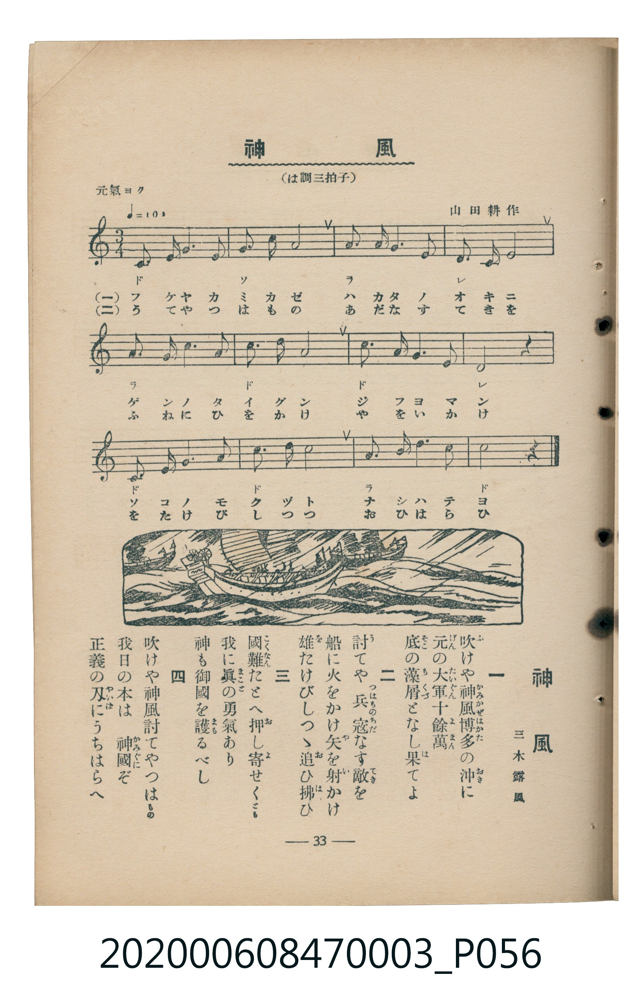

# 神風

> Re:Shōka 使用 AI 協助辨識與重建樂譜，可能會有錯誤。歡迎[回報](https://github.com/TMDLang/reshoka/issues)。

- **鋼琴伴奏版**：<br><audio controls src="kamikaze.mp3"></audio>
- **NEUTRINO 歌聲合成版**：<br><audio controls src="kamikaze_neutrino.mp3"></audio>

- 臺灣教育會公認『新定兒童唱歌』尋常科第三學年用（第三學期・第5首）
- 國立臺灣歷史博物館典藏（典藏號：2020.006.0847.0003）

## 說明


- 出處：臺灣教育會公認、臺北新高堂發行《新定兒童唱歌》尋常科第三學年用（昭和6年／1931年），
第三學期第 5 首〈神風〉，原書第 33 頁（掃描檔 P056.jpg）。
- 詞曲：三木露風 作詞／山田耕筰 作曲。
- 調性與拍號：ハ調（C 大調），3/4 拍，速度標示「元氣ヨク != 108」。
- 背景與曲風：敘述十三世紀元軍襲日（文永- 弘安之役）於博多灣遭遇暴風（神風）覆滅之歷史傳說。
山田耕筰以雄渾有力的 C 大調 3/4 拍與附點節奏譜寫，跨度達高音 Mi（`3^`）。
- 版本說明：本檔案為原書單聲部五線譜（附移動 Do 階名片假名）之忠實數位化版本，作為歷史教材史料保存。

### 編曲說明（鋼琴伴奏版）：

1. 前奏 (Intro, 4 小節)：引用第三段氣勢磅礴的上行終止樂句開場。
2. 主歌伴奏 (Kamikaze, 12 小節 × 4 段)：右手演奏山田耕筰譜寫之雄渾三拍子旋律，左手以厚實的三拍子和弦進行支撐。


## 歌詞

```text
一　吹（ふ）けや神風（かみかぜ）博多（はかた）の沖（おき）に
元（げん）の大軍（たいぐん）十餘萬（じふよまん）
底（そこ）の藻屑（もくづ）となし果（は）てよ

二　討（う）てや兵（つはもの）あだなる敵（てき）を
船に火をかけ矢（や）を射（い）かけ
雄（を）たけびしつゝ追（お）ひ拂（はら）ひ

三　國難（こくなん）たとへ押（お）し寄（よ）せくとも
我に眞（まこと）の勇氣あり
神も御國（みくに）を護（まも）るべし

四　吹けや神風討てやつはもの
我日の本は　神國（かみぐに）ぞ
正義の刃（やいば）にうちはらへ
```

## ABC

<div class="abc-score" data-abc-src="kamikaze.abc" aria-label="五線譜載入中"></div>

[下載 ABC 原始檔](kamikaze.abc)

## TMD 檔案連結

- [主旋律 TMD 檔案](kamikaze.tmd) [[在 TMD Studio 編輯](https://tmdlang.github.io/Tmd-TS/#tmd=s7IKdvYPcrWy4qpTUCpJTLdSSM7PyUlNLsnMz7MqzsjMK0nNjM_KTMmPL87Iz05Ugisry88pzU21Si9KTEmNN443MjAyiDcwMIs3sDAxBzIMjBFKi_NLi5JTrYqTM_Lzc-JLUitKkvLzsxHyBUX5Zal5iXlANQVFIBtTwIoQClLLMlNSQdKpKZkl-UWZiTlI7kgtKga7FWxJfElRYl5xclFmAcgDCFUlGalAx-Zm5mSWJBZVIsSBhqVn5lmVJGYCvQfyYnlifG5iZl5OYl4KsqqSjHygTwsyKq0yMotBTkhOzInPTsxDChCoAwoS01OtAgxMzZS4tLQUni-d93LRCgUtLS5FWwVDAwsue1sFZy4bY30TO5DGF-27njcufjZ15oumTc_mND9tXfNiVe_jhr5n0zY8XTfraeuk56uXPp2y8dnanscN_U83dD_dseP58onP16x5sqPz6dodT3dueT5lxfs9HXCRZ3PmP27eDeSavlw27f2eTrDzns7pfr66G2rX2u1P-zc97Z31vHPlyyUrnrbueDG9H2gChPFi5vz3e2aB4lIPGJd6oLgEMgyMwSZx6Wsp2FILcCkoKDxumPBs9qbns9e9WLXq2Yy-xw0TwaLNu5-273oxcyrQJTjCpxEo_rRnOjCUXq6e8XRB0_OZe14sBAZRF7Zw68YTbs9mrH06qccMyH-_p9_Q0tgQzOp8v6cH5BIFBeRwBbIVTBWAwfq4oQMSrY8bQCqf9s1_NnsHSNbYWOHlgkaQsX3Nz_r7n62aogBKCHpZBelAQx83NEG992LlPKC_gd4Dmv1szoqXczaB0siTvXOAEkB3PN248fmUDS8apj5fuwEkClSLpHfV_mcNy190tD_r7oXE1uPmfqAg0FZnhadLloOZIGcBk5gCUA2Q9bJh_tNdy56tmPl8ya7HDT1PW5ufbVj8uHnF46b1CpBU-bgBGKhwG5p7ns1cD7JhNshdQBueTZ3xYv-Gp72NQPc-2THt-ZYGoBkvdve-WLrp2fSlIP9Oa3-2YQco4vbMeLqu88nO7qd7dwKd8WzaHmBKe7pkFjASXzaufdnY_mzWFrCZ0BAEqnmxrO3Z7lagFmjKbNoMTA1Q1ygoIIfFk91LX85uebZj37M5nU-7Zj-f1aIA87IC1LdAV7-c2fJy97zn6xueLu1_sXbO0_WrgUHwYvsKYBC8bJwCTC8v529W8M0EOiHBOC4BJV6ed3Y8mwNMYaDECPL2nDXAKHy2sON50y5IJD-dtu5F46aXzSue7JryfPssoPFAY4AWPl---2n3VAWXfIWXs_qeTuh93tn-tLEdyAAaDwqM_Querl_2bOqOJ3t7n_ZMg1gDdBUwboFGQ_wNTOPP5k4AMabNfLJ_7tO1M0DuguYSiO3A1AxMIE9bVwCDG-jRJzvWghir5r1Yux6YdUB5eEPvs_ZO5DQHNuDJjobHDQ1PJwBjpONx41aQlxsnPm5qgUUBULD7ceN-MAn0UCckysDi68GCwFQG1LLu2SZgiQIU7HrcCPLY48bVINOBSQEsOulx02SIOlCU7AaqAArOf9zY8rhxAkQKmIBeLpnxYgLQ60CpGUCnPG4CMvZBZMFm7QJmeqDQ3MeNULNeTN_9dCPIb4-bmh439j9uBCY3oPiKx42rHjdOfzYPFAFAZ4IFlwGNA5kCFIKECjAOgb5-sXX70wnLYZ7teTpnBcSDT5dMewaU2tAOdxcoZ8yZC3E-KJ6AcQNUsGsqMKVB3AE0Bxgr8HDdBSxdGl6sAKYVoBvaYG5oedoKDGOgyBJQ-IGcvQ4sBWQsADm7qfvZVIiCZdCAbJoEMu5Fx05gkD5vXA3kg4N94vP5i8A-b4EoeroByABqA3PBCkDagFkCrGgSWBQY4BMfN24Ghg3I_qa5L_bvhcQZWHbTs26g68Hx2gQsI0AiGAHWvuvZ5C6gR0EBs3j1U1DC6nmxvw8o-GRf2_Ou9cDAALofHME9z3dsBLr3efskkNuBpfKENc_XrX25twtYHoNkZ-4BmgZ039PF659O2PZ0WhfIzNZtL1e2vgSW_Ovans9eiBycO4BZsQFYV72cvRjsyMngCAcGGCQtAL0GjPYdz7qAZsN9NP3peoj3O8Dc2WAtwJINnKWfdQDDYvXzOcBCFZzOQCaCihxQGu0GlliLQZHS1AVSCkweQE1P9y0E2g9WDcwOQJOAZQco5F-s3Q41ognkXGAUPm4ERtZ09MADhseTvfshXnjWNwlYeD1tmARMQy8aeoCBBwwSoIuAIfqsfTuwCHs-Z_6ztYuBwQlxCyjAls4DljxPds5_ur8VGFRAW5_snfh03baXTcuQwunp7NmQ7Iyci4GpEJL4kJMdNAyAZTQo985ZA5JoaABqgHkSku0nQP3ZOA-sAeimfStBQdQBztggI4FoAyTHA9P548aFkAQEjAwC2Q2YJrCmJ4ijgC56srP52Yz1EH9DvAsqLkGu6wGW9hCngEQ6moHagcnu6XpgsdcArF6BIfp8JbA2A4cK0BGUN0igQEFLn4vLOzE3MzuxCtiOy0zMy3eoMaipBldHNhZadmAGtpYQpLHQ8GzdVgUNE4WnG_qBdZAOvDAGySoYKgCbKZpYtAIthRoLNMEKWBdNBdd-j5s2AtlLgPRqhRogaz5YbDWY3AMkQWL9ULHHTfuBvD6IaNMqsOhacL3WDSSRLNjVA7SgsQ1iQeMyoLIWIL0EpK1xPVhbE1hmHcSoRghvARCvAuKZUNFlYNFesPpJCAtqFDQMFXSB0FhTVUNXVxPYYgLzQBIQpmEcVMYMzNUFyUCYZphajCBaoBIQHlAH2CofQ6ACYCUCFgLmBU2wTyCcbpBmYOKGcYFyjXMQ9oE8iiQzH8pZB5HrgnJ7QXKrUe00Aqtog6pYhmwnKAQRJjc1gXSvQ7azCapwAUhmFZQzEyK3DMlOYHii2GkMVjEZqqIfSXfTZIhumAdWgOR2INsJ88t0kLkdUM5siFw_ki5gnKPYaUJB2JIeOuByDXem2tWDL1MZEZupmjYBM8NmaCYBZRdIVlkC5m0AZ5XNULEd4CwIbCMD8TxwTgFlNZAsAmBkqa1AvBacZEBZYxPUKFDmAAUaiJwIFQNmOKA4sFyFykCyFEgWw3h47jCFZgLDODDXDJzVIGwjLFkKpgwjT8EykQEisiEZCZLqgGkKETWglAWWg8XiBFCUQlIiNLJnQGW2IiewfWBfwtTFI2yCZB9YslqLyGCg8ALJQdM-NFlNRLIJlpKaJoFkkBMjQh2STeBM0wRN4k3A9IGwCeQ6pAwFzjTIGbUJloDbQDK9UE4T2E-Q_IRiEzirwGxqBNu0CcqBFCjQvAW1CZIDoKHXDZXZD5KZAOWAy_rGeSg2Eah1OvFlEGOiM8hecMp73ATJJI-bF4H9DK4UmlvBZAc0K3SB1W0H1z-Pm0GVCUh0Bd4MAs4KoGwwHxxlwGYq2KPTwWLgXAgmQWJg44HBCAouYEsDKgrKUtgyCKTGMUJJ6ljzB5SPVOeYw6oWiAxQQQ1CFUYWmQuNIeQsAoxdlNJ0KUhuBXIkw4p6UBkMr3iWgYMWkmEwswg8G8xHZANIeAHNmw7lLgHJLUG2CVbab0KyCRh6kLDDnkVQkiA8pe5H9dNqlFoJJLMP5nmQDMyIndD4xJ5FgNUORFkLyHV9UA40i4AamVCRDSjVLnKFshDTW7DKDmJZLReXrp0CrPUGthvIV-YCAA)]
- [鋼琴伴奏 TMD 檔案](kamikaze_piano.tmd) [[在 TMD Studio 編輯](https://tmdlang.github.io/Tmd-TS/#tmd=s7IKdvYPcrWy4qpTUCpJTLdSyC8qychPL0osyKi0ysgsLskvykxOzInPTsxLVIIrKs4vLUpOjS9ITE-1CjAwNVPi0tJSeL503stFK97v6XjZvef5hC1P9mx5urT_eWfH-z2dClpaXIq2CoYGFlz2tgrOXDbG-iZ2INNetO963rj42dSZL5o2PZvT_LR1zYtVvY8b-p5N2_B03aynrZOer176dMrGZ2t7Hjf0P93Q_XTHjufLJz5fs-bJjs6na3c83bnl-RSQlXCRZ3PmP27eDeSavlw2DWgz2M1P53Q_X90NtWvt9qf9m572znreufLlkhVPW3e8mN4PNAHCeDFz_vs9s4wMjAz0DAzM9AwsTMyBDANjsElc-loKttQCXAoKCo8bJjybven57HUvVq16NqPvccNEsGjz7qftu17MnAp0CY7waQSKP-2ZDgyll6tnPF3Q9HzmnhcLgUHUhS3cuvGE27MZa59O6jED8t_v6Te0NDYEszrf7-kBuURBATlcgWwFUwVgsD5u6IDE9eMGkMqnffOfzd4BkjU2Vni5oBFkbF_zs_7-Z6umKIBSh15WQTrQ0McNTVDvvVg5D-hvoPeAZj-bs-LlnE1AwxSe7J0DlAC64-nGjc-nbHjRMPX52g0gUaBaJL2r9j9rWP6io_1Zdy8kth439wMFgbY6KzxdshzMBDkLmMQUgGqArJcN85_uWqYASYAIk55vXwE0GRL0WFMt0GxIKBjqKTzt7AWKK2h45pUU5esomCg83dD_fH2DJlDN0z1TgYEJCaln67Y-27D4afei54tbny_Z8nxWy5MdXcCoeb616dnaRc9WND3tX_pyWvfTBVug7lBQMNJTeLJjNzCmIFYraHgn5mZmJ1al6igYGkGtUTg8HWgl0HCwff2bn3V2P9szBagaOaherJ3zdP3qJzu7X85uebZjH8g13b1P1054Nr376b5uUERtXwbU-GT30qd9s56uXwZ2HFQNMBE83bPsZcMmoFufTVn_bNIEqPsoT-hQoKClz8UFDj2rgMzEvPwgD4cag5pqcBjYWGjZgRk1ChqGCrpAaKSpqqGrqwlMbyCeGVgiDiITB5WC8nVBcmZghjlUxggiA1RQg1BlAFLJVYviBh9kN5jA3WAYrxBtGAvGcI5pPJBtEg-io02RxA0ghsLiDI_fsBUekPzVAIxYBQ1YktKB5xmQrIKhAjBKNLFoBYYn1FigCVbABD0VnJweN20EspcA6dVAVz5ung8WWw0m94C9B8wvULHHTfuBvD6IaNMqsOhacOboBpJIFuzqAVrQ2AaxoHEZUFkLkF4C0ta4HqytCSyzDmJUI4S3AIhXAfFMqOgysGgvWP0khAXwSDdGiXRjkASEaQiLc0g8I0W5GaYWI4gWWFqA6QBb5WMIVPC4cStY6HHjRE2wTyCcbpDmx437YVygXOMchH0gjyLJzIdy1kHkuqDcXpDcalQ7jcAq2qAqliHbCQpBhMlNTSDd65DtbIIqXACSWQXlzITILUOyExieKHYag1VMhqroR9LdNBmiG-aBFSC5Hch2wvwyHWRuB5QzGyLXj6QLGOcodppQELakhw4X_ky1qwdfpjIiNlM1bQJmhs3QTALKLpCssgTM2wDOKpuhYjvAWfBx8wogngfOKaCsBpJFAIwstRWI14KTDChrbIIaBcocoEADkROhYsAMBxR_3AjKeCAZSJYCyWIYD88dpqhFJdZiFClLwZRh5ClYJoKUoUgZCZLqgGkKETWglAWWg8XiBFCUQlIiNLJnQGW2IiewfWBfwtTFI2yCZB9YslqLyGCg8ALJQdM-NFlNRLIJlpKaJoFkkBMjQh2STeBM0wRN4k3A9IGwCeQ6pAwFzjTIGbUJloDbQDK9UE4T2E-Q_IRiEzirwGxqBNu0CcqBFCjQvAW1CZIDoKHXDZXZD5KZAOWAy_rGeSg2Eah1QG0VnBnEmOgMshec8h43QTLJ4-ZFYD-DK4XmVjDZAc0KXWB128H1z-NmUGUCEl2BN4OAswIoG8wHR9njxs1gj04Hi4FzIZgEiYGNBwYjKLgeN3VCRUFZClsGoW0zAymLzIXGEHIWAcYuSmk6CyS3AjmSYUU9qAyGVzzLwEELyTCYWQSeDeYjsgEkvIDmTYdyl4DkliDbBCvtNyHZBAw9SNhhzyIoSRCeUvej-mk1Sq0EktkH8zxIBmbETmh8Ys8iwGoHoqwF5Lo-KAeaRVoQWXoDSrWLXKEsxPQWrLKDWIbReMPaKCS28YYny2BvV0I4wIZltEksSKwG1sIEtzJJq-TwWg61AoTRLDcDcsxyY0Eq4LaDmrUklR8ke5xAg1rXTgHcUFcAMmDxE-0DlEfhG6HxjdH4QM8C-cpcAA)]

## 分析

```text
================================================================================
📊 TMD Song Profile: [ 神風 ]
================================================================================
⏱  Duration:       0:20 (20.0s), 12 measures total
🎼 Key & Tempo:    首調基準 C, != 108.0 BPM, <3/4>
   - 分析範圍：      由實際發聲的音符與和弦推測調性；播放脈絡另行呈現
🎤 人聲音域:    C4 (MIDI 60) – D5 (MIDI 74) [跨度: 14 個半音 / 1.2 個八度, 難度: moderate]
   - 最低音:  C4 in [Kamikaze #1 @ m.1, 0:00]
   - 最高音: D5 in [Kamikaze #1 @ m.6, 0:08]
   - 適合: soprano, mezzo-soprano, contralto, tenor, baritone, bass
🏛  結構:      Kamikaze (20.0s)
⚡ 編曲密度:        Peak 1 軌道同時演奏
🗝  調性診斷：       C 大調（純淨自然大調，未偵測到可信轉調）
   - 風格氣質:    純淨自然大調（陽光明朗、易唱易記，無明顯調外色彩）
   - 轉調歷程:    全曲維持單一推測調性（未偵測到可信轉調）
   - 核心骨幹音:  C, A, D, G, E
   - 調性數值:    C 大調 [相關度: 0.77, 穩定度: Moderate, 自然音純度: 100.0%]
   - 候選調性 (K-S): C 大調 (0.77), G 大調 (0.68), A 小調 (0.68)
   - 五度圈歷程:   +0
   - 各段落調性細節:
     • [Kamikaze #1]: C 大調 (r: 0.77, 自然音純度: 100.0%)

  [ 五度圈游移軌跡 ]
              [C ]*
         F            G  
      Bb               D  
      Eb               A  
         Ab           E  
            Db       B  
               F# 
     (* = active key center)

  [ 十二半音累積音高分佈 ]
     C  : ████████████████████████  30.1%
     C# :                            0.0%
     D  : ████████████████          20.6%
     D# :                            0.0%
     E  : ████                       5.1%
     F  :                            0.0%
     F# :                            0.0%
     G  : ████████████████          20.6%
     G# :                            0.0%
     A  : ██████████████████        22.8%
     A# :                            0.0%
     B  : █                          0.7%
--------------------------------------------------------------------------------
Assignment 軌道音域：
  - Piano         : C4 – D5 (14 個半音 / 1.2 個八度, 38 個音符)
================================================================================
```


## 原書掃描頁




