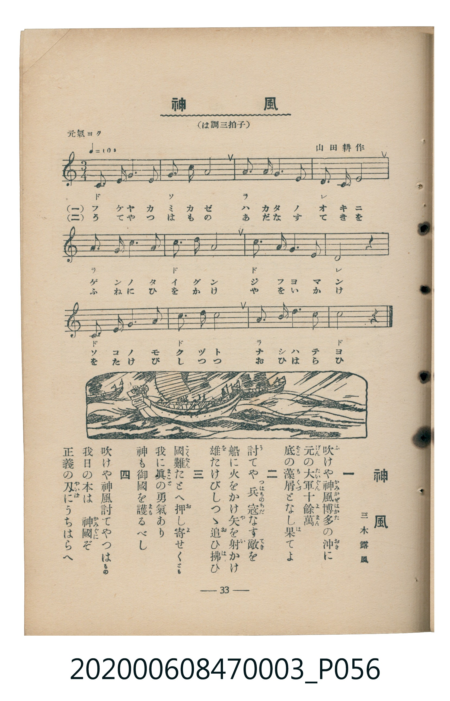

# 神風

<audio controls src="kamikaze.mp3"></audio>

- 臺灣教育會公認『新定兒童唱歌』尋常科第三學年用（第三學期・第5首）
- 國立臺灣歷史博物館典藏（典藏號：2020.006.0847.0003）

## 說明

【曲目說明】
・出處：臺灣教育會公認、臺北新高堂發行《新定兒童唱歌》尋常科第三學年用（昭和6年／1931年），
第三學期第 5 首〈神風〉，原書第 33 頁（掃描檔 P056.jpg）。
・詞曲：三木露風 作詞／山田耕作 作曲。
・調性與拍號：ハ調（C 大調），3/4 拍，速度標示「元氣ヨク != 108」。
・背景與曲風：敘述十三世紀元軍襲日（文永・弘安之役）於博多灣遭遇暴風（神風）覆滅之歷史傳說。
山田耕作以雄渾有力的 C 大調 3/4 拍與附點節奏譜寫，跨度達高音 Mi（`3^`）。
・版本說明：本檔案為原書單聲部五線譜（附移動 Do 階名片假名）之忠實數位化版本，作為歷史教材史料保存。

・編曲說明（鋼琴伴奏版）：
1. 前奏 (Intro, 4 小節)：引用第三段氣勢磅礴的上行終止樂句開場。
2. 主歌伴奏 (Kamikaze, 12 小節 × 4 段)：右手演奏山田耕作譜寫之雄渾三拍子旋律，左手以厚實的三拍子和弦進行支撐。

## 歌詞

```text
一　吹（ふ）けや神風（かみかぜ）博多（はかた）の沖（おき）に
元（げん）の大軍（たいぐん）十餘萬（じふよまん）
底（そこ）の藻屑（もくづ）となし果（は）てよ

二　討（う）てや兵（つはもの）あだなる敵（てき）を
船に火をかけ矢（や）を射（い）かけ
雄（を）たけびしつゝ追（お）ひ拂（はら）ひ

三　國難（こくなん）たとへ押（お）し寄（よ）せくとも
我に眞（まこと）の勇氣あり
神も御國（みくに）を護（まも）るべし

四　吹けや神風討てやつはもの
我日の本は　神國（かみぐに）ぞ
正義の刃（やいば）にうちはらへ
```

## 原書掃描頁



## 分析

```text
================================================================================
📊 TMD Song Profile: [ 神風 ]
================================================================================
⏱  Duration:       0:20 (20.0s), 12 measures total
🎼 Key & Tempo:    首調基準 C, != 108.0 BPM, <3/4>
   - 分析範圍：      由實際發聲的音符與和弦推測調性；播放脈絡另行呈現
🎤 人聲音域:    C4 (MIDI 60) – E5 (MIDI 76) [跨度: 16 個半音 / 1.3 個八度, 難度: moderate]
   - 最低音:  C4 in [Kamikaze #1 @ m.1, 0:00]
   - 最高音: E5 in [Kamikaze #1 @ m.7, 0:10]
   - 適合: soprano, mezzo-soprano, contralto, tenor, baritone, bass
🏛  結構:      Kamikaze (20.0s)
⚡ 編曲密度:        Peak 1 軌道同時演奏
🗝  調性診斷：       C 大調（純淨自然大調，未偵測到可信轉調）
   - 風格氣質:    純淨自然大調（陽光明朗、易唱易記，無明顯調外色彩）
   - 轉調歷程:    全曲維持單一推測調性（未偵測到可信轉調）
   - 核心骨幹音:  C, D, G, A, E
   - 調性數值:    C 大調 [相關度: 0.87, 穩定度: High, 自然音純度: 100.0%]
   - 候選調性 (K-S): C 大調 (0.87), G 大調 (0.66), A 小調 (0.59)
   - 五度圈歷程:   +0
   - 各段落調性細節:
     • [Kamikaze #1]: C 大調 (r: 0.87, 自然音純度: 100.0%)

  [ 五度圈游移軌跡 ]
              [C ]*
         F            G  
      Bb               D  
      Eb               A  
         Ab           E  
            Db       B  
               F# 
     (* = active key center)

  [ 十二半音累積音高分佈 ]
     C  : ████████████████████████  37.5%
     C# :                            0.0%
     D  : ████████████              19.1%
     D# :                            0.0%
     E  : ██████                     9.6%
     F  :                            0.7%
     F# :                            0.0%
     G  : ████████████              19.1%
     G# :                            0.0%
     A  : ████████                  11.8%
     A# :                            0.0%
     B  : █                          2.2%
--------------------------------------------------------------------------------
Assignment 軌道音域：
  - Piano         : C4 – E5 (16 個半音 / 1.3 個八度, 39 個音符)
================================================================================
```

## ABC

```abc
X:1
T:神風
C:TMD (Chen, Chih-Han / aguai)
M:3/4
L:1/16
Q:1/4=108
K:C

V:V1 name="Piano" snm="Pia"

[V:V1]
c6 d2 e3 f | g4 e4 g4 | a4 c3 a g4 | d4 c4 d4 |
a3 g a4 c4 | c4 g4 g4 | c3 d e3 d c4 | d8 z4 |
c6 d2 e3 g | c4 c4 g4 | a4 b3 c d4 | c8 z4 |
```

- [主旋律 TMD 檔案](kamikaze.tmd)
- [鋼琴伴奏 TMD 檔案](kamikaze_piano.tmd)
