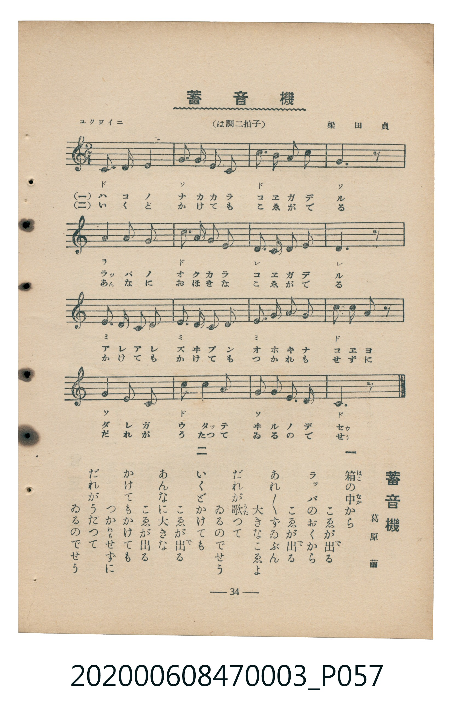

# 蓄音機（留聲機）

> Re:Shōka 使用 AI 協助辨識與重建樂譜，可能會有錯誤。歡迎回報。

- **鋼琴伴奏版**：<br><audio controls src="chikuonki.mp3"></audio>
- **NEUTRINO 歌聲合成版**：<br><audio controls src="chikuonki_neutrino.mp3"></audio>

- 臺灣教育會公認『新定兒童唱歌』尋常科第三學年用（第三學期・第6首）
- 國立臺灣歷史博物館典藏（典藏號：2020.006.0847.0003）

## 說明


- 出處：臺灣教育會公認、臺北新高堂發行《新定兒童唱歌》尋常科第三學年用（昭和6年／1931年），
第三學期第 6 首〈蓄音機〉（留聲機），原書第 34 頁（掃描檔 P057.jpg）。
- 詞曲：葛原𦱳（葛原しげる）作詞／梁田貞 作曲。
- 調性與拍號：ハ調（C 大調），2/4 拍，速度標示「ユクワイニ」（!= 108）。
- 背景與曲風：描寫孩童對留聲機（蓄音機）的好奇與驚嘆：木箱與大喇叭深處竟然傳出宏亮的歌聲，
無論播放多少次都不會累，讓人不禁好奇「究竟是誰在裡面唱歌呢？」。
- 版本說明：本檔案為原書單聲部五線譜（附移動 Do 階名片假名）之忠實數位化版本。

### 編曲說明（鋼琴伴奏版）：

1. 前奏 (Intro, 4 小節)：引用第四段「だれが歌つてゐるのでせう」俏皮輕快的結尾樂句開場。
2. 主歌伴奏 (Chikuonki, 16 小節 × 2 段)：右手演奏充滿童趣與彈性的旋律，左手以活潑的八分音符分解和弦伴奏。


## 歌詞

```text
一　箱（はこ）の中（なか）から　こゑが出（で）る
ラツパのおくから　こゑが出（で）る
あれあれずゐぶん　大（おほ）きなこゑよ
だれが歌（うた）つて　ゐるのでせう

二　いくどかけても　こゑが出（で）る
あんなに大きな　こゑが出る
かけてもかけても　つかれもせずに
だれがうたつて　ゐるのでせう
```

## ABC

<div class="abc-score" data-abc-src="chikuonki.abc" aria-label="五線譜載入中"></div>

[下載 ABC 原始檔](chikuonki.abc)

## TMD 檔案連結

- [主旋律 TMD 檔案](chikuonki.tmd) [[在 TMD Studio 編輯](https://tmdlang.github.io/Tmd-TS/#tmd=s7IKdvYPcrWy4qpTUCpJTLdSSM7PyUlNLsnMz7MqzsjMK0nNjM_KTMmPL87Iz05Ugisry88pzU21Si9KTEmNN443MjAyiDcwMIs3sDAxBzIMjBFKi_NLi5JTrYqTM_Lzc-JLUitKkvLzsxHyBUX5Zal5iXlANQVFIBtTwIoQClLLMlNSQdKpKZkl-UWZiTlI7kgtKga7FWxJfElRYl5xclFmAcgDCFUlGalAx5akJmfk5efkp1eiy-SWFmcmIwSBdqRn5lnlpmZmZWJxMFS6JDETGCiggClPjM9NzMzLScxLQVZVkpEPDJ-CjEqrjMxikMOTE3PisxPzkIIR6uyCxPRUqwADU3MlLi0thReTW17O3_xs5fz3ezqeT535onETmN2poKXFpWirYGhgwWVvq-DMZWOkb2IHMupF-67njYufAZU2bXo2p_lp65oXq3ofN_Q9m7bh6bpZT1snPV-99OmUjc_W9jxu6H-6ofvpjh3Pl098vmbNkx2dT9fueLpzy_MpK0CWwUSezZn_uHk3kGv2ctk0oM1gBz-d0_18dTfUrrXbn_Zveto763nnypdLVjxt3fFiej_QBAjjxUygc2eB0oQeME3ogdIEkGFgDDaJS19LwZZagEtBQeFxw4Rnszc9n73uxapVz2b0PW6YCBZt3v20fdeLmVOBLsERPo1A8ac904Gh9HL1jKcLmp7P3PNiITCIurCFWzeecHs2Y-3TST1mQP77Pf2GlsaGYFbn-z09IJcoKCCHK5CtYKYADNbHDR3wiH7cAFSMEtdAvU_75j-bvQOk3thE4eWCRpBFfc3P-vufrZqiAEoselkF6UCljxuaoB5-sXIeMCRAHp44G6j7w7KNm4GaIJzHjdMfN0563NQN1PFk7xygUqBbny1qfD5lw4tN8xSAQkCtSEat2v-sYfmLjvZn3b2Q6Hzc3A8UBJrnrPB0yXIwE-RKYBpUAKoBsl42zH-6a9mzFTOfL9n1uKHncfOyx03rHzevf9y05HFz9-MGoJoOSPJFdXRzz7OZ60E2zd70chEwOGcBvfh0_eqna1eCgn9DL1KwIEIMaMTzWS1Pl-59urQdqPflyllPZ7SB9M5Z8XzdRqAI0I1Pp7U_7V_7bPtGYCp4vnr-85ZtT5s2AxPF03X9T3atA2oHRizQZEQ0tSx8sXras0lrn03Z93TJrKcbJj5bs_Bl894nO3qBqeb5lvVAlS_WTX6yaxdQ5PmyRojtQK8-X7kNaP6zGetfrNrwdM6KF4sXvpy7CJJwnk5c9H4PMH6ByQ3m4eedHc_mAFMgKLGCXbwGGKHPFnY8b9oFifKn09YBnfWyecWTXVOeb5_1Yu0coM9fzmx5vnz30-6pCi75Ci9n9T2d0Pu8s_1pYzuQAYrSnd1P9y94un7Zs6k7nuztfdozDWINyFpoJoEYDvLzynlPW1c8mwYKuCc71oIYq-a9WLsemHNAWXhD77P2TuQEBjbgyY6Gxw0NwLAFKnncuP5x42RQLDauAxoAFln1uBGUtIDk4yZg7DYAFTxumvi4sQcY4GAFy0GyTd2QQFj5uLnlcTNQet3jxq7Hjf3EaWtsetzUAyNnPW6a8Lhx2-OmyUBtwNgGqwaatRvsil6wi8BmNXVANC8Aa-sBBgBYadvjRlAqety45HHjMpDNQOOausEuWv64cTZQAUgbKM2BAwcYU0_3zQP6_-naCdAIBiemJ7vaQJE1H5jTeoAKkNMchoLZTyf3PZ3YAETP54CSCzwhQhQ8ndoFNIRgYoLHyC5gsQQMsBZw-K0EBWEjMOSAua6JmICcDA6h1cCQg4YWqh64UiRT0W0Ahhww2nrAUsAAmwU0DiWoIYFMQgjjyoGg7DdzD6g8hwU1hPuyafHLXXvQghEYzkATgMH-tL8DyHjauxuYdl_unvdk53xgvn2xbNfTfdMhmZmooAY6kfJ6CgoUtPS5uJwzMrNL8_OyM60CMhPz8h1qDGqqwQWQjYWWHZiBrYaEVCINz9ZtVdAwUXi6of_5-gYdeC4FySoYKgCrL00sWoG2Qo0FmmAFzH79oFhq2gxk9QFZNUC6C8hfDcHNK0EiQFlQRt0IZK0Bs9rB6laDS0oQQDJ0Vw_Q0MYWcNT3A_FKiKGN3UA8EYiXAQ1pAotMBlsMEusBq14Otqob3dAaBQ1DBV0gNNJU1dDV1VQwBrJrFEyB0BjoTZB0HFjeHCqvYQbmGsZB-SC1IAEDhRqwgT6GQD3AYgssCHSGJpBYBzYTmPKhLgXipk6Q2SBngtU1TQSaDHIqRNdykLkg14K48TCTjcA6WqBq-kEmr4SajO5_4k3Gnwx29eBLBkZEJwNgKdwMpIBOhKWDplXgCFpPWUoAlS7QgAWpAgVFFzi6dwNxL1iGpMQAilwzYIwi4t0MGs-g9AAUNYLEPiwxQLjG8LQA4SOnBajfgWEP8j0wKYAjpws5EslPDtAAAKmBBAGK4btBhsMCgVopYkcnvhRhTGyKaFoEDJA1cBrkgl1A1gYgngbEm6FJ5HHzbCC9FlxsQBIIOHk0r8CWGDALAUyRJdDw7oGLAC1onAVNP4hCAVQMIAoFQ2DE4hc0hQpCEg8w7QCRGXqh0ASNAGAIgTggV4DFZ0HFJ4DEtwEZk_FEJCgewWm5qQO9aIDEIdDLIPVIRQEu8SVQ8W6gONYQIZgcns6ejS85mBBdQDSA8zsoQYByPiiql4Hz7H5IwdEGLghAqQNUWPTBioam3RB1WMuGBWADgN4CZ3qQx9rAmR_YTFgMDgeQARPASR-UL6GlAri1gF4sgIp4SHUAiVlQIQGpJNDSBFABZgkAdAk41sEugbgD6gpQ4CO7AxgnoLoCkS0hrsHM9tQysZaLS9dOAd5OANsAFFDmAgA)]
- [鋼琴伴奏 TMD 檔案](chikuonki_piano.tmd) [[在 TMD Studio 編輯](https://tmdlang.github.io/Tmd-TS/#tmd=s7IKdvYPcrWy4qpTUCpJTLdSyC8qychPL0osyKi0ysgsLskvykxOzInPTsxLVIIrKs4vLUpOjS9ITE-1CjAwNVfi0tJSeDG55eX8zc9Wzn-_p-P51JkvGjcB2Y-bd7_s3vN8wpYne7Y8Xdr_vLPj_Z5OBS0tLkVbBUMDCy57WwVnLhsjfRM7kOEv2nc9b1z8DKi5adOzOc1PW9e8WNX7uKHv2bQNT9fNeto66fnqpU-nbHy2tudxQ__TDd1Pd-x4vnzi8zVrnuzofLp2x9OdW55PWQGyHibybA7IBUCu2ctl04A2g73wdE7389XdULvWbn_av-lp76znnStfLlnxtHXHi-n9QBMgjBczgZ6ZZWRgZKBnYGCmZ2BhYg5kGBiDTeLS11KwpRbgUlBQeNww4dnsTc9nr3uxatWzGX2PGyaCRZt3P23f9WLmVKBLcIRPI1D8ac90YCi9XD3j6YKm5zP3vFgIDKIubOHWjSfcns1Y-3RSjxmQ_35Pv6GlsSGY1fl-Tw_IJQoKyOEKZCuYKQCD9XFDBzzqHzcAFSNiH6L3ad_8Z7N3gNQbmyi8XNAIsqiv-Vl__7NVUxRAyUcvqyAdqPRxQxPUwy9WzgOGBMjDE2cDdX9YtnEzUBOE87hx-uPGSY-buoE6nuydA1QKdOuzRY3Pp2x4sWmeAlAIqBXJqFX7nzUsf9HR_qy7FxKdj5v7gYJA85wVni5ZDmaCXAlMgwpANUDWy4b5T3ctU4CkUIRJz7evAJoMiRugbsxkDTQbEkyGegpPO3uB4goannklRfk6CiYKTzf0P1_foAlU83TPVGBoA4Pj6ezZz9ZtfdzQ87hxweMmINkDiqDGJY8blz1umgD04ePGdY8blz9unP24se1xQ--T_f3PZ617sWfq0_2rn89qeb51wtMN-56taHrav_TltO6nC7ZA3aqgYKSn8GTHbqBpEOcpaDhnZGaX5udlZ-ooGJpB3aJweLqCkQLQBWBH9W9-1tn9bM8UoPKnra3Pdu8HJpkX2xYDA-7p3g5gCAItfDa9--k-YLD3PN2-DKj4ye6lz7bsfrZ3IlDqaevqpx1twDTwfM0yIOPF8sXAdPR0zzKI_VB3UZ5LoEBBS5-LCxyyVgGZiXn5QR4ONQY11WC_21ho2YEZNQqmCroKxkCyRkHDMA7I1lUw1VTV0NXVBIrqguVNgCwjIMsQLGugUMNVi2KwD3aDDeMVog1jFUwhFCYfxDCF8IEUXB6EoXbA4wOPB7AVL5Ac2ACMNAUNWJrSgechkCzQL8C8r4lFKzDQoMYCTbACpuh-ULpu2gxk9YG99bi5C8hfDcHNK0EiQFlQ2t8IZK0Bs9rB6laDUxkIIBm6qwdoaGMLSFljPxCvhBja2A3EE4F4GdCQJrDIZLDFILEesOrlYKu60Q0FxRs4YozQos0UyDJEilZzqLyGGZhrGAflQ5IAJGJBBvoYAvU8blwPFgQ6QxNIrAOb-bhxFdSlQNzUCTIb5EyIug6gySCnQnjLQeaCXAvixsNMNgLraIGq6QeZvBJqMrr_iTcZfzLY1YMvGRgRnQxWPm5uBlJAJ8LSQdMqcAStpywlND1umgwNWJAqUFB0gaN7NxD3gmVISgygyDVDyc5m0HgGpQegqBEk9mGJAcI1hqcFCB85LUD9Dgx7kO-BSQEcOV3IkUh-coAGAEgNJAhQDN8NMhwWCNRKETs68aUIY2JTRNMiYICsgdMgF-wCsjYA8TQg3gxNIo-bZwPpteBiA5JAwMmjeQW2xIBZCGCKLIGGdw9cBGhB4yxo-kEUCqBiAFEoGIJLcHyCsFIfkniAaQeIzNALhSZIkDcBQwjEAbkCLD4LGhUtIPFtQPHJeCISFI_AOASq6kAvGiBxCPQySD1SUYBLfAlUvBsojjVECCYHSPMCZ3IwIbqAaADnd1CCAOV8UFQvA-fZ_ZCCow1cEIBSB6iw6IMVDU27Ieqwlg0LwAYAvQXO9CCPtYEzP7B1txgcDiADJoCTPihfQksFcEMIvViA1PKg6gASs6BCAlJJoKUJ5GoeXgIAXQKOdbBLIO6AugIU-GB3AEt1kDuAcQKqKxDZEuIazGxPLRMxmwlYmyPENhPwRDXOFo0JkDLBwweqB4UmSfUUXndALYAaD-fD7TUCMoxyY-E0cluLsEvQykdyQgTONwMyzIAuQA8SWCOPpKxJkUsItzZ17RTAjVoFIAOepKJ9gApQBYzAAspcAA)]

## 分析

```text
================================================================================
📊 TMD Song Profile: [ 蓄音機（留聲機） ]
================================================================================
⏱  Duration:       0:17 (17.8s), 16 measures total
🎼 Key & Tempo:    首調基準 C, != 108.0 BPM, <2/4>
   - 分析範圍：      由實際發聲的音符與和弦推測調性；播放脈絡另行呈現
🎤 人聲音域:    C4 (MIDI 60) – C5 (MIDI 72) [跨度: 12 個半音 / 1.0 個八度, 難度: easy]
   - 最低音:  C4 in [Chikuonki #1 @ m.1, 0:00]
   - 最高音: C5 in [Chikuonki #1 @ m.3, 0:02]
   - 適合: soprano, mezzo-soprano, contralto, tenor, baritone, bass
🏛  結構:      Chikuonki (17.8s)
⚡ 編曲密度:        Peak 1 軌道同時演奏
🗝  調性診斷：       C 大調（純淨自然大調，未偵測到可信轉調）
   - 風格氣質:    純淨自然大調（陽光明朗、易唱易記，無明顯調外色彩）
   - 轉調歷程:    全曲維持單一推測調性（未偵測到可信轉調）
   - 核心骨幹音:  C, G, E, D, A
   - 調性數值:    C 大調 [相關度: 0.88, 穩定度: High, 自然音純度: 100.0%]
   - 候選調性 (K-S): C 大調 (0.88), G 大調 (0.70), A 小調 (0.65)
   - 五度圈歷程:   +0
   - 各段落調性細節:
     • [Chikuonki #1]: C 大調 (r: 0.88, 自然音純度: 100.0%)

  [ 五度圈游移軌跡 ]
              [C ]*
         F            G  
      Bb               D  
      Eb               A  
         Ab           E  
            Db       B  
               F# 
     (* = active key center)

  [ 十二半音累積音高分佈 ]
     C  : ████████████████████████  29.2%
     C# :                            0.0%
     D  : ██████████████            16.7%
     D# :                            0.0%
     E  : ████████████████          19.2%
     F  :                            0.0%
     F# :                            0.0%
     G  : █████████████████         20.8%
     G# :                            0.0%
     A  : ███████████               13.3%
     A# :                            0.0%
     B  : █                          0.8%
--------------------------------------------------------------------------------
Assignment 軌道音域：
  - Piano         : C4 – C5 (12 個半音 / 1.0 個八度, 50 個音符)
================================================================================
```


## 原書掃描頁




