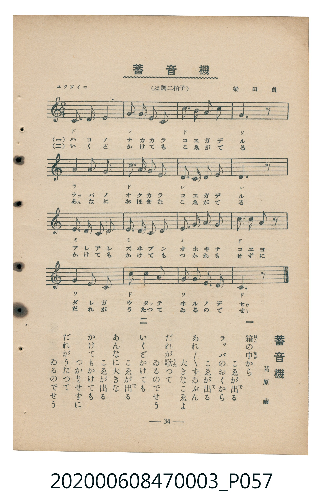

# 蓄音機（留聲機）

> Re:Shōka 使用 AI 協助辨識與重建樂譜，可能會有錯誤。歡迎回報。

<audio controls src="chikuonki.mp3"></audio>

- 臺灣教育會公認『新定兒童唱歌』尋常科第三學年用（第三學期・第6首）
- 國立臺灣歷史博物館典藏（典藏號：2020.006.0847.0003）

## 說明

【曲目說明】
・出處：臺灣教育會公認、臺北新高堂發行《新定兒童唱歌》尋常科第三學年用（昭和6年／1931年），
第三學期第 6 首〈蓄音機〉（留聲機），原書第 34 頁（掃描檔 P057.jpg）。
・詞曲：葛原齒（葛原しげる）作詞／梁田貞 作曲。
・調性與拍號：ハ調（C 大調），2/4 拍，速度標示「ユクワイニ」（!= 108）。
・背景與曲風：描寫孩童對留聲機（蓄音機）的好奇與驚嘆：木箱與大喇叭深處竟然傳出宏亮的歌聲，
無論播放多少次都不會累，讓人不禁好奇「究竟是誰在裡面唱歌呢？」。
・版本說明：本檔案為原書單聲部五線譜（附移動 Do 階名片假名）之忠實數位化版本。

・編曲說明（鋼琴伴奏版）：
1. 前奏 (Intro, 4 小節)：引用第四段「だれが歌つてゐるのでせう」俏皮輕快的結尾樂句開場。
2. 主歌伴奏 (Chikuonki, 16 小節 × 2 段)：右手演奏充滿童趣與彈性的旋律，左手以活潑的八分音符分解和弦伴奏。

## 歌詞

```text
一　箱（はこ）の中（なか）から　こゑが出（で）る
ラツパのおくから　こゑが出（で）る
あれあれずゐぶん　大（おほ）きなこゑよ
だれが歌（うた）つて　ゐるのでせう

二　いくどかけても　こゑが出（で）る
あんなに大きな　こゑが出る
かけてもかけても　つかれもせずに
だれがうたつて　ゐるのでせう
```

## ABC

```abc
X:1
T:蓄音機（留聲機）
M:2/4
L:1/16
Q:1/4=108
K:C
V:V1 name="Piano" snm="Pia"
[V:V1]
C3 D E4 | G2 G2 E2 C2 | c3 B A3 c | G6 z2 |
w: 1.~は こ の | な か か ら | こ ゑ が で | る
w: 2.~い く ど | か け て も | こ ゑ が で | る
A4 A2 G2 | c3 A G2 E2 | D3 C D3 E | D6 z2 |
w: 1.~ラッ パ の | お く か ら | こ ゑ が で | る
w: 2.~あん な に | お ほ き な | こ ゑ が で | る
E3 D C2 D2 | E3 D C2 D2 | E3 G A2 G2 | c2 c2 A2 z2 |
w: 1.~あ れ あ れ | ず ゐ ぶ ん | お ほ き な | こ ゑ よ
w: 2.~か け て も | か け て も | つ か れ も | せ ず に
G4 E2 C2 | c2 c4 A2 | G2 G2 E3 D | C6 z2 |
w: 1.~だ れ が | う たっ て | ゐ る の で | せう
w: 2.~だ れ が | う たっ て | ゐ る の で | せう
```

## TMD 檔案連結

- [主旋律 TMD 檔案](chikuonki.tmd) [[在 TMD Studio 編輯](https://tmdlang.github.io/Tmd-TS/#tmd=s7IKdvYPcrWy4qpTUCpJTLdSSM7PyUlNLsnMz7MqzsjMK0nNjM_KTMmPL87Iz05Ugisry88pzU21Si9KTEmNN443MjAyiDcwMIs3sDAxBzIMjBFKi_NLi5JTrYqTM_Lzc-JLUitKkvLzsxHyBUX5Zal5iXlANQVFIBtTwIoQClLLMlNSQdKpKZkl-UWZiTlI7kgtKga7FWxJfElRYl5xclFmAcgDCFUlGalAx5akJmfk5efkp1eiy-SWFmcmK3FpaSm8mNzycv7mZyvnv9_T8XzqzBeNm8DsTgUtLS5FWwVDAwsue1sFZy4bI30TO5ApL9p3PW9c_AyotGnTsznNT1vXvFjV-7ih79m0DU_XzXraOun56qVPp2x8trbncUP_0w3dT3fseL584vM1a57s6Hy6dsfTnVueT1kBsgwm8mzO_MfNu4Fcs5fLpgFtBrv16Zzu56u7oXat3f60f9PT3lnPO1e-XLLiaeuOF9P7gSZAGC9mAp07CxQfesD40APFB5BhYAw2iUtfS8GWWoBLQUHhccOEZ7M3PZ-97sWqVc9m9D1umAgWbd79tH3Xi5lTgS7BET6NQPGnPdOBofRy9YynC5qez9zzYiEwiLqwhVs3nnB7NmPt00k9ZkD--z39hpbGhmBW5_s9PSCXKCgghyuQrWCmAAzWxw0d8Ih-3ABUjBLXQL1P--Y_m70DpN7YROHlgkaQRX3Nz_r7n62aohBgYGqul1WQDlT6uKEJ6uEXK-cBQwLk4Ymzgbpf7p0E1ANhP26c_rhx0uOmbqCGJ3vnAFUCnfpsUePzKRtebJqnABQC6kQyadX-Zw3LX3S0P-vuhcTm4-Z-oCDQPGeFp0uWg5kgRwKToAJQDZD1smH-013Lnq2Y-XzJrscNPY-blz1uWv-4ef3jpiWPm7sfNwDVdEBSL6qbm3uezVwPsmn2ppeLgKE5C-jDp-tXP127EhT6G3qRQgURYEAjns9qebp079Ol7UC9L1fOejqjDaR3zorn6zYCRYBufDqt_Wn_2mfbNwITwfPV85-3bHvatBmYJp6u63-yax1QOzBegSYjYqll4YvV055NWvtsyr6nS2Y93TDx2ZqFL5v3PtnRC0w0z7esB6p8sW7yk127gCLPlzVCbAd69fnKbUDzn81Y_2LVhqdzVrxYvPDl3EWQdPN04qL3e4DRC0xtMA8_7-x4NgeYAEFpFeziNcD4fLaw43nTLkiMP522Duisl80rnuya8nz7rBdr5wB9_nJmy_Plu592T1VwyVd4Oavv6YTe553tTxvbgQxQlO7sfrp_wdP1y55N3fFkb-_TnmkQa0DWQvMIxHCQn1fOe9q64tk0UMA92bEWxFg178Xa9cCMA8rBG3qftXcipy-wAU92NDxuaACGLVDJ48b1jxsng2KxcR3QALDIqseNoKQFJB83AWO3AajgcdPEx409wAAHK1gOkm3qhgTCysfNLY-bgdLrHjd2PW7sJ05bY9Pjph4YOetx04THjdseN00GagPGNlg10KzdYFf0gl0ENqupA6J5AVhbDzAAwErbHjeCUtHjxiWPG5eBbAYa19QNdtHyx42zgQpA2kBpDhw4wJh6um8e0P9P106ARjA4MT3Z1QaKrPmbQRl23zzkNIehYPbTyX1PJzYA0fM5oOQCT4gQBU-ndgENIZiY4DGyC1gqAQOsBRx-K0FB2AgMOWCuayImICeDQ2g1MOSgoYWqB64UyVR0G4AhB4y2HrAUMMBmAY1DCWpIIJMQwrhyICj7zdwDKs5hQQ3hvmxa_HLXHrRgBIYz0ARgsD_t7wAynvbuBqbdl7vnPdk5H5hvXyzb9XTfdEhmJiqogU6kvJqCAgUtfS4u54zM7NL8vOxMq4DMxLx8hxqDmmpwAWRjoWUHZmCrICF1SMOzdVsVNEwUnm7of76-QQeeS0GyCoYKwNpLE4tWoK1QY4EmWAGzXz8olpo2A1l9QFYNkO4C8ldDcPNKkAhQFpRRNwJZa8CsdrC61eCSEgSQDN3VAzS0sQUc9f1AvBJiaGM3EE8E4mVAQ5rAIpPBFoPEesCql4Ot6kY3tEZBw1BBFwiNNFU1dHU1FYyB7BoFUyA0BnoTJB0HljeHymuYgbmGcVA-SC1IwEChBmygjyFQD7DYAgsCnaEJJNaBzQSmfKhLgbipE2Q2yJlgdU0TgSaDnArRtRxkLsi1IG48zGQjsI4WqJp-kMkroSaj-594k_Eng109-JKBEdHJAFgKNwMpoBNh6aBpFTiC1lOWEkClCzRgQapAQdEFju7dQNwLliEpMYAi1wwYo4h4N4PGMyg9AEWNILEPSwwQrjE8LUD4yGkB6ndg2IN8D0wK4MjpQo5E8pMDNABAaiBBgGL4bpDhsECgVorY0YkvRRgTmyKaFgEDZA2cBrlgF5C1AYinAfFmaBJ53DwbSK8FFxuQBAJOHs0rsCUGzEIAU2QJNLx74CJACxpnQdMPolAAFQOIQsEQGLH4BU2hgpDEA0w7QGSGXig0QSMAGEIgDsgVYPFZUPEJIPFtQMZkPBEJikdwWm7qQC8aIHEI9DJIPVJRgEt8CVS8GyiONUQIJoens2fjSw4mRBcQDeD8DkoQoJwPiupl4Dy7H1JwtIELAlDqABUWfbCioWk3RB3WsmEB2ACgt8CZHuSxNnDmBzYTFoPDAWTABHDSB-VLaKkAbi2gFwugIh5SHUBiFlRIQCoJtDQBVIBZAgBdAo51sEsg7oC6AhT4yO4AxgmorkBkS4hrMLM9tUys5eLStVOAtxPANgAFlLkA)]
- [鋼琴伴奏 TMD 檔案](chikuonki_piano.tmd) [[在 TMD Studio 編輯](https://tmdlang.github.io/Tmd-TS/#tmd=s7IKdvYPcrWy4tLSUngxueXl_M3PVs5_v6fj-dSZLxo3AdmPm3e_7N7zfMKWJ3u2PF3a_7yz4_2eTgUtLS5FWwVDAwsue1sFZy4bI30TO646BaUX7bueNy5-BtTctOnZnOanrWterOp93ND3bNqGp-tmPW2d9Hz10qdTNj5b2_O4of_phu6nO3Y8Xz7x-Zo1T3Z0Pl274-nOLc-nrABZDxN5NgfkAiDX7OWyaUCblUC2PJ3T_Xx1N9Sutduf9m962jvreefKl0tWPG3d8WJ6P9AECOPFTKBnZhkZGBnoGRiY6RlYmJgDGQbGYJO49LUUbKkFuBQUFB43THg2e9Pz2eterFr1bEbf44aJYNHm3U_bd72YORXoEhzh0wgUf9ozHRhKL1fPeLqg6fnMPS8WAoOoC1u4deMJt2cz1j6d1GMG5L_f029oaWwIZnW-39MDcomCAnK4AtkKZgrAYH3c0AGP-scNQMWI2Ifofdo3_9nsHSD1xiYKLxc0gizqa37W3_9s1RSFAANTc72sgnSg0scNTVAPv1g5DxgSIA9PnA3U_XLvJKAeCPtx4_THjZMeN3UDNTzZOweoEujUZ4san0_Z8GLTPAWgEFAnkkmr9j9rWP6io_1Zdy8kNh839wMFgeY5KzxdshzMBDkSmAQVgGqArJcN85_uWqYASaAIk55vXwE0GRI1QN2YqRpoNiSUDPUUnnb2AsUVNDzzSorydRRMFJ5u6H--vkETqObpnqnAwAaGxtPZs5-t2_q4oedx44LHTUCyBxQ_jUseNy573DQB6MPHjeseNy5_3Dj7cWPb44beJ_v7n89a92LP1Kf7Vz-f1fJ864SnG_Y9W9H0tH_py2ndTxdsgbpVQcFIT-HJjt1A0yDOU9BwzsjMLs3Py87UUTA0g7pF4fB0BSMFoAvAjurf_Kyz-9meKUDlT1tbn-3eD0wxL7YtBgbc070dwBAEWvhsevfTfcBg73m6fRlQ8ZPdS59t2f1s70Sg1NPW1U872oBJ4PmaZUDGi-WLgcno6Z5lEPuh7qI8k0CBgpY-Fxc4ZK0CMhPz8oM8HGoMaqrBfrex0LIDM2oUTBV0FYyBZI2ChmEckK2rYKqpqqGrqwkU1QXLmwBZRkCWIVjWQKGGqxbFYB_sBhvGK0QbxiqYQihMPohhCuEDKbg8CEPtgMcHHg9gK10gGbABGGkKGrA0pQPPQiBZoF-AWV8Ti1ZgoEGNBZpgBUzR_aB03bQZyOoDe-txcxeQvxqCm1eCRICyoLS_EchaA2a1g9WtBqcyEEAydFcP0NDGFpCyxn4gXgkxtLEbiCcC8TKgIU1gkclgi0FiPWDVy8FWdaMbCoo3cMQYoUWbKZBliBSt5lB5DTMw1zAOyockAUjEggz0MQTqedy4HiwIdIYmkFgHNvNx4yqoS4G4qRNkNsiZYHVNE4Emg5wK0bUcZC7ItSBuPMxkI7COFqiafpDJK6Emo_ufeJPxJ4NdPfiSgRHRyWDl4-ZmIAV0IiwdNK0CR9B6ylJC0-OmydCABakCBUUXOLp3A3EvWIakxACKXDOU7GwGjWdQegCKGkFiH5YYIFxjeFqA8JHTAtTvwLAH-R6YFMCR04UcieQnB2gAgNRAggDF8N0gw2GBQK0UsaMTX4owJjZFNC0CBsgaOA1ywS4gawMQTwPizdAk8rh5NpBeCy42IAkEnDyaV2BLDJiFAKbIEmh498BFgBY0zoKmH0ShACoGEIWCIbgExycIK_UhiQeYdoDIDL1QaIJGADCEQByQK8Dis6DiE0Di24CMyXgiEhSP4LTc1IFeNEDiEOhlkHqkogCX-BKoeDdQHGuIEEwOkOYFzuRgQnQB0QDO76AEAcr5oKheBs6z-yEFRxu4IAClDlBh0QcrGpp2Q9RhLRsWgA0Aeguc6UEeawNnfmDrbjE4HEAGTAAnfVC-hJYK4IYQerEAqeVB1QEkZkGFBKSSQEsTyNU8vAQAugQc62CXQNwBdQUo8JHdAYwTUF2ByJYQ12Bme2qZiNlMwNocIbaZgCeqcbZoTICUCR4-UD0oNEmqp_C6A2oB1Hg4H26vEZBhlBsLp5HbWoRdglY-khMicL4ZkGEGdAF6kMAaeSRlTYpcQri1qWunAG7UKgAZ8CQV7QNUgCpgBBZQ5gIA)]

## 分析

```text
================================================================================
📊 TMD Song Profile: [ 蓄音機（留聲機） ]
================================================================================
⏱  Duration:       0:17 (17.8s), 16 measures total
🎼 Key & Tempo:    首調基準 C, != 108.0 BPM, <2/4>
   - 分析範圍：      由實際發聲的音符與和弦推測調性；播放脈絡另行呈現
🎤 人聲音域:    C4 (MIDI 60) – C5 (MIDI 72) [跨度: 12 個半音 / 1.0 個八度, 難度: easy]
   - 最低音:  C4 in [Chikuonki #1 @ m.1, 0:00]
   - 最高音: C5 in [Chikuonki #1 @ m.3, 0:02]
   - 適合: soprano, mezzo-soprano, contralto, tenor, baritone, bass
🏛  結構:      Chikuonki (17.8s)
⚡ 編曲密度:        Peak 1 軌道同時演奏
🗝  調性診斷：       C 大調（純淨自然大調，未偵測到可信轉調）
   - 風格氣質:    純淨自然大調（陽光明朗、易唱易記，無明顯調外色彩）
   - 轉調歷程:    全曲維持單一推測調性（未偵測到可信轉調）
   - 核心骨幹音:  C, G, E, D, A
   - 調性數值:    C 大調 [相關度: 0.88, 穩定度: High, 自然音純度: 100.0%]
   - 候選調性 (K-S): C 大調 (0.88), G 大調 (0.70), A 小調 (0.65)
   - 五度圈歷程:   +0
   - 各段落調性細節:
     • [Chikuonki #1]: C 大調 (r: 0.88, 自然音純度: 100.0%)

  [ 五度圈游移軌跡 ]
              [C ]*
         F            G  
      Bb               D  
      Eb               A  
         Ab           E  
            Db       B  
               F# 
     (* = active key center)

  [ 十二半音累積音高分佈 ]
     C  : ████████████████████████  29.2%
     C# :                            0.0%
     D  : ██████████████            16.7%
     D# :                            0.0%
     E  : ████████████████          19.2%
     F  :                            0.0%
     F# :                            0.0%
     G  : █████████████████         20.8%
     G# :                            0.0%
     A  : ███████████               13.3%
     A# :                            0.0%
     B  : █                          0.8%
--------------------------------------------------------------------------------
Assignment 軌道音域：
  - Piano         : C4 – C5 (12 個半音 / 1.0 個八度, 50 個音符)
================================================================================
```


## 原書掃描頁




