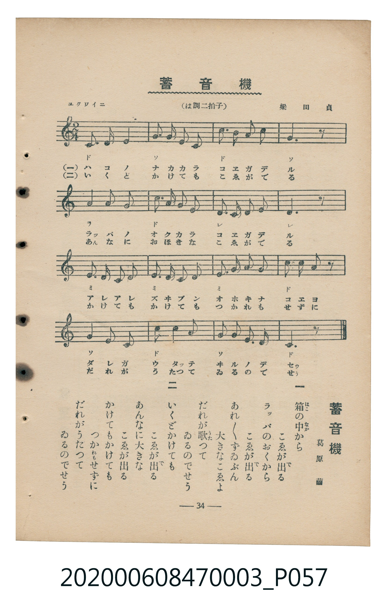

# 蓄音機（留聲機）

<audio controls src="chikuonki.mp3"></audio>

- 臺灣教育會公認『新定兒童唱歌』尋常科第三學年用（第三學期・第6首）
- 國立臺灣歷史博物館典藏（典藏號：2020.006.0847.0003）

## 說明

【曲目說明】
・出處：臺灣教育會公認、臺北新高堂發行《新定兒童唱歌》尋常科第三學年用（昭和6年／1931年），
第三學期第 6 首〈蓄音機〉（留聲機），原書第 34 頁（掃描檔 P057.jpg）。
・詞曲：葛原齒（葛原しげる）作詞／梁田貞 作曲。
・調性與拍號：ハ調（C 大調），2/4 拍，速度標示「ユクワイニ」（!= 108）。
・背景與曲風：描寫孩童對留聲機（蓄音機）的好奇與驚嘆：木箱與大喇叭深處竟然傳出宏亮的歌聲，
無論播放多少次都不會累，讓人不禁好奇「究竟是誰在裡面唱歌呢？」。
・版本說明：本檔案為原書單聲部五線譜（附移動 Do 階名片假名）之忠實數位化版本。

・編曲說明（鋼琴伴奏版）：
1. 前奏 (Intro, 4 小節)：引用第四段「だれが歌つてゐるのでせう」俏皮輕快的結尾樂句開場。
2. 主歌伴奏 (Chikuonki, 16 小節 × 2 段)：右手演奏充滿童趣與彈性的旋律，左手以活潑的八分音符分解和弦伴奏。

## 歌詞

```text
一　箱（はこ）の中（なか）から　こゑが出（で）る
ラツパのおくから　こゑが出（で）る
あれあれずゐぶん　大（おほ）きなこゑよ
だれが歌（うた）つて　ゐるのでせう

二　いくどかけても　こゑが出（で）る
あんなに大きな　こゑが出る
かけてもかけても　つかれもせずに
だれがうたつて　ゐるのでせう
```

## 原書掃描頁



## 分析

```text
================================================================================
📊 TMD Song Profile: [ 蓄音機（留聲機） ]
================================================================================
⏱  Duration:       0:17 (17.8s), 16 measures total
🎼 Key & Tempo:    首調基準 C, != 108.0 BPM, <2/4>
   - 分析範圍：      由實際發聲的音符與和弦推測調性；播放脈絡另行呈現
🎤 人聲音域:    C4 (MIDI 60) – C5 (MIDI 72) [跨度: 12 個半音 / 1.0 個八度, 難度: easy]
   - 最低音:  C4 in [Chikuonki #1 @ m.1, 0:00]
   - 最高音: C5 in [Chikuonki #1 @ m.3, 0:02]
   - 適合: soprano, mezzo-soprano, contralto, tenor, baritone, bass
🏛  結構:      Chikuonki (17.8s)
⚡ 編曲密度:        Peak 1 軌道同時演奏
🗝  調性診斷：       C 大調（純淨自然大調，未偵測到可信轉調）
   - 風格氣質:    純淨自然大調（陽光明朗、易唱易記，無明顯調外色彩）
   - 轉調歷程:    全曲維持單一推測調性（未偵測到可信轉調）
   - 核心骨幹音:  C, G, E, D, A
   - 調性數值:    C 大調 [相關度: 0.88, 穩定度: Moderate, 自然音純度: 100.0%]
   - 候選調性 (K-S): C 大調 (0.88), G 大調 (0.76), E 小調 (0.64)
   - 五度圈歷程:   +0
   - 各段落調性細節:
     • [Chikuonki #1]: C 大調 (r: 0.88, 自然音純度: 100.0%)

  [ 五度圈游移軌跡 ]
              [C ]*
         F            G  
      Bb               D  
      Eb               A  
         Ab           E  
            Db       B  
               F# 
     (* = active key center)

  [ 十二半音累積音高分佈 ]
     C  : ████████████████████████  25.0%
     C# :                            0.0%
     D  : █████████████████         17.5%
     D# :                            0.0%
     E  : ██████████████████        19.2%
     F  : ██                         1.7%
     F# :                            0.0%
     G  : ██████████████████████    22.5%
     G# :                            0.0%
     A  : ████████████              12.5%
     A# :                            0.0%
     B  : ██                         1.7%
--------------------------------------------------------------------------------
Assignment 軌道音域：
  - Piano         : C4 – C5 (12 個半音 / 1.0 個八度, 50 個音符)
================================================================================
```

## ABC

```abc
X:1
T:蓄音機（留聲機）
C:TMD (Chen, Chih-Han / aguai)
M:2/4
L:1/16
Q:1/4=108
K:C

V:V1 name="Piano" snm="Pia"

[V:V1]
c3 d e4 | g2 g2 a2 g2 | c3 b c3 a | g6 z2 |
a4 g2 a2 | c3 b c2 a2 | d3 c d3 e | d6 z2 |
e2 d2 e2 d2 | e2 d2 e2 g2 | e2 a2 g2 a2 | c2 c2 c2 z2 |
g4 e2 g2 | c3 g e4 | g2 f2 e2 d2 | c6 z2 |
```

- [主旋律 TMD 檔案](chikuonki.tmd)
- [鋼琴伴奏 TMD 檔案](chikuonki_piano.tmd)
