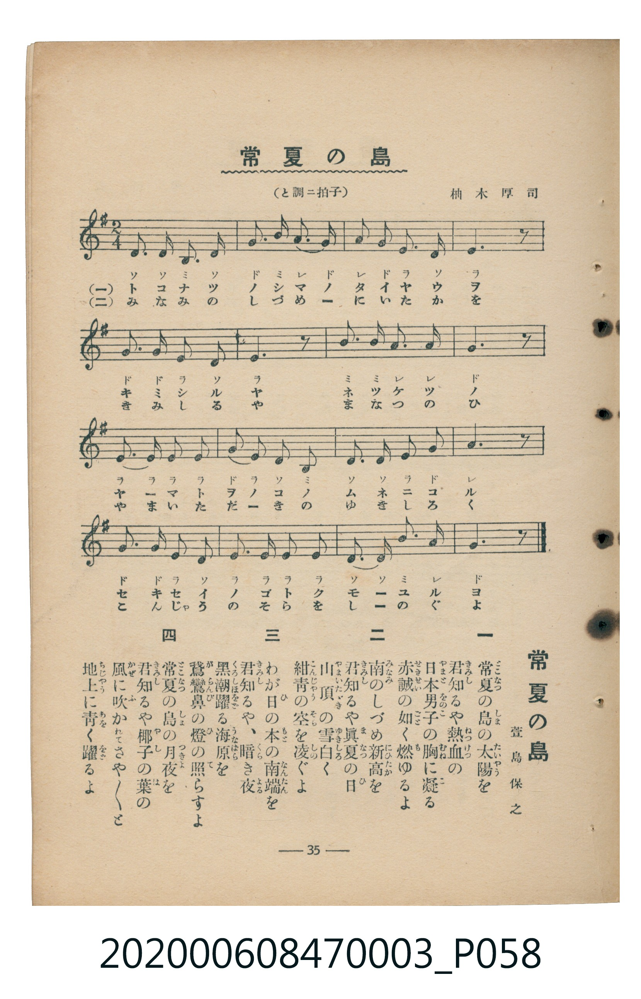

# 常夏の島

<audio controls src="tokonatsu_no_shima.mp3"></audio>

- 詞：萱島保之
- 曲：柚木厚司
- 臺灣教育會公認《新定兒童唱歌》尋常科第三學年用（2020.006.0847.0003）

## 說明

原書資訊與歌詞全文（對應 P058.jpg，書頁 p. 35，第三學期第 7 首）：
調性與拍號：と調二拍子（G 大調 2/4 拍）

## 歌詞

```text
一
常夏（とこなつ）の島（しま）の太陽（たいやう）を
君知（きみし）るや熱血（ねつけつ）の
日本男子（やまとをのこ）の胸（むね）に凝（こ）る
赤誠（せきせい）の如（ごと）く燃（も）ゆるよ

二
南（みなみ）のしづめ新高（にひたか）を
君知（きみし）るや眞夏（まなつ）の日（ひ）
山頂（やまいたゞき）の雪白（ゆきしろ）く
紺青（こんじやう）の空（そら）を凌（しの）ぐよ

三
わが日（ひ）の本（もと）の南端（なんたん）を
君知（きみし）るや、暗（くら）き夜（よる）
黒潮躍（くろしほをど）る海原（うなばら）を
鵞鑾鼻（がらんび）の燈（ひ）の照（て）らすよ

四
常夏（とこなつ）の島（しま）の月夜（つきよ）を
君知（きみし）るや椰子（やし）の葉（は）の
風（かぜ）に吹（ふ）かれてさや／＼と
地上（ちじやう）に青（あを）く躍（をど）るよ
```

## ABC

```abc
X:1
T:常夏の島
C:曲：柚木厚司
M:2/4
L:1/16
Q:1/4=108
K:G
V:V1 name="Piano" snm="Pia"
[V:V1]
d2 d2 B2 d2 | g3 b a3 g | a2 g2 e2 d2 | e6 z2 |
g3 g e2 d2 | e6 z2 | b2 b2 a3 a | g6 z2 |
e3 e e2 e2 | g2 e2 d2 B2 | d2 d2 e3 g | a6 z2 |
g3 g e2 d2 | e2 e2 e2 e2 | d3 d b2 a2 | g6 z2 |
```

## TMD 檔案連結

- [主旋律 TMD 檔案](tokonatsu_no_shima.tmd)
- [鋼琴伴奏 TMD 檔案](tokonatsu_no_shima_piano.tmd)

## 分析

```text
================================================================================
📊 TMD Song Profile: [ 常夏の島 ]
================================================================================
⏱  Duration:       0:17 (17.8s), 16 measures total
🎼 Key & Tempo:    首調基準 G, != 108.0 BPM, <2/4>
   - 分析範圍：      由實際發聲的音符與和弦推測調性；播放脈絡另行呈現
🎤 人聲音域:    B3 (MIDI 59) – E5 (MIDI 76) [跨度: 17 個半音 / 1.4 個八度, 難度: challenging]
   - 最低音:  B3 in [TokonatsuNoShima #1 @ m.1, 0:00]
   - 最高音: E5 in [TokonatsuNoShima #1 @ m.14, 0:15]
   - 適合: soprano, mezzo-soprano, contralto, tenor, baritone, bass
🏛  結構:      TokonatsuNoShima (17.8s)
⚡ 編曲密度:        Peak 1 軌道同時演奏
🗝  調性診斷：       E 小調（純淨自然小調，未偵測到可信轉調）
   - 風格氣質:    純淨自然小調（陰鬱抒情、旋律集中，無明顯調外色彩）
   - 轉調歷程:    全曲維持單一推測調性（未偵測到可信轉調）
   - 核心骨幹音:  E, G, D, A, B
   - 調性數值:    E 小調 [相關度: 0.82, 穩定度: High, 自然音純度: 100.0%]
   - 候選調性 (K-S): E 小調 (0.82), G 大調 (0.69), D 大調 (0.56)
   - 五度圈歷程:   +4
   - 各段落調性細節:
     • [TokonatsuNoShima #1]: E 小調 (r: 0.82, 自然音純度: 100.0%)

  [ 五度圈游移軌跡 ]
               C  
         F            G  
      Bb               D  
      Eb               A  
         Ab          [E ]*
            Db       B  
               F# 
     (* = active key center)

  [ 十二半音累積音高分佈 ]
     C  :                            0.0%
     C# :                            0.0%
     D  : ██████████████            18.6%
     D# :                            0.0%
     E  : ████████████████████████  33.1%
     F  :                            0.0%
     F# :                            0.0%
     G  : ██████████████████        24.6%
     G# :                            0.0%
     A  : ██████████                14.4%
     A# :                            0.0%
     B  : ███████                    9.3%
--------------------------------------------------------------------------------
Assignment 軌道音域：
  - Piano         : B3 – E5 (17 個半音 / 1.4 個八度, 49 個音符)
================================================================================
```


## 原書掃描頁




