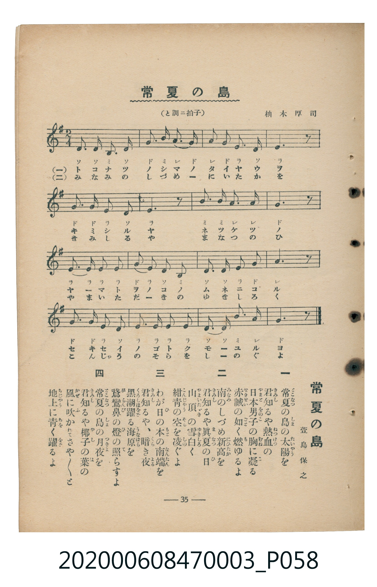

# 常夏の島

> Re:Shōka 使用 AI 協助辨識與重建樂譜，可能會有錯誤。歡迎回報。

- **鋼琴伴奏版**：<br><audio controls src="tokonatsu_no_shima.mp3"></audio>
- **NEUTRINO 歌聲合成版**：<br><audio controls src="tokonatsu_no_shima_neutrino.mp3"></audio>

- 詞：萱島保之
- 曲：柚木厚司
- 臺灣教育會公認《新定兒童唱歌》尋常科第三學年用（2020.006.0847.0003）

## 說明

原書資訊與歌詞全文（對應 P058.jpg，書頁 p. 35，第三學期第 7 首）：
調性與拍號：と調二拍子（G 大調 2/4 拍）


## 歌詞

```text
一
常夏（とこなつ）の島（しま）の太陽（たいやう）を
君知（きみし）るや熱血（ねつけつ）の
日本男子（やまとをのこ）の胸（むね）に凝（こ）る
赤誠（せきせい）の如（ごと）く燃（も）ゆるよ

二
南（みなみ）のしづめ新高（にひたか）を
君知（きみし）るや眞夏（まなつ）の日（ひ）
山頂（やまいたゞき）の雪白（ゆきしろ）く
紺青（こんじやう）の空（そら）を凌（しの）ぐよ

三
わが日（ひ）の本（もと）の南端（なんたん）を
君知（きみし）るや、暗（くら）き夜（よる）
黒潮躍（くろしほをど）る海原（うなばら）を
鵞鑾鼻（がらんび）の燈（ひ）の照（て）らすよ

四
常夏（とこなつ）の島（しま）の月夜（つきよ）を
君知（きみし）るや椰子（やし）の葉（は）の
風（かぜ）に吹（ふ）かれてさや／＼と
地上（ちじやう）に青（あを）く躍（をど）るよ
```

## ABC

<div class="abc-score" data-abc-src="tokonatsu_no_shima.abc" aria-label="五線譜載入中"></div>

[下載 ABC 原始檔](tokonatsu_no_shima.abc)

## TMD 檔案連結

- [主旋律 TMD 檔案](tokonatsu_no_shima.tmd) [[在 TMD Studio 編輯](https://tmdlang.github.io/Tmd-TS/#tmd=s7IKdvYPcrWy4qpTUCpJTLdSSM7PyUlNLsnMz7MqzsjMK0nNjM_KTMmPL87Iz05Ugisry88pzU21Si9KTEmNN443MjAyiDcwMIs3sDAxBzIMjBFKi_NLi5JTrYqTM_Lzc-JLUitKkvLzsxHyBUX5Zal5iXlANQVFIBtTwIoQClLLMlNSQdKpKZkl-UWZiTlI7kgtKga7FWxJfElRYl5xclFmAcgDCFUlGalAx-YllpQWpaKLFqcmFufnFSOEgTakZ-ZZlSRmlifmxeenpWUmo1iZX1SSkQ_0eEFGpVVGZjHIRcmJOfHZiXlI4QN1T0FieqpVgIGphRKXlpbC0x07ni7pf9y47unmbQpaWlyKtgqGBhZc9rYK7lw2RvomdiDtL1bOe79n1osJG4GKnuyf-2RnN9jUZ7M3AYWfzZ_1bM6Kp32znvbvAAu_aN_1vHHxs6kzXzRtejan-Wnrmhereh83dD2btuHpullPWyc9X7306ZSNz9b2PG7ofrqhG-iE58snPl-z5smOzqdrdzzdueX5lBXv93SAIlAPGIF6oAgEMgyM3-_pVOLi0tdSsKUW4FJQUHjaN__Z7B0vNre_WNH1oqMd6C6gf5-2rng2rR3oiqcbep-1dyqAAkwvqyD9_Z4eoOKXCxoVCvQUjE2BXLjDn82ZD2QrmCu8XDYN6FJg0IBMf7Fq_7OG5SBzu3tfzJwPFH3cuAIo-GRXD1Dk6doJQDvcFZ4uWQ4UUwAGuAJQFKibC6T3yY4GsAPBcQRUB9T5uHHy48ZVjxuXANVAYg0sPv1x4z6oyJJVL2fuBQvOf9zY8rip5XFjG0iqaRLYrAmzn89fCpbufdy4H6gTLNcNVPe8beOLhQ1gqbVACx43ToRbA9L5bPrSZ3PWPJ-yHeJmsMH7QC5qmgRUAXQXROmL5h1g2QagKWCR1U_b54INBSto6gYHytYlL1YtAIvOBjsESLZA3b-sCSw-BWg0WKT_eXsz2ESgOFB_G9ixHZDw2dUD9lMv0BNALUDfAENmP8QccJgsfdzUCEx2L1fPACtY_bhxEzhYuokLkDnzYOEO9Cgi0IEhARYEpv5OsBEbN75cAHY1NEyA5PzHTfOAJkI0vJy96jkkToDOB1kz_XETRKofpP_5ll0v506ChNHjJmD8zkDEWuO65yt3gaXmPm4CpimQs5-298AifR1YzQR4gOwAO-hxEzBH9yA7E-TqOWsgwQgL2HXAcHu-ej1YzSqwvUBHQyKJUMg8bmh8NgsS6P1QZzX2Pl0yB2wBEIHCF2TEy92Tnu1d92IX0LMQpWC_N-4Gp5mVEOOebd0OzIFgBcDAAYbyBrhHwUZsnfdy4r6Xe3aDVfQA5cBO3QwNnPYOZD8-b10O5i4D6weKzISFzNPZs0nOSs_mdED9BMoNvUCjiAqcZ0s2IGURsDgwW0wE-gmoGBjcsAz1chGolAMmxseNQEvAOWXCTrDIVjAXaFYP0CuPG6cCDXq_B-jqPUBXgy2fs-HJji6w0oWoqWU1LCE1Ad0JSWHQ0EcKcVCYAE2hvPSEAgUtfS6ukPzsfGBtVlzqlx-ckZmbaBWQmZiX71BjUFMNskzBxtBMyw7MwlZ-K4BL0YYXC3sUNEwUnm7of76-QQde6Gpi0QC0E2rYy1l9Tyf0WgFT_V5w2geTzfPh7BogrxOkFiz6uHkNlN0JlgHxIPKPm1ei6AHxkAHCRg2gUzWBFjZ3gDVsBmvuApMtUM19EEuatgPZ86AW9oFkmvaDxZeARcBk0zKonk14LNzVA7KwEay5cRWYhLDXQTQ3TodY0rgUaGAj1MI9YJnVYHGQw4A5HEx2Q_Q0TcJuYY2CabyCLhACKWM4q0bBEMw0VjAC04ZAERALJGoGUgXWVANhw6ABSAhsqI8hyC0rwKLAnAf2BYS9BOzKdVDedCDeB2WvA8vMB7NbQGQTmGxsA1sEcj_CJrDlEJuMQLr2Q81YhcSGmDcdyoOEFEQ3JJxAopvAJMTObvz2GIPk-qGm9UD1wu1paoLyIH5G2A_yN7AMQ9gDZuOxx4TckFsCZveC7ehA-BSLPfgz5q4eyjImPPt1EshkkGwLEgcnVGjmRM2wELMwEi1StmxaCzcMlAFBLFAeAGkGZThk63qh4uDc0bQRLAZiw7MrkNR4sWrJsyW9L9t7n_ZuADb4nq5f9rxpF1Dv4-ZmoB6gBqAqTWy5FWQ6JKdC8iew7IXYB0zHKO4AxhskF0NyNrhYAOdsEL0JKIMB4FkVkikNCWRBYK5FzrtGcI3YsykoyYCSDsThYDbQ6RCHoyUdoIq18OQIbDNiSZrYMyhpdsASNig7g5I1IpFDMh3WzEmiHdCs3ARMpTCdwGwDUg0qCHBlTJLsgIpBMiss467HEVYEastOCjMlJOuBaGimBJOwLIacUeHZEqWGhelH1KNYEihybQnJfKBqCVInQupPWM0HqTNhtSmIDZJZAOaBMtLjZlDmgagAyYCyNC4LIfkPmstAiQe5_gP5A2L9HrAY2HBYPdrUhiQGrVObeqHJA6uF8OwGpMAsMAHJX4hMCa5HkStWqCZYLYojJ8LTECQHQKoBWBEOSTOgKgHGBsk0QNWvBWJQlQZRgScVg3IjPF1CggpWNYG8vQDuAlBKR9gDqoQhooh0Dwso3DkSlsdguoCdARQfrQTLwlwK0gGzB5TzN0B1g5Mc3uoSZgKwbQ0mQSEBEt8K5oFkga1rMHsZVGYq1OwWFDai6iU6ZwK7GjStLjFJWM6EqESuPImsMHdDNQPTDJgNaZ9Cqj8QbwvYQEhrdz1UZhHUkaDcDGrBIirZFXgshNaMk6EWglozwP5LMzieIVUgKCMCe7tgaXBBBG6mgmSg2RFkI1TVBKjnQS7DYiPe2hEtuyI1ecEMQlXkbGjyAiVkGBuSXGDF-hRo0oEkepAzIS1CUMKCJmpoRQFrm2HJmODMDWkjQkMKYngbilVzwWEFUgbKE5CwgqV_mJoJ-KwC501QfoDWf-AmKUgXuKyFm7EJzobYAso7MD0QFTPx2QLOmQuhKuHRjjAOVlw1wYsDWMjBsjqkgMAXcrVcXLp2Cui9UQWgmDIXAA)]
- [鋼琴伴奏 TMD 檔案](tokonatsu_no_shima_piano.tmd) [[在 TMD Studio 編輯](https://tmdlang.github.io/Tmd-TS/#tmd=s7IKdvYPcrWy4qpTUCpJTLdSyC8qychPL0osyKi0ysgsLskvykxOzInPTsxLVIIrKs4vLUpOjS9ITE-1CjAwtVDi0tJSeLpjx9Ml_Y8b1z3dvO39no6X3XueT9jyZM-Wp0v7n3d2vN_TqaClxaVoq2BoYMFlb6vgzmVjpG9iBzLzxcp57_fMejFhI1Dnk_1zn-zsBlv1bPYmoPCz-bOezVnxtG_W0_4dYOEX7bueNy5-NnXmi6ZNz-Y0P21d82JV7-OGrmfTNjxdN-tp66Tnq5c-nbLx2dqexw3dTzd0A931fPnE52vWPNnR-XTtjqc7tzyfsgLoQCMDIwM9AwMzPQMLE3Mgw8AY6EYlLq6Q_Oz8vMSS4lK__OCMzNxEq4DMxLz8IA-HGoOaai4FILAxNNOyA7P0tRRs0YEC2KqGFwt7FDRMFJ5u6H--vkFHARRMelkF6ZpYNGjpwwx7Oavv6YReK4XHTXuBAlCyeT6cXQPkdYLUgkUfN6-BsjvBMiAeRP5x80oUPSAeMkDYqAF0qibQwuYOsIbNYM1dYLIFqrkPYknTdiB7HtTCPpBM036w-BKwCJhsWgbVswmPhbt6QBY2gjU3rgKTEPY6iObG6RBLGpcCDWyEWrgHLLMaLA5y2ONGcKg0dkP0NE3CbmGNgmm8gi4QAiljOKtGwRDMNFYwAtOGQBEQCyRqBlIF1lQDYcOgAUgIbKiPIcgtK8Cijxsng30BYS8Bu3IdlDcdiPdB2evAMvPB7BYQ2QQmG9vAFoHcj7AJbDnEJiOQrv1QM1YhsSHmTYfyZoFDCqIbEk4g0U1gEmJnN357jEFy_VDTeqB64fY0NUF5ED8j7Af5-3HTZIQ9YDYee0zIDbklYHYv2I4OhE-x2IM_Y-7qoSxjwrNfJ4FMBsm2IHFwQoVmTtQMCzELI9EiZcumtXDDQBkQxALlAZBmUIZDtq4XKg7OHU0bwWIgNjy7AkmNF6uWPFvS-7K992nvhvd7ep6uX_a8aRdQ7-PmZqAeoAagKk1suRVkOiSnQvLn4yZYzoPYAXcHMN4guRiSs8HFAjhng-hNQBkMAM-qkExpSCALAnMtct41gmvEnk1BSQaUdCAOB7OBToc4HC3pAFWshSfHx40TsSRN7BmUNDtgCRuUnUHJGpHIIZkOa-Yk0Q5oVm4CplKYTmC2AakGFQS4MiZJdkDFIJkVlnHX4wgrArVlJ4WZEpL1QDQ0U4JJWBZDzqjwbIlSw8L0I-pRLAkUubaEZD5QtQSpEyH1J6zmg9SZsNoUxAbJLADzQBnpcTMo80BUgGRAWRqXhZD8B81loMSDXP-B_AGxfg9YDGw4rB5takMSg9apTb3Q5IHVQnh2A1JgFpiA5C9EpgTXo8gVK1QTrBbFkRPhaQiSAyDVAKwIh6QZUJUAY4NkGqDq1wIxqEqDqMCTikG5EZ4uIUEFq5pA3l4AdwEopSPsAVXCEFFEuocFFO4cCctjMF2PG3ej-GglWBbmUpAOmD2gnL8Bqhuc5PBWlzATHjfOAZOgkACJbwXzQLKPm3rA7GVQmalQs1tQ2Iiql-ic-XT2bJpWl5gkLGdCVCJXnkRWmLuhmoFpBsyGtE8h1R-ItwVsIKS1ux4qswjqSFBuBrVgEZXsCjwWQmvGyVALQa2ZGY-bmsHxDKkCQRnxceNcsDS4IAI3U0Ey0OwIshGqagLU8yCXYbERb-2Ill2RmrxgBqEqcjY0eYESMowNSS6wYn0KNOlAEj3ImZAWIShhQRM1tKKAtc2wZExw5oa0EaEhBTG8DcWqueCwAikD5QlIWMHSP0zNBHxWgfMmKD9A6z9wkxSkC1zWws3YBGdDbAHlHZgeiIqZ-GwB58yFUJXwaEcYByuumuDFASzkYFkdUkDgC7laXJ1RH-TOqAm0LwqM43iFaMNYZIZpPJBlGg9imgGZBlDXI6mACiOrBMohFILko83ic1GMRTEfh6EwTagGg-VBHtO1U0D3W7QPUBKruBEOcWMc4iZgcWUuAA)]

## 分析

```text
================================================================================
📊 TMD Song Profile: [ 常夏の島 ]
================================================================================
⏱  Duration:       0:17 (17.8s), 16 measures total
🎼 Key & Tempo:    首調基準 G, != 108.0 BPM, <2/4>
   - 分析範圍：      由實際發聲的音符與和弦推測調性；播放脈絡另行呈現
🎤 人聲音域:    B3 (MIDI 59) – B4 (MIDI 71) [跨度: 12 個半音 / 1.0 個八度, 難度: easy]
   - 最低音:  B3 in [TokonatsuNoShima #1 @ m.1, 0:00]
   - 最高音: B4 in [TokonatsuNoShima #1 @ m.2, 0:01]
   - 適合: soprano, mezzo-soprano, contralto, tenor, baritone, bass
🏛  結構:      TokonatsuNoShima (17.8s)
⚡ 編曲密度:        Peak 1 軌道同時演奏
🗝  調性診斷：       E 小調（純淨自然小調，未偵測到可信轉調）
   - 風格氣質:    純淨自然小調（陰鬱抒情、旋律集中，無明顯調外色彩）
   - 轉調歷程:    全曲維持單一推測調性（未偵測到可信轉調）
   - 核心骨幹音:  E, G, D, A, B
   - 調性數值:    E 小調 [相關度: 0.84, 穩定度: High, 自然音純度: 100.0%]
   - 候選調性 (K-S): E 小調 (0.84), G 大調 (0.69), D 大調 (0.54)
   - 五度圈歷程:   +4
   - 各段落調性細節:
     • [TokonatsuNoShima #1]: E 小調 (r: 0.84, 自然音純度: 100.0%)

  [ 五度圈游移軌跡 ]
               C  
         F            G  
      Bb               D  
      Eb               A  
         Ab          [E ]*
            Db       B  
               F# 
     (* = active key center)

  [ 十二半音累積音高分佈 ]
     C  :                            0.0%
     C# :                            0.0%
     D  : █████████████             17.8%
     D# :                            0.0%
     E  : ████████████████████████  33.1%
     F  :                            0.0%
     F# :                            0.0%
     G  : ██████████████████        24.6%
     G# :                            0.0%
     A  : ██████████                13.6%
     A# :                            0.0%
     B  : ████████                  11.0%
--------------------------------------------------------------------------------
Assignment 軌道音域：
  - Piano         : B3 – B4 (12 個半音 / 1.0 個八度, 49 個音符)
================================================================================
```


## 原書掃描頁




