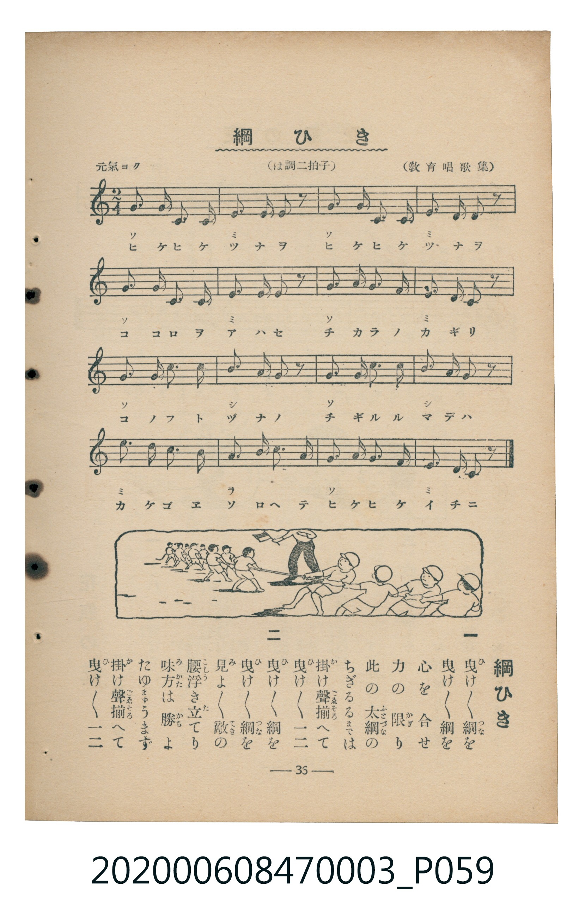

# 綱ひき

> Re:Shōka 使用 AI 協助辨識與重建樂譜，可能會有錯誤。歡迎回報。

- **NEUTRINO 歌聲合成版**：<br><audio controls src="tsunahiki_neutrino.mp3"></audio>
- **鋼琴伴奏版**：<br><audio controls src="tsunahiki.mp3"></audio>


- 教育唱歌集
- 臺灣教育會公認《新定兒童唱歌》尋常科第三學年用（2020.006.0847.0003）

## 說明

原書資訊與歌詞全文（對應 P059.jpg，書頁 p. 36，補充教材第 1 首）：
調性與拍號：は調二拍子（C 大調 2/4 拍），元氣ヨク ♩=116


## 歌詞

```text
一
曳け曳け綱を　曳け曳け綱を
心を合せ　力の限り
此の太綱の　ちぎるるまでは
掛け聲揃へて　曳け曳け一二

二
曳け曳け綱を　曳け曳け綱を
見よ見よ敵の　腰浮き立てり
味方は勝よ　たゆまうまず
掛け聲揃へて　曳け曳け一二
```

## ABC

```abc
X:1
T:綱ひき
M:2/4
L:1/16
Q:1/4=116
K:C
V:V1 name="Piano" snm="Pia"
[V:V1]
G3 G C3 C | E3 E E2 z2 | G3 G C3 C | E3 D D2 z2 |
w: 1.~ひ け ひ け | つ な を | ひ け ひ け | つ な を
w: 2.~ひ け ひ け | つ な を | ひ け ひ け | つ な を
G3 G C3 C | E3 E E2 z2 | G3 A G3 F | E3 D C2 z2 |
w: 1.~こ こ ろ を | あ は せ | ち か ら の | か ぎ り
w: 2.~み よ み よ | て き の | こ し う き | た て り
G3 G c3 c | B3 A G2 z2 | G3 G c3 c | B3 A G2 z2 |
w: 1.~こ の ふ と | づ な の | ち ぎ る る | ま で は
w: 2.~み か た は | か ち よ | た ゆ ま ず | う ま ず
e3 d c3 B | A3 B c3 A | G3 A G3 F | E3 D C2 z2 |
w: 1.~か け ご ゑ | そ ろ へ て | ひ け ひ け | い ち に
w: 2.~か け ご ゑ | そ ろ へ て | ひ け ひ け | い ち に
```

## TMD 檔案連結

- [主旋律 TMD 檔案](tsunahiki.tmd) [[在 TMD Studio 編輯](https://tmdlang.github.io/Tmd-TS/#tmd=s7IKdvYPcrWy4qpTUCpJTLdSSM7PyUlNLsnMz7MqzsjMK0nNjM_KTMmPL87Iz05Ugisry88pzU21Si9KTEmNN443MjAyiDcwMIs3sDAxBzIMjBFKi_NLi5JTrYqTM_Lzc-JLUitKkvLzsxHyBUX5Zal5iXlANQVFIBtTwIoQClLLMlNSQdKpKZkl-UWZiTlI7kgtKga7FWxJfElRYl5xclFmAcgDCFUlGalAx6alFpdkliHrhogXF-QXAa3T0lJ4vm3j48ZNjxt7FbS0uBRtFQwNzbjsbRWcuWyM9E3sQNqeTZ35omnT0ykbn63teTm7DWzUi_ZdzxsXQ2SezWl-2rrmxarexw1dz6ZteLpu1tPWSc9XL4XoeNzQ_XRD99MdO54vn_h8zZonOzqfrt3xdOeW51NWvN_TAQpEPWAg6oECEcgwMH6_p1OJi0tfS8GWWoBLQUHhad_8Z7N3vNjc_mJF14uOdqC7Xqyc97R1xbNp7UBXPN3Q-6y9UyHAwNRSL6sg_f2eHqDilwsaFQr0FIzNgNwXi-c8bW0FevfZ3AlATygYKrxcNg3o0vd7ZoFMf7Fq_7OG5SBzu3tfzJwPFH3cuB4o-GRXD1Dk6doJQDucFZ4uWQ4UUwAGqwJQFKy752lr87MNix83r3jctF7h0cyVtqDgBxn5ZEcDiHo2e_PjxokQEhRTTZMeNzRgCoK9uL8ZyHo6oeNx42ygoqddsx83rns5c8Ljpi6wSWuXAPlPl6wCR_g6oIrHjQsfN_Y9buoGocZ9jxuXA10NVtoH1DrxReOmZ_3Njxt3PG5chmYp0HFAr0HcCaRJc-eLZUALOyDks6lbIW550brh2dZ1wFT4fDXQLcugbn46cfOzaTuBrnraPReoGuzm-Y-b2sCuhZDg8CfWwUCllCcnKFDQ0ufiCikuzUvMyMzOtArITMzLd6gxqKkG2aJgY6FlB2YAE7KhromVAjiPTYSRwKhYBQwOHKJAk0FaaxQ0TBV0gdBUU1VDV1dTQcMQzDWEcoHyxmABY6iAsYIB8ZqMoAJGIE1g-3wMgZJAt4ClgQ4C6kXhgWWXQPmrNBVATo2HiJKqB2KfEX3tA0aFqa4FKComg1BTLyiVNjYBkxcwxwBFgbkBmCY7QQkSyADljC7qRIUZTBOEa4IrKgzRo2Iy1COTQd5s6oXwmiZBvdkElV0P9CbQA9CgWQgV7Qbr6YTy1kH1dEP5faCg6UKPiv1QGzrAwYrEA8sug-rtBdm3DmYfzI3TwXraEGrAsvOh_GWo9gGjwlLX0AgaF8DwBhYDKx43LgVlAKDRWEsmPHERB4mMOETAmqMEvCn2jEGUNmzxAQxNIG8rlLcC6telSMkOET6w-ACGODA-oOHfBIwdsOw-qOxykJ71OOIDEpfwsATGN0pcLgSFbQfMPqiqpjawHpj5s6B6YPGzD2TfLOT4MDTWNTQDRQgwxIFl0ZTHTUASWOr2QgpUtKKqBRxFq5HixBgSmkaw0IQFrzkidM1QBGAKYKFNeXaBBQikVJgCDQhYqTAXygcmTSBvByJhElGitCAFNdDXaNFEV3trubh07RTgFY8CkKPMBQA)]
- [鋼琴伴奏 TMD 檔案](tsunahiki_piano.tmd) [[在 TMD Studio 編輯](https://tmdlang.github.io/Tmd-TS/#tmd=s7IKdvYPcrWy4tLSUni-bePjxk2PG3vf7-l42b3n-YQtT_Zsebq0_3lnx_s9nQpaWlyKtgqGhmZc9rYKzlw2Rvomdlx1CkrPps580bTp6ZSNz9b2vJzdpgQSe9G-63njYojMsznNT1vXvFjV-7ih69m0DU_XzXraOun56qUQHY8bup9u6H66Y8fz5ROfr1nzZEfn07U7nu7c8nzKCqAzjAyMDPQMDMz0DCxMzIEMA2OgS5S4uEKKS_MSMzKzM60CMhPz8oM8HGoMaqq5FIDAxkLLDszQ11Iw1DWxUgD7aSKMXPK4cdXjpkk4RLX0wVprFDRMFXSB0FRTVUNXV1NBwxDMNYRygfLGYAFjqICxggHxmoygAkYgTWD7fAyBkkC3gKWBDgLqReGBZZdA-as0FUBOjYeIkqoHYp8Rfe0DRoWprgUoKiaDUFMvUPJxY9PjxvWPG2cDRRc-bux-3NT5uHEdiNHY97ipizpRYQbTBOGa4IoKQ_SomAz1yGSQN5t6IbymSVBvNkFl1wO9CfQANGgWQkW7wXo6obx1UD3dUH4fKGi60KNiP9SGDnCwIvHAssugentB9q2D2Qdz43SwnjaEGrDsfCh_Gap9wKiw1DU0gsYFMLy3Pm5c8bhxKSgDAI0GxwUw_IHRAYyIfY8blwN9iScu4iCREYcIWHOUgDfFnjGI0oYtPoChCeRthfJWQP26FCnZIcIHFh_AEAfGBzT8m4CxA5bdB5VdDtKzHkd8QOISHpbA-EaJy4WgsO2A2QdV1dQG1gMzfxZUDyx-9oHsm4UcH4bGuoZmoAgBhjiwLJryuAlIzgXlksYdoLhHLapawFG0GilOjCGhaQQLTVjwmiNC1wxFAKYAFtqUZxdYgEBKhSnQgICVCnOhfGDSBPJ2IBImESVKC1JQA32NFk10tbcWo97xQa53TKD1To2CYbxCtGEshAFK_nC-aXw8iAPxAnZ1JvjUgcQxDIRFBZKwCVAYYRKa3UBv6NopwH0S7QOURhUwAgsocwEA)]

## 分析

```text
================================================================================
📊 TMD Song Profile: [ 綱ひき ]
================================================================================
⏱  Duration:       0:16 (16.6s), 16 measures total
🎼 Key & Tempo:    首調基準 C, != 116.0 BPM, <2/4>
   - 分析範圍：      由實際發聲的音符與和弦推測調性；播放脈絡另行呈現
🎤 人聲音域:    C4 (MIDI 60) – E5 (MIDI 76) [跨度: 16 個半音 / 1.3 個八度, 難度: moderate]
   - 最低音:  C4 in [Tsunahiki #1 @ m.1, 0:00]
   - 最高音: E5 in [Tsunahiki #1 @ m.13, 0:12]
   - 適合: soprano, mezzo-soprano, contralto, tenor, baritone, bass
🏛  結構:      Tsunahiki (16.6s)
⚡ 編曲密度:        Peak 1 軌道同時演奏
🗝  調性診斷：       C 大調（純淨自然大調，未偵測到可信轉調）
   - 風格氣質:    純淨自然大調（陽光明朗、易唱易記，無明顯調外色彩）
   - 轉調歷程:    全曲維持單一推測調性（未偵測到可信轉調）
   - 核心骨幹音:  G, C, E, A, B
   - 調性數值:    C 大調 [相關度: 0.88, 穩定度: Moderate, 自然音純度: 100.0%]
   - 候選調性 (K-S): C 大調 (0.88), E 小調 (0.78), G 大調 (0.75)
   - 五度圈歷程:   +0
   - 各段落調性細節:
     • [Tsunahiki #1]: C 大調 (r: 0.88, 自然音純度: 100.0%)

  [ 五度圈游移軌跡 ]
              [C ]*
         F            G  
      Bb               D  
      Eb               A  
         Ab           E  
            Db       B  
               F# 
     (* = active key center)

  [ 十二半音累積音高分佈 ]
     C  : ████████████████████      26.3%
     C# :                            0.0%
     D  : ████                       5.3%
     D# :                            0.0%
     E  : ████████████████          21.1%
     F  : █                          1.8%
     F# :                            0.0%
     G  : ████████████████████████  31.6%
     G# :                            0.0%
     A  : █████                      7.0%
     A# :                            0.0%
     B  : █████                      7.0%
--------------------------------------------------------------------------------
Assignment 軌道音域：
  - Piano         : C4 – E5 (16 個半音 / 1.3 個八度, 57 個音符)
================================================================================
```


## 原書掃描頁




