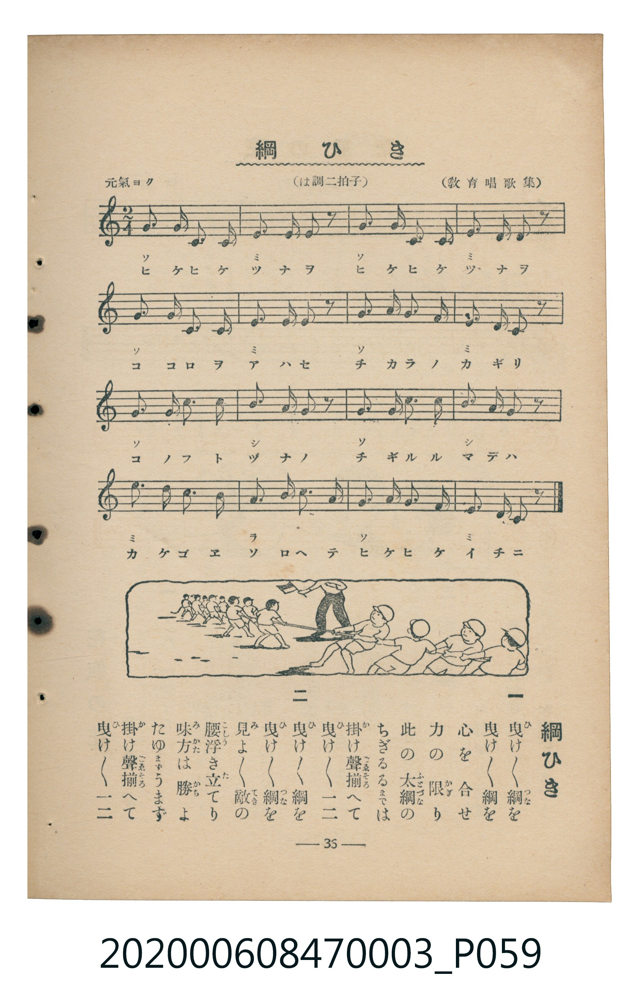

# 綱ひき

> Re:Shōka 使用 AI 協助辨識與重建樂譜，可能會有錯誤。歡迎[回報](https://github.com/TMDLang/reshoka/issues)。

- **鋼琴伴奏版**：<br><audio controls src="tsunahiki.mp3"></audio>
- **NEUTRINO 歌聲合成版**：<br><audio controls src="tsunahiki_neutrino.mp3"></audio>

- 教育唱歌集
- 臺灣教育會公認《新定兒童唱歌》尋常科第三學年用（2020.006.0847.0003）

## 說明

原書資訊與歌詞全文（對應 P059.jpg，書頁 p. 36，補充教材第 1 首）：
調性與拍號：は調二拍子（C 大調 2/4 拍），元氣ヨク ♩=116


## 歌詞

```text
一
曳け曳け綱を　曳け曳け綱を
心を合せ　力の限り
此の太綱の　ちぎるるまでは
掛け聲揃へて　曳け曳け一二

二
曳け曳け綱を　曳け曳け綱を
見よ見よ敵の　腰浮き立てり
味方は勝よ　たゆまうまず
掛け聲揃へて　曳け曳け一二
```

## ABC

<div class="abc-score" data-abc-src="tsunahiki.abc" aria-label="五線譜載入中"></div>

[下載 ABC 原始檔](tsunahiki.abc)

## TMD 檔案連結

- [主旋律 TMD 檔案](tsunahiki.tmd) [[在 TMD Studio 編輯](https://tmdlang.github.io/Tmd-TS/#tmd=s7IKdvYPcrWy4qpTUCpJTLdSSM7PyUlNLsnMz7MqzsjMK0nNjM_KTMmPL87Iz05Ugisry88pzU21Si9KTEmNN443MjAyiDcwMIs3sDAxBzIMjBFKi_NLi5JTrYqTM_Lzc-JLUitKkvLzsxHyBUX5Zal5iXlANQVFIBtTwIoQClLLMlNSQdKpKZkl-UWZiTlI7kgtKga7FWxJfElRYl5xclFmAcgDCFUlGalAx6alFpdkliHrhogXF-QXIVkHtCE9M88qNzUzKxOLc4FqM_KB_i7IqLTKyCwGOSg5MSc-OzEPKXigzilITE-1CjAwtVTi0tJSeL5t4-PGTY8bexW0tLgUbRUMDc247G0VnLlsjPRN7EB6n02d-aJp09MpG5-t7Xk5uw1s3ov2Xc8bF0Nkns1pftq65sWq3scNXc-mbXi6btbT1knPVy-F6Hjc0P10Q_fTHTueL5_4fM2aJzs6n67d8XTnludTVrzf0wGKIj1gFOmBogjIMDB-v6dTiYtLX0vBllqAS0FB4Wnf_Gezd7zY3P5iRdeLjnagu16snPe0dcWzae1AVzzd0PusvVMBFCZ6WQXp7_f0ABW_XNCoUKCnYGwG5L5YPOdpayvQu8_mTgB6QsFQ4eWyaUCXvt8zC2T6i1X7nzUsB5nb3fti5nyg6OPG9UDBJ7t6gCJP104A2uGs8HTJcqCYAjBYFYCiYN09T1ubn21Y_Lh5xeOm9QqPZq60BQU_yMgnOxpA1LPZmx83ToSQoJhqmvS4oQFTEOzF_c1A1tMJHY8bZwMVPe2a_bhx3cuZEx43dYFNWrsEyH-6ZBU4wtcBVTxuXPi4se9xUzcINe573Lgc6Gqw0j6g1okvGjc9629-3LjjceMyNEuBjgN6DeJOIE2aO18sA1rYASGfTd0KccuL1g3Ptq4DpsLnq4FuWQZ189OJm59N2wl01dPuuUDVYDfPf9zUBnYthASHP7EOBiqlPDlBgYKWPhdXSHFpXmJGZnamVUBmYl6-Q41BTTXIFgUbCy07MAOYkA11TawUwHlsIowERsUqYHDgEAWaDNJao6BhqqALhKaaqhq6upoKGoZgriGUC5Q3BgsYQwWMFQyI12QEFTACaQLb52MIlAS6BSwNdBBQLwoPLLsEyl-lqQByajxElFQ9EPuM6GsfMCpMdS1AUTEZhJp6Qam0sQmYvIA5BigKzA3ANNkJSpBABihndFEnKsxgmiBcE1xRYYgeFZOhHpkM8mZTL4TXNAnqzSao7HqgN4EegAbNQqhoN1hPJ5S3DqqnG8rvAwVNF3pU7Ifa0AEOViQeWHYZVG8vyL51MPtgbpwO1tOGUAOWnQ_lL0O1DxgVlrqGRtC4AIY3sBhY8bhxKSgDAI3GWjLhiYs4SGTEIQLWHCXgTbFnDKK0YYsPYGgCeVuhvBVQvy5FSnaI8IHFBzDEgfEBDf8mYOyAZfdBZZeD9KzHER-QuISHJTC-UeJyIShsO2D2QVU1tYH1wMyfBdUDi599IPtmIceHobGuoRkoQoAhDiyLpjxuApLAUrcXUqCiFVUt4ChajRQnxpDQNIKFJix4zRGha4YiAFMAC23KswssQCClwhRoQMBKhblQPjBpAnk7EAmTiBKlBSmogb5Giya62lvLxaVrpwCveBSAHGUuAA)]
- [鋼琴伴奏 TMD 檔案](tsunahiki_piano.tmd) [[在 TMD Studio 編輯](https://tmdlang.github.io/Tmd-TS/#tmd=s7IKdvYPcrWy4qpTUCpJTLdSyC8qychPL0osyKi0ysgsLskvykxOzInPTsxLVIIrKs4vLUpOjS9ITE-1CjAwtVTi0tJSeL5t4-PGTY8be9_v6XjZvef5hC1P9mx5urT_eWfH-z2dClpaXIq2CoaGZlz2tgrOXDZG-iZ2IAOfTZ35omnT0ykbn63teTm7DWzJi_ZdzxsXQ2SezWl-2rrmxarexw1dz6ZteLpu1tPWSc9XL4XoeNzQ_XRD99MdO54vn_h8zZonOzqfrt3xdOeW51NWAJ1hZGBkoGdgYKZnYGFiDmQYGANdosTFFVJcmpeYkZmdaRWQmZiXH-ThUGNQU82lAAQ2Flp2YIa-loKhromVAthPE2HkkseNqx43TcIhqqUP1lqjoGGqoAuEppqqGrq6mgoahmCuIZQLlDcGCxhDBYwVDIjXZAQVMAJpAtvnYwiUBLoFLA10EFAvCg8suwTKX6WpAHJqPESUVD0Q-4zoax8wKkx1LUBRMRmEmnqBko8bmx43rn_cOBsouvBxY_fjps7HjetAjMa-x01d1IkKM5gmCNcEV1QYokfFZKhHJoO82dQL4TVNgnqzCSq7HuhNoAegQbMQKtoN1tMJ5a2D6umG8vtAQdOFHhX7oTZ0gIMViQeWXQbV2wuybx3MPpgbp4P1tCHUgGXnQ_nLUO0DRoWlrqERNC6A4b31ceOKx41LQRkAaDQ4LoDhD4wOYETse9y4HOhLPHERB4mMOETAmqMEvCn2jEGUNmzxAQxNIG8rlLcC6tdZSMkOET6w-ACGODA-oOHfBIwdsOw-qOxykJ71OOIDEpfwsATGN0pcLgSFbQfMPqiqpjawHpj5s6B6YPGzD2TfLOT4MDTWNTQDRQgwxIFl0ZTHTUByLiiXNO4AxT1qUdUCjqLVSHFiDAlNI1howoLXHBG6ZigCMAWw0KY8u8ACBFIqTIHyYMl3LjRggEkTyNuBSJhElCgtSEEN9DVaNNHV3lqMescHud4xgdY7NQqG8QrRhrEQBij5w_mm8fEgDsQL2NWZ4FMHEscwEBYVSMImQGGESWh2A72ha6cA90m0D1AaVcAILKDMBQA)]

## 分析

```text
================================================================================
📊 TMD Song Profile: [ 綱ひき ]
================================================================================
⏱  Duration:       0:16 (16.6s), 16 measures total
🎼 Key & Tempo:    首調基準 C, != 116.0 BPM, <2/4>
   - 分析範圍：      由實際發聲的音符與和弦推測調性；播放脈絡另行呈現
🎤 人聲音域:    C4 (MIDI 60) – E5 (MIDI 76) [跨度: 16 個半音 / 1.3 個八度, 難度: moderate]
   - 最低音:  C4 in [Tsunahiki #1 @ m.1, 0:00]
   - 最高音: E5 in [Tsunahiki #1 @ m.13, 0:12]
   - 適合: soprano, mezzo-soprano, contralto, tenor, baritone, bass
🏛  結構:      Tsunahiki (16.6s)
⚡ 編曲密度:        Peak 1 軌道同時演奏
🗝  調性診斷：       C 大調（純淨自然大調，未偵測到可信轉調）
   - 風格氣質:    純淨自然大調（陽光明朗、易唱易記，無明顯調外色彩）
   - 轉調歷程:    全曲維持單一推測調性（未偵測到可信轉調）
   - 核心骨幹音:  G, C, E, A, B
   - 調性數值:    C 大調 [相關度: 0.88, 穩定度: Moderate, 自然音純度: 100.0%]
   - 候選調性 (K-S): C 大調 (0.88), E 小調 (0.78), G 大調 (0.75)
   - 五度圈歷程:   +0
   - 各段落調性細節:
     • [Tsunahiki #1]: C 大調 (r: 0.88, 自然音純度: 100.0%)

  [ 五度圈游移軌跡 ]
              [C ]*
         F            G  
      Bb               D  
      Eb               A  
         Ab           E  
            Db       B  
               F# 
     (* = active key center)

  [ 十二半音累積音高分佈 ]
     C  : ████████████████████      26.3%
     C# :                            0.0%
     D  : ████                       5.3%
     D# :                            0.0%
     E  : ████████████████          21.1%
     F  : █                          1.8%
     F# :                            0.0%
     G  : ████████████████████████  31.6%
     G# :                            0.0%
     A  : █████                      7.0%
     A# :                            0.0%
     B  : █████                      7.0%
--------------------------------------------------------------------------------
Assignment 軌道音域：
  - Piano         : C4 – E5 (16 個半音 / 1.3 個八度, 57 個音符)
================================================================================
```


## 原書掃描頁




