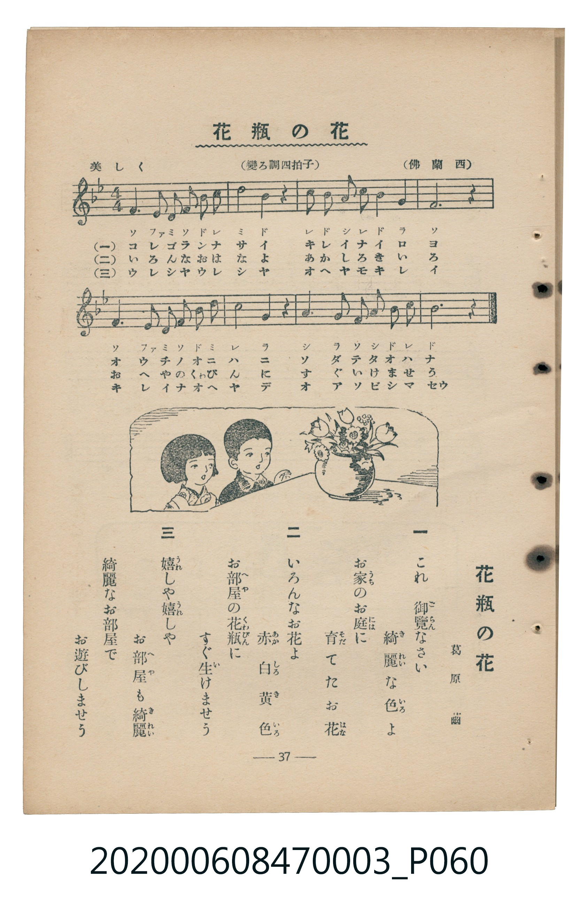

# 花瓶の花

> Re:Shōka 使用 AI 協助辨識與重建樂譜，可能會有錯誤。歡迎[回報](https://github.com/TMDLang/reshoka/issues)。

- **鋼琴伴奏版**：<br><audio controls src="kabin_no_hana.mp3"></audio>
- **NEUTRINO 歌聲合成版**：<br><audio controls src="kabin_no_hana_neutrino.mp3"></audio>

- 詞：葛原𦱳
- 曲：佛蘭西
- 臺灣教育會公認《新定兒童唱歌》尋常科第三學年用（2020.006.0847.0003）

## 說明

原書資訊與歌詞全文（對應 P060.jpg，書頁 p. 37，補充教材第 2 首）：
調性與拍號：變ろ調四拍子（Bb 大調 4/4 拍），美しく ♩=96


## 歌詞

```text
一
これ御覽なさい　綺麗な色よ
お家のお庭に　育てたお花

二
いろんなお花よ　赤白黃色
お部屋の花瓶に　すぐ生けませう

三
嬉しや嬉しや　お部屋も綺麗
綺麗なお部屋で　お遊びしませう
```

## ABC

<div class="abc-score" data-abc-src="kabin_no_hana.abc" aria-label="五線譜載入中"></div>

[下載 ABC 原始檔](kabin_no_hana.abc)

## TMD 檔案連結

- [主旋律 TMD 檔案](kabin_no_hana.tmd) [[在 TMD Studio 編輯](https://tmdlang.github.io/Tmd-TS/#tmd=s7IKdvYPcrWy4qpTUCpJTLdSSM7PyUlNLsnMz7MqzsjMK0nNjM_KTMmPL87Iz05Ugisry88pzU21Si9KTEmNN443MjAyiDcwMIs3sDAxBzIMjBFKi_NLi5JTrYqTM_Lzc-JLUitKkvLzsxHyBUX5Zal5iXlANQVFIBtTwIoQClLLMlNSQdKpKZkl-UWZiTlI7kgtKga7FWxJfElRYl5xclFmAcgDCFUlGalAxxbkJOYhGQs0KT0zz6okMRPoN5D_yhPjcxMz84CqUpBVlWTkA71ZkFFplZFZDLI_OTEnPjsxDyk0oLYXJKanWgUYmBkocWlpKbzo2vh88rbHjeuADAUtLS5FWwVLMy57WwWnJC4bE30TO5D2Fyvnvd8z68XE2U_75n9YtnEz2MxnszcBBZ_snf1ixtoXS_eDxV6073reuPjZ1JkvmjY9m9P8tHXNi1W9jxu6nk3b8HTdrKetk56vXvp0ysZna3seN3Q_3dD9dMeO58snPl-z5smOzqdrdzzdueX5lBXv93SAYkoPGFN6oJgCMgyM3-_pVOLi0tdSsKUW4FJQUAD659nsHS82t79Y0fWiox3oLqBXn7aueDatHeiKpxt6n7V3KoDCSi-rIP39nh6g4pcLGhUK9BSMzYHcF4vnPG1tBXr32dwJQE8oGCm8XDYN6FJguIBMf7Fq_7OG5SBzu3tfzJwPCsJ1XY-beoHiT2fPBgo-XTsBaI1TksLTJcuBggrA8FYACoNN6Hm-r-9x4_THjf0Kj2autAVGCsjIJzsaQNTjxsmPm3qe7lv4Ytnex42rHjdOfdzY8rih4fm2XS93AfWsetG56XFTB0Rp19N1oAgGMXatfdy4GqgOGD2PG5c9bpwPFARGPMToXT0Q9S1AJz5umgw2FyQLNAikZeuS5zP3vtzdDDQaau7L5hVPN3ZD0g44EYGMftw483HjhOdTgEZPfNy473Hj7MeNbVC3d4LDfE0nyF9NLXAGWBfMtKYmiCdASuHeQbJsOVR1Y9fjxs3gAILZAdRAeaqAAgUtfS4u78SkzDy_fA9gLrIKyEzMy3eoMaipBtmjYGOhZQdmAFOkoa6JlcLjps2Pm9c8btryuHnl42YgGxjRWx83LQFKrAVLLAELAUkgdwXIeJDuGgXTeAVdIDSJVzCOB3EMgYmoRsEYLKgL5OkqGABxDVDUUME8HkzpKpiBNMH1QiBYGdhQH8MaUAIBiwJTCZA9BUh3AvFkIHsVUCMwvUB1AWMbSEKMe9zYC1XfAlYHkQMmBohsUweSbWAdENuMQDpBKiFqYbYA4wiI14PNXQWzDWwGzLYmIO4G4ukQfUDbYe4B2QbiYbHNGKSzDclvIN0g97aB-SDZ6XDbkP0Gcs0OiNomkM1g24A6ILIQ96PbBoxcU10LUOSuety07HFz4-PmPhC7uftxcz-QBErsfdzc8Li57XHTfrAEULQLX-Qag6MSYg84FiGxC4xZqAhQFZADSQWgqMYVvV3Q6AN6u3EhEK-DenE12Dvr4dG7GikI5kLFFgDxMiCejzWSsEUvzDZoAIJt63_c1AekNoNjC5La0C2cCRWbAE1TE4F4HxDPBstCYhF7DENiHzU1QmIQZBsstoClAUoMQ8RAsTsX7DJw6gDaCJIFFREYFtZycenaKSDlcwUgV5kLAA)]
- [鋼琴伴奏 TMD 檔案](kabin_no_hana_piano.tmd) [[在 TMD Studio 編輯](https://tmdlang.github.io/Tmd-TS/#tmd=s7IKdvYPcrWy4qpTUCpJTLdSyC8qychPL0osyKi0ysgsLskvykxOzInPTsxLVIIrKs4vLUpOjS9ITE-1CjAwM1Di0tJSeNG18fnkbY8b1wEZ7_d0vOze83zClid7tjxd2v-8s-P9nk4FLS0uRVsFSzMue1sFpyQuGxN9EzuQmS9Wznu_Z9aLibOf9s3_sGzjZrBFz2ZvAgo-2Tv7xYy1L5buB4u9aN_1vHHxs6kzXzRtejan-Wnrmhereh83dD2btuHpullPWyc9X7306ZSNz9b2PG7ofrqh--mOHc-XT3y-Zs2THZ1P1-54unPL8ykrgG4zMjAy0DMwMNMzsDAxBzIMjIHOU-Li8k5Myszzy_cAetYqIDMxLz_Iw6HGoKaaSwEIbCy07MCMGgXTeAVdIDSJVzCOB3EMFYyAosZgQV0gT1fBAIhrgKKGCubxYEpXwQykCa4XAsHKwIb6GNYoPG6cDBZ93NQDZE8B0p1APBnIXgXU-LhxKlTX48YWIAkx7nFjL1R9C1gdRO5xUy9EtqkDyTawDohtRiCdIJUQtTBbHjd2AfF6sLmrYLaBzYDZ1gTE3UA8HaIPaDvMPSDbQDwsthmDdLYh-Q2kG-TeNjAfJDsdbhuy30Cu2QFR2wSyGWwbUAdEFuJ-dNuwRY8xODIgKsHxAIkfYNxARYCqgBxIPIIiC1cEdUEjAOjwxoVAvA7qyNVgB62HR9BqJE_MhYotAOJlQDwfazBjiyCYbdAgANvW_7ipD0htBoc3JL2gWzgTKjYBmiomAvE-IJ4NloXEA_Y4gsQfanqCxAHINlh4P25cjhJHEDFQ_MwFuwwcv0AbQbKzsVlYiyWr-SBnNRN4VjOMj1eINoyPRTDQxAzAEQ4SAZJQZWbx8bkghUjiYCZQLR5jjUBMI5BOEAvNXCQmpgNAHtK1U0DyU7SPYawCupARppAxWEiZCwA)]

## 分析

```text
================================================================================
📊 TMD Song Profile: [ 花瓶の花 ]
================================================================================
⏱  Duration:       0:20 (20.0s), 8 measures total
🎼 Key & Tempo:    首調基準 B,, != 96.0 BPM, <4/4>
   - 分析範圍：      由實際發聲的音符與和弦推測調性；播放脈絡另行呈現
🎤 人聲音域:    D4 (MIDI 62) – D5 (MIDI 74) [跨度: 12 個半音 / 1.0 個八度, 難度: easy]
   - 最低音:  D4 in [KabinNoHana #1 @ m.1, 0:01]
   - 最高音: D5 in [KabinNoHana #1 @ m.2, 0:02]
   - 適合: soprano, mezzo-soprano, contralto, tenor, baritone, bass
🏛  結構:      KabinNoHana (20.0s)
⚡ 編曲密度:        Peak 1 軌道同時演奏
🗝  調性診斷：       A# 大調（純淨自然大調，未偵測到可信轉調）
   - 風格氣質:    純淨自然大調（陽光明朗、易唱易記，無明顯調外色彩）
   - 轉調歷程:    全曲維持單一推測調性（未偵測到可信轉調）
   - 核心骨幹音:  F, A#, C, D, G
   - 調性數值:    A# 大調 [相關度: 0.90, 穩定度: Moderate, 自然音純度: 100.0%]
   - 候選調性 (K-S): A# 大調 (0.90), F 大調 (0.87), D 小調 (0.64)
   - 五度圈歷程:   -2
   - 各段落調性細節:
     • [KabinNoHana #1]: A# 大調 (r: 0.90, 自然音純度: 100.0%)

  [ 五度圈游移軌跡 ]
               C  
         F            G  
     [Bb]*              D  
      Eb               A  
         Ab           E  
            Db       B  
               F# 
     (* = active key center)

  [ 十二半音累積音高分佈 ]
     C  : █████████████             14.3%
     C# :                            0.0%
     D  : ███████████               12.5%
     D# : ███                        3.6%
     E  :                            0.0%
     F  : ████████████████████████  26.8%
     F# :                            0.0%
     G  : ████████                   8.9%
     G# :                            0.0%
     A  : ████████                   8.9%
     A# : ██████████████████████    25.0%
     B  :                            0.0%
--------------------------------------------------------------------------------
Assignment 軌道音域：
  - Piano         : D4 – D5 (12 個半音 / 1.0 個八度, 30 個音符)
================================================================================
```


## 原書掃描頁




