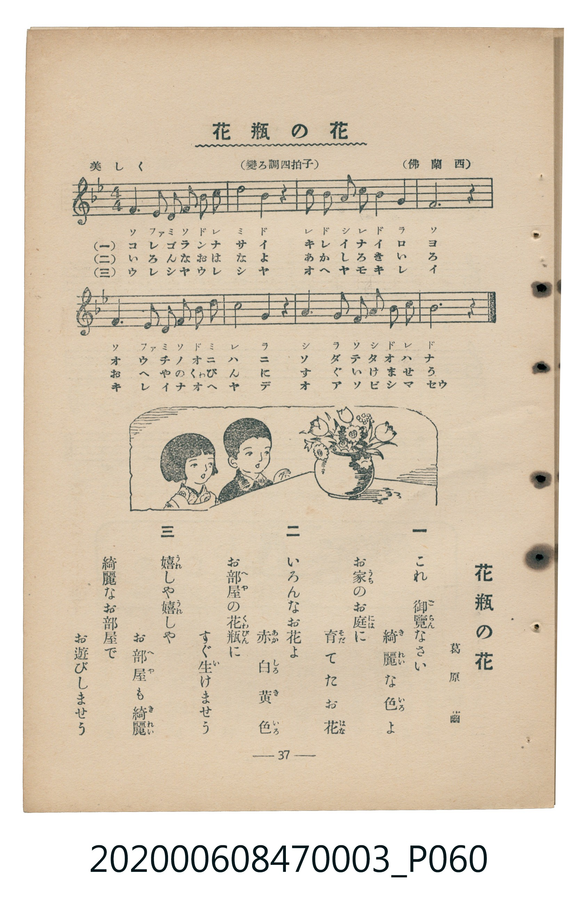

# 花瓶の花

> Re:Shōka 使用 AI 協助辨識與重建樂譜，可能會有錯誤。歡迎回報。

- **NEUTRINO 歌聲合成版**：<br><audio controls src="kabin_no_hana_neutrino.mp3"></audio>
- **鋼琴伴奏版**：<br><audio controls src="kabin_no_hana.mp3"></audio>


- 詞：葛原齒
- 曲：佛蘭西
- 臺灣教育會公認《新定兒童唱歌》尋常科第三學年用（2020.006.0847.0003）

## 說明

原書資訊與歌詞全文（對應 P060.jpg，書頁 p. 37，補充教材第 2 首）：
調性與拍號：變ろ調四拍子（Bb 大調 4/4 拍），美しく ♩=96


## 歌詞

```text
一
これ御覽なさい　綺麗な色よ
お家のお庭に　育てたお花

二
いろんなお花よ　赤白黃色
お部屋の花瓶に　すぐ生けませう

三
嬉しや嬉しや　お部屋も綺麗
綺麗なお部屋で　お遊びしませう
```

## ABC

```abc
X:1
T:花瓶の花
C:曲：佛蘭西
M:4/4
L:1/16
Q:1/4=96
K:Bb
V:V1 name="Piano" snm="Pia"
[V:V1]
F6 E2 D2 F2 B2 c2 | d8 B4 z4 | c2 B2 A2 c2 B4 G4 | F12 z4 |
w: 1.~こ れ ご ら ん な | さ い | き れ い な い ろ | よ
w: 2.~い ろ ん な お は | な よ | あ か し ろ き い | ろ
w: 3.~う れ し や う れ | し や | お へ や も き れ | い
F6 E2 D2 F2 B2 d2 | c8 G4 z4 | A6 G2 F2 A2 B2 c2 | B12 z4 |
w: 1.~お う ち の お に | は に | そ だ て た お は | な
w: 2.~お へ や の くゎ び | ん に | す ぐ い け ま せ | う
w: 3.~き れ い な お へ | や で | お あ そ び し ま | せう
```

## TMD 檔案連結

- [主旋律 TMD 檔案](kabin_no_hana.tmd) [[在 TMD Studio 編輯](https://tmdlang.github.io/Tmd-TS/#tmd=s7IKdvYPcrWy4qpTUCpJTLdSSM7PyUlNLsnMz7MqzsjMK0nNjM_KTMmPL87Iz05Ugisry88pzU21Si9KTEmNN443MjAyiDcwMIs3sDAxBzIMjBFKi_NLi5JTrYqTM_Lzc-JLUitKkvLzsxHyBUX5Zal5iXlANQVFIBtTwIoQClLLMlNSQdKpKZkl-UWZiTlI7kgtKga7FWxJfElRYl5xclFmAcgDCFUlGalAxxbkJOYBjdXSUnjRtfH55G2PG9cBGQpaWlyKtgqWZlz2tgpOSVw2JvomdiCdL1bOe79n1ouJs5_2zX-5dxLYtGezNwHFnuyd_WLG2hdL94PFXrTvet64-NnUmS-aNj2b0_y0dc2LVb2PG7qeTdvwdN2sp62Tnq9e-nTKxmdrex43dD_d0P10x47nyyc-X7PmyY7Op2t3PN255fmUFe_3dIDCUA8YhnqgMAQyDIzf7-lU4uLS11KwpRbgUlBQAHrn2ewdLza3v1jR9aKjHeguoE-ftq54Nq0d6IqnG3qftXcqBBiYGehlFaS_39MDVPxyQaNCgZ6CsTmQ-2LxnKetrUDvPps7AegJBSOFl8umAV0KDBeQ6S9W7X_WsBxkbnfvi5nzQSG4rutxUy9Q_Ons2UDBp2snAK1xSlJ4umQ5UFABGNwKQGGwCT3P9_U9bpz-uLFf4dHMlbbAOAEZ-WRHA4h63Dj5cVPP030LXyzb-7hx1ePGqY8bWx43NDzftuvlLqCeVS86Nz1u6oAo7Xq6DhS_IMautY8bVwPVAaPnceOyx43zgYLAeIcYvasHor4F6MTHTZPB5oJkgQaBtGxd8nzm3pe7m4FGQ8192bzi6cZuSNIBpyGQ0Y8bZz5unPB8CtDoiY8b9z1unP24sQ3q9k5wmK_pBPmrqQXOAOuCmdbUBPEESCncO0iWLYeqbux63LgZHEAwO4AaKE8VUKCgpc_F5Z2YlJnnl--RmJdoFZCZmJfvUGNQUw2yR8HGQssOzACmSENdEyuFx02bHzevedy05XHzysfNQDYworc-bloClFgLllgCFgKSQO4KkPEg3TUKpvEKukBoEq9gHA_iGAITUY2CMVhQF8jTVTAA4hqgqKGCeTyY0lUwA2mC64VAsDKwoT6GNaAEAhYFphIgewqQ7gTiyUD2KqBGYHqB6gLGNpCEGPe4sReqvgWsDiIHTAwQ2aYOJNvAOiC2GYF0glRC1MJsAcYREK8Hm7sKZhvYDJhtTUDcDcTTIfqAtsPcA7INxMNimzFIZxuS30C6Qe5tA_NBstPhtiH7DeSaHRC1TSCbwbYBdUBkIe5Htw0Yuaa6FqDIXfW4adnj5sbHzX0gdnP34-Z-IAmU2Pu4ueFxc9vjpv1gCaBoF77INQZHJcQecCxCYhcYs1ARoCogB5IKQFGNK3q7oNEH9HbjQiBeB_XiarB31sOjdzVSEMyFii0A4mVAPB9rJGGLXpht0AAE29b_uKkPSG0GxxYktaFbOBMqNgGapiYC8T4gng2WhcQi9hiGxD5qaoTEIMg2WGwBSwOUGIaIgWJ3Lthl4NQBtBEkCyoiMCys5eLStVNAyucKQK4yFwA)]
- [鋼琴伴奏 TMD 檔案](kabin_no_hana_piano.tmd) [[在 TMD Studio 編輯](https://tmdlang.github.io/Tmd-TS/#tmd=s7IKdvYPcrWy4tLSUnjRtfH55G2PG9cBGe_3dLzs3vN8wpYne7Y8Xdr_vLPj_Z5OBS0tLkVbBUszLntbBackLhsTfRM7rjoFpRcr573fM-vFxNlP--a_3DtJCST2bPYmoNiTvbNfzFj7Yul-sNiL9l3PGxc_mzrzRdOmZ3Oan7auebGq93FD17NpG56um_W0ddLz1UufTtn4bG3P44bupxu6n-7Y8Xz5xOdr1jzZ0fl07Y6nO7c8n7IC6DQjAyMDPQMDMz0DCxNzIMPAGOg6JS4u78SkzDy_fI_EvESrgMzEvPwgD4cag5pqLgUgsLHQsgMzahRM4xV0gdAkXsE4HsQxVDACihqDBXWBPF0FAyCuAYoaKpjHgyldBTOQJrheCAQrAxvqY1ij8LhxMlj0cVMPkD0FSHcC8WQgexVQ4-PGqVBdjxtbgCTEuMeNvVD1LWB1ELnHTb0Q2aYOJNvAOiC2GYF0glRC1MJsedzYBcTrweaugtkGNgNmWxMQdwPxdIg-oO0w94BsA_Gw2GYM0tmG5DeQbpB728B8kOx0uG3IfgO5ZgdEbRPIZrBtQB0QWYj70W3DFj3G4MiAqATHAyR-gHEDFQGqAnIg8QiKLFwR1AWNAKDDGxcC8TqoI1eDHbQeHkGrkTwxFyq2AIiXAfF8rMGMLYJgtkGDAGxb_-OmPiC1GRzekPSCbuFMqNgEaKqYCMT7gHg2WBYSD9jjCBJ_qOkJEgcg22Dh_bhxOUocQcRA8TMX7DJw_AJtBMnOxmZhLZas5oOc1UzgWc0wPl4h2jA-FsFAEzMARzhIBEhClZnFx-eCFCKJg5lAtXiMNQIxjUA6QSw0c5GYmA4AeUjXTgHJT9E-hrEK6EJGmELGYCFlLgA)]

## 分析

```text
================================================================================
📊 TMD Song Profile: [ 花瓶の花 ]
================================================================================
⏱  Duration:       0:20 (20.0s), 8 measures total
🎼 Key & Tempo:    首調基準 B,, != 96.0 BPM, <4/4>
   - 分析範圍：      由實際發聲的音符與和弦推測調性；播放脈絡另行呈現
🎤 人聲音域:    D4 (MIDI 62) – D5 (MIDI 74) [跨度: 12 個半音 / 1.0 個八度, 難度: easy]
   - 最低音:  D4 in [KabinNoHana #1 @ m.1, 0:01]
   - 最高音: D5 in [KabinNoHana #1 @ m.2, 0:02]
   - 適合: soprano, mezzo-soprano, contralto, tenor, baritone, bass
🏛  結構:      KabinNoHana (20.0s)
⚡ 編曲密度:        Peak 1 軌道同時演奏
🗝  調性診斷：       A# 大調（純淨自然大調，未偵測到可信轉調）
   - 風格氣質:    純淨自然大調（陽光明朗、易唱易記，無明顯調外色彩）
   - 轉調歷程:    全曲維持單一推測調性（未偵測到可信轉調）
   - 核心骨幹音:  F, A#, C, D, G
   - 調性數值:    A# 大調 [相關度: 0.90, 穩定度: Moderate, 自然音純度: 100.0%]
   - 候選調性 (K-S): A# 大調 (0.90), F 大調 (0.87), D 小調 (0.64)
   - 五度圈歷程:   -2
   - 各段落調性細節:
     • [KabinNoHana #1]: A# 大調 (r: 0.90, 自然音純度: 100.0%)

  [ 五度圈游移軌跡 ]
               C  
         F            G  
     [Bb]*              D  
      Eb               A  
         Ab           E  
            Db       B  
               F# 
     (* = active key center)

  [ 十二半音累積音高分佈 ]
     C  : █████████████             14.3%
     C# :                            0.0%
     D  : ███████████               12.5%
     D# : ███                        3.6%
     E  :                            0.0%
     F  : ████████████████████████  26.8%
     F# :                            0.0%
     G  : ████████                   8.9%
     G# :                            0.0%
     A  : ████████                   8.9%
     A# : ██████████████████████    25.0%
     B  :                            0.0%
--------------------------------------------------------------------------------
Assignment 軌道音域：
  - Piano         : D4 – D5 (12 個半音 / 1.0 個八度, 30 個音符)
================================================================================
```


## 原書掃描頁




